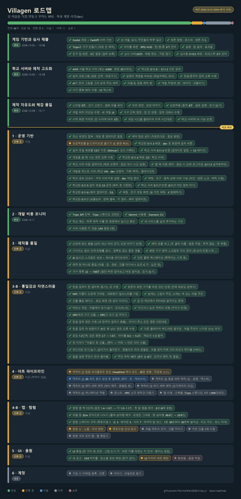

# dev 브랜치 작업 정리 (2026-10-14)

팀원이 dev 브랜치에 무엇이 있는지 한 번에 보도록 모은 문서입니다. 자세한 내용은 링크한 문서에 있습니다.

| 브랜치 | 내용 |
|---|---|
| `main` | 공모전 제출판 0.10.2. 심사 서버가 쓰므로 그대로 둡니다 |
| `dev` | 학과 개발판. 지금 게임 버전은 **0.11.9** (메인 서버에서 사용 중) |

**처음이라면 이 순서로 보세요.**
1. [로드맵](roadmap/README.md): 끝난 일, 하는 중인 일, 다음 할 일 (그림 포함)
2. [버전별 바뀐 점](releases/school_changes_KO.txt): 0.11.0부터 0.11.9까지 게임 변화 전부
3. [학과 공유 안내서](SHARE_GUIDE_KO.md): 내 PC에서 소스로 실행하기, 각자의 서버·키 쓰기, 필요한 프로그램과 버전
4. 아래 영역별 요약

---

## 1. 게임 (game/, server/)

버전별 핵심입니다. 전체 목록은 [school_changes_KO.txt](releases/school_changes_KO.txt)에 있습니다.

| 버전 | 날짜 | 핵심 |
|---|---|---|
| 0.11.0 | 10-08 | 학교 서버 규칙(1회 최대 35크레딧, 전체 예산 4,000크레딧). Tripo가 색까지 입힌 가구, 참고 사진, 움직이는 2~3부품 가구. 텍스처 1K 압축 |
| 0.11.1 | 10-08 | 견적에서 AI가 정리한 문장 보기. 한도를 넘는 옵션은 잠금. 한글·중국어 입력 커서 수정 |
| 0.11.2 | 10-09 | 마을·집 공용 제작 창. AI가 먼저 그림을 그려 보여 주는 제작. 색칠 작업대(붓·레이어·되돌리기). 설정이 계정을 따라감 |
| 0.11.3 | 10-12 | 스타일 9종과 크기 5단계. 자유 회전, 모양 바꾸기(가로·깊이·높이·반전). 클릭·접근 상호작용. 시각별 타이틀 그림. 새 버전 알림·점검 예고 |
| 0.11.4 | 10-14 | 만든 물건의 충돌이 실제 모양을 따름. 제작 진행률. 살아 움직이는 물건 22종(실제 시각 시계 등). 마을 의자·침대에 앉고 눕기. 낮 주민 15명. NPC에게 가구 선물·호감도·편지·답례. 어디서나 같은 캐릭터 모습. 종료 충돌 수정 |
| 0.11.5 | 10-15 | 한글 입력 엔진 수정, 켤 때 자동 패치, 점검 시 강제 로그아웃, 채팅·친구 서버, 첫 이야기 |
| 0.11.6 | 10-15 | UI 통일, 새 로고·타이틀, 부드러운 앉기·눕기, 주민 부탁 19개 |
| 0.11.7 | 10-15 | 늘 켜진 채팅, K 함께하기, 보물상자 11개, 판매 별씨, 키 정리 |
| 0.11.8 | 10-16 | 탐험 스테이지·시간대·튜토리얼, 집 출입(주인 있을 때만), 재접속 위치, 효과음 다양화, 꾸미기 메뉴, AI 제작 거절 사유 |
| 0.11.9 | 10-16 | 캐릭터 8명·표시 이름, 몬스터 18종, 가방, 농사, 들고 다니기, 게시판·편지·가게, 리깅·애니 세트, 모닥불 버프, 마을 성능 |

**다음 버전(0.11.5)에 들어갈 것:** `Villagen.exe` 옆 `world.cfg`로 각자의 서버를 기본 월드로 지정([안내서 A](SHARE_GUIDE_KO.md#a-게임만-하기)), 로컬 서버가 Gemini 키로 설계(`tools/play_tripo.ps1`).

## 2. 캐릭터 얼굴 파이프라인 (진행 중)

Tripo로 만든 얼굴을 **원본 모양 그대로 두고** 자르기, 부품 추가, 리깅, 표정만 더해 게임에서 표정을 짓게 하는 작업입니다.

- 문서 목록: [docs/character_pipeline/](character_pipeline/README.md) (테스트마다 그림·결과표·실패 원인이 있는 보고서)
- 현황표: [00 테스트 현황](character_pipeline/00_테스트_현황.md)
- 결론 문서: [16 세 방식 최종 비교](character_pipeline/16_세_방식_최종_비교/) → P2로 새로 만든 원본을 고리 모양으로 자르는 방식이 가장 좋음. 다듬기는 [17](character_pipeline/17_방식1_다듬기/)
- 스크립트: `tools/face_auto/` (Blender 자동 처리), 정책: `docs/CHARACTER_GENERATION_POLICY.json`
- 작업 파일: `art/characters/character1_face_v2/`, `_v3/`의 스크립트·설정·미리보기. Blender 장면과 3D 원본(약 110MB)은 용량 때문에 Git에 올리지 않습니다.
- 참고 그림: `art/references/character1_*`

## 3. 섬 지도 실험실 (labs/terrain_lab, 진행 중)

- 다리 4개를 실제 강폭에 맞춰 다시 만들기(`tools/build_archipelago_fitted_bridges.py`, Blender)와 나무 다리 셰이더
- 꽃·덤불·나무의 먼 거리용 저해상도 모델(LOD) 만들기(`tools/build_archipelago_prop_lods.py`)와 확인(`inspect_lods.gd`)
- 텍스처는 원본 해상도를 유지하고 GPU 압축(`tools/optimize_archipelago_texture_imports.py`)
- 같은 화면에서 전후 성능 비교(`performance_audit.gd`, `tools/report_archipelago_performance.py`)
- 지도 에셋 자체는 용량 때문에 팀 안에서 따로 전달합니다([안내서 B-2](SHARE_GUIDE_KO.md#b-2-큰-에셋-받기-지도-가구-몬스터-npc))

## 4. 조사 자료

- [정보 수집 허브 INDEX](research_hub/INDEX.md): 영상 생성 모델·표정·동작 도구 비교, 가격, 커뮤니티 반응. 조사가 필요하면 여기부터 봅니다.
- 얼굴 표정 자동 생성 도구 조사, 영상 모델 조사: `docs/character_pipeline/reports/`, `research_notes/`

## 5. 운영 (서버, 배포)

- 학교 서버: AWS 서울. 만들기와 업데이트는 [SCHOOL_SERVER_KO.txt](SCHOOL_SERVER_KO.txt), 설치 파일 올리기는 [DOWNLOAD_HOSTING_KO.md](DOWNLOAD_HOSTING_KO.md)
- 설치 파일과 압축 파일은 **GitHub에 올리지 않고, 내려받기 주소도 적지 않습니다**. 주소는 학교 공지로만 안내합니다.
- 각자 서버를 열고 싶다면: [학과 공유 안내서 C](SHARE_GUIDE_KO.md#c-학과-온라인-서버-aws-서울)

## 6. 알려진 남은 일

- 낮 주민 15명의 대화 초상화가 아직 없음
- 새 문구 약 100개의 영어·중국어 번역 검토 (답례 선물 이름은 한국어만 있음)
- 시계 바늘이 움푹한 문자판 위에 떠 보이는 경우
- 테스트 정리: `hud_fold_check`, `studio_flow`, 포트 8766을 직접 적은 테스트 3개, 가끔 실패하는 `village_rest_check`
- 얼굴 파이프라인: 입 안(T2) 마무리, 표정 레퍼런스 방향(카툰·애니 먼저)
