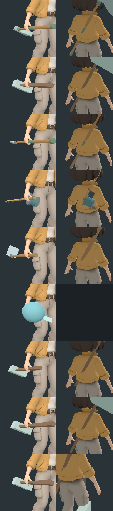

# 장비 소켓 (80번)

캐릭터 리그마다 같은 이름의 소켓을 두었습니다. 그래서 장비가 어디에 붙을지 아이템 자료만 보고 정해지고, 도구마다 회전을 따로 고치지 않아도 됩니다.

## 소켓

| 이름 | 위치 | 아이템 +Y 방향 | ISS-1 별칭 |
|---|---|---|---|
| hand_r | 오른손바닥 중심 | 손잡이를 따라 도구 머리 쪽 | grip_r |
| hand_l | 왼손바닥 중심(hand_r의 거울상) | 같음 | grip_l |
| back | 등 날개뼈 사이, 사선 28° | 끈 방향(위로 비스듬히) | back |
| hip_r, hip_l | 허리띠 양옆 | 아래로 늘어뜨림 | hip_r, hip_l |
| head | 정수리 | 위 | head_top |

- 코드: `game/scripts/equip_sockets.gd`
  - `EquipSockets.socket(skeleton, name) -> Node3D`: 처음 부를 때 BoneAttachment3D("Socket_<name>")와 그 아래 "Frame"을 만들고, 아이템은 Frame 아래에 붙입니다.
  - 플레이어는 `player.socket(name)`, 주민은 `shadow_figure.socket(name)`으로 부릅니다.
- 뼈는 ISS-1 휴머노이드 매핑(`IxRig.bone`)으로 찾습니다.
  - Explorer B: 플레이어와 주민이 함께 씁니다.
  - A포즈 Tripo 리그: 해루, 예전 GLB.
  - Mixamo(`mixamorig_*`): 05의 몬스터, 보니·솔.
- 위치는 리그의 쉬는 자세에서 계산합니다. 위는 Hips→Head, 앞은 LeftFoot→LeftToes, 옆은 LeftHand→RightHand 방향입니다. 그래서 다시 export해도 따라갑니다.
- hand_r은 ISS-1의 GRIP_R(예전 player.gd의 쥠)과 같습니다. Mixamo는 쉬는 자세에서 계산합니다(손목에서 7 cm, 쥠 축은 몸 앞쪽).
- 조정값은 미터 단위입니다(`assets/equip/equip_sockets.json`의 `sockets`). 리그와 캐릭터 크기는 자동으로 상쇄됩니다.

## 아이템 자료 (`game/assets/equip/equip_sockets.json` → `items`)

```json
"axe": {"hold": "hand_r", "stow": "back", "grip": [0, 0, 0], "rot": [0, 0, 0], "stow_rot": [0, 0, 180], "scale": 1.0}
```

- `hold`: 쓰는 동안 붙는 소켓
- `stow`: 들고 다니지만 안 쓸 때 붙는 소켓. `""`이면 넣어 둡니다(작아지며 사라짐).
- `grip`: 아이템 공간에서 손바닥 중심에 오는 점
- `rot`, `stow_rot`: 소켓 기준 회전(도, x·y·z)
- `scale`: 크기 배율

지금 들어 있는 아이템: 도끼, 창, 낚싯대, 괭이, 물뿌리개, 빗자루, 우산, 등불.

## 동작

- `player.equip(item)`: 손에 있던 아이템은 자기 보관 소켓으로 가고(없으면 넣어 둠), 새 아이템이 hand_r에 붙습니다. 보관 중이던 아이템을 다시 쓰면 등에서 손으로 옮깁니다.
- 손과 보관 소켓 사이 이동은 0.22초 동안 부드럽게 일어납니다(순간이동 없음).
- 옷을 바꿔 몸을 다시 만들면, 보관 중이던 아이템도 새 몸에 다시 붙습니다.

## 생성(AI 제작) 물건

`EquipSockets.estimate_grip(node)`가 같은 형식의 기록을 돌려줍니다.
- 메시 경계 상자의 가장 긴 축을 손잡이 선으로 봅니다.
- 양 끝 20% 구간의 단면 퍼짐을 비교해 더 가는 쪽을 손잡이로 봅니다.
- 손잡이 끝에서 길이의 12% 들어간 곳을 쥡니다.

## 검사 (`tests/equip_sockets_check.gd`)

- 소켓이 모두 있는지
- hold·stow 전환이 맞는지
- 손잡이 접촉: 쥔 곳 ±4 cm에서 손잡이 축이 손바닥 중심 가까이 있고, 반지름이 0.6~6 cm인지
- 들기 → 보관 → 다시 들기 → 휘두르기 동안 아이템이 튀지 않는지(motion_watch)
- 자동 추정이 도끼·창·낚싯대의 손잡이 끝을 맞게 찾는지
- 창 모드: `artifacts/equip-sockets-sheet.png`(아이템별 손 클로즈업과 보관 모습)

## 2026-10-16 결과

`equip_sockets_check` PASS(실패 0):
- 플레이어와 주민 모두 소켓 6개가 있습니다.
- 손잡이가 있는 8종 모두 손바닥 중심과 손잡이 축이 1 mm 안에서 맞고, 반지름은 1.8~2.4 cm입니다. 물뿌리개는 손잡이가 없어 판정에서 뺐습니다.
- 들기 → 보관 → 다시 들기 → 휘두르기 동안 순간이동 0건입니다.
- 손잡이 추정은 3종 모두 맞았습니다. 단위 시험은 `python tools/equip_grip_estimate.py --selftest`(6건 PASS)입니다.
- 곡괭이·빗자루·우산·등불은 아직 전용 모델이 없어 임시 망치 모양으로 보입니다. 자료만 준비돼 있습니다.


