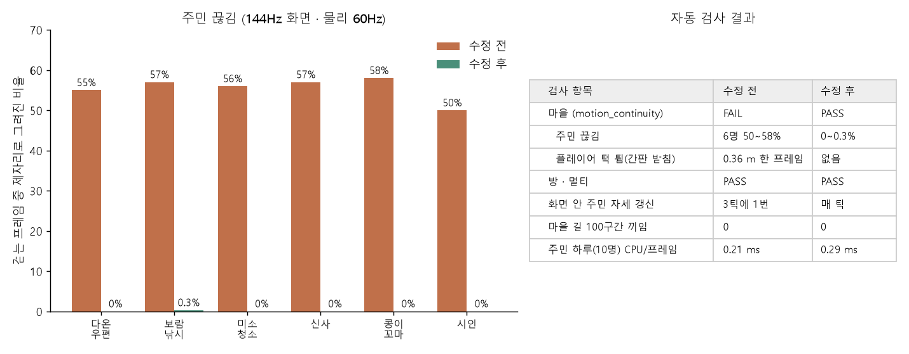

# 끊김·순간이동 자동 검사 사용법 (77번)

애니메이션이나 이동 코드를 고친 세션은 병합 요청 전에 이 검사를 통과해야 합니다.

## 바로 돌리기

서버, 창, 크레딧 없이 돌아갑니다. 실제 시간으로 약 1분 걸립니다. **`--fixed-fps`는 붙이지 마세요.** 그려지는 프레임이 물리 틱 사이에 와야 해서입니다.

```
powershell -ExecutionPolicy Bypass -File D:\lsm26\locks\wait_heavy.ps1
.tools\godot\Godot_v4.7.2-stable_win64_console.exe --headless --path game --script res://tests/motion_continuity.gd -- --scene=village,room,multi --fps=144
```

- 마지막 줄이 `MOTION_CONTINUITY PASS`면 통과입니다. 실패하면 종료 코드가 1입니다.
- 장면별로 `MOTION_WATCH <장면> PASS|FAIL ...` 요약 한 줄이 나옵니다. 문제가 있으면 `MOTION_ISSUE <장면> <대상> <종류> ...` 줄에 프레임 번호와 위치가 함께 나옵니다.
- 장면 하나만 돌릴 수 있습니다: `--scene=village`, 방은 `--room=01_cafe`, 화면 주사율은 `--fps=60`.

## 장면

| 장면 | 움직이는 것 |
|---|---|
| village | 실제 플레이어(`player.gd`)가 따라가는 카메라 아래에서 섬을 걷습니다. 길을 걷고 뛰며, 등대 부두 턱(0.46 m)을 오르내리고, 계단 있는 문 앞까지 갑니다. 주변에서는 주민 8명이 걷습니다. |
| room | `studio.tscn` 방 안에서 WASD로 여덟 방향을 걷고 멈춥니다. 그다음 계단을 오릅니다. 검은 페이드로 가려진 프레임은 판정하지 않습니다. |
| multi | 다른 플레이어를 불규칙한 presence 피드로 그립니다(`remote_motion.gd` → `player.gd` visual_only). 중간에 12 m 문 이동이 한 번 있는데, 피드가 순간이동으로 표시하므로 허용됩니다. |

## 무엇을 실패로 보나 (`tests/motion_watch.gd`)

판정은 화면 안에서 보이는 몸에만 합니다. 화면 밖에 있거나 페이드·숨김 상태인 몸은 판정하지 않고, 숨었다가 나타나며 생기는 점프도 허용합니다.

| 종류 | 기준 |
|---|---|
| jump | 그려진 몸이 한 프레임에 `최고속도×2×dt+5cm`보다 더 움직임 (순간이동, 스냅) |
| vertical_pop | 높이가 초당 3.2 m보다 빠르게 바뀜 (턱을 한 틱에 올라감) |
| spin | 60fps 기준 한 프레임에 0.75 rad보다 더 돎 |
| judder | 걷는 중인데 그려진 몸이 멈춘 프레임이 3%를 넘음 (물리 틱에만 움직이고 그리기 보간이 없음) |
| pose_pop | 뼈 하나가 한 물리 틱에 0.24 m보다 더 움직임 (블렌드 없는 클립 전환, T포즈 프레임) |
| stale_pose | 화면 안에서 걷는데 자세가 3틱 넘게 그대로임 (애니메이션 LOD가 너무 거침) |

## 내 테스트에 붙이기

```gdscript
const MotionWatch = preload("res://tests/motion_watch.gd")
var watch = MotionWatch.new(camera)
watch.add("player", player, {"speed": 4.5, "draw": player.visual, "skeleton": func(): return player.hand_skeleton})
watch.add("monster", beast, {"speed": 6.0, "shown": func(): return beast.visible})
# 그려지는 프레임마다:  watch.frame(delta)      물리 틱마다:  watch.tick()
# 테스트가 직접 옮길 때(문, 리스폰):  watch.excuse("player", 3)
var result = watch.report()      # {"pass", "issues", "counts", "max", "judder"}
MotionWatch.print_report("my_scene", result)
```

`add()` 옵션은 다음과 같습니다.
- `speed`(필수): 최고 지면 속도
- `draw`: 실제로 그려지는 노드
- `skeleton`: Skeleton3D 또는 그것을 돌려주는 Callable
- `shown`: 보이는지 판정하는 Callable
- `walking`: 지금 걷는 중인지 판정하는 Callable
- `yaw_node`: 방향을 읽을 노드

## 함께 있는 도구

- `tests/motion_diag.gd`: 한 지점에서 실제 플레이어를 걷게 하고 틱마다 위치, 바닥·벽 접촉, 부딪힌 물체를 찍습니다. 검사가 잡은 위치의 원인을 볼 때 씁니다.
  `--headless --fixed-fps 60 ... -- --from=x,z --to=x,z --ticks=150`
- `tests/motion_fps.gd`: 주민이 모두 나온 마을을 창으로 그리며 프레임 시간을 잽니다. 새 애니메이션 LOD와 옛 규칙을 6초씩 번갈아 잽니다.

## 2026-10-16 결과 (wt/motion)



- 수정 전에는 마을 장면이 FAIL이었습니다.
  - 주민 6명이 144Hz 화면에서 걷는 프레임의 50~58%를 제자리로 그렸습니다. 물리 틱 사이 보간이 없었기 때문입니다.
  - 플레이어가 간판 받침에 0.36 m 올라탔다가 떨어졌습니다.
- 수정 후에는 마을·방·멀티 모두 PASS입니다.
- 회귀 검사: 마을 길 100구간 100/100, 주민 하루 시뮬레이션 OK.
- 주민 15명이 화면 안에 있는 마을에서 프레임 시간은 평균 2.8 → 2.9~3.1 ms, 최악 1%는 8~10.5 → 7.3~9.6 ms였습니다. 주민 CPU는 틱당 0.77 → 0.93~1.0 ms입니다.
