> GitHub에서 읽기 쉽게 [index.html](index.html)을 옮긴 사본입니다. 원본(HTML)을 내려받아 브라우저로 열면 원래 모양으로 보입니다.

# 얼굴 리그 자동화 보고서

Tripo 머리 3개로 실험 · 2026-10-11 · CC5 Headshot, Seed-san 랩핑, MPFB 템플릿, 원본 유지 리깅 비교

## 요약

- **실패의 공통 원인은 두 가지입니다.** ① 다른 얼굴용으로 만든 표정 이동값을 그대로 복사했고, ② 원본 메쉬를 템플릿 모양으로 바꿨습니다. ①은 큰 눈이 끝까지 안 감기거나 접히는 문제를, ②는 얼굴 전체가 찌그러지고 대칭이 깨지는 문제를 만듭니다.

- **새 원칙**(사용자 결정): 원본 메쉬의 모양은 바꾸지 않습니다. 자르기, 부품 추가, 리깅, 표정만 합니다. 이 원칙으로 머리 3개를 리깅했고, 셋 모두 기본 모양 차이가 **0.0mm**입니다.

- **표정은 복사하지 않고 그 얼굴에서 계산합니다.** v3 머리에서 MPFB 깜빡임을 복사하면 눈꺼풀 틈이 6mm 남고 42개 정점이 눈알을 뚫습니다. 계산식은 틈 1.2mm, 뚫림 0개입니다.

- **아직 안 되는 것**: Tripo가 조각한 눈꺼풀은 감기는 구조가 아니라서, 원본을 유지한 채 계산만으로는 감은 눈꺼풀이 구겨집니다. 해결책으로 **눈 감은 표정을 Tripo로 한 번 더 생성해 투사**하는 방법을 제안합니다(8장).

- Faceit은 "점 → 리그 → 표정 굽기"를 하는 좋은 도구지만, 점 찍기가 손으로 하는 단계라 무인 자동화는 확인되지 않았습니다. MPFB는 CC0 사람 템플릿과 ARKit 52 표정을 파이썬으로 무인 생성할 수 있어서, **가중치·회전축 기증자**로 쓰고 있습니다.

- 실사·반실사·애니·카툰·SD는 **하나의 파이프라인**으로 통합할 수 있습니다. 갈래별로 다른 것은 눈과 입을 처리하는 모듈뿐입니다(5장).

## 1공통 실패 원인

CC5 Headshot, Seed-san 랩핑, MPFB 템플릿은 모두 같은 두 지점에서 실패했습니다.

### 원인 A · 다른 얼굴의 표정 이동값을 복사

템플릿의 표정 키(셰이프키)는 "각 정점을 몇 mm 어디로 옮기라"는 고정된 이동값입니다. 이 값은 템플릿 얼굴의 눈 높이와 입 크기에 맞춰 만들어져 있습니다. 사람 눈은 높이가 약 1cm라서 위 눈꺼풀이 1cm 내려오면 닫힙니다. v3 머리의 눈은 약 2.6cm입니다. 같은 이동값으로는 위 눈꺼풀이 중간에서 멈추고, 늘어난 면 위에서 이동 방향이 틀어지면서 접힙니다.

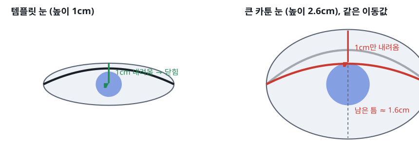

***그림 1-1.** 원인 A의 원리. 회색 선이 처음 위치, 빨간 선이 이동값을 적용한 뒤의 위 눈꺼풀입니다.*

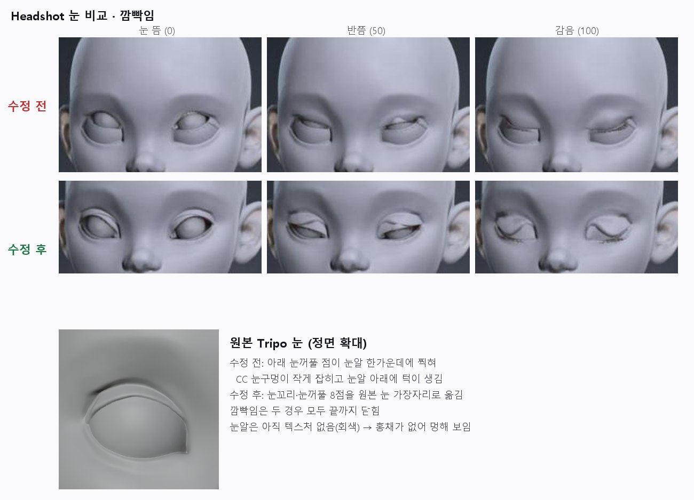

***그림 1-2. CC5 Headshot 실제 결과.** 위쪽은 눈꺼풀 점을 눈 가운데에 찍어 CC가 사람 크기 눈으로 인식한 경우로, 감기는 하지만 눈알 아래에 턱이 생겼습니다. 아래쪽은 점을 진짜 테두리에 맞춘 경우로, 큰 눈에 사람용 깜빡임이 걸려 물결 모양으로 접힙니다.*

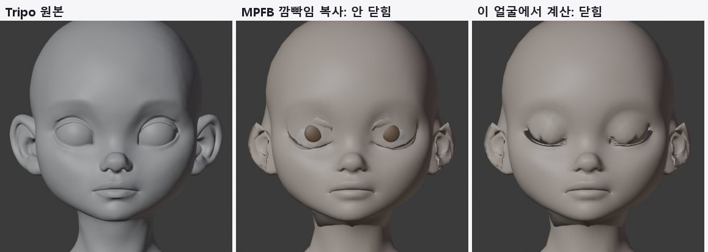

***그림 1-3. MPFB 템플릿으로 같은 실험.** MPFB의 eyeBlink를 복사하면 거의 닫히지 않습니다(가운데). 같은 얼굴에서 눈알 중심을 축으로 회전시켜 계산하면 닫힙니다(오른쪽). 이 그림은 템플릿 모양을 씌운 상태라 원인 B도 함께 보입니다.*

| 머리 | 뜬 눈 틈 | MPFB 깜빡임 복사 | 계산식 깜빡임 | 눈알을 뚫은 눈꺼풀 정점 (복사 → 계산) |
|---|---|---|---|---|
| character1 v3 | 22.3mm | 6.2mm | 1.2mm | 42 → 0 |
| explorer 모듈 머리 | 29.0mm | 9.4mm | 2.4mm | 119 → 1 |
| explorer 웃는 머리 | 20.3mm | 64.7mm | 7.1mm | 146 → 58 |

감은 상태에서 위·아래 눈꺼풀 가장자리 사이 최대 거리입니다. 0에 가까울수록 잘 닫힌 것입니다. 웃는 머리는 입력 자체가 입을 벌린 웃는 얼굴이라 제외 대상입니다(원인 C).

### 원인 B · 원본을 템플릿 모양으로 바꿈

Headshot, Seed-san 랩핑, MPFB 맞춤은 모두 템플릿 메쉬를 원본 표면 위로 늘여 붙이고 원본을 버리는 방식입니다. 템플릿의 면 흐름은 템플릿 얼굴 비율에 맞춰져 있습니다. 그래서 큰 눈 쪽은 면이 늘어나고 볼과 코 주변은 눌리며, 그 차이가 얼굴 전체로 퍼집니다. 템플릿 정점 수도 원본보다 훨씬 적어서(Seed-san 6천 개, MPFB 머리 4,300개, Tripo 원본 9만 4천 개) 코·입술의 세부를 다 담지 못합니다. 대칭도 계산 과정에서 깨질 수 있습니다. Seed-san 랩핑에서 원본은 좌우 차이가 0.13mm였는데 결과는 평균 0.6mm, 최대 4.3mm가 됐습니다.

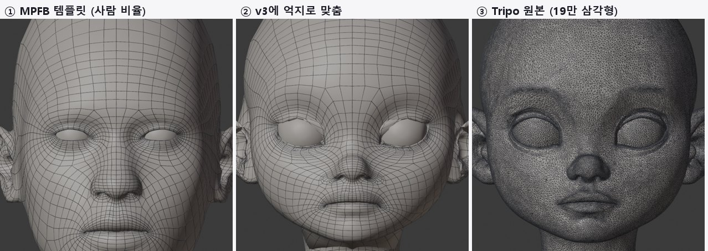

***그림 1-4. 면 흐름 비교.** ① MPFB의 깔끔한 사람 얼굴 면 흐름이 ② v3 비율에 맞추면서 눈 주변은 크게 늘어나고 나머지는 눌립니다. ③ 원본은 면 흐름은 없지만 모양 자체는 정확합니다. "얼굴 전체가 찌그러졌다"는 지적이 바로 ②의 상태입니다.*

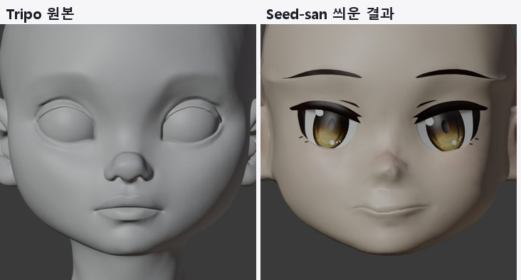

***그림 1-5. Seed-san 랩핑 결과.** 코가 한쪽으로 기울었습니다. 눈 테두리를 좌우 따로 검출하고, 맞춤 기준 정점을 좌우 다르게 뽑은 것이 원인입니다.*

### 원인 C · 입력 메쉬 문제

- **눈알과 입술이 붙어 있습니다.** Tripo는 눈알과 눈꺼풀, 윗입술과 아랫입술을 한 덩어리 표면으로 만듭니다. 자르지 않으면 감거나 벌릴 수 없습니다.

- **UV 경계에서 정점이 갈라져 있습니다.** glTF는 UV 경계마다 정점을 나눕니다. 붙이지 않고 "작은 조각 정리"를 하면 표면 조각이 지워져 구멍이 납니다. 실험 중 실제로 발생했고, 먼저 붙이도록 고쳤습니다.

- **표정이 들어간 원본**(입 벌리고 웃는 얼굴)은 입술 경계를 찾을 수 없어 리깅 품질이 떨어집니다. 기본형 규칙(무표정, 입 다묾)이 필요한 이유입니다.

- **MediaPipe 오검출**: 이마 쪽만 잘린 화면에서 눈 주변을 작은 얼굴로 인식해 머리 크기가 42cm로 잘못 잡혔습니다. 화면 구도를 세 가지로 찍어 보고 두 눈 사이가 가장 넓은 결과를 고르도록 고쳤습니다.

### 원인 D · 메쉬에 없는 정보

도구가 아무리 좋아도 원본에 없는 정보는 만들어 내지 못합니다. 실제 눈꺼풀은 눈썹 밑에 접혀 있던 여분의 피부가 펴지면서 눈알 표면을 따라 내려옵니다. Tripo 눈꺼풀은 뜬 눈만 보고 조각한 두꺼운 띠라서, 감은 모양에 대한 정보가 없습니다. 눈꺼풀·눈알 분리와 입 안은 자르기와 부품 추가로 채웠습니다. 감은 모양은 다른 곳에서 가져와야 합니다.

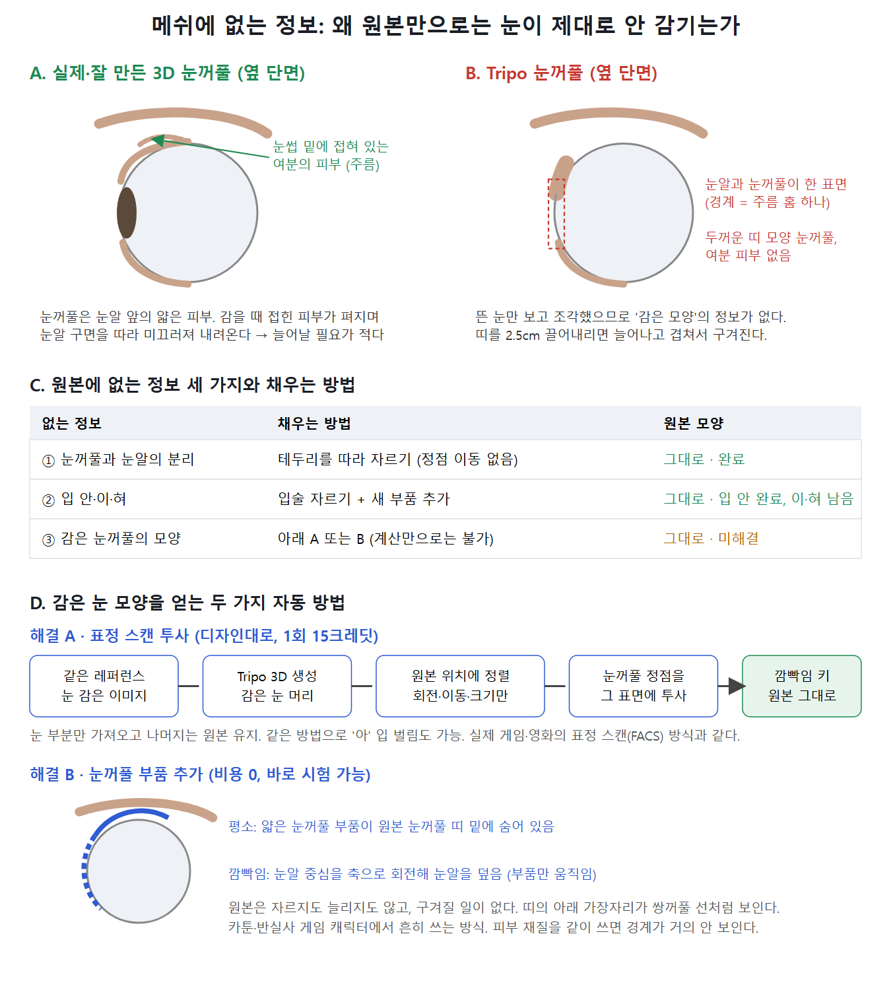

***그림 1-6.** 실제 눈꺼풀과 Tripo 눈꺼풀의 단면 차이. 아래는 감은 모양을 얻는 두 가지 자동 방법입니다. A는 같은 캐릭터를 눈 감은 상태로 다시 생성해 투사하는 표정 스캔이고, B는 원본 띠 밑에 숨긴 얇은 눈꺼풀 부품을 회전시키는 방식입니다.*

## 2원칙: 원본은 그대로, 리깅과 애니메이션만

**사용자 결정 (2026-10-11)** "앞으로 원본 메쉬를 임의적으로 변형시키지 마세요. 리깅과 애니메이션이 전부입니다."

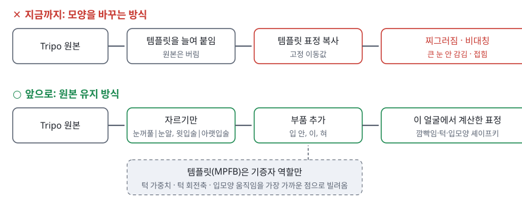

***그림 2-1.** 두 방식의 차이. 원본 유지 방식에서는 템플릿이 모양을 바꾸지 않고, 움직임 정보만 빌려줍니다.*

## 3Faceit: 무엇이 뛰어나고, 자동화가 되는가

Faceit은 Blender 애드온입니다. 얼굴에 점을 찍으면 Rigify 기반 얼굴 리그를 만들어 붙이고, 그 리그로 만든 표정 자세를 셰이프키로 굽습니다. 핵심 장점은 **표정을 고정 이동값으로 복사하지 않고, 그 얼굴에 맞춰 놓은 뼈로 다시 만든다**는 점입니다. 원인 A를 구조적으로 피하는 방식이고, 우리 파이프라인의 "이 얼굴에서 계산" 원칙과 같습니다.

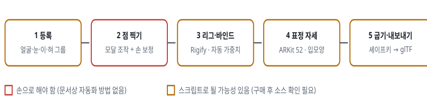

***그림 3-1.** Faceit 작업 흐름과 무인 자동화 가능성. 출처: Faceit 공식 문서(아래).*

#### 뛰어난 점

- 점 → 리그 → 표정 굽기를 한 도구에서 처리. 표정이 그 얼굴의 뼈에서 다시 만들어짐

- ARKit 52, Audio2Face, 혀, 입모양 21종 프리셋. 2.3판은 사용자 표정도 가능

- 교정 조각(코렉티브)을 비파괴로 얹고 좌우 자동 대칭

- Live Link Face, iFacialMocap, 웹캠(Hallway), 영상(Face Landmark Link) 모캡 연결

- 사실·카툰·의인화 캐릭터 지원, 평평한 애니 눈용 설정(Flat) 있음

#### 한계와 요구 조건

- 얼굴은 **하나로 이어진 표면**, 무표정·눈 뜸·입 다묾, 깔끔한 면 흐름, 중복 정점 없음

- 눈은 **별도 눈알**(구형 가정). Tripo처럼 붙은 눈은 먼저 잘라야 함

- 깜빡임은 눈꺼풀 뼈를 셰이프키로 구운 것. 큰 눈에서 눈알을 뚫을 수 있어 보정 키를 쓰라고 FAQ에서 안내

- 점 찍기는 모달 조작 + 손 보정이라 무인 처리 근거 없음. 한 파일에 캐릭터 하나

- 가격: 1.8판 78달러, 2.3판 99달러, 스튜디오 289달러 (GPL)

**판정**: Faceit을 Tripo 머리마다 무인으로 돌리는 것은 지금 근거로는 어렵습니다. 대신 Faceit의 핵심 아이디어("점에서 리그, 리그에서 표정")를 우리 스크립트가 무인으로 재현하고 있습니다. 사서 쓴다면 "손으로 한 번 정리한 기준 얼굴"에서 표정 품질을 비교하는 기준 도구로 쓰는 것이 맞습니다.

출처: [Faceit 문서](https://faceit-doc.readthedocs.io/en/latest/) (landmarks, geometry, rigging, bake, FAQ, mocap 페이지), [판매 페이지](https://superhivemarket.com/products/faceit). 점 메쉬 정점 수와 연산자 이름은 공개 자료로 확인하지 못했습니다.

## 4MPFB: 무엇이고, 어디에 쓰는가

MPFB(MakeHuman Plugin for Blender)는 무료 오픈소스 사람 생성기입니다. 코드는 GPL-3.0이고, 기본 메쉬와 표정 자산은 **CC0**(자유 사용)입니다. 저장소에는 2.0.17판이 설치되어 있고, 최신판은 2.0.18(2026-10-10)입니다. 이번에 백그라운드 Blender에서 파이썬으로 사람 생성과 표정 불러오기까지 직접 돌려 확인했습니다.

| 항목 | 내용 (직접 측정 · 문서) |
|---|---|
| 기본 메쉬 | 정점 19,158 (몸 13,380 + 보조 메쉬), 전부 사각면, 좌우 완전 대칭. 머리 부분만 잘라 4,308 정점 |
| 보조 메쉬 | 눈알, 속눈썹, 위·아래 이, 혀, 머리카락, 옷 맞춤용. 뼈 위치용 관절 큐브(턱, 눈, 눈꺼풀 등) |
| 모양 조절 | 성별·나이·근육·체중·비율·키 등 거시 조절 + 세부 대상 1,258개(눈 17종, 입 22종, 코 21종…). 애니·카툰 비율용 대상은 없음 |
| 리그 | default 163뼈(얼굴 뼈 포함), game_engine 53뼈, Mixamo 52/64뼈, Rigify 메타리그(얼굴 전체) |
| 표정 | ARKit 52 얼굴 단위, 입모양 22종(마이크로소프트), 15종(Meta/Oculus). 모두 CC0, 셰이프키로 불러옴 |
| 자동화 | HumanService, FaceService 등 파이썬 서비스로 무인 생성 가능. 이번 실험에서 23초 만에 머리 템플릿 생성 |

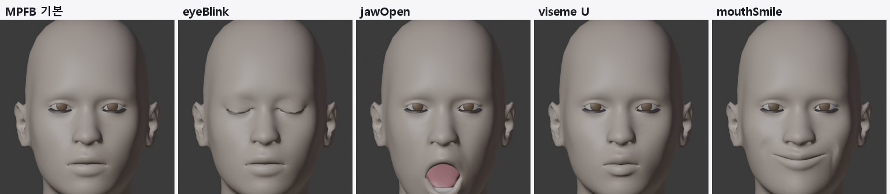

***그림 4-1. MPFB 표정은 자기 얼굴에서는 완벽합니다.** 깜빡임, 턱 벌림, 입모양, 웃음이 모두 깔끔합니다. 같은 이동값을 비율이 다른 얼굴에 복사하면 그림 1-3처럼 실패합니다.*

**우리 파이프라인에서의 역할**: MPFB 모양을 쓰지 않습니다(원칙 2). MPFB 템플릿을 원본 위에 맞춰 놓고, 다음 정보만 가장 가까운 점으로 원본에 옮깁니다.

- **턱 가중치**: jawOpen이 각 정점을 얼마나 움직이는지

- **턱 회전축**: jawOpen 움직임을 회전으로 풀어 계산. MPFB 기준 귀 앞, 20.9° 회전

- **입모양 움직임**: 사람과 비율이 비슷한 입에 한정

## 5스타일별 워크플로우와 통합

갈래마다 파이프라인을 따로 만들 필요는 없습니다. 준비 → 기준점 → 자르기·부품 → 턱·목 리그 → 검사 → 내보내기는 같고, 다른 것은 **눈과 입을 어떻게 움직이느냐**뿐입니다. 이 부분을 모듈로 바꿔 끼우면 하나의 파이프라인으로 통합됩니다.

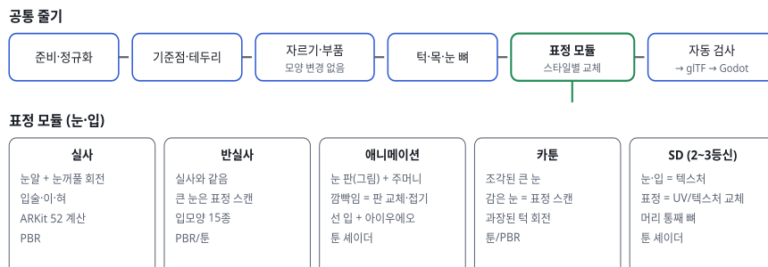

***그림 5-1.** 공통 줄기 하나에 스타일별 표정 모듈을 바꿔 끼웁니다. 어떤 모듈을 쓸지는 기준점에서 잰 눈 크기 비율, 코 돌출, 입 구조로 자동 판정합니다.*

| 갈래 | 눈 처리 | 입 처리 | 감은 눈 만드는 법 | 현재 상태 |
|---|---|---|---|---|
| 실사 | 눈알 분리 + 눈꺼풀 회전 | 입술 자르기, 입 안·이·혀 추가 | 계산(회전) - 사람 비율이라 잘 맞음 | 계산 검증됨 |
| 반실사 | 같음 | 같음 | 계산 + 필요 시 감은 눈 스캔 | v3에서 부분 성공 |
| 애니메이션 | 눈 그림 판, 피부 주머니 | 선 입, 아이우에오 판 | 판 교체·접기 또는 그림 교체 | Seed-san으로 시험 |
| 카툰 (큰 조각 눈) | 눈알 분리, 큰 회전 | 과장된 턱 | **표정 스캔 투사** 추천 | 계산만으로는 구겨짐 |
| SD | 텍스처 | 텍스처 | 텍스처 교체 | 미시험 |

## 6앞·좌·우 이미지와 영상을 주면 좋아지는 점

지금은 3D 조각만 보고 눈 테두리와 입술 경계를 추측합니다. 원래 디자인 이미지가 있으면 추측을 확인하거나 대체할 수 있습니다.

#### 정면 이미지

- 기준점을 원본 디자인에서 직접 검출하고 3D 기준점과 대조해 오검출을 걸러냄

- 애니·SD는 눈·입 그림을 그대로 텍스처로 투사

#### 좌·우 이미지

- 코·입술·턱의 옆선으로 깊이 기준점을 보강

- 귀 위치와 크기 확인(지금은 귀 기준점이 가장 불안정)

#### 표정 이미지 (눈 감음, 아·이·우·에·오)

- 같은 캐릭터의 표정을 Tripo로 생성하고 원본 정점을 그 표면에 투사하면 디자인대로 감은 눈·벌린 입을 얻음

- 원본 모양은 그대로이고 표정 키만 생김. 실제 FACS 스캔 방식과 같음

#### 영상

- 얼굴 연기 영상에서 MediaPipe가 프레임마다 ARKit 52 값을 뽑아 표정 곡선을 만듦(립싱크·표정 테스트)

- 턴테이블 영상은 결과 렌더와 나란히 놓고 자동 비교하는 검사 자료로 씀

## 7실행 결과 (제안 순서대로)

| 단계 | 한 일 | 결과 |
|---|---|---|
| 1 MPFB 템플릿 | MPFB로 머리 템플릿 생성, ARKit 52 + 입모양 37종 셰이프키 굽기 | 4,308 정점, 표정 86개, 좌우 오차 0, 23초 |
| 2 표면 맞춤 + 대칭 | 기준점·눈 테두리·입술 경계 → 박판 스플라인 → 비강체 맞춤(매 단계 좌우 대칭) | v3 평균 1.1mm, 대칭 0.0mm. 하지만 모양을 바꾸므로 원칙 위반 → 기증자로만 사용 |
| 3 계산식 깜빡임 | 눈알 구면 맞춤, 중심축 회전으로 위 눈꺼풀을 아래 가장자리까지 | 틈 1.2mm, 뚫림 0 (복사는 6.2mm, 42개) |
| 4 턱·입모양 | MPFB jawOpen에서 회전축·가중치 계산, 입모양은 가장 가까운 점으로 옮김 | 턱 벌림·이·우 자연스러움 |
| 5 자동 검사 | 기본 모양 차이, 대칭, 깜빡임 틈, 눈알 뚫림, 맞춤 오차를 qa.json으로 | 세 머리 모두 자동 측정 |
| + 원본 유지 리깅 | 원칙 2에 따라 원본을 자르고(눈 421·138·118변) 입 안 부품 추가, 표정 계산 | **기본 모양 차이 0.0mm (3/3)**, 눈 감김은 부분 성공 |

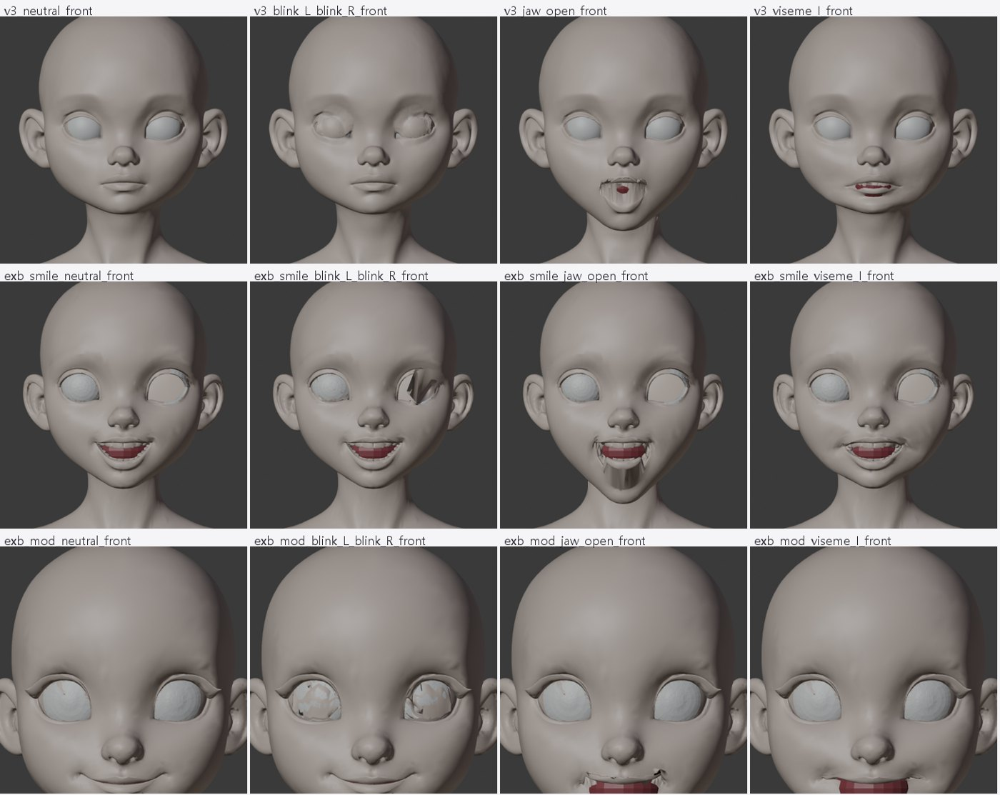

***그림 7-1. 원본 유지 리깅, 머리 3개.** 왼쪽부터 기본(원본과 동일), 깜빡임, 턱 벌림, 입모양 I. 기본 얼굴은 셋 다 원본 그대로입니다. 턱과 입은 대체로 동작하고, 감은 눈은 구겨지거나 덜 덮이는 곳이 남아 있습니다. 가운데 줄은 입력이 웃는 얼굴이라 입 안이 처음부터 보입니다.*

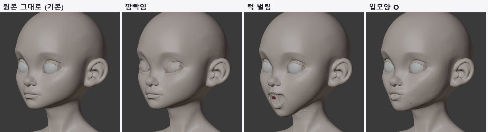

***그림 7-2. v3, 3/4 각도.** 원본 얼굴 그대로 턱과 입모양이 움직입니다. 감은 눈은 위 눈꺼풀이 내려오지만, 원래 조각된 두꺼운 눈꺼풀 띠가 접히면서 구겨집니다.*

| 원본 유지 리깅 | 기본 모양 차이 | 자른 변 | 감은 눈 틈 (왼 / 오른) | 평가 |
|---|---|---|---|---|
| character1 v3 | 0.0mm | 421 | 1.4 / 7.2mm | 턱·입 좋음, 눈 구겨짐 |
| explorer 모듈 머리 | 0.0mm | 118 | 1.7 / 3.3mm | 눈꺼풀 조각 깨짐 |
| explorer 웃는 머리 | 0.0mm | 138 | 11.6 / 2.2mm | 입력 부적합(웃는 얼굴, 한쪽 눈 평면) |

### 왜 눈 감김이 아직 안 되는가

Tripo는 눈을 뜬 모습만 보고 눈꺼풀을 조각합니다. 그래서 눈꺼풀이 얇은 피부가 아니라, 눈 위에 두껍게 붙은 띠 모양입니다. 원본을 바꾸지 않는 한 이 띠를 그대로 끌어내려야 합니다. 큰 눈을 덮으려면 2.5cm 이상 내려와야 하는데, 띠의 굴곡이 겹치면서 구겨집니다. 계산을 더 다듬어도 "닫히기는 하지만 디자인대로 감긴 모양"은 나오지 않습니다. 감은 모양의 정답이 원본 안에 없기 때문입니다. 그래서 감은 모양을 생성 결과에서 가져오는 방법(8장 1번)을 제안합니다.

## 8다음 단계 제안

**표정 스캔 투사 (추천, 감은 눈 해결)**

  - 같은 레퍼런스로 "눈 감은 얼굴" 정면 이미지를 만들고 Tripo로 3D를 생성합니다. 생성 1회 15크레딧입니다.

  - 원본 눈꺼풀 정점을 그 표면에 투사해 깜빡임 키를 만듭니다. 원본은 그대로이고, 감은 모양은 디자인대로 나옵니다.

  - 같은 방법으로 '아' 입 벌림 스캔도 만들 수 있습니다.

2. **애니·SD 스타일**: 눈·입을 그림 판이나 텍스처로 처리하는 모듈을 만듭니다. 이 경우 깜빡임은 형태 변형이 아니라 판 교체라 구겨질 일이 없습니다.

3. **입 안 완성**: 이와 혀를 추가하고, 아래 이와 혀가 턱을 따라가게 합니다.

4. **입력 규칙 강화**: 무표정, 입 다묾, 눈 뜸, 구멍 없음을 자동 검사하고, 통과하지 못하면 다시 생성합니다.

5. **Godot 연결**: 원본 유지 리깅 결과를 glTF로 내보내 실행 화면에서 확인합니다(Seed-san 때와 같은 방식).

6. **몸 연결**: 같은 원칙(원본 유지 + 뼈·가중치만)으로 Tripo 몸 메쉬를 리깅합니다.

**결정이 필요한 것**: 1번에 Tripo 크레딧을 쓸지(눈 감음 1회 + 입 벌림 1회 = 30크레딧), 그리고 이 캐릭터의 목표 스타일이 반실사·카툰 쪽인지 애니 쪽인지.

## 9파일

`tools/face_auto/`

  - `head_prepare.py`: 정면 찾기, 정점 붙이기, 크기 맞춤

  - `face_landmarks_mp.py`: MediaPipe 기준점

  - `facelib.py`: 눈 테두리, 대칭, 계산식 깜빡임

  - `mpfb_head_template.py`: MPFB 템플릿 생성

  - `face_fit.py`: 템플릿 맞춤, 기증자용

  - `rig_original.py`: 원본 유지 리깅

  - `render_fit.py`, `wire_render.py`: 렌더

- 실행 환경: `.tools/landmark-venv`(MediaPipe 1.1.0), `.tools/blender-profiles/face-v3`(MPFB 2.0.17)

- 이 보고서: `docs/character_pipeline/02_얼굴_리그_보고서/` (같은 폴더에 제작 가이드와 그림 모음)
