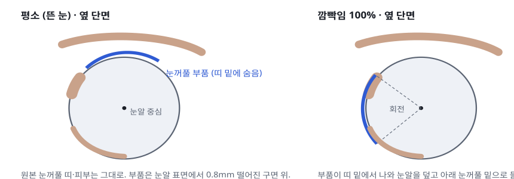
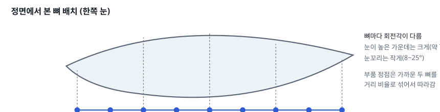
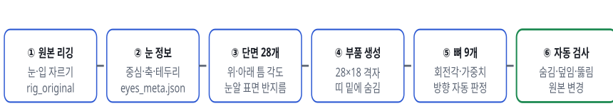
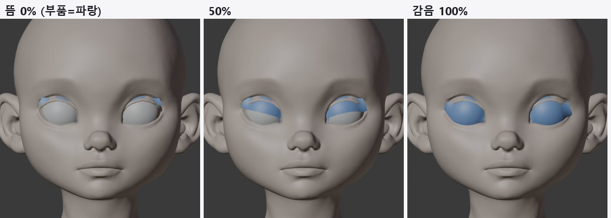
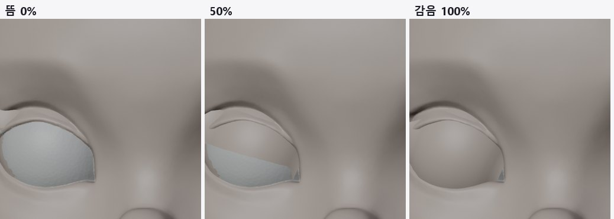
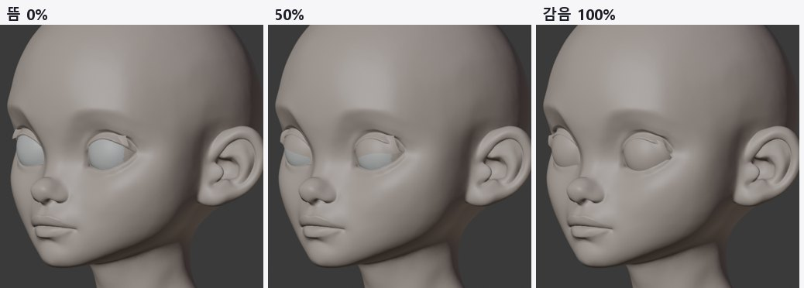
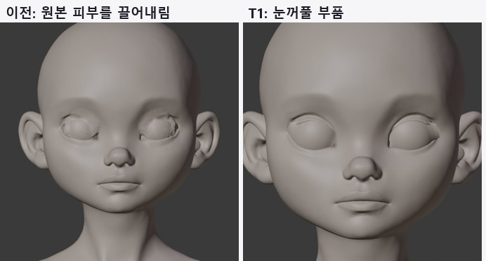
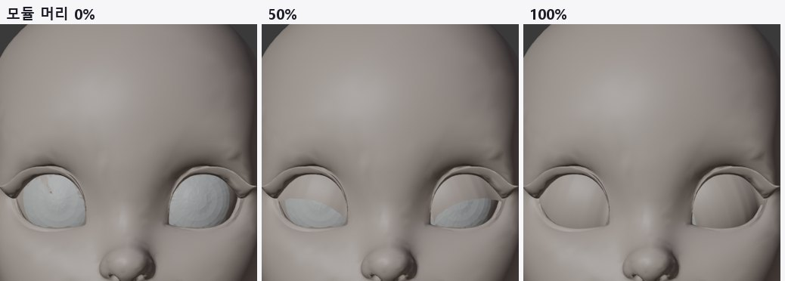
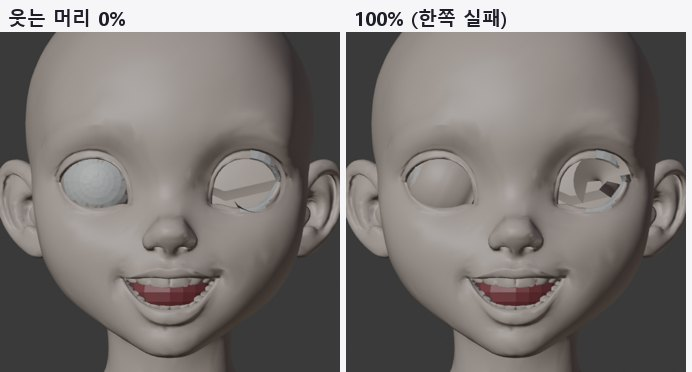

> GitHub에서 읽기 쉽게 [index.html](index.html)을 옮긴 사본입니다. 원본(HTML)을 내려받아 브라우저로 열면 원래 모양으로 보입니다.

# T1 · 눈꺼풀 부품으로 깜빡임

2026-10-12 · 원본 얼굴은 정점 하나도 움직이지 않고, 새로 추가한 눈꺼풀 부품만 뼈로 회전 · 머리 3개

> **결론**: 원본을 그대로 둔 채 깜빡임이 됩니다. v3와 모듈 머리는 감았을 때 눈을 100% 덮고, 0~100% 전 구간에서 눈알을 뚫지 않으며, 원본 얼굴 변경은 0.0mm입니다. 남은 것은 v3의 뜬 상태에서 눈꺼풀 부품 가장자리가 가늘게 보이는 문제(정점 기준 11~16%)와 입력이 부적합한 웃는 머리입니다.

## 1. 작동 원리

이전 방식은 원본 눈꺼풀 피부를 끌어내렸습니다. Tripo 눈꺼풀은 두꺼운 띠라서 끌어내리면 구겨졌습니다. 이번에는 원본 피부를 그대로 두고, 그 밑에 얇은 눈꺼풀 부품을 숨겨 둡니다. 깜빡일 때 부품만 눈알 중심을 축으로 회전시켜 눈을 덮습니다.

***그림 1.** 단면 원리. 파란 선이 새로 추가한 눈꺼풀 부품입니다. 원본(살색)은 움직이지 않습니다.*

***그림 2.** 한 눈에 뼈 9개. 모두 같은 눈 축(바깥→안쪽 눈꼬리) 위에 있어서 회전축은 같고, 회전각만 다릅니다. 뼈 하나로 하면 눈꼬리에서 부품이 삐져나왔습니다(4장).*

## 2. 순서

***그림 3.** 처리 순서. ①은 이전 테스트의 원본 유지 리깅이고, ②~⑥이 이번에 추가한 단계입니다.*

| 단계 | 하는 일 | 설정값 |
|---|---|---|
| ② 눈 정보 | 잘라 낸 눈알 표면으로 구 맞춤 → 중심. 눈꼬리 두 점 → 눈 축. 깊이 탐색으로 찾은 위·아래 눈꺼풀 테두리 | - |
| ③ 단면 | 눈 축을 따라 28곳에서 위 테두리 각도·아래 테두리 각도·그 사이 틈을 잼. 부품이 쓸고 지나갈 각도 범위에서 실제 눈알 표면 반지름을 광선으로 잼 | 바깥·안쪽 눈꼬리에서 1mm 안쪽까지 |
| ④ 부품 | 단면마다 "필요 회전 + 숨김 여유" 높이의 구면 띠. 아래 가장자리를 위 테두리보다 0.11rad 위(띠 밑)에 둠 | 여유 0.8mm, 숨김 0.11rad, 아래 겹침 0.05rad |
| ⑤ 뼈 | 눈 축 위에 뼈 9개. 각 뼈 회전각 = 담당 구간에서 필요한 회전 중 최댓값. 정점은 가까운 두 뼈를 거리 비율로 섞음. 감는 방향(부호)은 시험 회전으로 자동 판정 | 뼈 9개/눈 |
| ⑥ 검사 | 평소 부품이 앞에서 보이는 비율, 감았을 때 눈 덮임 비율, 0·50·100%에서 눈알 안으로 들어간 정점 수, 원본 얼굴 정점 변화 | qa_lids.json |

## 3. 결과

***그림 4. v3, 부품을 파란색으로 표시.** 평소에는 거의 숨어 있고, 50%에서 내려오며, 100%에서 눈 전체를 덮습니다.*

***그림 5. v3 눈 확대 (같은 살색).** 감으면 원본 눈꺼풀 띠가 쌍꺼풀 선처럼 남고 그 아래가 매끈하게 덮입니다. 이전 방식의 구겨짐이 없습니다.*

***그림 6. v3, 3/4 각도.***

***그림 7. 이전 방식과 비교.** 왼쪽은 원본 피부를 끌어내린 결과(구겨짐), 오른쪽은 이번 눈꺼풀 부품입니다.*

***그림 8. explorer 모듈 머리.** 숨김·덮임·뚫림 모두 통과했습니다.*

***그림 9. explorer 웃는 머리.** 한쪽 눈은 정상이고, 다른 쪽은 입력 눈 표면이 평면이라 깨집니다. 입력 규칙 검사(T5)에서 걸러야 할 사례입니다.*

| 머리 | 원본 변경 | 평소 보이는 비율 (L / R) | 감았을 때 덮임 | 눈알 뚫림 0·50·100% | 판정 |
|---|---|---|---|---|---|
| character1 v3 | 0.0mm | 11% / 16% | 100% / 100% | 0 · 0 · 0 | 통과, 가장자리 보임 보완 필요 |
| explorer 모듈 머리 | 0.0mm | 0% / 0% | 100% / 100% | 0 · 0 · 0 | 통과 |
| explorer 웃는 머리 | 0.0mm | 85% / 0% | 92% / 98% | 8·0·12 / 0·0·2 | 입력 부적합 |

"평소 보이는 비율"은 부품 정점 중 정면 광선에 원본 피부보다 먼저 닿는 정점의 비율입니다. v3의 11~16%는 대부분 위 눈꺼풀 바로 아래 가장자리 한 줄이라, 살색에서는 가는 선으로만 보입니다.

## 4. 시행착오

1. **뼈 1개**: 가운데 큰 틈에 맞춘 회전(70°)을 눈꼬리에도 똑같이 써서, 부품이 너무 크고 높아졌습니다. 눈꼬리 양 끝에서 띠처럼 삐져나왔습니다.

2. **뼈 5개, 각도를 단면에서 보간**: 안쪽 눈꼬리 쪽이 아래로 길게 내려간 눈이라 그 구간 회전이 모자랐습니다(덮임 82%, 뚫림 15개).

3. **뼈 9개, 담당 구간 최댓값**: 덮임 100%, 뚫림 0.

4. **평소 숨김 여유 0.05 → 0.11rad**: v3 보이는 비율 14~19% → 11~16%.

## 5. 남은 일

- **v3 가장자리**: 위 눈꺼풀 띠가 얇은 바깥 눈꼬리 위쪽에서 숨김 여유를 단면별로 키웁니다. 피부 안쪽 깊이를 재서 자동으로 정합니다.

- **속눈썹 선**: 감은 눈에 속눈썹 선(그림 또는 얇은 부품)을 추가하면 "감은 눈"으로 더 잘 읽힙니다.

- **Godot (T3)**: 뼈 18개(양쪽)를 깜빡임 값 하나로 돌리는 스크립트로 엔진에서 확인합니다.

- **입력 규칙 (T5)**: 웃는 머리 같은 입력은 자동으로 걸러냅니다.

## 6. 파일

- `tools/face_auto/lid_parts.py`: 눈꺼풀 부품과 뼈, 자동 검사

- `tools/face_auto/render_lids.py`: 0·50·100% 렌더 (살색과 확인용 파란색)

- `tools/face_auto/rig_original.py`: 눈 정보 `eyes_meta.json` 저장 추가
