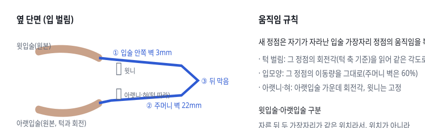
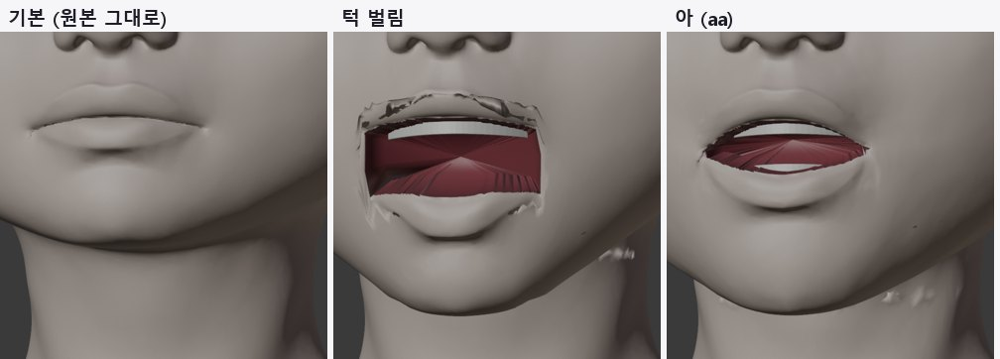
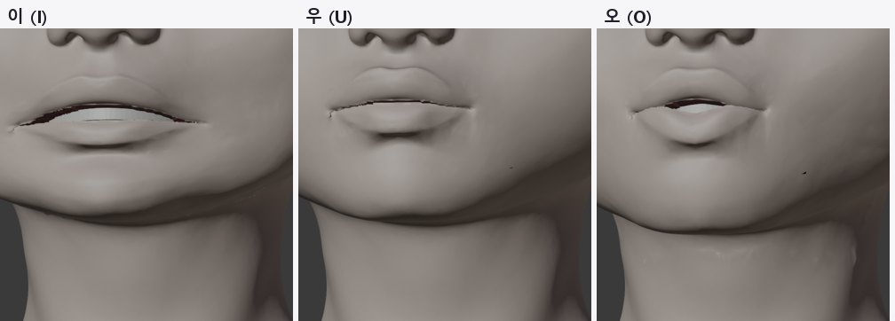
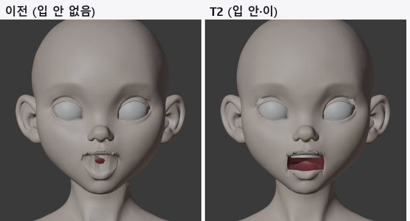
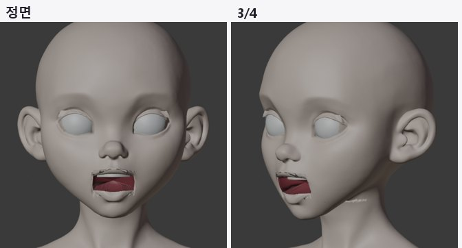
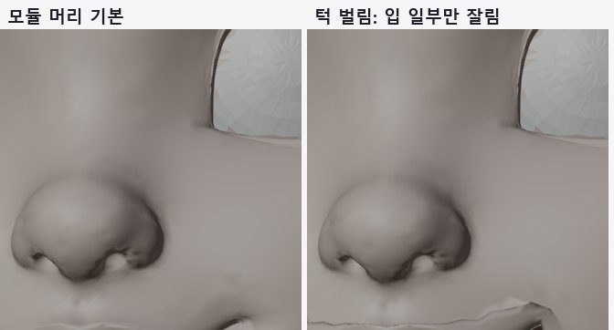

> GitHub에서 읽기 쉽게 [index.html](index.html)을 옮긴 사본입니다. 원본(HTML)을 내려받아 브라우저로 열면 원래 모양으로 보입니다.

# T2 · 입 안 (주머니·이·혀)

2026-10-12 · 원본 정점은 그대로, 잘린 입술 가장자리에서 새 부품을 이어 붙임 · v3 + 모듈 머리

> **결론**: v3는 입을 벌리면 입 안 주머니와 윗니가 보이고, '아'·'이' 입모양에서 이가 드러납니다. 원본 정점 변경은 0.0mm입니다. 남은 문제는 네모나게 각진 입꼬리, 윗입술 안쪽 벽의 들쭉날쭉함, 목 옆 작은 혹, 약한 '오'·'우'입니다. 모듈 머리는 입술 경계 검출 실패로 입의 일부만 잘렸습니다.

## 1. 작동 원리

***그림 1.** 입 안 구조. 파란 선이 새로 추가한 부품이고, 살색 입술은 원본입니다.*

## 2. 순서와 설정

| 단계 | 하는 일 | 설정값 |
|---|---|---|
| ① 입 틈 찾기 | 입술을 자른 자리의 경계 고리 중 가운데에 있고 반은 턱과 움직이는 것 | v3: 정점 120, 너비 53mm |
| ② 부품 생성 | 고리 → 안쪽 벽(3mm 뒤) → 주머니 벽(중심 쪽 85%·90%, 22mm 뒤) → 뒤 막음(26mm). 윗니·아랫니 호, 혀(타원체) | 입 안 재질 진한 빨강 |
| ③ 표정 복사 | 모든 표정 키에서 새 정점이 가장자리 정점을 따라감 | 턱 각도는 회전으로 재적용 |
| ④ 검사 | 입 영역 정면 광선 221개가 처음 닿는 것: 피부 / 입 안 / 머리 껍질 안쪽(비침) | qa_mouth.json |

## 3. 결과

***그림 2. v3 기본·턱 벌림·아.** 기본은 원본 그대로이고, 벌리면 입 안 주머니와 윗니가 보입니다.*

***그림 3. 이·우·오.** '이'는 넓게 벌어지며 이가 보이고, '우'·'오'는 변화가 작습니다(MPFB 입모양 움직임을 그대로 가져온 값).*

***그림 4. 이전과 비교.** 이전에는 입술 사이로 머리 껍질 안쪽이 줄무늬로 보였습니다.*

***그림 5. 턱 벌림 전체 모습.***

***그림 6. 모듈 머리 (실패).** 웃는 모양으로 휜 입선을 경계 검출이 따라가지 못해, 입 너비 5cm 중 1.1cm만 잘렸습니다.*

| 상태 | 피부 | 입 안 | 비침(머리 안쪽) |
|---|---|---|---|
| v3 기본 | 221 | 0 | 0 |
| v3 턱 벌림 | 56 | 149 | 16 |
| v3 아 | 99 | 122 | 0 |
| v3 오 | 207 | 14 | 0 |
| 모듈 머리 턱 벌림 | 104 | 25 | 92 |

원본 정점 변경: v3 0.0mm, 모듈 머리 0.0mm. 턱 벌림 때 아랫입술 가운데 회전 14.5°.

## 4. 시행착오

1. **입술 위·아래 판정 오류**: 자른 두 가장자리가 같은 위치라 위치로 판정하다 아랫입술 일부가 윗입술로 분류됐습니다. 아랫입술 회전이 2.3°에 그쳤고, 면 소속으로 판정하도록 고쳐 14.5°가 됐습니다.

2. **입모양에서 입이 안 벌어짐**: 같은 이유로 두 가장자리가 같은 움직임을 받았습니다. 각자 자기 쪽으로 1.2mm 옮긴 위치에서 MPFB 움직임을 찾도록 고쳤습니다.

3. **목 혹**: 턱 가중치가 목까지 퍼졌습니다. 턱 밑·뒤에서 줄였지만 목 옆 일부에 남아 있습니다.

## 5. 남은 일

- 입꼬리: 틈 양 끝에서 안쪽 벽을 둥글게 모아 네모난 모서리를 없앱니다.

- 윗입술 안쪽 벽: 경계 고리를 부드럽게 다듬은 뒤 벽을 만듭니다.

- 목 옆 혹: 턱 가중치를 턱선 기준 거리로 다시 제한합니다.

- '오'·'우': MPFB 값이 약하면 입술 고리를 오므리는 계산을 더합니다. 표정 스캔(T7)의 '아' 스캔과도 비교합니다.

- 모듈 머리: 휜 입선을 따라가도록 입술 경계 탐색을 고칩니다(T4와 함께).

## 6. 파일

- `tools/face_auto/mouth_parts.py`: 입 안 주머니·이·혀, 표정 복사, 광선 검사

- `tools/face_auto/rig_original.py`: 입술 위·아래 판정, 입모양 측별 조회, 목 가중치 감소
