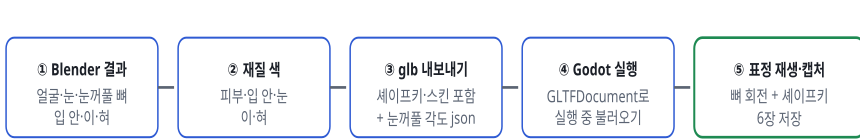
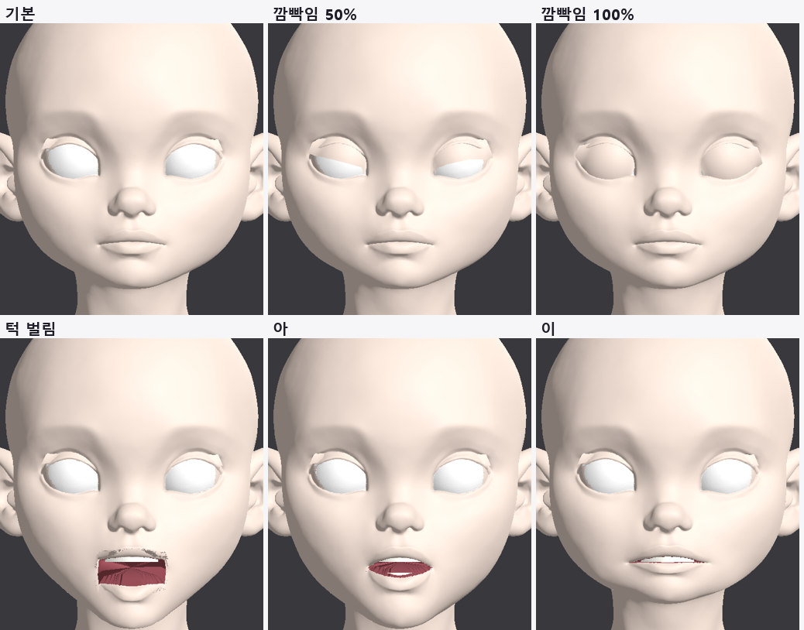

> GitHub에서 읽기 쉽게 [index.html](index.html)을 옮긴 사본입니다. 원본(HTML)을 내려받아 브라우저로 열면 원래 모양으로 보입니다.

# T3 · Godot 4.7에서 실행

2026-10-12 · 원본 유지 리깅(v3) → glTF → Godot 4.7.2 GL Compatibility · 실행 중 불러와서 캡처

> **결론**: 엔진에서도 Blender와 같게 움직입니다. 눈꺼풀 뼈 18개로 깜빡임 0·50·100%, 표정 키 6개(턱 벌림, 아·이·우·에·오)가 모두 로드되고 재생됩니다. 파일 크기는 6.3MB(원본 얼굴 정점 9만 4천 개)로, 게임용 면 수 줄이기는 T6에서 합니다.

## 1. 순서

***그림 1.** 처리 순서.*

## 2. 깜빡임을 엔진에서 돌리는 방법

눈꺼풀 부품은 뼈로 움직입니다. 각 뼈는 Blender에서 눈 축 방향으로 만들었고, 그 축이 뼈의 Y축입니다. 그래서 엔진에서는 "쉬는 자세 회전 × Y축 기준 회전(각도 × 깜빡임 값)"을 넣으면 됩니다. 뼈별 각도는 내보낼 때 json으로 함께 저장합니다.

func set_blink(t: float) -> void: for i in skel.get_bone_count(): var n := skel.get_bone_name(i) if lids.has(n): var rest := skel.get_bone_rest(i) skel.set_bone_pose_rotation(i, rest.basis.get_rotation_quaternion() * Quaternion(Vector3.UP, lids[n]["angle"] * t))

입 표정은 일반 셰이프키라 `set_blend_shape_value`로 켭니다. 아래 이·혀도 같은 이름의 키를 가지고 있어서 함께 움직입니다.

## 3. 결과

***그림 2. Godot 4.7 실행 화면.** 기본, 깜빡임 50·100%, 턱 벌림, 아, 이. Blender 결과와 같은 모양입니다.*

| 항목 | 값 |
|---|---|
| glTF 불러오기 | 성공 (오류 0) |
| 메쉬 | 7개 (얼굴, 눈, 눈꺼풀 2, 윗니, 아랫니, 혀) |
| 표정 키 | jaw_open, viseme_aa, I, U, E, O |
| 눈꺼풀 뼈 | 18개 (한쪽 9개) |
| 파일 크기 | 6.3MB |

## 4. 남은 일

- 게임용 표정 제어: 깜빡임 값 하나와 입모양 값들을 받아 뼈·키를 움직이는 얼굴 제어 스크립트를 실제 캐릭터 장면에 붙이고, 자동 깜빡임 타이머를 넣습니다.

- 면 수 줄이기 (T6): 얼굴 9만 4천 정점을 게임용으로 줄이고 대칭을 검증합니다.

- 재질: 지금은 단색입니다. 원본 텍스처를 입히는 단계가 남았습니다.

## 5. 파일

- `tools/face_auto/export_rig_glb.py`: 재질 색, glb 내보내기, 눈꺼풀 각도 json

- Godot 시험 프로젝트: 임시 폴더 `godot_rig/` (`main.gd` 실행 중 불러오기·캡처)
