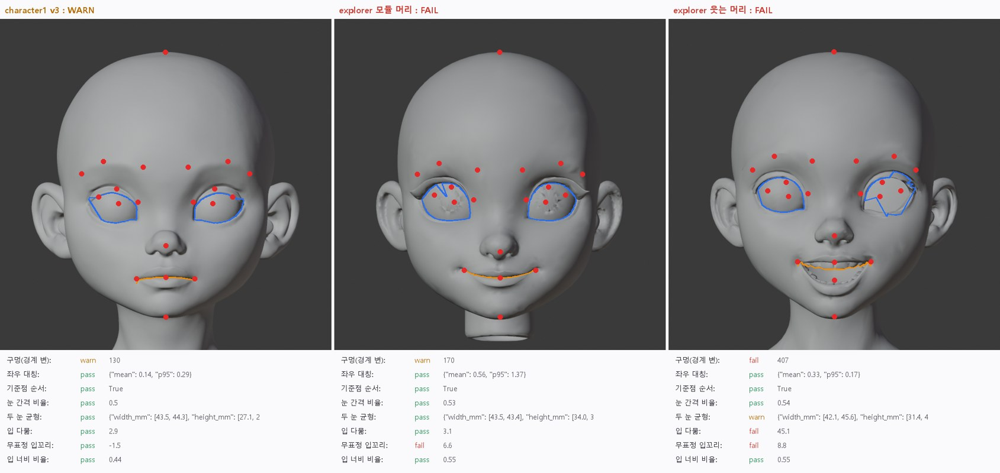

> GitHub에서 읽기 쉽게 [index.html](index.html)을 옮긴 사본입니다. 원본(HTML)을 내려받아 브라우저로 열면 원래 모양으로 보입니다.

# T4·T5 · 입력 검사 (리깅 전에 거르기)

2026-10-12 · 메쉬·대칭·기준점·눈·입·무표정 8개 항목 자동 판정 · 머리 3개

> **결론**: 검사가 맞게 걸러냅니다. v3는 "주의"로 통과했습니다(구멍 경계 130변, 리깅에는 지장 없음). 두 explorer 머리는 "실패"입니다. 모듈 머리는 입꼬리가 6.6mm 올라간 웃는 얼굴이고(T2 입술 경계 실패의 원인), 웃는 머리는 입이 열려 있고 입꼬리가 올라갔으며 구멍이 있습니다. 실패한 머리는 리깅으로 보내지 않고 다시 생성하면 됩니다. 사람이 볼 필요가 없습니다.

## 1. 검사 항목

| 항목 | 재는 법 | 통과 기준 | 왜 필요한가 |
|---|---|---|---|
| 구멍 | 정점을 붙인 뒤 경계 변 수 | 0 통과, 200 미만 주의 | 구멍이 크면 자르기·입 안이 새어 보임 |
| 좌우 대칭 | 얼굴 정점을 거울로 옮겼을 때 표면까지 거리 | 95%가 1.5mm 이내 | 대칭이 필요한 캐릭터의 기준(사용자 원칙) |
| 기준점 순서 | 눈썹 > 눈 > 코 > 입 > 턱 (높이) | 순서 맞음 | MediaPipe 오검출 걸러내기 (T4) |
| 눈 간격 비율 | 양 바깥 눈꼬리 거리 ÷ 눈 높이의 머리 폭 | 0.45~0.95 | 엉뚱한 곳을 얼굴로 잡은 경우 걸러냄 (T4) |
| 두 눈 균형 | 깊이로 찾은 두 눈 테두리의 폭·높이 차이 | 15% 이내 | 한쪽 눈이 평면·깨짐이면 눈꺼풀 부품이 실패 |
| 입 다묾 | 입술 경계 가운데에서 앞면보다 얼마나 깊이 들어가는지 | 6mm 미만 | 열린 입은 입술 자르기·입 안이 틀어짐 |
| 무표정 입꼬리 | 입꼬리 높이 − 입술 가운데 높이 | ±2.5mm 통과, ±4mm 주의 | 웃는 입은 표정의 0점이 틀어지고 경계 검출 실패 |
| 입 너비 비율 | 입 너비 ÷ 눈 간격 | 0.25~0.9 | 입꼬리 오검출 걸러내기 |

## 2. 결과

***그림 1.** 파란 선은 깊이로 찾은 눈 테두리, 주황 선은 입술 경계, 빨간 점은 MediaPipe 기준점입니다. 웃는 머리는 오른쪽 눈 테두리가 깨지고, 입술 경계가 열린 입 위로 지나갑니다.*

| 머리 | 판정 | 걸린 항목 | 조치 |
|---|---|---|---|
| character1 v3 | 주의 | 경계 변 130 | 리깅 진행 (실제로 T1~T3 정상) |
| explorer 모듈 머리 | 실패 | 입꼬리 +6.6mm (웃음) | 무표정 레퍼런스로 다시 생성 |
| explorer 웃는 머리 | 실패 | 입 열림 45mm, 입꼬리 +8.8mm, 구멍 407, 두 눈 높이 31/40mm | 무표정·입 다문 레퍼런스로 다시 생성 |

## 3. 이전 테스트와의 관계

- T1 눈꺼풀: 웃는 머리 한쪽 눈 실패 → "두 눈 균형" 경고로 미리 잡힘

- T2 입 안: 모듈 머리 입술 경계 실패 → "무표정 입꼬리" 실패로 미리 잡힘

- 앞으로 파이프라인은 이 검사를 맨 앞에 두고, 실패하면 리깅을 하지 않고 재생성 목록으로 보냅니다.

## 4. 남은 일

- 기준점 재검출: 실패 시 정면 레퍼런스 이미지에서 MediaPipe를 다시 돌려 3D 기준점과 비율을 대조합니다.

- v3 경계 변 130: 어디인지 위치를 표시해서 실제 구멍인지 내보내기 분할인지 확인합니다.

## 5. 파일

- `tools/face_auto/input_check.py`: 8개 항목 판정, 결과 json, 표시용 그림 자료
