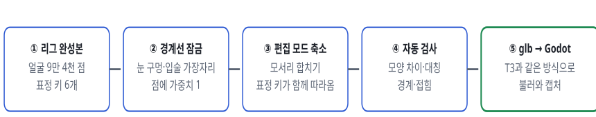
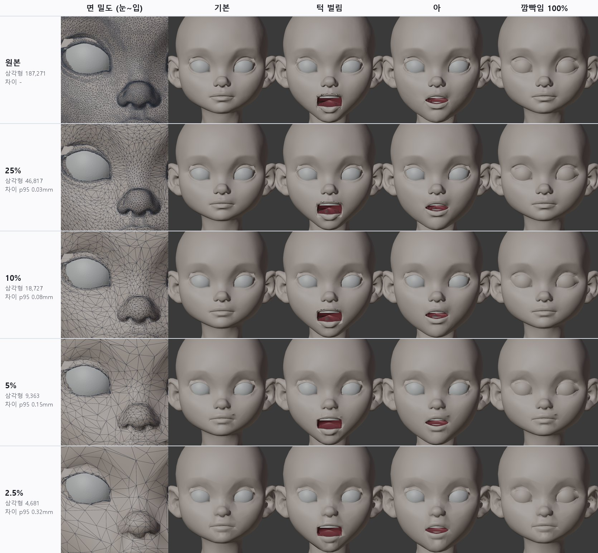
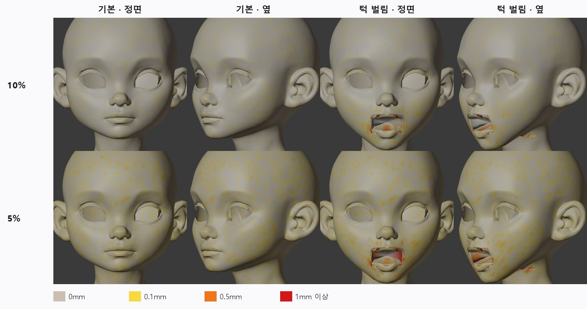
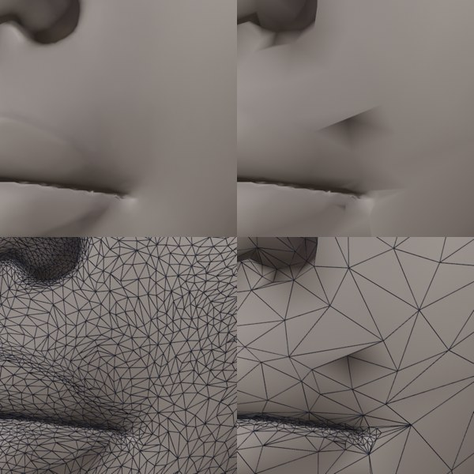
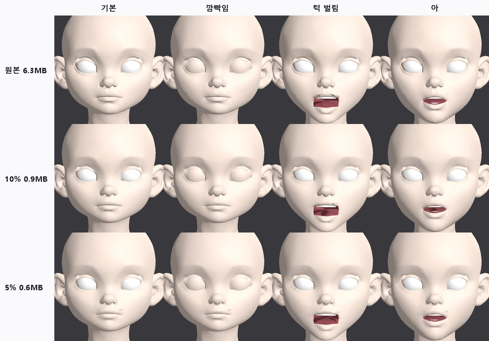

> GitHub에서 읽기 쉽게 [index.html](index.html)을 옮긴 사본입니다. 원본(HTML)을 내려받아 브라우저로 열면 원래 모양으로 보입니다.

# T6 · 게임용 면 수 줄이기 (대칭 검증 포함)

2026-10-12 · character1 v3 리그 완성본 · 25 / 10 / 5 / 2.5 % · Blender 4.5 무인 실행 + Godot 4.7 확인

> **결론**: **10%(삼각형 18,727개, glb 0.9MB)를 게임 기본 단계로 권장**합니다. 원본과의 모양 차이는 95%가 0.08mm 이내이고, 턱·입모양 키를 켠 상태도 같습니다. 눈 구멍과 입술 가장자리는 1개 점도 움직이지 않았습니다(눈꺼풀·입 안 부품이 그대로 맞음). 대칭은 원본보다 나빠지지 않았습니다. 5%는 입꼬리 위에 작은 접힘이 생겨 먼 거리용으로만 씁니다.

## 1. 순서

***그림 1.** 처리 순서. 비율 하나당 약 1분, 네 단계를 한 번에 실행합니다.*

### 표정 키를 다시 옮기지 않아도 되는 이유

Blender 편집 모드에서는 표정 키(셰이프키)가 점마다 붙은 데이터로 함께 들어 있습니다. 모서리 두 점을 하나로 합치면 그 데이터도 두 점 사이 값으로 섞입니다. 그래서 줄인 뒤에도 턱 벌림·입모양 키가 그대로 남고, 따로 옮기는 단계(오차가 생기는 곳)가 없습니다. 아래 표에서 키를 켠 상태의 차이가 기본 상태와 같은 것이 그 확인입니다.

### 경계선을 잠그는 이유

눈꺼풀 부품(T1)은 눈 구멍 테두리 바로 뒤에 숨어 있고, 입 안(T2)은 입술 가장자리에 붙어 있습니다. 이 선이 움직이면 틈이 보입니다. 그래서 경계선 위의 점만 가중치 1로 잠그고, 나머지는 자유롭게 줄입니다. 처음에는 경계 주변 12mm를 넓게 보호했는데, 그러면 경계 주변만 촘촘하고 머리 뒤가 너무 거칠어져서(2.5%에서 차이 p95 2.3mm) 선 위의 점만 잠그는 방식으로 바꿨습니다.

## 2. 결과

***그림 2.** 왼쪽 열은 오른쪽 눈~입꼬리 부분의 면 밀도입니다. 10%까지는 기본·턱 벌림·아·깜빡임이 원본과 거의 같습니다. 5%부터 입꼬리 위에 작은 그늘(접힘)이 보이고, 2.5%는 입술 윤곽이 흐려집니다.*

| 단계 | 삼각형 | glb | 모양 차이 p95   (기본 / 턱 / 아) | 거울 차이 p95 | 경계선 이동 | 판정 |
|---|---|---|---|---|---|---|
| 원본 | 187,271 | 6.3MB | - | 1.07mm | - | - |
| 25% | 46,817 | 1.6MB | 0.03 / 0.03 / 0.03mm | 1.02mm | 0 | 원본과 구별 불가 |
| **10%** | 18,727 | 0.9MB | 0.08 / 0.08 / 0.08mm | 0.94mm | 0 | 게임 기본 단계 |
| 5% | 9,363 | 0.6MB | 0.15 / 0.16 / 0.16mm | 0.86mm | 0 | 입꼬리 접힘, 중간 거리용 |
| 2.5% | 4,681 | 0.5MB | 0.32 / 0.33 / 0.32mm | 0.77mm | 0 | 입술 윤곽 흐림, 먼 거리용 |

모양 차이는 줄인 면 위 점에서 원본 표면까지의 거리, 그리고 원본 점에서 줄인 면까지의 거리 두 방향으로 쟀습니다. 표에는 앞 방향만 적었고, 뒤 방향도 같은 수준입니다(10%: 0.07mm). 입모양 이·우·에·오도 각각 같은 수준입니다(`qa_lod.json`).

## 3. 차이가 어디에 생기나

***그림 3.** 원본 표면을 줄인 면까지의 거리로 칠했습니다. 기본 상태는 10%에서 0.1mm를 넘는 곳이 0.6%뿐입니다. 턱 벌림에서 빨간 곳은 두 군데입니다. (1) 입 안 주머니: 원래 거칠고 밖에서 보이지 않는 면입니다. (2) 턱 아래 목의 가는 선: 원본 턱 키가 이미 이곳을 구기고 있습니다(원본 삼각형 319개가 뒤집힘, T2의 "목 혹" 문제). 줄인 면이 그 구김을 따라가지 못해서 생긴 차이이고, 줄이기 때문에 생긴 문제가 아닙니다.*

## 4. 대칭 검증

- **모양 대칭**: 얼굴 앞쪽 점을 좌우로 뒤집어 같은 표면까지 거리를 쟀습니다. 원본 p95 1.07mm, 줄인 단계 0.77~1.02mm입니다. 줄이면서 비대칭이 늘지 않았습니다. 2.5%가 오히려 작은 것은 잔주름이 사라져서입니다.

- **점 짝 대칭**: Blender 축소의 "대칭" 옵션은 좌우 짝이 되는 점이 있을 때만 작동합니다. Tripo 원본은 짝인 점이 거의 없어서(0.1~0.6%) 옵션을 켜도 끈 것과 결과가 똑같았습니다. 확인을 위해 두 번 실행해 비교했습니다.

- **완전 대칭이 꼭 필요하면**: 왼쪽 반을 줄이고 오른쪽에 뒤집어 붙이면 점 짝까지 대칭이 됩니다. 다만 오른쪽 모양이 원본 비대칭만큼(p95 약 1mm) 바뀝니다. "원본 모양 유지" 원칙 때문에 기본으로는 하지 않았습니다. 필요하면 옵션으로 넣겠습니다.

## 5. 5%의 입꼬리 접힘

***그림 4.** 왼쪽 원본, 오른쪽 5%. 위는 음영, 아래는 면. 입꼬리 위에 큰 삼각형이 생기고 그중 하나가 아래를 향해 접혀(법선이 아래쪽) 그늘이 집니다.*

자동 검사가 이런 접힘을 찾습니다. 접힘은 원본 표면과 60도 넘게 어긋난 면, 또는 원본에서는 뒤집히지 않는데 표정 키에서 뒤집히는 면입니다. 고치는 방법도 두 가지 시험했습니다.

| 시도 | 결과 |
|---|---|
| 접힘 주변 3mm 원본 점을 잠그고 다시 줄이기 (4회 반복) | 접힘 49 → 17개. 입꼬리 그늘은 사라졌지만 윗입술 가운데에 작은 주름이 새로 생기고 차이 p95가 0.14 → 0.23mm로 커짐. 기본값은 끔(옵션으로 남김) |
| 움직이는 부위(입·눈 주변) 전체에 약한 보호 가중치 | 머리 뒤가 너무 거칠어져 차이 p95 2~3mm. 버림 |

결론적으로 5% 이하에서는 입술처럼 부드러운 윤곽을 지키는 다른 줄이기 방식이 필요합니다(아래 남은 일). 10%는 이 문제가 없습니다.

## 6. Godot에서 확인

***그림 5.** T3와 같은 Godot 시험 장면에 줄인 glb를 넣었습니다. 메쉬 7개, 표정 키 6개, 눈꺼풀 뼈 18개 모두 그대로 불러와집니다. 10%는 원본과 구별하기 어렵고, 5%는 입꼬리 그늘과 면 각짐이 보입니다.*

## 7. 권장 구성

| 게임 단계 | 쓸 비율 | 쓰는 곳 |
|---|---|---|
| LOD0 | 10% (18.7k 삼각형) | 대화·클로즈업·플레이어 캐릭터 |
| LOD1 | 5% (9.4k) | 화면 높이의 1/4 이하로 보일 때 |
| LOD2 | 2.5% (4.7k) | 먼 거리, 군중 |

## 8. 남은 일

- 5% 이하 입술 윤곽 지키기: 곡률이 큰 선(입술 윤곽, 쌍꺼풀 선)에 비용을 더 주는 줄이기를 직접 구현하거나, 깨끗한 사각면으로 다시 덮는 방식(QuadriFlow 등)과 비교. 다시 덮는 방식은 모양이 조금 바뀌므로 차이 측정을 함께 합니다.

- 텍스처: 줄일 때 UV도 함께 섞이므로 원본 텍스처를 그대로 쓸 수 있을 것으로 보입니다. 아직 텍스처를 입혀 확인하지는 않았습니다.

- 턱 키의 목 구김(T2 문제)을 고치면 턱 벌림 차이 지도의 빨간 선도 함께 사라집니다.

## 9. 파일

- `tools/face_auto/lod_decimate.py`: 경계 잠금, 편집 모드 축소, 모양 차이·대칭·경계·접힘 검사, 선택적 접힘 보수(`LOD_REPAIR`)

- `tools/face_auto/render_lod.py`: 단계별 면 밀도·기본·턱·아·깜빡임 그림

- 결과물(임시 폴더): `t6/lod/lod_25|10|5|2.5.blend`, `qa_lod.json`, Godot 시험 `t6/godot_10`, `t6/godot_5`
