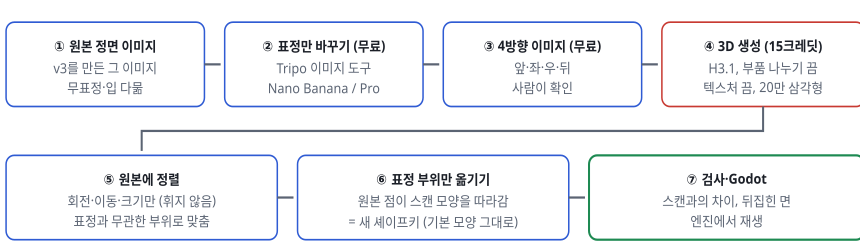
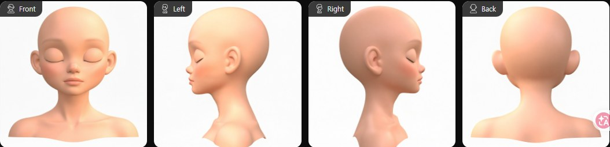
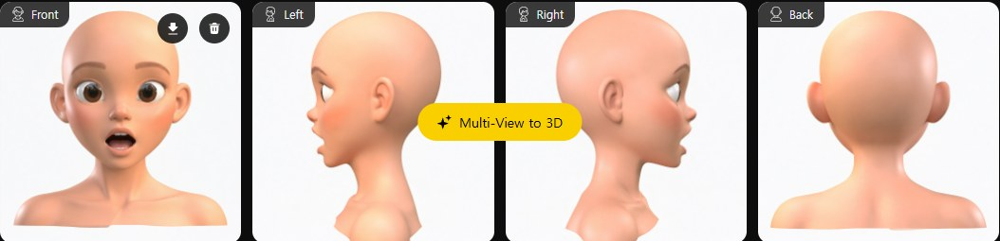
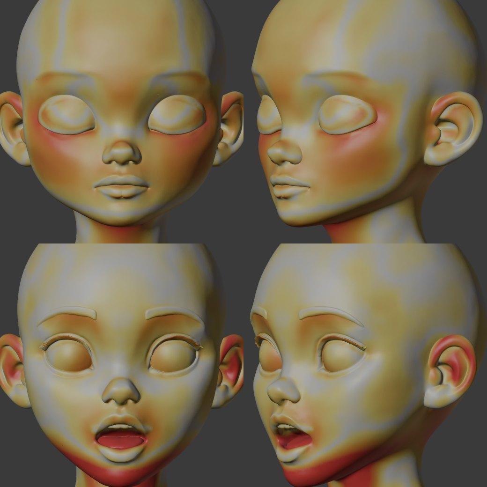
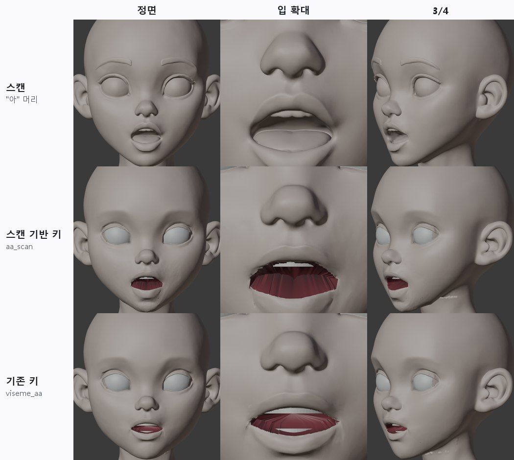
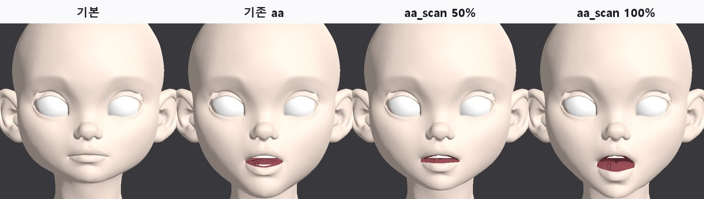
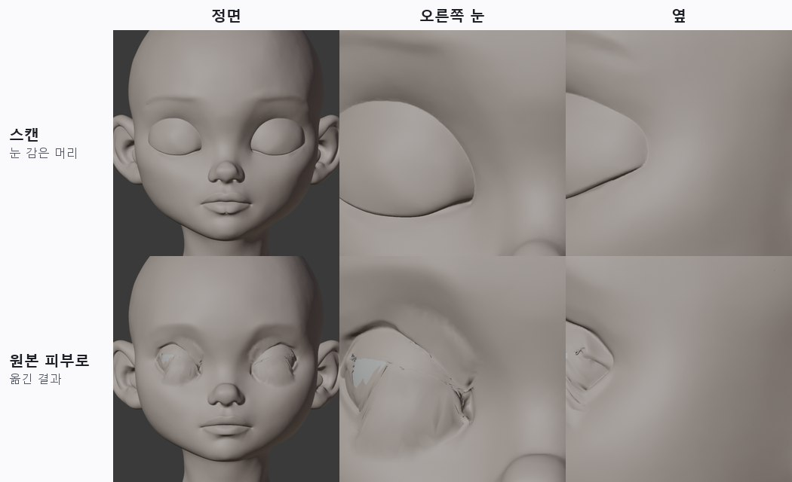
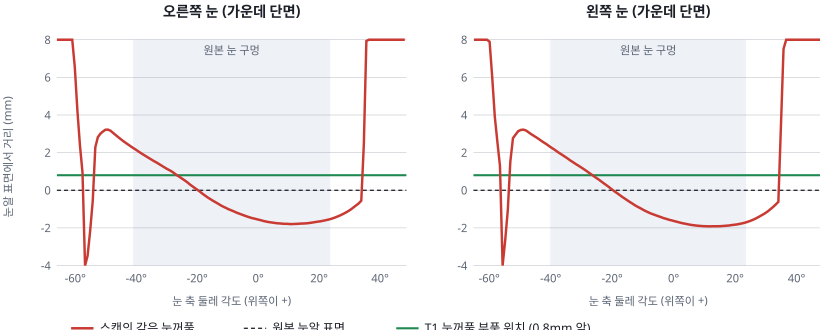

> GitHub에서 읽기 쉽게 [index.html](index.html)을 옮긴 사본입니다. 원본(HTML)을 내려받아 브라우저로 열면 원래 모양으로 보입니다.

# T7 · 표정 스캔: Tripo로 표정 머리를 만들어 원본에 옮기기

2026-10-12 · character1 v3 · 눈 감은 머리 + "아" 입 머리 · Tripo 30크레딧 · 원본 모양은 그대로, 표정 키만 추가

> **결론**

> - **입("아"): 성공.** 스캔에서 입이 벌어진 모양과 턱이 내려간 정도를 가져와 원본에 `aa_scan` 키를 만들었습니다. 기존 템플릿 '아'(가는 틈)보다 실제 "아"처럼 둥글게 벌어집니다(가운데 높이 20mm로 스캔과 같음). 기본 모양 변화는 0이고, Godot에서도 50%·100% 모두 정상입니다.

> - **눈 감기: 모양을 옮기는 방식은 실패.** 원본 눈 구멍이 너무 크고 테두리 피부가 좁아서, 스캔의 감은 눈꺼풀 모양으로 피부를 끌어 덮으면 주름과 구멍이 생깁니다. 대신 **측정용으로는 쓸모가 있습니다.** 스캔의 감은 눈꺼풀은 원본 눈알 표면과 거의 같은 자리(중앙값 −0.2~−0.3mm, 범위 ±2mm)에 있습니다. 그래서 T1 눈꺼풀 부품(눈알 0.8mm 앞)이 맞는 위치라는 것을 생성기 쪽 결과로 확인했습니다.

> - **비용**: 3D 생성 2회 × 15 = 30크레딧. 참고 이미지 수정과 4방향 이미지는 무료였습니다.

## 1. 순서

***그림 1.** 처리 순서. 빨간 칸만 돈이 듭니다.*

## 2. 참고 이미지 (생성 전에 확인)

***그림 2.** 눈 감은 얼굴. 원본 정면 이미지에 "눈만 편하게 감기, 나머지는 그대로"로 수정했습니다(Nano Banana, 무료). 한 번에 원하는 결과가 나왔습니다.*

***그림 3.** "아" 입. 기본 Nano Banana로는 놀란 "오"나 웃는 입이 나와서, Nano Banana Pro에 "입꼬리를 올리지 말 것, 턱을 내린 아"를 넣어 세 번째에 얻었습니다. 이 이미지는 눈썹과 눈도 조금 바뀌었습니다(놀란 듯). 그래서 아래 얼굴만 가져다 씁니다.*

## 3. 원본에 정렬

새로 만든 머리는 같은 캐릭터라도 원본과 조금씩 다릅니다. 그래서 휘지 않는 변환(회전·이동·크기 하나)만 풀었습니다. 맞출 때는 표정이 바꾸지 않는 부위만 씁니다. 눈 감은 머리는 눈 주변을 뺀 전체, "아" 머리는 정수리·귀·코입니다. 먼저 기준점으로 대략 맞춘 뒤, 가장 가까운 점끼리 반복해서 맞추고(ICP) 많이 어긋난 20%는 버렸습니다.

***그림 4.** 정렬한 스캔을 원본까지의 거리로 칠했습니다(회색 0, 노랑 1mm, 주황 3mm, 빨강 6mm 이상). 위는 눈 감은 머리, 아래는 "아" 머리입니다. 표정 부위(감은 눈, 벌린 입, 내려간 턱)가 다른 것은 당연합니다. 그 밖에 볼·귀·목도 3~6mm 다릅니다. 같은 이미지를 바탕으로 해도 생성할 때마다 생기는 차이입니다.*

| 스캔 | 크기 보정 | 바뀌면 안 되는 부위의 차이 (중앙 / 95%) | 뜻 |
|---|---|---|---|
| 눈 감은 머리 | ×1.004 | 1.35 / 5.6mm | 스캔을 통째로 쓰면 얼굴이 1~2mm, 볼·귀는 더 많이 바뀝니다. 그래서 **표정 부위만, 부드럽게 경계를 두고** 가져옵니다. |
| "아" 머리 | ×1.084 | 0.59 / 6.4mm |  |

"아" 머리의 크기 보정이 8%인 이유: 정리 단계가 머리 높이(턱~정수리)를 24cm로 맞추는데, 턱이 내려가 머리가 길어진 만큼 작게 줄어 있었습니다. 정렬이 이를 자동으로 바로잡았습니다.

## 4. 입 "아": 스캔 기반 키

1. **턱 세기**: 기존 턱 벌림 키를 몇 배 하면 스캔의 턱 끝에 가장 가까운지 찾았습니다. 1.15배에서 차이 1.8mm였습니다(1배일 때 3.1mm).

2. **스캔의 입 벌림 윤곽**: 정면에서 깊이를 재서 "원본 입술보다 6mm 이상 깊은 곳"을 입 벌림으로 봤습니다. 그 윗선과 아랫선이 윤곽입니다. 폭 49mm(원본 53mm), 가운데 높이 20mm입니다.

3. **입술 가장자리**: 원본의 윗입술·아랫입술 가장자리 점을 입꼬리 사이 같은 비율 위치의 스캔 윤곽으로 보냈습니다.

4. **아래 얼굴**: 나머지 피부는 스캔 표면으로 붙인 뒤, 움직임을 매끄럽게 폈습니다. 두 머리 사이의 1~2mm 잡음을 없애기 위해서입니다. 코 밑과 볼 쪽으로 갈수록 영향이 줄어듭니다.

5. **입 안**: 입 안 주머니는 가까운 입술 가장자리를 따라가고, 아랫니·혀는 턱 키 1.15배를 씁니다.

***그림 5.** 위: 스캔. 가운데: 원본에 만든 `aa_scan`. 아래: 기존 템플릿 `viseme_aa`. 스캔 기반 키는 스캔처럼 둥글게 벌어지고 턱이 함께 내려갑니다. 기존 키는 가는 틈만 벌어집니다.*

| 항목 | 값 |
|---|---|
| 가운데 입 벌림 높이 (스캔 / 만든 키) | 20.0 / 20.3mm |
| 아래 얼굴의 스캔과의 차이 (중앙 / 95%) | 1.3 / 3.6mm (매끄럽게 편 대가. 펴기 전 0.5 / 1.8mm는 울퉁불퉁) |
| 키가 뒤집은 면 | 155 / 33,973 (0.5%, 입 안 주머니 주름과 목 구김) |
| 기본 모양 변화 | 0.0mm |

### 매끄럽게 펴는 정도

스캔 표면에 그대로 붙이면 두 머리의 잡음 때문에 입술 주변이 울퉁불퉁하고, 코 밑에 가로줄이 생겼습니다. 영향 범위의 경계를 12mm에 걸쳐 서서히 줄이고, 움직임을 300번 이웃 평균으로 폈습니다. 40번, 120번, 300번을 비교해 300번을 골랐습니다. 입 벌림 모양은 그대로이고 피부만 매끈해집니다.

## 5. Godot에서 확인

***그림 6.** T3와 같은 Godot 시험 장면입니다. 표정 키 7개(기존 6 + `aa_scan`)가 불러와지고, 50%에서도 중간 모양이 자연스럽습니다.*

## 6. 눈 감기: 모양 이식은 실패, 측정은 성공

### 모양을 옮겨 본 결과

눈꺼풀 피부를 눈 축 둘레로 돌려 위아래 가장자리를 만나게 하고, 높이는 스캔의 감은 눈꺼풀 표면에서 가져왔습니다. 두 번 고쳤지만 주름과 바깥 눈꼬리 구멍이 남았습니다.

***그림 7.** 위: 스캔의 감은 눈(매끈한 반구). 아래: 원본 피부로 옮긴 결과(주름, 흰 구멍). 원본 눈 구멍은 가로 약 40mm로 크고, 그 둘레 피부는 좁은 띠입니다. 이 띠를 늘려 구멍 전체를 덮어야 해서 면이 접힙니다. T1에서 피부 깜빡임이 실패한 이유와 같습니다.*

### 측정으로 쓰기

스캔의 감은 눈꺼풀이 원본 눈알 표면에서 얼마나 떨어져 있는지 쟀습니다. 눈 축 둘레로 광선을 쏘아 단면을 구했습니다.

***그림 8.** 눈 가운데 단면. 빨간 선이 스캔의 감은 눈꺼풀입니다. 눈 구멍 범위(회색 바탕) 안에서 원본 눈알 표면(점선) 근처 ±2mm에 있습니다. T1 부품 위치(초록, 0.8mm 앞)와 1~2mm 안에서 맞습니다. 눈꺼풀이 만나는 선(주름)은 깊이 0.02~0.05mm로 거의 없었습니다. 생성기는 감은 눈을 매끈한 반구로 만든다는 뜻입니다.*

| 눈 | 눈알 표면에서 감은 눈꺼풀까지 (5% / 중앙 / 95%) |
|---|---|
| 오른쪽 | −1.9 / −0.3 / +2.1mm |
| 왼쪽 | −1.9 / −0.2 / +2.3mm |

정리하면 눈은 T1 부품 방식을 유지합니다. 스캔은 부품의 감은 위치와 볼록함을 맞추는 기준으로 씁니다.

## 7. 비용과 기록

| 작업 | Tripo 작업 ID | 크레딧 |
|---|---|---|
| 참고 이미지 수정 4장, 4방향 이미지 2세트 | - | 0 |
| 눈 감은 머리 (196,304면) | `2b9f6317` | 15 |
| "아" 머리 (188,544면, 입 안·혀 포함) | `64acd818` | 15 |
| 합계 (잔액 22,795 → 22,765) | 30 |  |

## 8. 다음에 할 수 있는 것

- **나머지 입모양**: 이·우·에·오를 같은 방법으로 만들면 템플릿 입모양을 스캔 기반으로 모두 바꿀 수 있습니다. 4 × 15 = 60크레딧이고 승인이 필요합니다.

- **입 안 주머니 주름**: 크게 벌리면 입 안 주머니가 접혀 빨간 주름이 보입니다. 주머니를 벌림 크기에 맞춰 넓히는 보정이 필요합니다.

- **자동화**: ①~④는 지금 Chrome에서 Tripo Studio를 조작합니다. 이미지 수정 프롬프트와 생성 설정은 정해졌으므로, 같은 순서를 스크립트로 반복할 수 있습니다. ⑤~⑦은 이미 무인으로 실행됩니다.

- **T1 보정**: 측정값(중앙 −0.3mm)은 감은 눈꺼풀이 눈알에 더 붙어도 된다는 뜻입니다. 부품의 0.8mm를 줄여 보는 시험을 할 수 있습니다.

## 9. 파일

- `tools/face_auto/expr_align.py`: 기준점 + 가장 가까운 점 반복으로 휘지 않는 정렬, 바뀌면 안 되는 부위의 차이 보고

- `tools/face_auto/expr_keys.py`: `aa`(턱 세기, 입 벌림 윤곽, 입술 가장자리, 매끄럽게 펴기, 입 안) / `blink`(감은 눈꺼풀 단면 측정, 시험용 이식)

- 스캔 원본(유료) 보관: `art/characters/character1_face_v3/source/tripo_eyes_closed_2b9f6317.glb`, `tripo_mouth_ah_64acd818.glb`

- 결과물(임시 폴더 `t7/`): 정렬 blend, `keys/aa.blend`(aa_scan 키 포함), Godot 시험 `t7/godot`
