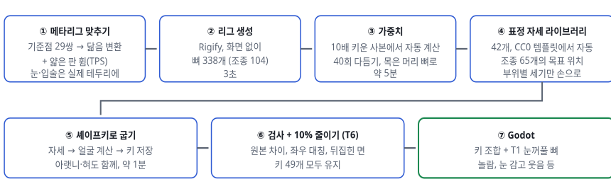
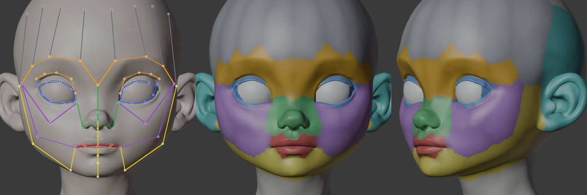
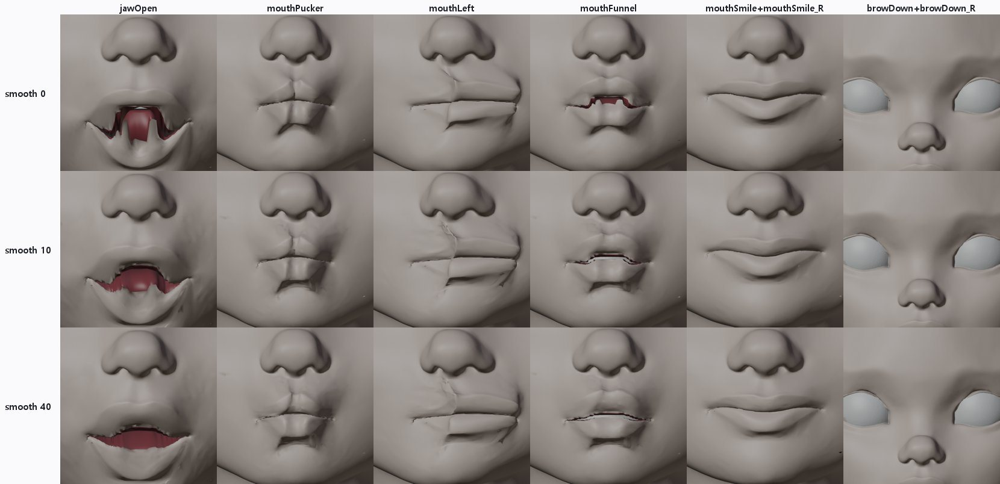
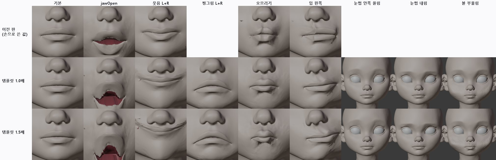
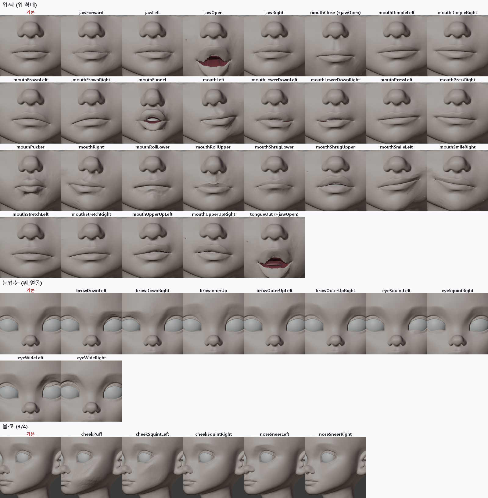
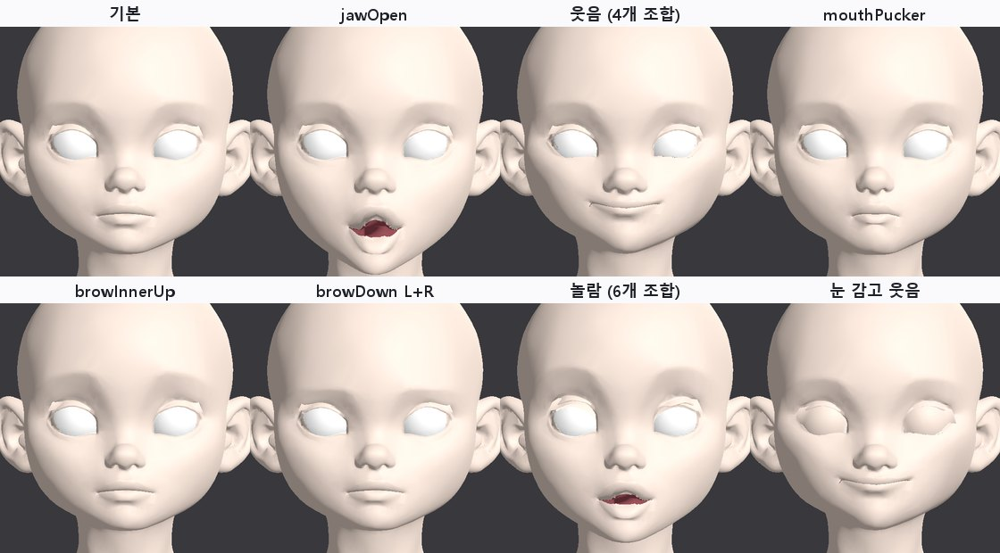

> GitHub에서 읽기 쉽게 [index.html](index.html)을 옮긴 사본입니다. 원본(HTML)을 내려받아 브라우저로 열면 원래 모양으로 보입니다.

# T13 · Rigify 얼굴 리그 자동 맞춤 (Faceit 흐름을 무료로 무인 재현)

2026-10-12 · character1 v3 원본 · Blender 4.5 내장 Rigify · 사람 손 없이 실행 · ARKit 52개 중 42개 셰이프키 + 눈 깜빡임 2개는 T1 부품 · 2판: 표정 크기를 CC0 템플릿에서 자동으로 가져옴

> **결론**

> - **흐름은 끝까지 자동으로 됩니다.** 우리 기준점으로 Rigify 얼굴 메타리그를 맞추고, 리그를 생성하고, 가중치를 붙이고, 표정 42개를 셰이프키로 굽고, 10%로 줄여 Godot에서 재생했습니다. 사람이 점을 찍거나 누른 단계는 없습니다. 한 머리에 약 7분 걸립니다(가중치 다듬기 5분).

> - **원본 모양은 그대로입니다.** 쉬는 자세의 차이는 0.0002mm(계산 오차)입니다. 좌우 표정은 거울로 비교해 95%가 3~15% 이내로 같습니다.

> - **2판에서 표정이 잘 보이게 됐습니다.** 1판은 자세 값을 손으로 2~5mm로 작게 잡아서 대부분 무표정처럼 보였습니다. 2판은 원본 위에 맞춰 둔 CC0 MPFB 템플릿의 ARKit 표정에서 각 조종점이 몇 mm 움직이는지 자동으로 읽어 옵니다. 웃음 16mm, 볼 부풀림 19mm, 눈썹 내림 11mm 정도로 커졌습니다. 손으로 정한 값은 부위별 세기 3개뿐입니다(턱 0.7배, 입 1.0배, 눈썹·눈·볼·코 1.5배).

> - **남은 품질 문제**: 턱 벌림 때 아랫입술 안쪽 면과 입술 경계의 들쭉날쭉함이 보이고, 눈썹은 이 머리에 눈썹 그림이 없어 약하게 읽힙니다.

> - **Faceit과의 관계**: Faceit이 해 주는 일(얼굴 뼈, ARKit 자세, 굽기)을 무료로 재현했습니다. 그래서 Faceit은 이제 필수가 아니라 **품질 비교 기준**입니다. 자세 다듬기를 직접 하느냐, Faceit 프리셋을 사느냐의 선택입니다.

## 1. 순서

***그림 1.** 처리 순서. Faceit이 GUI로 하는 일(점 맞추기 → 얼굴 리그 → ARKit 자세 → 굽기)과 같은 순서입니다.*

## 2. 뼈 맞추기와 가중치

***그림 2.** 왼쪽: 맞춘 얼굴 뼈(파랑 눈꺼풀, 빨강 입술, 주황 눈썹, 초록 코, 보라 볼, 노랑 턱, 회색 이마). 가운데·오른쪽: 각 점을 가장 많이 움직이는 뼈 부위로 칠한 가중치. 눈꺼풀 뼈는 T1과 같은 깊이 테두리 위에, 입술 뼈는 입술 경계 바로 위·아래에 놓입니다.*

| 메타리그 관절 | 우리 점 | 방법 |
|---|---|---|
| 눈꺼풀 고리 8점 × 2 | 깊이로 찾은 눈 테두리 (눈꼬리 2 + 위 3 + 아래 3) | 테두리 위에 정확히 |
| 위 눈썹 3점 × 2 | MediaPipe 눈썹 1~6 | TPS + 표면에 붙이기 |
| 코끝, 입꼬리 2, 윗·아랫입술 가운데, 턱 끝, 정수리 | 16, 20, 22, 34/35 ±3.5mm, 24, 31 | TPS + 표면에 붙이기 |
| 턱 뼈 | T2에서 구한 턱 회전축 → 턱 끝 | 그대로 |
| 눈알, 이, 혀 | 눈알 중심, 우리 이·혀 부품 | 그대로 |
| 나머지 (볼, 이마, 관자놀이, 귀) | 위 29쌍으로 만든 휨을 따라감 | TPS + 표면에 붙이기, 좌우 평균으로 정확히 대칭 |

### 가중치에서 막힌 것과 해결

- **자동 가중치 실패**: Blender의 자동 가중치가 "해를 찾지 못함"으로 모든 점에서 실패했습니다. 머리 높이 24cm가 계산에는 너무 작은 크기였습니다. 10배 키운 사본에서 계산하고 같은 점 번호로 옮기자 22초 만에 모든 점에 붙었습니다.

- **V자 턱**: 자동 가중치는 뼈 사이 경계가 날카로워 턱을 벌리면 아랫입술이 V자로 꺾였습니다. 40회 이웃 평균으로 다듬자(Faceit에도 있는 단계) 타원으로 벌어졌습니다. 입술·눈 경계는 잘려 있어서 다듬어도 위아래가 섞이지 않습니다.

- **어깨 끌림**: 다듬으면서 턱 영향이 목·어깨로 번져 턱을 벌리면 어깨가 2cm 내려갔습니다. 턱 끝 아래 45mm 구간에서 얼굴 뼈 영향을 서서히 없애고 머리 뼈(움직이지 않음)로 넘겼습니다. 턱 벌림의 뒤집힌 면이 438개에서 56개로 줄었습니다.

***그림 3.** 가중치 다듬기 0 / 10 / 40회 비교(자세 조정 전 버전). 40회에서 턱 벌림이 V자에서 타원이 되고 웃음이 부드러워집니다.*

## 3. 표정 자세 라이브러리

각 표정은 "조종 뼈 65개를 각각 어디로 보내는가"의 목록입니다.

### 1판: 손으로 쓴 값 (작아서 실패)

웃음(왼쪽)을 입꼬리 (+3, +3, +5)mm처럼 손으로 적었습니다. 24cm 머리에서 2~5mm는 너무 작아서 시트에서 대부분 무표정처럼 보였습니다.

### 2판: 템플릿에서 자동으로 읽기

1. face_fit 단계에서 CC0 MPFB 머리 템플릿(ARKit 52개 포함)을 이미 원본 위에 맞춰 두었습니다. 원본 모양은 바꾸지 않고 템플릿만 맞춘 것입니다.

2. 각 조종 뼈 위치에서 가장 가까운 템플릿 표면 점을 찾고, 그 점이 각 ARKit 키에서 움직이는 양을 원본 크기로 바꿔 조종 뼈의 목표로 씁니다. 윗입술 조종은 1.2mm 위, 아랫입술 조종은 1.2mm 아래에서 찾아 위아래 입술이 섞이지 않게 했습니다.

3. 턱은 턱 끝 조종이 템플릿 턱 끝을 따라가도록 회전 각도를 풉니다.

4. Rigify 입·볼 조종은 옆 조종을 50%씩 따라가도록 묶여 있어서 위치를 바로 지정하면 최대 17mm 어긋났습니다. 그래서 각 조종의 "1mm 움직였을 때 실제 이동"을 미리 재고, 그 비율로 한 개씩 고쳐 가며(끌려가는 쪽은 나중에) 맞췄습니다. 대부분 1.5mm 이내로 맞고, 서로 따라가는 코 조종 한 쌍은 가장 좋았던 단계에서 멈춥니다.

5. 키 이름은 ARKit 표준 이름(`mouthSmileLeft` 등)을 그대로 씁니다.

| 묶음 | 표정 | 개수 |
|---|---|---|
| 턱 | jawOpen, jawForward, jawLeft, jawRight | 4 |
| 입 | Smile, Frown, Dimple, Stretch, Press, LowerDown, UpperUp (각 L/R), Funnel, Pucker, Left, Right, RollLower/Upper, ShrugLower/Upper, Close | 23 |
| 눈썹·볼·코 | browDown L/R, browInnerUp, browOuterUp L/R, cheekPuff, cheekSquint L/R, noseSneer L/R | 10 |
| 눈 | eyeSquint L/R, eyeWide L/R | 4 |
| 혀 | tongueOut | 1 |
| 셰이프키 아님 | eyeBlink L/R → T1 눈꺼풀 부품(뼈). eyeLook 8개 → 눈알 뼈 회전 | 10 |

템플릿에는 혀 키가 없어 `tongueOut`만 직접 정했습니다. `mouthClose`는 ARKit 규칙대로 "턱 10° + 입술 붙이기"에서 "턱 10°"를 뺀 보정 키로 굽습니다. `tongueOut`도 "턱 16° + 혀 내밀기"에서 "턱 16°"를 뺀 혀만의 키라서 `jawOpen`과 함께 켭니다. 처음에는 혀 키 안에 턱 회전을 넣었더니, 두 키를 같이 켤 때 턱이 두 번 돌아 혀가 턱 아래로 뚫고 나왔습니다.

## 4. 결과

***그림 4.** 위: 1판(손으로 쓴 값). 가운데: 템플릿 크기 그대로(1.0배). 아래: 1.5배. 1판은 웃음·오므리기·입 이동이 거의 보이지 않습니다. 템플릿 값은 바로 읽힙니다. 1.5배는 입 주변이 찢어져 보여서 입은 1.0배, 턱은 0.7배, 위 얼굴만 1.5배로 정했습니다.*

***그림 5.** 2판 42개 전체를 부위별로 확대했습니다(빨간 글씨가 각 부위의 기본 모습). mouthClose와 tongueOut은 jawOpen과 함께 쓰는 보정 키라서 jawOpen을 켠 상태로 보여 줍니다. 보조개·입술 누르기·코 찡그림·눈 찡그림은 원래 작은 표정이라 차이가 작습니다.*

| 검사 | 결과 |
|---|---|
| 쉬는 자세 원본 차이 | 0.0002mm |
| 가중치 없는 점 | 0 / 93,816 |
| 좌우 대칭 (거울 비교 95%, 움직임 대비) | 2.1~8.8% (eyeWide만 55%: 템플릿 쪽 눈 모양 차이) |
| 조종 뼈가 목표에 못 미친 거리 (최대) | 4.1mm (대부분 1.5mm 이내) |
| 뒤집힌 면이 10개 넘는 표정 | mouthClose 215, mouthRollUpper 75, cheekSquintLeft 28, mouthSmileRight 18 (42개 합계 393, 대부분 입술 경계) |
| 10% 줄인 뒤 원본과 차이 (키 49개 중 최대 95%) | 0.081mm (삼각형 18,727개) |

## 5. Godot에서 확인

***그림 6.** 10%로 줄인 머리(5.8MB, 키 49개)를 Godot 4.7에 불러와 조합했습니다. "놀람"은 6개 키, "눈 감고 웃음"은 웃음 키 4개 + T1 눈꺼풀 뼈입니다. ARKit 표준 이름이라 얼굴 추적 앱이나 Audio2Face 같은 도구의 값을 바로 넣을 수 있습니다. 웃음과 오므리기는 이 거리에서도 보이고, 눈썹은 눈썹 그림이 없어 약하게 보입니다.*

## 6. 평가

| 잘 되는 것 | 부족한 것 |
|---|---|
| 사람 손 없이 끝까지 실행 (약 7분) 원본 모양 유지, 정확한 좌우 대칭 뼈 표정 크기를 템플릿에서 자동으로 가져옴 (손 값은 부위별 세기 3개) 웃음·찡그림·오므리기·입 모으기·입 이동·볼 부풀림·눈썹이 구분됨 ARKit 이름 42개 + 깜빡임 뼈, 조합 재생 T6 줄이기와 바로 이어짐 | 입술 경계의 들쭉날쭉함 (원본을 자른 경계, T2와 같은 문제) 턱 벌림 때 아랫입술 안쪽 면이 피부색으로 드러남 (텍스처를 입히면 입술 색) 눈썹 그림이 없어 눈썹 표정이 약하게 읽힘 eyeWide 좌우 차이 (55%) 왼쪽 볼에 작은 검은 점 1개 (원인 확인 필요) 혀 내밀기는 아랫입술 위까지만 나옴 시선 8개는 아직 안 함 |

## 7. 다음 단계

- **텍스처 입혀 보기**: 원본 Tripo 텍스처(입술 색, 눈썹)를 입혀야 표정이 실제로 어떻게 읽히는지 알 수 있습니다.

- **입술 경계 다듬기**: 들쭉날쭉한 입술 자른 선을 매끈하게 하는 것이 입 표정 품질에 가장 큽니다(T2 남은 일).

- **T7 스캔과 합치기**: "아"는 스캔 기반 키(`aa_scan`)가 더 좋았습니다. 표정마다 더 좋은 쪽을 고르는 방식이 가능합니다.

- **다른 머리에 적용**: 입력 검사(T5)를 통과한 새 머리로 같은 명령을 돌려 정말 손 없이 되는지 확인합니다.

- **Faceit**: 사면 같은 머리로 Faceit 결과와 나란히 비교해 자세 값을 맞추는 기준으로 씁니다. 필수는 아닙니다.

## 8. 파일

- `tools/face_auto/rigify_fit.py`: 메타리그 맞추기, 리그 생성, 가중치(10배 사본, 다듬기, 목 처리), 이·혀 연결, 쉬는 자세 검사

- `tools/face_auto/rigify_bake.py`: 자세 라이브러리(`--mpfb`: 템플릿에서 자동, 없으면 1판 손 값), 부위별 세기(`--k-jaw`, `--k-upper`), 조종 뼈 맞추기, 굽기, 좌우 대칭·뒤집힌 면·조종 오차 검사, 내보내기용 파일

- 결과(임시 폴더 `t13/`): `fit/rigify_fit.blend`(리그), `bake/arkit_rig.blend`, `bake/arkit.blend`, `lod/lod_10.blend`, Godot 시험 `t13/godot`
