> GitHub에서 읽기 쉽게 [index.html](index.html)을 옮긴 사본입니다. 원본(HTML)을 내려받아 브라우저로 열면 원래 모양으로 보입니다.

# T14 · 리깅 포인트 자동 배치 (어떤 얼굴이든)

2026-10-12 · 시험 얼굴 16개(Tripo 240크레딧) + character1 v3 · Blender 4.5 · MediaPipe 478점 · CC0 MPFB 머리 템플릿 · 사람 손 없이 실행

> **결론**

> - **맞추는 점이 29개에서 얼굴당 190~370개로 늘었습니다.** 텍스처 입힌 머리를 5방향에서 찍어 MediaPipe 478점을 찾고, 흔들리는 점을 버린 뒤 좌우 짝으로 평균 냅니다.

> - **위치가 약 3배 정확해졌습니다.** 점 일부를 숨기고 맞히게 하면 오차 중앙값이 2.5mm → 0.76mm, 95번째 백분위가 약 7mm(최대 17mm) → 약 2.6mm입니다(17개 머리).

> - **Rigify 얼굴 관절 92개가 16개 얼굴 모두에 자동으로 놓였습니다.** 실사, 노인, 아이, 엘프, 드워프, 오거, 애니, 픽사풍, SD를 포함합니다. 높이 순서 검사는 16/16 통과입니다. 귀 관절은 옆면에서 귀를 직접 찾아 실제 귀 위에 놓입니다(16/16, 엘프 귀 포함).

> - **눈꺼풀 고리는 얼굴마다 자동으로 고릅니다.** 사람 눈은 MediaPipe 윤곽, 큰 만화 눈은 깊이로 찾은 눈 테두리입니다(애니 f09, 픽사풍 f11, character1).

> - **모든 관절이 정확히 좌우 대칭입니다.** 원본 메쉬는 바꾸지 않고 회전·이동으로만 똑바로 세웁니다.

> - **character1에 적용한 결과**: 쉬는 자세 차이는 0.0002mm로 유지됩니다. 42개 표정의 뒤집힌 면은 497 → 330개로 줄었습니다. 입 벌림 모양이 자연스러워지고, 웃음·볼 부풀림의 볼 주름이 줄었습니다(배수 1.0).

## 1. 순서

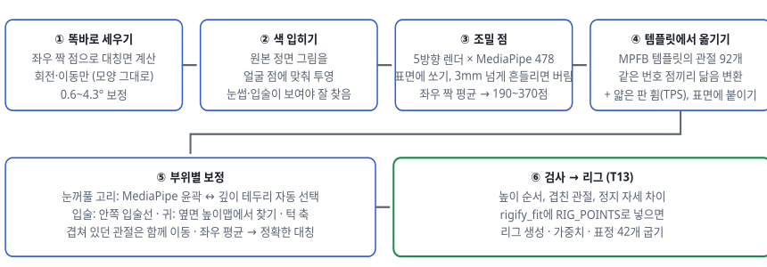

***그림 1.** 처리 순서. 이전(T13)에는 ④에서 의미 점 29쌍만 썼고, 귀·볼·이마는 그 29점으로 만든 휨에 끌려가기만 했습니다.*

## 2. 시험 얼굴 16개

여러 얼굴 형태에서 자동 배치가 버티는지 보려고 Tripo로 16개를 만들었습니다. 생성 하나에 15크레딧씩 240크레딧을 썼습니다(허용 500). 모두 대머리로 요청해 머리카락이 얼굴 점을 가리지 않게 했습니다. 7개는 전신으로 나와서 머리만 잘라 썼습니다.

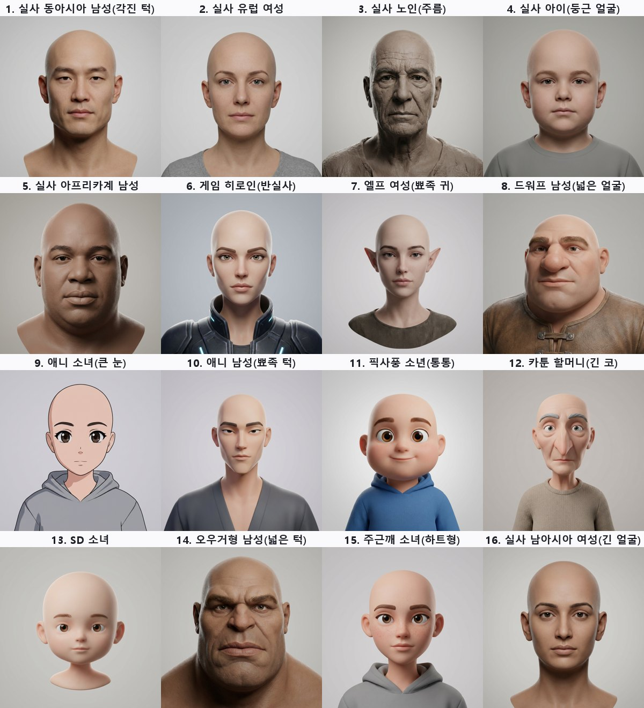

***그림 2.** 시험 얼굴 16개의 정면 원본 그림. 실사(f01~f05, f16), 세미리얼(f06, f15), 판타지(f07 엘프, f08 드워프, f14 오거), 애니(f09, f10), 픽사풍(f11), 카툰(f12), SD(f13).*

## 3. 조밀 점 찾기

1. **똑바로 세우기**: Tripo 머리는 몇 도 돌아 나오기도 합니다. 정면 렌더에서 MediaPipe 점을 찾아 메쉬에 쏘고, 좌우 짝 점(번호로 정한 219쌍)의 차이 방향으로 대칭면을 구해 그 면이 x = 0이 되게 돌립니다. 두 번 반복합니다. 모양은 바꾸지 않습니다.

2. **색 입히기**: 시험 머리에는 텍스처가 없어서 원본 정면 그림을 투영했습니다. 회색 머리보다 눈썹·입술 위치를 훨씬 잘 찾습니다.

3. **5방향 측정**: 정면, 좌우 10°, 위아래 5°로 렌더해 각각 478점을 찾고 표면에 쏩니다. 점마다 5개의 중앙값을 쓰고, 방향에 따라 3mm 넘게 흔들리면 버립니다.

4. **눈 점 검사**: 만화 눈에서는 MediaPipe가 큰 눈 안에 사람 크기 눈을 그립니다. 눈 점이 깊이로 찾은 눈 테두리에서 2mm 넘게 떨어지면 조밀 점에서 뺍니다(눈꺼풀은 5장에서 따로 정함).

5. **대칭**: 짝 점을 평균 내고 다시 표면에 붙입니다. 가운데 점은 x = 0에 둡니다.

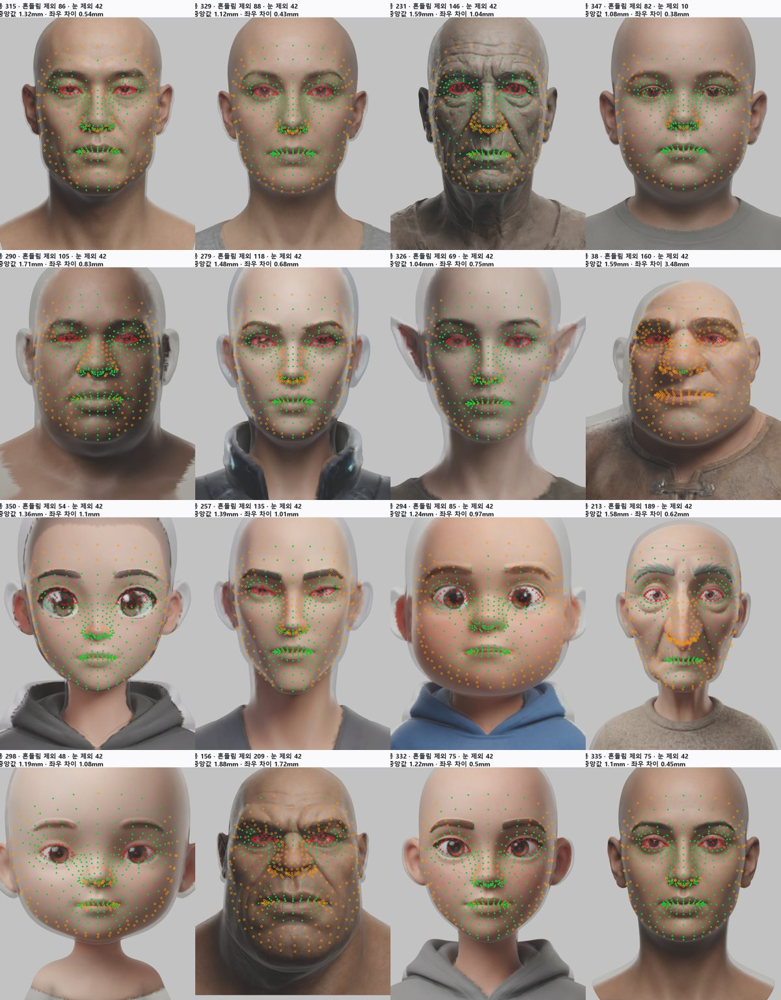

***그림 3.** 16개 얼굴에서 남은 조밀 점. 주름이 깊은 f03·f12, 과장된 f08·f14는 흔들리는 점이 많아 190~230개만 남고, 매끈한 얼굴은 330~370개가 남습니다.*

## 4. 템플릿에서 옮기기, 그리고 정확도

CC0 MPFB 머리 템플릿에 Rigify 얼굴 관절 92개를 한 번 맞춰 두었습니다. 템플릿에서도 같은 MediaPipe 점을 찾아 두었기 때문에, 새 머리와는 같은 번호끼리 짝이 생깁니다. 이 짝으로 먼저 크기·회전·위치를 맞추고, 남은 차이는 얇은 판 휨(TPS)으로 공간을 부드럽게 휘어서 관절을 옮깁니다. 피부 관절은 표면에 붙입니다.

**정확도 측정**: 각 머리에서 조밀 점 일부를 숨기고, 나머지로 만든 휨이 숨긴 점을 얼마나 맞히는지 쟀습니다. 관절은 점 사이에 놓이므로, 점 사이를 얼마나 잘 따라가는지가 곧 관절 위치의 정확도입니다.

- **이전 방식**: 의미 점 28개(눈 윤곽 16, 눈썹 6, 코끝, 입꼬리 2, 입술 가운데 2, 턱 끝)로 휨을 만들고 나머지 점 전부를 예측합니다.

- **새 방식**: 점을 5묶음으로 나눠, 4묶음으로 휨을 만들고 남은 1묶음을 예측합니다(5겹 교차 검증).

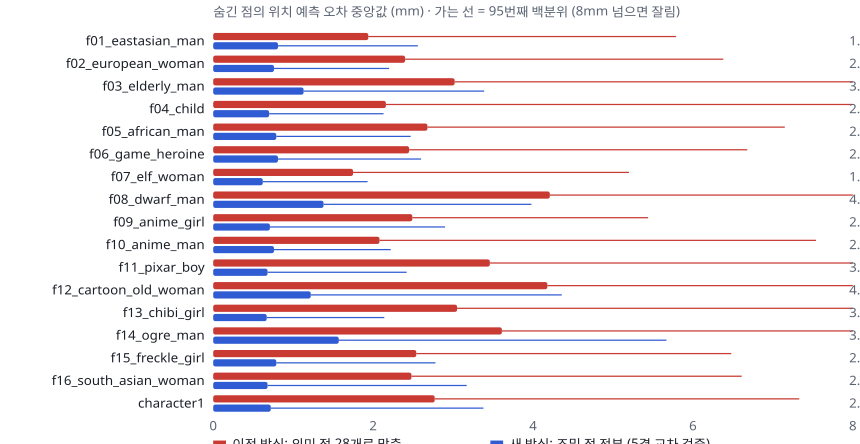

***그림 4.** 숨긴 점 예측 오차. 굵은 막대는 중앙값, 가는 선은 95번째 백분위까지입니다(8mm에서 자름). 오른쪽 숫자는 이전 → 새 중앙값(mm)입니다. 17개 머리의 중앙값은 2.5mm → 0.76mm입니다. 이전 방식은 볼·턱선·이마처럼 의미 점에서 먼 곳에서 크게 틀렸습니다(드워프 f08 최대 17mm, 오거 f14 15mm).*

## 5. 부위별 보정

### 눈꺼풀 고리 (눈마다 8점)

후보가 두 개이고, 각각 맞는 눈이 다릅니다.

| 후보 | 잘 맞는 눈 | 틀리는 경우 |
|---|---|---|
| MediaPipe 눈 윤곽 | 사람 눈 (가늘고 긴 눈) | 큰 만화 눈 안에 작은 사람 눈을 그리거나 V자로 꺾임 |
| 깊이로 찾은 눈 테두리 (눈 주변에서 처음 깊이가 꺾이는 곳) | 큰 만화 눈, 잘린 눈 구멍 | 조각된 사람 눈에서 눈 밑 주름까지 떠돎 |

자동 선택 규칙입니다(두 눈은 같은 쪽을 씁니다).

1. 쓸 수 있는 고리: 볼록하고, 가로/세로 비율이 1.2~6이어야 합니다. 깊이 테두리는 눈썹보다 아래에 있어야 하고, 20% 넓혔을 때 MediaPipe 눈의 60% 이상을 품어야 합니다.

2. MediaPipe 눈의 가로/세로 비율이 2.6 이상이면 사람 눈으로 보고 MediaPipe를 씁니다.

3. 그렇지 않고 깊이 테두리가 MediaPipe 눈보다 1.6배 이상 넓으면 만화 눈으로 보고 깊이 테두리를 씁니다.

4. 둘 다 아니면 쓸 수 있는 쪽을 쓰고, 둘 다 못 쓰면 템플릿에서 옮긴 고리를 씁니다.

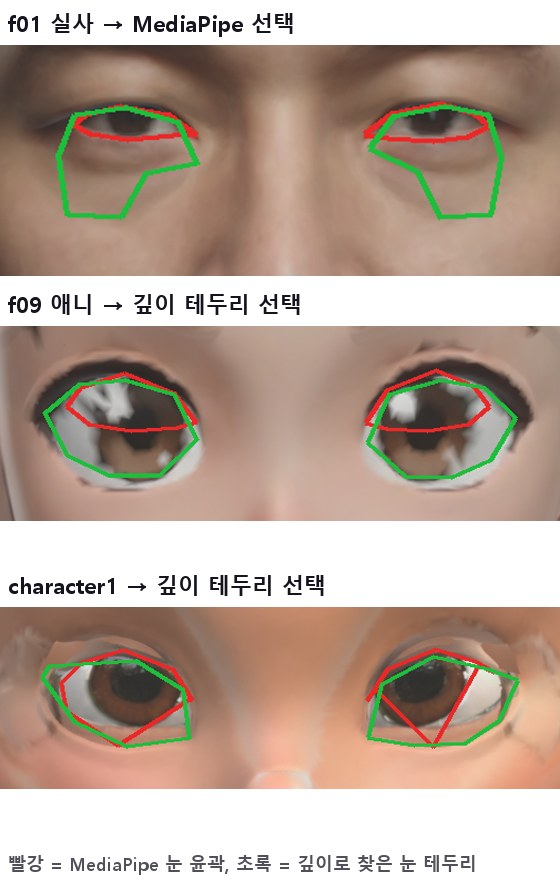

***그림 5.** 빨강 MediaPipe, 초록 깊이 테두리. f01은 깊이 테두리가 눈 밑 주름까지 내려가서 MediaPipe를 골랐습니다. f09는 MediaPipe가 큰 눈 안에 작은 눈을 그려 깊이 테두리를 골랐습니다. character1은 MediaPipe가 V자로 꺾이고, 깊이 테두리가 실제 눈 절단선과 거의 겹칩니다.*

### 입술, 턱, 대칭, 겹친 관절

- **입술**: 입꼬리는 안쪽 입술선의 끝(MediaPipe 78/308)에, 윗·아랫입술 가운데는 입술선(13/14)의 3.5mm 위·아래에 놓습니다.

- **턱 축**: 템플릿의 입 벌림(jawOpen) 모양에서 회전축을 풀어 두고, 그 축을 관절처럼 옮깁니다.

- **겹친 관절**: 메타리그에서 한 점을 여러 뼈가 같이 씁니다. 예를 들어 입꼬리는 윗입술·아랫입술·턱 옆·볼 아래, 4개 뼈의 끝입니다. 한 뼈만 옮기면 나머지 뼈가 쉬는 자세에서도 돌아갑니다. 그래서 보정한 끝을 같은 점을 쓰던 다른 끝에도 똑같이 적용합니다.

- **대칭**: 왼쪽·오른쪽 관절을 거울로 평균 내고, 가운데 관절은 x = 0에 둡니다.

### 귀

MediaPipe 점은 귀 앞에서 끝나서, 휨만으로는 귀 관절이 귀보다 약 2cm 앞(관자놀이)에 떨어졌습니다. 그래서 귀를 직접 찾습니다.

1. 눈꼬리 뒤부터 머리 옆을 옆쪽 광선으로 찍어 높이맵을 만듭니다(어떤 메쉬 밀도에서도 됨).

2. 그 높이맵을 얼굴 높이의 35% 크기 사각형으로 깎아(열림 연산) 머리통만 남깁니다.

3. 원래 맵과 깎은 맵의 차이가 얼굴 높이의 3.5%를 넘는 덩어리 중 가장 강한 것을 귀로 고릅니다. 아래 경계에 닿는 덩어리(어깨, 옷깃)는 버립니다.

4. 메타리그의 귀 고리 5점을 귀 상자 안에 비율대로 놓고, 귀 표면에 붙입니다.

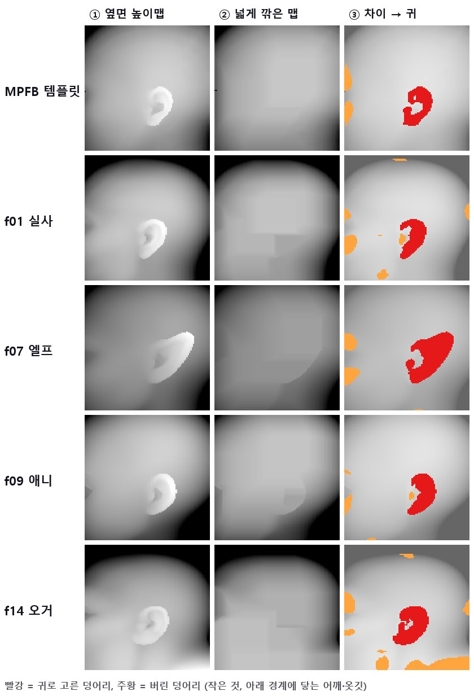

***그림 6.** 귀 찾기. 템플릿, 사람, 뾰족한 엘프 귀, 애니, 오거 모두 귀 덩어리 하나가 잡힙니다. 처음에는 아래 범위를 턱 끝까지 잡아서 후드·어깨가 있는 4개(f06, f08, f09, f11)에서 어깨를 귀로 골랐습니다. 아래 범위를 입 높이로 올리고, 아래 경계에 닿는 덩어리를 버려서 해결했습니다. 찾은 귀 높이는 55~69mm, 엘프는 68~69mm입니다.*

## 6. 16개 얼굴 결과

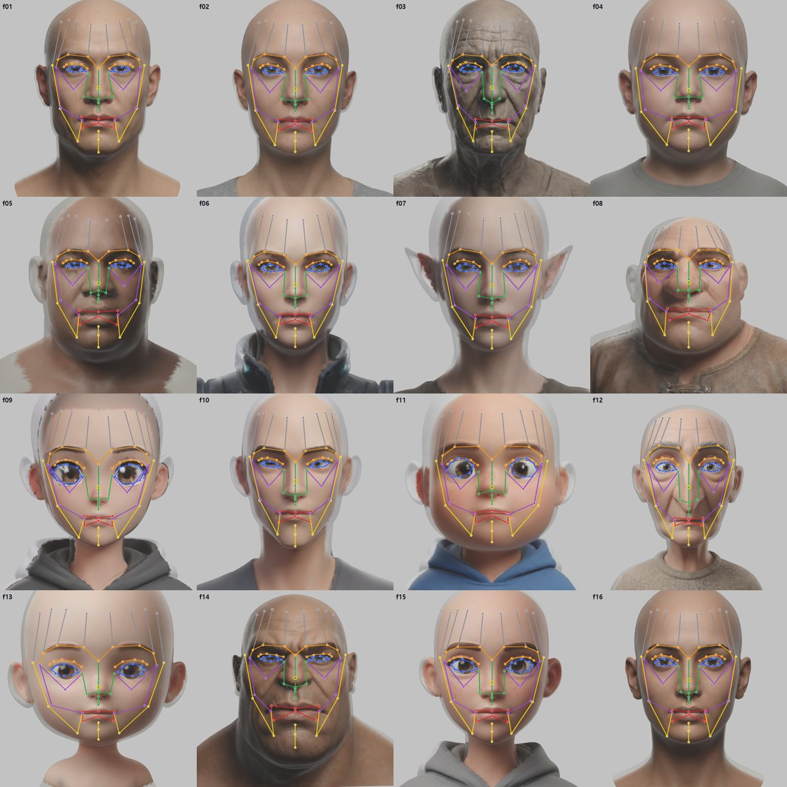

***그림 7.** 정면. 파랑 눈꺼풀, 주황 눈썹, 빨강 입술, 초록 코, 보라 볼, 노랑 턱, 회색 이마. 큰 눈(f09, f11)은 눈 테두리 전체를, 가는 눈은 눈꺼풀 선을 따라갑니다.*

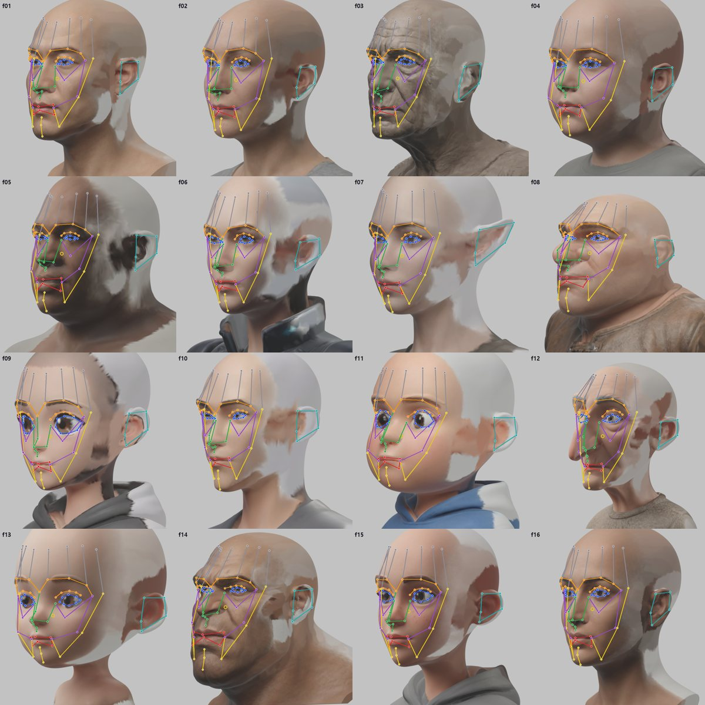

***그림 8.** 3/4 뷰. 모든 관절이 표면 위에 있고, 귀 고리(청록)가 실제 귀 위에 놓입니다. 머리 뒤쪽 흰 부분은 정면 그림 한 장으로 색을 입혀 생긴 빈 곳입니다(관절 배치와는 무관).*

| 얼굴 | 조밀 점 | 흔들림 중앙값 | 대칭 강제 전 좌우 차이 | 기울기 보정 | 눈꺼풀 고리 | 귀 높이 | 숨긴 점 오차 (이전 → 새) | 순서 |
|---|---|---|---|---|---|---|---|---|
| f01 동아시아 남성 | 335 | 1.31mm | 1.22mm | 0.8° | MediaPipe | 60mm | 1.94 → 0.81mm | 통과 |
| f02 유럽 여성 | 326 | 1.03mm | 0.92mm | 1.0° | MediaPipe | 61mm | 2.40 → 0.76mm | 통과 |
| f03 노인 남성 | 228 | 1.59mm | 4.78mm | 4.2° | MediaPipe | 67mm | 3.02 → 1.13mm | 통과 |
| f04 아이 | 342 | 1.04mm | 0.86mm | 1.0° | MediaPipe | 59mm | 2.16 → 0.70mm | 통과 |
| f05 아프리카계 남성 | 293 | 1.72mm | 1.04mm | 1.8° | MediaPipe | 64mm | 2.68 → 0.79mm | 통과 |
| f06 게임 여주인공 | 316 | 1.49mm | 1.42mm | 2.4° | MediaPipe | 57mm | 2.45 → 0.81mm | 통과 |
| f07 엘프 여성 | 342 | 1.02mm | 1.84mm | 1.8° | MediaPipe | 68mm | 1.75 → 0.62mm | 통과 |
| f08 드워프 | 215 | 1.75mm | 10.64mm | 1.7° | MediaPipe | 62mm | 4.21 → 1.38mm | 통과 |
| f09 애니 소녀 | 367 | 1.29mm | 1.88mm | 1.4° | **깊이 테두리** | 57mm | 2.49 → 0.71mm | 통과 |
| f10 애니 남성 | 288 | 1.35mm | 2.23mm | 1.0° | MediaPipe | 57mm | 2.08 → 0.76mm | 통과 |
| f11 픽사풍 소년 | 308 | 1.37mm | 2.75mm | 1.2° | **깊이 테두리** | 59mm | 3.46 → 0.68mm | 통과 |
| f12 카툰 할머니 | 219 | 1.57mm | 1.34mm | 2.4° | MediaPipe | 58mm | 4.18 → 1.22mm | 통과 |
| f13 SD 소녀 | 364 | 1.24mm | 1.59mm | 0.6° | MediaPipe | 56mm | 3.05 → 0.67mm | 통과 |
| f14 오거 | 192 | 1.88mm | 2.45mm | 1.6° | MediaPipe | 69mm | 3.61 → 1.57mm | 통과 |
| f15 주근깨 소녀 | 332 | 1.32mm | 2.00mm | 1.5° | MediaPipe | 56mm | 2.54 → 0.79mm | 통과 |
| f16 남아시아 여성 | 345 | 1.08mm | 0.68mm | 1.0° | MediaPipe | 59mm | 2.48 → 0.68mm | 통과 |
| **character1 v3** | 280 | 1.88mm | 1.38mm | — | **깊이 테두리** | 63mm | 2.77 → 0.72mm | 통과 |

좌우 차이는 대칭을 강제하기 전 짝 점의 거울 거리입니다. 드워프 f08(10.6mm)과 노인 f03(4.8mm)은 Tripo가 만든 얼굴 자체가 비대칭이고, 관절은 평균으로 대칭이 됩니다.

## 7. character1에 적용

`rigify_fit.py`에 `RIG_POINTS`로 이 결과를 넣었습니다. 얼굴 관절 92개는 새 배치를 쓰고, 이미 잘라 둔 눈 구멍(눈꺼풀 고리), 눈알, 턱 축, 이, 혀는 T1·T2 부품에서 그대로 가져옵니다. 표정은 템플릿 크기 그대로(1.0배) 구웠습니다.

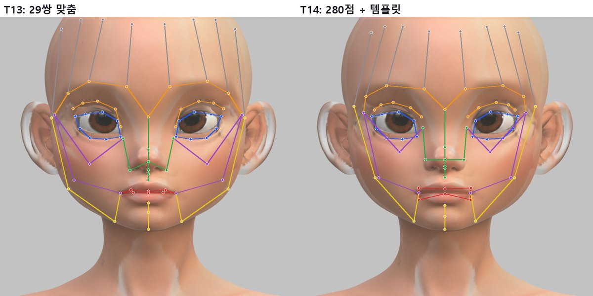

***그림 9.** character1 최종 관절. 이전에는 코 날개 관절이 눈 안쪽 아래까지 벌어졌고, 볼·턱선이 의미 점에 끌려 비뚤었습니다. 새 배치는 코 관절이 콧방울에, 입꼬리가 입술 끝에 놓이고, 눈꺼풀은 두 리그 모두 실제 눈 절단선(T1)을 씁니다.*

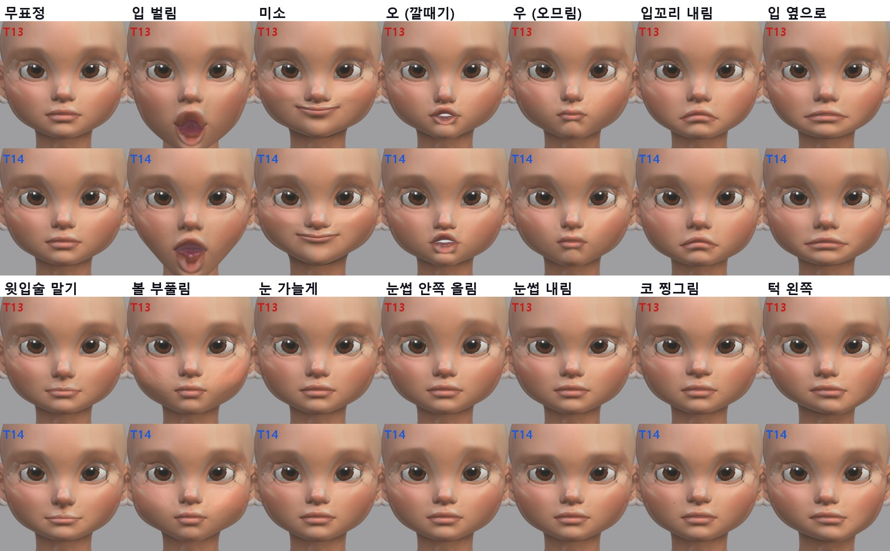

***그림 10.** 표정 14개, 원본 텍스처(위 T13, 아래 T14). 입 벌림이 O자로 오므라들던 것이 옆으로 자연스럽게 벌어지고, 웃음이 입꼬리에서 올라갑니다. 눈 감기는 두 리그 모두 T1 눈꺼풀 부품이 맡아서 이 비교에서 빼고 "눈 가늘게"로 바꿨습니다.*

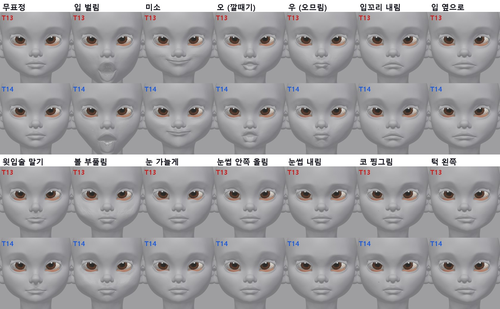

***그림 11.** 같은 표정의 회색 렌더(모양만 보기). 이전 리그의 웃음에 생기던 볼의 깊은 주름, 볼 부풀림의 울퉁불퉁함, 오므리기의 턱 움푹 패임이 줄었습니다.*

| 검사 (표정 42개) | T13 (29쌍) | T14 (조밀 점) |
|---|---|---|
| 쉬는 자세 원본 차이 | 0.0002mm | 0.0002mm |
| 뒤집힌 면 합계 | 497 | 330 |
| 10개 넘는 표정 | mouthClose 298, mouthRollUpper 75, jawOpen 64, mouthSmileRight 18 | mouthClose 159, jawOpen 64, mouthFunnel 38, mouthRollUpper 17, mouthSmileRight 16 |
| 조종 뼈 목표 오차 (중앙값 / 최대) | 0.52 / 3.23mm | 0.42 / 2.72mm |
| 좌우 대칭 (거울 비교 95%, 움직임 대비) | 2.0~56% | 2.1~59% (eyeWide만 큼, 이전과 같음) |
| 가중치 없는 점 | 0 | 0 |

## 8. 막힌 것과 해결

- **사람 눈에서 깊이 테두리가 떠돎**(f01): 눈 밑 주름까지 내려가 세로로 긴 고리가 됐습니다. MediaPipe 눈이 가늘면(비율 2.6 이상) MediaPipe를 먼저 쓰게 했습니다.

- **MediaPipe 눈이 너무 가늘어 탈락**(f05, 비율 5.15): 허용 비율을 5에서 6으로 넓혔습니다.

- **character1의 깊이 테두리 탈락**: 깊이 테두리와 MediaPipe 눈의 크기가 비슷해서 "품는가" 검사가 경계에서 12%만 통과했습니다. 깊이 테두리를 20% 넓혀서 검사하게 했습니다.

- **귀가 어깨로 잡힘**(4개): 6장 그림 6 설명 참고.

- **템플릿에서 귀를 못 찾음**: 템플릿 메쉬가 4,308점밖에 안 돼 점 기반 높이맵에 구멍이 났습니다. 옆쪽 광선 방식으로 바꿨습니다.

- **쉬는 자세에서 2.25mm 움직임**: 입꼬리 관절을 윗·아랫입술 뼈에만 옮겨서, 같은 점을 쓰던 턱 옆 뼈(chin.L/R)가 쉬는 자세에서도 크게 돌아 있었습니다. 겹친 관절을 함께 옮기게 하자 0.0002mm로 돌아왔습니다.

- **여러 개를 동시에 렌더하다 Blender가 멈춤**(f04 한 번): 동시 실행을 4개에서 3개로 줄이고 다시 돌렸습니다.

## 9. 평가

| 잘 되는 것 | 부족한 것 |
|---|---|
| 16가지 얼굴 형태에서 사람 손 없이 관절 92개 배치 맞추는 점 29 → 190~370개, 위치 오차 약 3배 감소 눈 종류(사람 / 만화)를 스스로 판단 귀를 직접 찾음 (뾰족 귀 포함) 정확한 좌우 대칭, 원본 모양 유지 character1 리그와 바로 이어짐, 표정 품질도 좋아짐 | 시험 머리 16개는 아직 눈·입을 자르지 않아 표정까지는 못 봄 주름이 깊거나 과장된 얼굴은 조밀 점이 190~230개로 적음 mouthFunnel 뒤집힌 면 증가(9 → 38, 입술 경계) 눈썹 그림이 없는 머리에서는 눈썹 점이 약함 관절 수는 Rigify 표준 92개 그대로 (더 촘촘한 입술·볼 뼈는 아직 없음) |

## 10. 다음 단계

- **시험 머리 16개를 끝까지**: 눈·입 자르기(T1·T2)를 자동으로 돌리고, 같은 리그·표정 굽기로 16개의 표정 시트를 만듭니다. 그래야 "어떤 얼굴이든"이 표정까지 증명됩니다.

- **T15 표정 이미지로 애니메이션**: 표정별 여러 방향 이미지에서 MediaPipe 점을 찾고, 그 점에 맞도록 조종 뼈 값을 역으로 풉니다. 이번에 만든 조밀 점과 템플릿 짝이 그대로 쓰입니다.

- **관절 수 늘리기 (선택)**: 입술·볼을 더 촘촘히 움직이고 싶으면 Rigify의 새 얼굴 체인(뼈 줄 수 자유)으로 입술 고리와 볼 뼈를 추가할 수 있습니다.

- **다른 도구와 비교**: Faceit(구매 후), OmniFaceRig·RigAnyFace(코드 공개 시)를 같은 16개 얼굴로 비교합니다.

- **Blender–Tripo 플러그인**: 연결되면 시험 얼굴·표정 스캔을 Blender 안에서 바로 받아 이 흐름에 넣습니다.

## 11. 파일

- `tools/face_auto/sym_align.py`: 대칭면으로 똑바로 세우기

- `tools/face_auto/texture_front.py`: 정면 그림으로 시험 머리 색 입히기

- `tools/face_auto/dense_landmarks.py`: 5방향 MediaPipe 조밀 점, 흔들림 필터, 좌우 짝 대칭

- `tools/face_auto/rig_points.py`: 템플릿 모드(관절 92개를 MPFB에 한 번 맞춤, 턱 축, 귀), 머리 모드(옮기기, 눈꺼풀 선택, 입술, 귀, 겹친 관절, 대칭, 검사 렌더)

- `tools/face_auto/data/mp_mirror_pairs.json`, `data/rig_template.json`: 좌우 짝 표, 템플릿 관절·점·귀 고리·겹친 관절

- `tools/face_auto/rigify_fit.py`: `RIG_POINTS=<json>`로 새 배치 사용, 겹친 관절 함께 이동

- 결과(임시 폴더 `t14/`): `rig/`(16개 관절·렌더), `c1/`(character1 리그·표정·텍스처), `holdout.json`(정확도)
