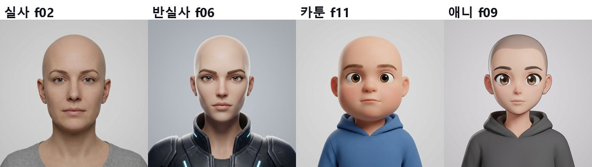
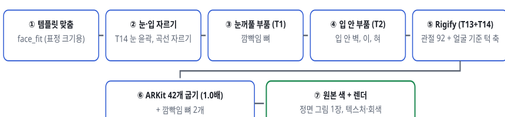
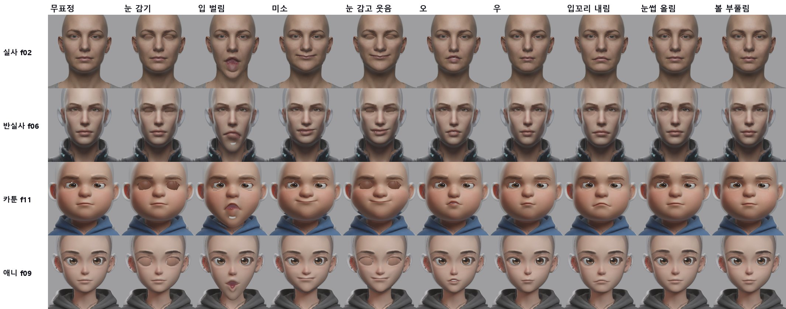
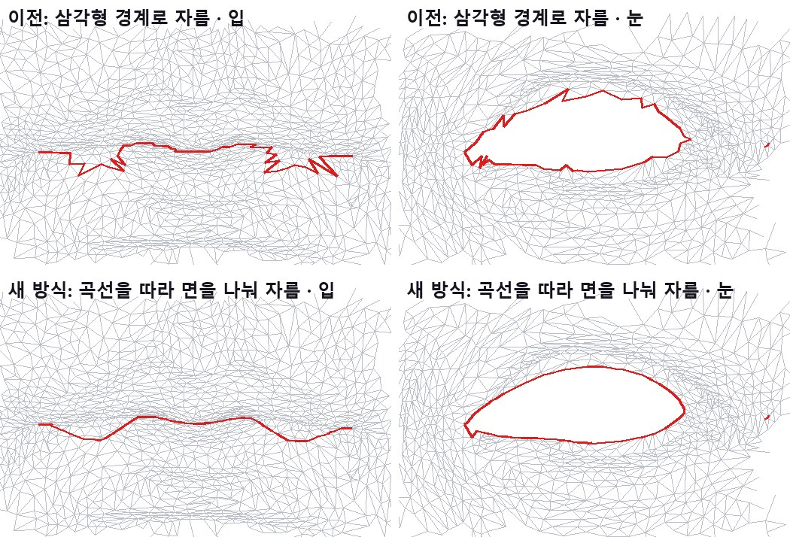
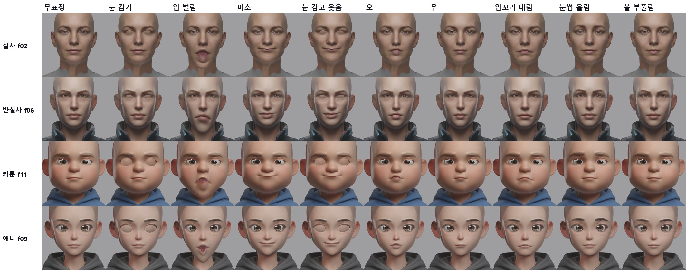
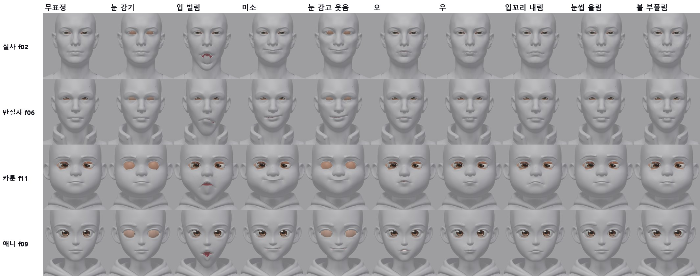
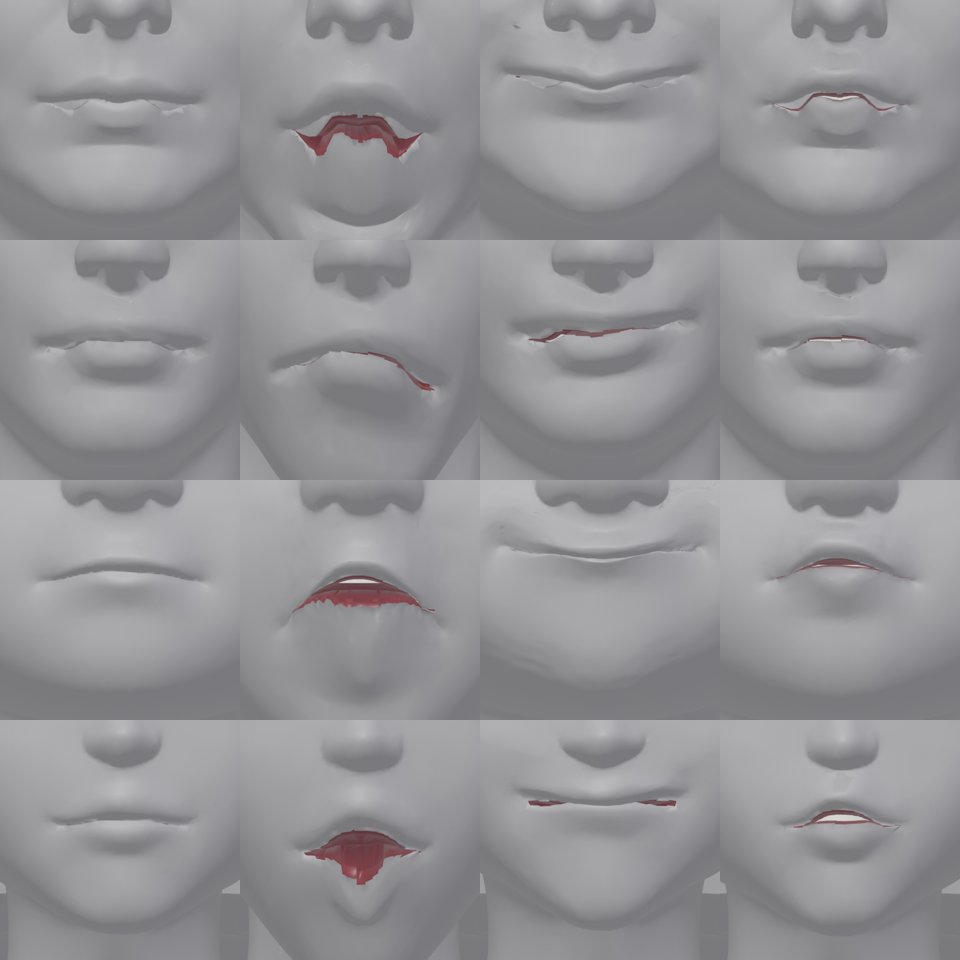

> GitHub에서 읽기 쉽게 [index.html](index.html)을 옮긴 사본입니다. 원본(HTML)을 내려받아 브라우저로 열면 원래 모양으로 보입니다.

# T14b · 4가지 스타일로 끝까지 (실사 · 반실사 · 카툰 · 애니)

2026-10-12 · T14 시험 얼굴 중 스타일별 1개씩 · 자르기 → 눈꺼풀·입 부품 → Rigify(T14 관절) → ARKit 42개(1.0배) → 원본 색 · 크레딧 사용 없음

> **결론**

> - **4가지 스타일 모두 사람 손 없이 끝까지 돕니다.** 한 머리에 약 7분입니다. 원본과의 차이는 0.0004mm 이하이고, 원래 꼭짓점은 하나도 빠지거나 움직이지 않습니다.

> - **4개 모두 잘 보이는 것**: 눈 깜빡임, 미소, 눈 감고 웃음, 입꼬리 내림. 오·우·볼 부풀림·눈썹 올림도 움직이지만 작게 보입니다.

> **이번 회차에 고친 것 4가지**

>   1. 눈 자르기에 T14 눈 윤곽을 연결했습니다(사람 눈은 MediaPipe). f06에서 실패하던 것과 f02의 짝짝이 눈이 해결됐습니다.

>   2. 눈과 입을 지그재그가 아닌 매끈한 곡선으로 자릅니다. 원본 표면 위에 새 꼭짓점을 넣는 방식입니다.

>   3. 턱 회전축을 얼굴 점에서 구합니다. 아랫니가 턱 밖으로 나오던 문제가 해결됐습니다.

>   4. 정면 그림 한 장으로 색을 입혀도 헬멧 같은 회색 테두리, 옷 색 번짐, 갈색 눈꺼풀이 생기지 않습니다.

> - **남은 큰 문제는 입 안입니다.** 입을 크게 벌리면 입 안 벽(T2 부품)이 구겨져 보이고 입술 안쪽이 너덜거립니다. 특히 실사 f02와 카툰 f11에서 심합니다. 반실사 f06은 입이 작게 벌어집니다.

## 1. 고른 4개와 순서

***그림 1.** 스타일별 1개씩입니다. 실사는 사람 눈, 반실사는 우리 게임에 가까운 스타일, 카툰과 애니는 큰 눈(눈꺼풀을 깊이 테두리로 찾는 쪽)입니다. 이 4개가 되면 나머지도 될 것으로 봅니다.*

***그림 2.** 한 머리의 전체 흐름(약 7분, 가중치 계산이 5분). 시작은 T14에서 똑바로 세운 머리와 그 관절 배치입니다.*

## 2. 1차 결과와 찾은 문제

***그림 3.** 1차 결과(고치기 전). 흐름은 끝까지 돌았지만 아래 문제가 보였습니다.*

| 문제 | 원인 | 해결 |
|---|---|---|
| f06 눈 자르기 실패, f02 좌우 눈 구멍 크기 다름 (9mm 대 14mm) | 눈 자르기는 깊이 테두리만 써서, 사람 눈에서는 눈 밑 주름으로 새어 나감 (T14에서 본 문제) | T14가 MediaPipe를 고른 머리는 그 16점 윤곽(대칭, 표면 위)으로 자름 → f02 10.6 대 10.9mm |
| 입술선이 다물어도 찢긴 것처럼 보이고, 눈 구멍 가장자리가 들쭉날쭉함 | 곡선 근처 삼각형들의 경계를 따라 열어서 지그재그가 됨 | 곡선이 지나는 면을 먼저 곡선을 따라 나눔(새 꼭짓점은 원래 모서리 위) → 매끈한 선 (그림 4) |
| 입을 벌리면 아랫니가 턱 밖으로 나옴 (f06, f11) | 턱 축이 턱 끝과 같은 높이에 있어서, 축보다 위에 있는 이가 앞으로 돌아 나옴. 축은 템플릿을 머리 전체에 맞춘 값인데, 상반신 모델에서는 맞춤이 틀어짐(오차 95% 30mm) | 얼굴 점으로 맞춘 템플릿 축 사용 (턱 끝보다 약 10cm 위, 7cm 뒤). character1 기존 축과 1.3cm 이내 |
| 머리 옆이 투명한 헬멧처럼 보임, 관자놀이에 옷 색 번짐 | 그림 배경·림 조명이 묻음. 얼굴에서 먼 곳은 그림 휨이 옷 쪽을 가리킴. 안 보이는 곳 채우기 기준색이 옷 색 | 배경은 테두리부터 채워 찾고 가장자리 띠도 뺌. 얼굴에서 멀수록 휨을 줄임. 기준색은 볼 피부. 두피는 목·옷이 아닌 위쪽에서만 채움 |
| 감은 눈꺼풀이 갈색·흰색 반점 | 눈 위 피부를 샘플했는데 큰 눈에서는 속눈썹·눈썹이 섞임 | 볼 피부색보다 조금 어둡게 |

***그림 4.** f02 입술·왼쪽 눈의 자른 선(빨강). 위: 이전, 삼각형 경계로 자름. 아래: 새 방식, 곡선을 따라 면을 먼저 나눈 뒤 자름. 새 꼭짓점은 원래 모서리 위에 있어서 표면 모양은 그대로입니다(원본 표면과의 거리 0.00003mm 이하, 원래 꼭짓점 이동 0).*

## 3. 최종 결과

***그림 5.** 최종 결과, 원본 색. 깜빡임·미소·눈 감고 웃음·입꼬리 내림은 4개 모두 자연스럽습니다. 오·우·볼 부풀림·눈썹 올림은 원래 작은 표정이라 차이가 작게 보입니다.*

***그림 6.** 같은 표정, 회색(모양만). 감은 눈꺼풀(주황)은 부품의 바탕색입니다.*

***그림 7.** 입 확대, 회색. 위에서부터 f02, f06, f11, f09이고, 왼쪽부터 무표정 · 입 벌림 · 미소 · 오입니다. 다문 입술선은 매끈해졌습니다(f11, f09). 입 벌림에서는 입 안 벽(빨강)이 구겨져 보이고, f02 윗입술이 W자로 처집니다. f06은 입이 작게 벌어집니다. 실사 f02와 반실사 f06은 다문 상태에서도 입꼬리 끝에 작은 조각이 보입니다.*

## 4. 검사

| 항목 | 실사 f02 | 반실사 f06 | 카툰 f11 | 애니 f09 |
|---|---|---|---|---|
| 눈 자르기 기준 | MediaPipe 윤곽 | MediaPipe 윤곽 | 깊이 테두리 | 깊이 테두리 |
| 곡선으로 나눈 면 (오른눈/왼눈/입) | 105 / 90 / 86 | 39 / 39 / 37 | 164 / 158 / 80 | 117 / 115 / 40 |
| 원본 표면과의 거리 / 원래 꼭짓점 이동 | 0.00001 / 0mm | 0.00003 / 0mm | 0.00002 / 0mm | 0.00002 / 0mm |
| 뜬 눈 틈 왼/오른 | 10.6 / 10.9mm | 11.5 / 10.3mm | 30.3 / 30.7mm | 27.3 / 27.9mm |
| 눈 감기: 눈 덮임 / 눈알 뚫음 | 100% / 0 | 100% / 0 | 100% / 0 | 100% / 0 |
| 쉬는 상태 눈꺼풀 부품 노출 (왼/오른) | 14 / 18% | 2 / 2% | 0 / 15% | 0 / 0% |
| 리그 쉬는 자세 차이 | 0.0003mm | 0.0004mm | 0.0002mm | 0.0002mm |
| 표정 42개 뒤집힌 면 합계 (가장 큰 것) | 525 (mouthClose 248) | 190 (mouthClose 25) | 785 (mouthClose 263, jawOpen 111) | 466 (mouthClose 103) |

## 5. 남은 문제와 다음 단계

1. **입 안 (가장 큼)**: T2 입 안 벽이 입술 가장자리에서 3mm 뒤로 곧게 들어간 뒤 주머니로 이어집니다. 크게 벌리면 그 벽이 구겨져 보입니다. 벽을 입술 안쪽 곡면으로 다시 만들고, 턱을 따라가는 비율을 위·아래로 나누는 것이 다음 할 일입니다. 실사 f02의 W자 윗입술과 mouthClose의 뒤집힌 면도 같은 곳입니다.

2. **f06 입이 작게 벌어짐**: 아랫입술의 턱 영향이 약합니다. 가중치를 확인합니다.

3. **쉬는 상태 눈꺼풀 부품 노출** (f02, f11 한쪽): 부품이 윗눈꺼풀 밑으로 덜 들어갑니다. T1 부품 위치를 눈마다 조정합니다.

4. **입꼬리 끝 작은 조각** (f02, f06): 자른 선 끝부분 처리입니다.

## 6. 파일

- `tools/face_auto/rig_original.py`: 곡선 자르기(면을 먼저 나눈 뒤 열기), `EYE_RIMS`로 T14 눈 윤곽 사용, 원본 표면 검사

- `tools/face_auto/rig_points.py`: 사람 눈일 때 눈 윤곽 전체(64점)를 함께 저장, 턱 축은 닮음 변환으로

- `tools/face_auto/rigify_fit.py`: `RIG_POINTS`를 쓸 때 턱 축도 그 파일에서

- `tools/face_auto/project_texture.py`: 옆·뒤 그림 없어도 동작, 배경·가장자리 빼기, 얼굴에서 먼 곳은 휨 줄이기, 두피 채우기, 눈꺼풀 색

- 결과(임시 폴더 `s4/`): 머리마다 `fit, rig, t1, t2, rfit, bake, tex.blend`, 실행 스크립트 `chain.sh`
