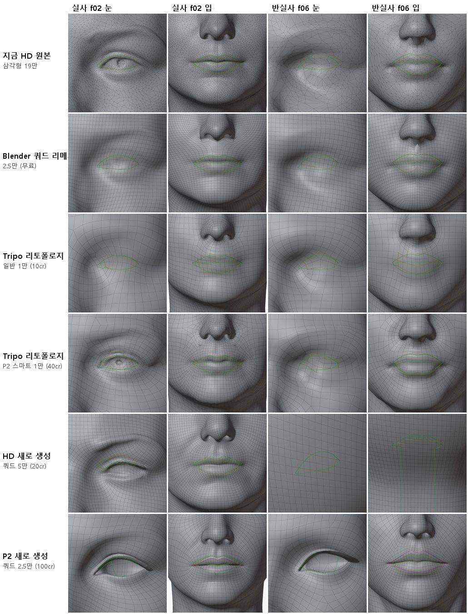
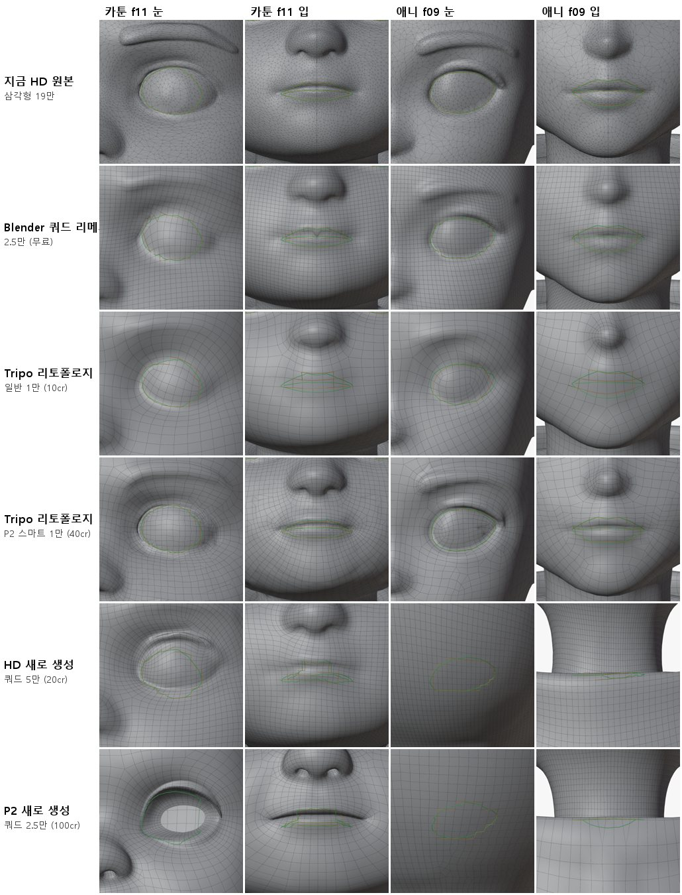
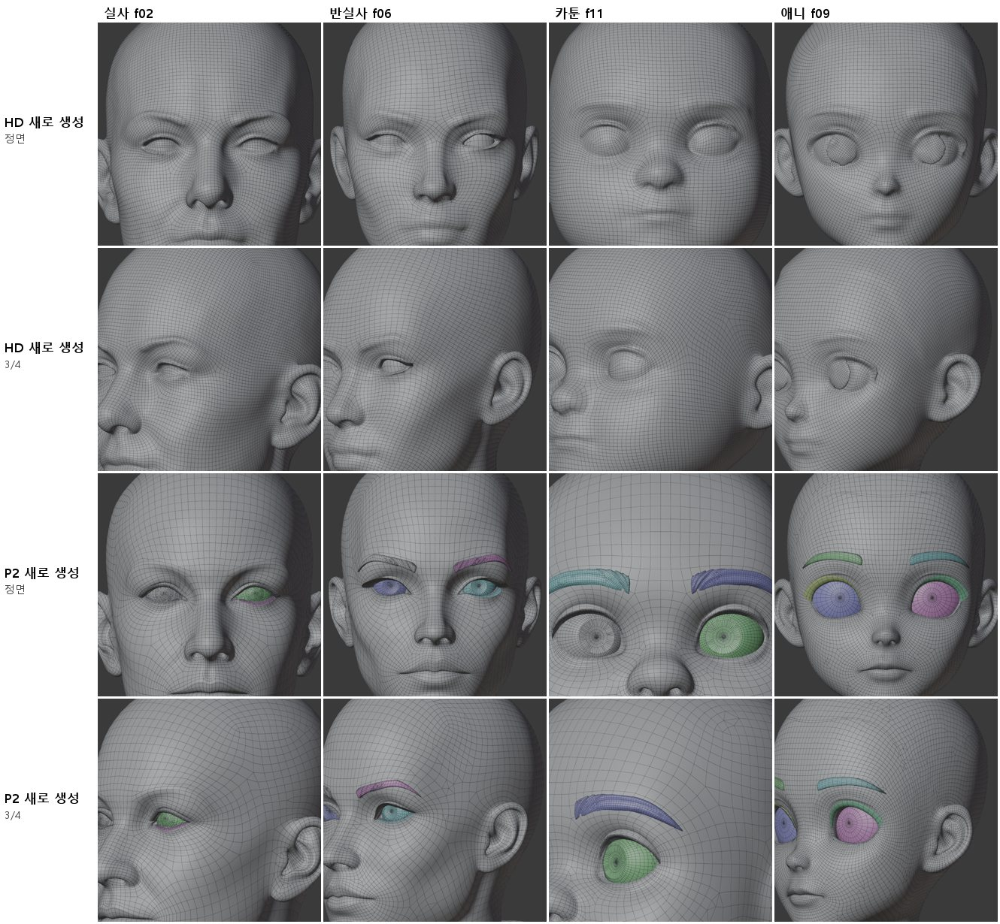

> GitHub에서 읽기 쉽게 [index.html](index.html)을 옮긴 사본입니다. 원본(HTML)을 내려받아 브라우저로 열면 원래 모양으로 보입니다.

# 깨끗한 원본 비교 (쿼드 토폴로지)

2026-10-12 · 실사 f02 · 반실사 f06 · 카툰 f11 · 애니 f09 · Tripo 크레딧 970 사용 (승인 2,000, 잔액 22,165 → 21,195)

> **결론**

> - **추천: Tripo 스마트 메시 P2로 새로 생성(쿼드 2.5만, 머리당 100크레딧)한 메시를 새 원본으로 쓰는 것.** 눈 구멍이 이미 뚫려 있고, 안구·눈썹·눈꺼풀·입속이 따로 나오며, 눈과 입 둘레에 동심원 고리가 있습니다. "깨끗한 원본을 뽑아 겹치고 자르기만 한다"는 방식에 그대로 맞습니다.

> - **단, 새 머리입니다.** 지금 HD 원본과 얼굴 모양이 6~9mm 다르고, 좌우 대칭이 아니며(대칭화 필요), 피부 조각에 구멍과 비다양체 모서리가 있습니다(조각 경계). 그림과 닮았는지 따로 확인해야 합니다.

> - **지금 얼굴을 그대로 지켜야 하면**: Tripo 리토폴로지 + 스마트 메시 P2(머리당 40크레딧). 모양 차이 95% 값 0.6~0.8mm로 원본을 지키고 눈 둘레가 촘촘하지만, 최대 1만 면이고 눈·입을 완전히 감싸는 고리는 생기지 않습니다.

> - **권하지 않음**: Blender 쿼드 리메시(무료)·Tripo 일반 리토폴로지는 격자가 눈·입을 가로질러 지나가고 눈 모양이 뭉개집니다. HD 새 생성 쿼드는 고른 격자일 뿐 눈이 피부에 덮여 붙어 나옵니다.

## 1. 무엇을 비교했나

사용자 지적(2026-10-12): 지금 방식은 불규칙한 삼각형 원본(약 19만 면) 위에 눈·입 고리를 새로 짜 넣으면서 일그러짐·움푹 꺼짐·불완전한 이음새가 생깁니다. 처음부터 깨끗한 폴리곤 원본을 받아 겹치고 자르기만 하는 방법을 찾기 위해, 가능한 방식을 4개 머리에 모두 돌렸습니다.

| 방식 | 입력 | 비용(머리당) | 결과 면 수 |
|---|---|---|---|
| 지금 HD 원본 | 그림 1장 → H3.1 (이전에 만든 것) | - | 삼각형 약 19만 |
| Blender 쿼드 리메시 (QuadriFlow, 대칭) | 대칭 원본, 머리만 자름 | 0 | 쿼드 2.1~2.5만 |
| Tripo 리토폴로지 일반 | 대칭 원본 머리를 올림 | 10 | 쿼드 약 0.94~0.97만 |
| Tripo 리토폴로지 + 스마트 메시 P2 | 대칭 원본 머리를 올림 | 40 | 쿼드 약 0.90~0.95만 |
| HD(H3.1) 새로 생성, 쿼드 | 4방향 그림(정면·왼쪽·오른쪽·뒤) | 20 | 쿼드 4.3~4.7만 |
| 스마트 메시 P2 새로 생성, 쿼드 | 4방향 그림 | 100 | 쿼드 2.6~2.8만 (조각 6~21개) |

Studio 화면에서 확인한 옵션: HD 모델은 토폴로지 쿼드/삼각형과 면 수(쿼드 500~5만)를 고를 수 있습니다. 스마트 메시 P2는 쿼드 500~2.5만, 생성 개수 1·2·4를 고릅니다. 리토폴로지 도구는 올린 모델을 쿼드 500~1만으로 바꾸고, 스마트 메시 P2를 켜면 40, 끄면 10크레딧입니다.

## 2. 측정

평가 도구 `tools/face_auto/topo_eval.py`(새로 만듦): 결과 메시를 원본 머리(머리만 자른 대칭 원본)에 맞춘 뒤 면 수·쿼드 비율·구멍·대칭·모양 차이와, 눈 테두리·입술 선을 따라 닫힌 고리가 있는지 잽니다. 고리 판정은 "Blender 고리 선택으로 고를 수 있는 닫힌 고리가 윤곽에서 평균 1mm·최대 2mm 안에 있는가"입니다(시험용 구에서 정확히 찾는 것을 확인).

| 방식 | 쿼드 비율 | 얼굴 모양 차이 95% | 눈 둘레 모양 차이 95% | 눈가 모서리 길이 | 눈·입 닫힌 고리 | 좌우 대칭 | 조각 |
|---|---|---|---|---|---|---|---|
| 지금 HD 원본 | 1% 미만 | 0 | 0 | 1.5~4.0mm | 없음 (삼각형) | 대칭화함 | 1 |
| Blender 쿼드 리메시 2.5만 | 100% | 0.18~0.25mm | 0.6~1.3mm | 약 3mm | 없음 (격자가 가로지름) | 정확히 대칭 | 1 |
| Tripo 리토폴로지 일반 | 100% | 0.53~0.56mm | 0.8~1.7mm | 4.1~4.4mm | 없음 | 아님 | 1 |
| Tripo 리토폴로지 + P2 | 92~95% | 0.59~0.76mm | 0.6~0.9mm | 1.7~4.3mm | 부분 (눈가 촘촘) | 아님 | 1 |
| HD 새로 생성 쿼드 | 100% | 8.2~8.7mm (새 머리) | - | 1.7~4.0mm | 없음, 눈이 피부에 덮임 | 아님 | 1 |
| P2 새로 생성 쿼드 | 88~93% | 6.8~8.7mm (새 머리) | - | 0.9~4.1mm | 입 둘레 동심원 고리 4~5개(f02·f06에서 측정), 눈 구멍이 뚫림 | 아님 | 6~21 (안구·눈썹·눈꺼풀·입속) |

새로 생성한 두 방식은 원래 원본과 다른 새 머리라서, 원래 원본의 눈·입 윤곽으로 재는 고리 수치는 참고만 됩니다(윤곽 자체가 6~9mm 어긋남). 그림 3처럼 각자 좌표계에서 직접 보는 것이 정확합니다.

***그림 1.** 눈·입 확대 와이어, 실사 f02와 반실사 f06. 위에서부터 지금 HD 원본, Blender 쿼드 리메시, Tripo 리토폴로지 일반, 리토폴로지+P2, HD 새 생성, P2 새 생성입니다. 초록은 원래 원본의 윤곽, 주황은 그 윤곽에 가장 가까운 모서리 길, 자홍은 찾은 닫힌 고리입니다. 새 생성 두 줄은 다른 머리라 칸 위치가 어긋날 수 있습니다(f06 HD 새 생성 칸은 정렬 실패).*

***그림 2.** 같은 비교, 카툰 f11과 애니 f09. 리토폴로지+P2(4번째 줄)는 원래 모양을 지키면서 눈가가 촘촘합니다. P2 새 생성(맨 아래)은 f11에서 눈 구멍이 뚫리고(흰 부분) 그 둘레를 고리가 감쌉니다. f09 새 생성 두 칸은 정렬 실패로 목이 보입니다.*

***그림 3.** 새로 생성한 메시를 정렬 없이 각자 좌표에서 본 것(조각마다 색). HD 새 생성(위 2줄)은 고른 쿼드 격자이고, 눈이 피부에 덮여 붙어 있으며 f06·f09는 눈 모양이 어색합니다. P2 새 생성(아래 2줄)은 안구(파랑·분홍·초록), 눈썹, 눈꺼풀이 따로 나오고 눈 둘레를 고리가 감쌉니다. f02는 한쪽 안구만 따로 나왔습니다.*

## 3. 크레딧과 실수

| 항목 | 건수 | 크레딧 |
|---|---|---|
| 리토폴로지 일반 (머리 4 + 처음 올린 f02 상반신 1) | 5 | 50 |
| 리토폴로지 + 스마트 메시 P2 | 4 | 160 |
| HD 새로 생성 쿼드 (올바른 4 + 잘못된 4) | 8 | 160 |
| P2 새로 생성 쿼드 (올바른 4 + 잘못된 2) | 6 | 600 |
| **합계** | 23 | **970** (잘못된 것 280 포함) |

**실수**: 4방향 입력 칸의 화면 순서가 왼쪽·**오른쪽**·뒷면인데 왼쪽·뒷면·오른쪽 순서로 넣어, 처음 HD 4건과 P2 2건은 오른쪽과 뒷면 그림이 바뀐 채 생성됐습니다(280크레딧). 칸의 이름표를 화면에서 읽어 확인한 뒤 모두 올바른 순서로 다시 생성했고, 바뀐 결과는 비교에서 뺐습니다. 또 f06 원본이 전신이라 처음에 상반신째 올리려다 취소하고, 4개 모두 턱 아래 8cm까지 머리만 잘라 올렸습니다.

## 4. 다음 단계 (P2 새 원본을 고를 경우)

1. P2 결과가 그림과 닮았는지 확인(정면 그림과 겹쳐 보기, 기준점 비교).

2. 좌우 대칭화: 왼쪽 반의 고리 구조를 거울 복사해 고리를 유지한 채 대칭으로(지금 `sym_mirror.py` 방식, 면 방향·가운데 선 처리 수정판).

3. 눈: 이미 뚫린 눈 구멍과 따로 나온 안구·눈꺼풀을 그대로 씀. 눈꺼풀 가장자리 고리를 감기 계산(`ring_blink`)의 고리로 지정.

4. 입: 입술 둘레 고리 중 입술 틈 고리를 골라 그 선만 잘라 위·아래 입술을 나눔. 입속·이·혀는 P2 조각 또는 새 이·잇몸·혀(`organ_teeth.py` v2)를 씀.

5. 리그: 촘촘한 리그(뼈 129개, 눈꺼풀·입술 관절을 고리 위에) → 표정 42개 + 눈 감기 + 눈 굴리기 8개.

## 5. 파일

- 평가 도구: `tools/face_auto/topo_eval.py`. 결과: 임시 폴더 `m1/topo/eval/<방식>/<머리>/topo_qa.json`와 와이어 그림, 표 `m1/topo/table.md`.

- 받은 메시 16개: `m1/topo/dl/` (FBX, 18MB). Tripo 에셋에도 남아 있습니다.
