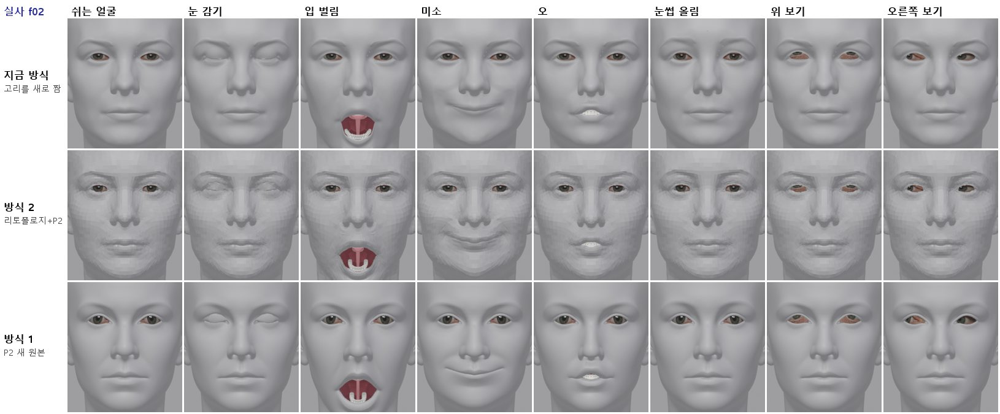
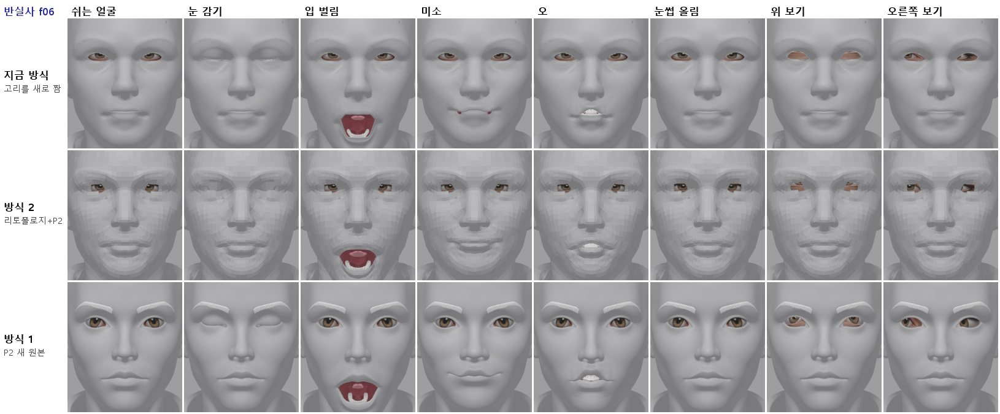
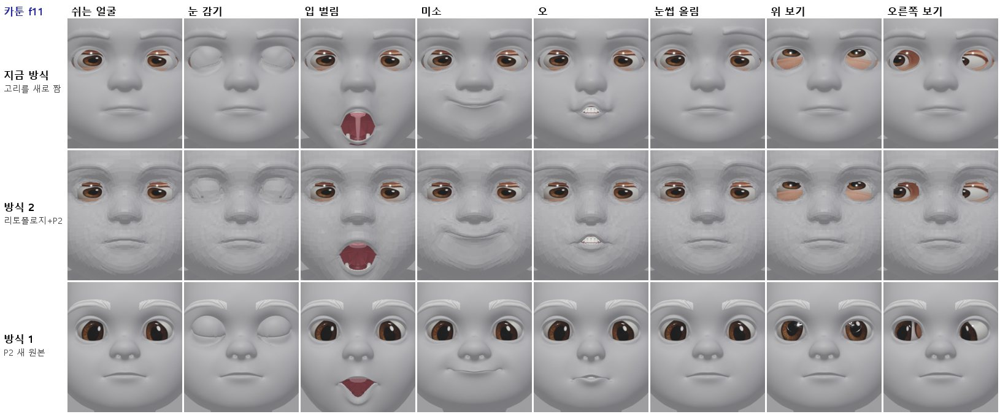
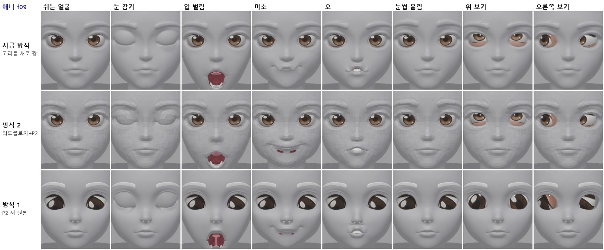
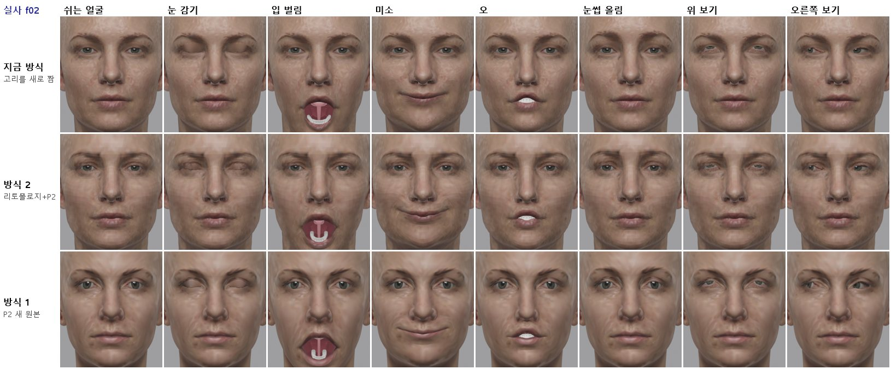
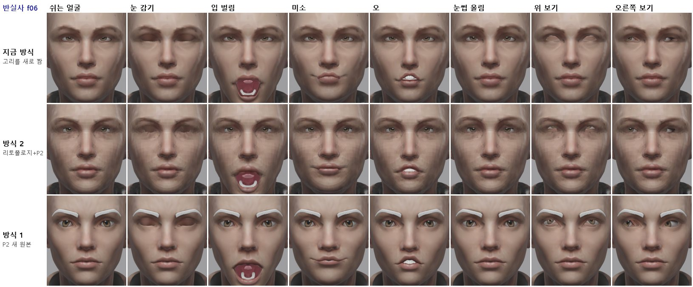
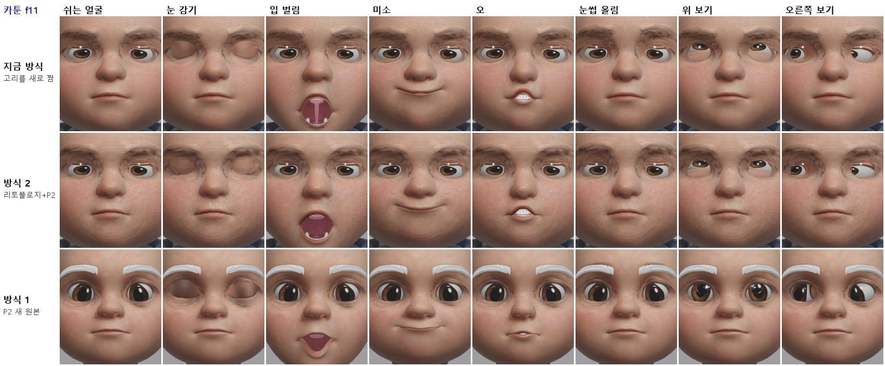
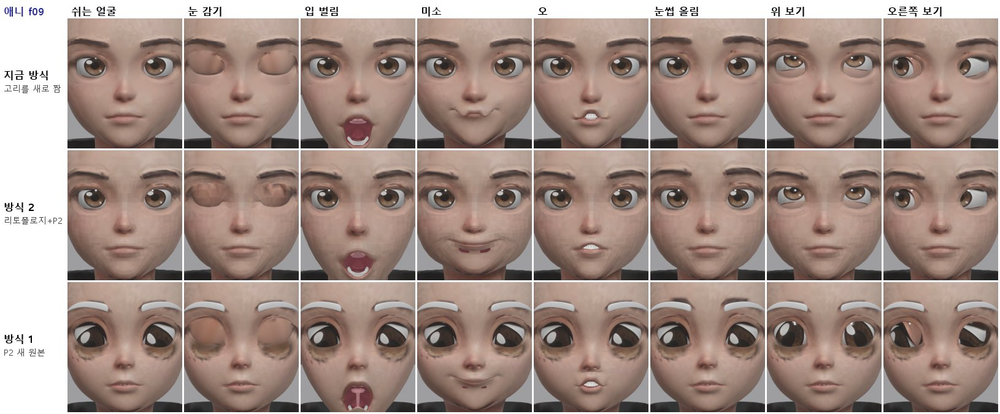
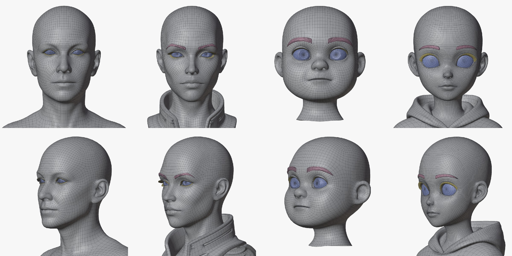
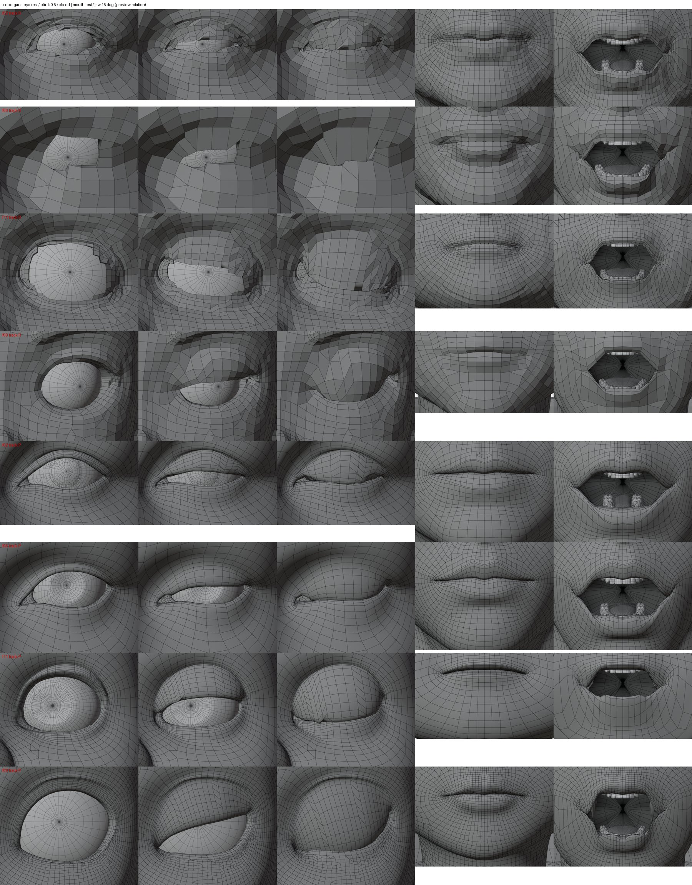

> GitHub에서 읽기 쉽게 [index.html](index.html)을 옮긴 사본입니다. 원본(HTML)을 내려받아 브라우저로 열면 원래 모양으로 보입니다.

# 세 방식 최종 비교 (리그·표정·텍스처까지)

2026-10-13 · 실사 f02 · 반실사 f06 · 카툰 f11 · 애니 f09 · 같은 체인(chain_v3.sh, tex_v3.sh)으로 세 바탕을 끝까지 돌림

> **판정: 방식 1 (P2 새 원본 + 고리 따라 자르기)이 가장 좋습니다**

> - **메시가 가장 깨끗합니다.** 쉬는 얼굴에 일그러짐·움푹 꺼짐·이음새가 없고, 감은 눈꺼풀이 매끈합니다. 42개 표정에서 뒤집힌 면이 4~58개(지금 방식 17~121개)이고, 감은 눈꺼풀과 안구 사이 여유가 0.41~0.52mm로 가장 큽니다.

> - **표정은 지금 방식과 같은 수준이거나 더 깨끗합니다.** 입 벌림 입술 틈 31~46mm(지금 방식 33~44mm). 지금 방식에서 생기던 애니 f09 미소의 물결치는 입술이 없습니다.

> - **약점**(다음 다듬기 대상): ① 눈썹·안구 같은 P2 조각에 색이 입혀지지 않음(눈썹이 흰색) ② 정점 색 텍스처라 정점이 적은 메시(0.8~2.2만 개)에서 흐림 ③ f11 닮음이 보통(볼·턱이 좁음) ④ f09 미소 때 입꼬리에 작은 틈, f11 입 벌림 모양이 조금 세모.

> - **방식 2 (리토폴로지 + P2)**는 지금 얼굴을 지키지만 약 9천 면이라 면이 각지게 보이고 눈 구멍이 계단처럼 잘립니다. 기본 방식으로는 권하지 않습니다.

> - **지금 방식 (고리를 새로 짬)**은 텍스처가 가장 선명하지만(정점 10만 개), 고리를 새로 짜면서 생기는 일그러짐·이음새 문제가 남습니다.

## 1. 비교 조건

|  | 지금 방식 (sym3) | 방식 2 (R) | 방식 1 (P) |
|---|---|---|---|
| 바탕 | HD 원본(삼각형 약 19만) 대칭화 | HD 원본을 Tripo 리토폴로지 + 스마트 메시 P2(쿼드 약 9천) | Tripo 스마트 메시 P2로 새로 생성(쿼드 약 1.3~2.3만) 대칭화 |
| 눈·입 | 구멍을 내고 고리를 새로 짬 (organ_eye, organ_mouth) | 있는 고리(경로)를 따라 자르기만 함 (loop_organs.py): 피부 점은 0.000mm도 안 움직임, 눈꺼풀 안쪽 접힘·안구·입속만 추가 |  |
| 공통 뒤 단계 | 새 이·잇몸·혀(organ_teeth v2) → 대칭 고정 → 촘촘한 Rigify(변형 뼈 129개, 눈꺼풀·입술 관절을 고리 위에, 턱관절 축) → 입속 무게(아래 턱 100%) → 안구 리그 연결 → 표정 42개 → 눈 감기 + 반쯤 감기 보정 → 눈 굴리기 8개 → 대칭 고정 → 4방향 3K 텍스처 → 눈꺼풀 색 |  |  |

## 2. 측정

| 항목 | 지금 방식 | 방식 2 | 방식 1 |
|---|---|---|---|
| 입 벌림 입술 틈 (가운데) | 33~44mm | 32~42mm | 31~46mm |
| 이·혀가 피부 밖으로 나온 점 (3가지 입) | 0 | 0~11 | 0~1 |
| 42개 표정의 뒤집힌 면 합 | 17~121 | 4~70 | 4~58 |
| 감은 눈꺼풀 ↔ 안구 최소 거리 | 0.21~0.31mm | 0.31~0.32mm | 0.41~0.52mm |
| 무게 없는 점 / 쉬는 얼굴 오차 | 모두 0 / 0.002mm 이하 |  |  |
| 피부 정점 수 (텍스처 해상도) | 약 9.9만 | 약 0.93~0.98만 | 0.77~2.2만 (f11 0.77만, f02 0.86만, f06 1.7만, f09 2.2만) |

**고친 오류**(이번 비교 중): 표정 굽기가 템플릿 크기 비율을 머리 전체 높이로 정하는데, 방식 1·2는 목 아래를 잘라 높이가 짧아 비율이 0.85 대신 1.36~1.50이 됐습니다. 그래서 입술 틈이 4~21mm로 약하게 나왔고 이가 비쳤습니다. 같은 좌표의 원래 머리 크기 기준을 쓰도록 바꿔 다시 구웠습니다. 그 밖에 새 Rigify 얼굴용 안구 연결, 카툰 입꼬리(입꼬리가 입술 가운데보다 낮음)에서 입술 관절 고르기, 큰 머리의 텍스처 눈 구멍 찾기, P 바탕의 얼굴 렌더 숨김을 고쳤습니다.

## 3. 그림

***그림 1.** 실사 f02 회색(메시만). 위부터 지금 방식, 방식 2, 방식 1. 방식 2는 면이 각지고, 방식 1은 쉬는 얼굴·눈 감기·입 벌림·오가 가장 매끈합니다.*

***그림 2.** 반실사 f06 회색.*

***그림 3.** 카툰 f11 회색. 방식 1의 입 벌림이 조금 세모입니다(다듬기 대상).*

***그림 4.** 애니 f09 회색. 지금 방식의 미소는 입술이 물결치고, 방식 1은 매끈하지만 입꼬리에 작은 틈이 보입니다.*

***그림 5.** 실사 f02 텍스처. 정점 색 방식이라 정점이 많은 지금 방식이 가장 선명합니다.*

***그림 6.** 반실사 f06 텍스처. 방식 1의 눈썹은 P2 조각이라 색이 입혀지지 않아 흰색입니다.*

***그림 7.** 카툰 f11 텍스처.*

***그림 8.** 애니 f09 텍스처. 방식 1의 안구는 P2 안구 조각에 정면 그림이 투영되어 홍채 모양이 어색합니다.*

***그림 9.** 방식 1 바탕(P2 새 원본, 대칭화). 안구(파랑)·눈썹(분홍)·눈꺼풀(노랑)이 따로 있습니다. f02·f06·f11은 눈 구멍이 뚫려 있지 않고 피부가 안구 뒤로 말려 들어가 있어서, 그 가장자리 경로를 따라 잘랐습니다. 실제 구멍이 있는 것은 f09뿐입니다.*

***그림 10.** 고리 따라 자르기 미리보기(와이어). 위 4줄 방식 2, 아래 4줄 방식 1. 눈은 뜬 눈·반쯤·감은 눈, 입은 다문 입·턱 15°(간이 회전).*

## 4. 방식 1을 다듬을 순서 (제안)

1. **텍스처를 이미지로**: 정점 색 대신 UV를 펴고 4방향 그림을 2K 이미지로 구워 넣기(면이 적어도 선명). P2 눈썹·눈꺼풀 조각에도 색 입히기(또는 Tripo 텍스처 생성 결과를 쓰기).

2. **안구**: P2 안구 조각 대신 우리 안구(홍채 그림 따로) 또는 P2 텍스처 안구를 쓰고, 정면 투영으로 눈꺼풀 색이 묻는 문제를 없애기.

3. **입**: 미소 때 입꼬리 틈(f09), 입 벌림 모양(f11) 다듬기 — 입꼬리 고리와 입술 관절 배치.

4. **눈 감기 모서리**: 완전히 감을 때 눈 모서리에서 뒤집히는 작은 삼각형 정리.

5. **닮음**: f11은 볼·턱이 좁게 나와 다시 생성할지 결정(머리당 100크레딧).

## 5. 파일

- 체인: 임시 폴더 `m1/chain_v3.sh`, `m1/tex_v3.sh` (sym3 | R | P). 결과 `m1/v3/<방식>/<머리>/`.

- 새 도구: `tools/face_auto/loop_organs.py`, `loop_lib.py`, `p2_base.py`, `topo_eval.py`, `organ_eye_bind.py`, `organ_eye_look_keys.py`, `rig_viz_wire.py`.
