> GitHub에서 읽기 쉽게 [index.html](index.html)을 옮긴 사본입니다. 원본(HTML)을 내려받아 브라우저로 열면 원래 모양으로 보입니다.

# 방식 1 다듬기: 메시 · 리깅 포인트 · 본 · 표정

2026-10-13 · 실사 f02 · 반실사 f06 · 카툰 f11 · 애니 f09 · 체인 `chain_v4.sh` (텍스처는 범위에서 뺌, 회색 렌더로 검토)

> **결론**

> - **4명 모두 한 번에 자동으로 리깅됩니다.** 얼굴 본 162개(전체 844개, 변형 본 160개)가 붙고, 웨이트가 빠진 정점은 0입니다. 얼굴에는 ARKit 표정 키 52개가 모두 있고, 보정 키 34개가 더 들어갑니다.

> **눈**은 참조 그림의 눈 모양을 따릅니다.

>   - 우리 안구로 바꿨고, 쉬는 시선은 정면에서 5° 이내입니다.

>   - 감기는 두 눈 구석(코 쪽 눈곱 끼는 자리, 귀 쪽 끝)을 0 mm로 고정합니다. 위아래 선은 처음부터 끝까지 100% 맞닿고, 남는 틈은 0.02~0.05 mm입니다.

>   - 시선을 옮기면 윗꺼풀이 0.6배, 아랫꺼풀이 0.25배 따라옵니다.

> - **입**은 조절점을 12개 늘렸습니다. 입술 반쪽당 5본, 입꼬리 옆 근육점, 팔자주름 사슬, 턱 옆입니다. 입꼬리가 템플릿만큼 열리고, f02, f06, f11은 뒤집힌 면이 크게 줄었습니다.

> - **치아·잇몸·혀**를 새로 만들었습니다. 치열은 U자에서 자연스러운 포물선이 됐고, 잇몸은 치아와 함께 만듭니다. 혀는 혀 모양의 별도 물체로 4본 사슬에 붙입니다.

> **남은 문제**

>   - f09(애니)는 입 뒤집힌 면이 아직 많습니다.

>   - f11과 f09 입꼬리에 작은 계단 주름이 있습니다. 메시를 자른 경로 문제입니다.

>   - 템플릿에서 온 윗입술 M자(f09)가 남아 있습니다.

> - 자세한 내용은 9절에 있습니다.

## 1. 바뀐 흐름

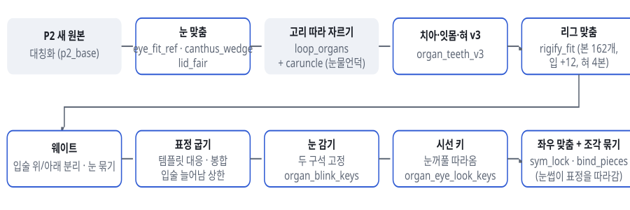

***4명 모두 같은 명령 하나**로 돌아갑니다: `bash m1/run_v4_all.sh`. 머리 4개를 동시에 돌려 약 10분 걸립니다. 텍스처 단계는 `WITH_TEX=1`일 때만 돕니다(보류).*

## 2. 리깅 포인트와 본

리깅 포인트는 본이 피부에 닿는 관절 자리입니다. Rigify 얼굴 메타리그를 얼굴 메시의 고리와 랜드마크에 맞춰 자동으로 놓습니다. 4명 모두 같은 구조이고, 위치만 얼굴마다 다릅니다.

| 항목 | 개수 (4명 같음) | 설명 |
|---|---|---|
| 전체 본 | 844 | Rigify가 만드는 조절 · 기계(MCH) · 원본(ORG) · 변형(DEF) 본 전부 |
| 변형 본 (DEF) | 160 | 실제로 피부를 움직이는 본, 웨이트가 붙는 본 |
| 얼굴 조절 본 | 170 | 애니메이터가 잡는 조절점 |
| 리깅 포인트 (변형 본의 관절 자리) | 159 | 변형 본의 머리·꼬리가 놓이는 서로 다른 자리. 피부 위 135개, 안쪽 24개(안구 중심·혀·치아·머리 축) |
| 얼굴 본 (조밀 메타리그) | 162 | 이전 149 → 입 보강 +12, 혀 3본 → 4본 +1 |

| 부위 | 변형 본 | 조절 본 | 이번에 바뀐 점 |
|---|---|---|---|
| 눈·눈꺼풀 | 38 | 37 | 눈꺼풀 사슬 끝 관절을 두 눈 구석 정점 위에 정확히 놓음 (이전 0.8~5.4 mm 어긋남) |
| 눈썹 | 28 | 28 | - |
| 입술·입 | 20 | 21 | 입술 반쪽당 4본 → 5본(입꼬리 쪽을 더 나눔), 입꼬리 공용 관절을 입 틈 꼭짓점 위로 |
| 볼·팔자주름 | 22 | 16 | 입꼬리 옆 근육점(modiolus), 팔자주름 2본 사슬 새로 |
| 턱·턱끝 | 12 | 13 | 턱 옆 관절(chin.L.001) 새로, 턱 경첩은 jaw_pivot에 |
| 혀 | 4 | 6 | 윗면 밑 일직선 3본 → 혀 가운데 선을 따라 휘는 4본 사슬, 뿌리는 턱에 |
| 코 · 귀 · 이마 · 머리·목 · 치아 | 9 · 10 · 8 · 7 · 2 | 11 · 12 · 8 · 12 · 2 | - |

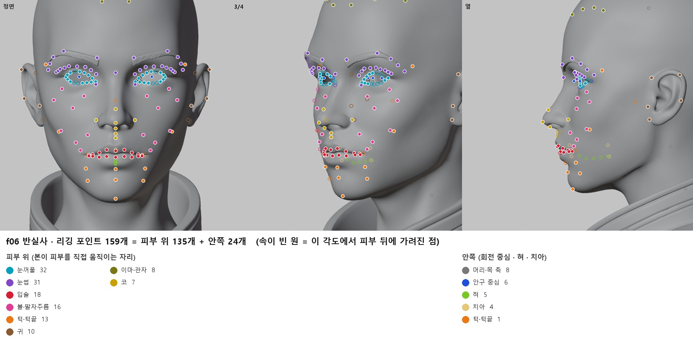

***리깅 포인트 159개** (f06 반실사). 점 하나가 관절 하나이고, 색은 부위입니다. 속이 빈 원은 그 각도에서 피부 뒤에 가려진 점입니다. 피부 위 135개 중 눈꺼풀 32개, 눈썹 31개, 입술 18개, 볼·팔자주름 16개, 턱 13개가 표정을 대부분 만듭니다.*

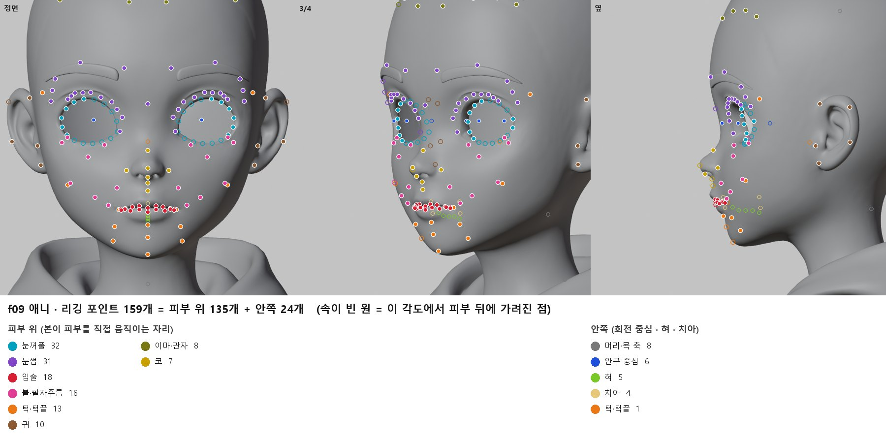

*같은 159개가 애니 얼굴(f09)에서는 큰 눈과 작은 입에 맞춰 자리만 달라집니다.*

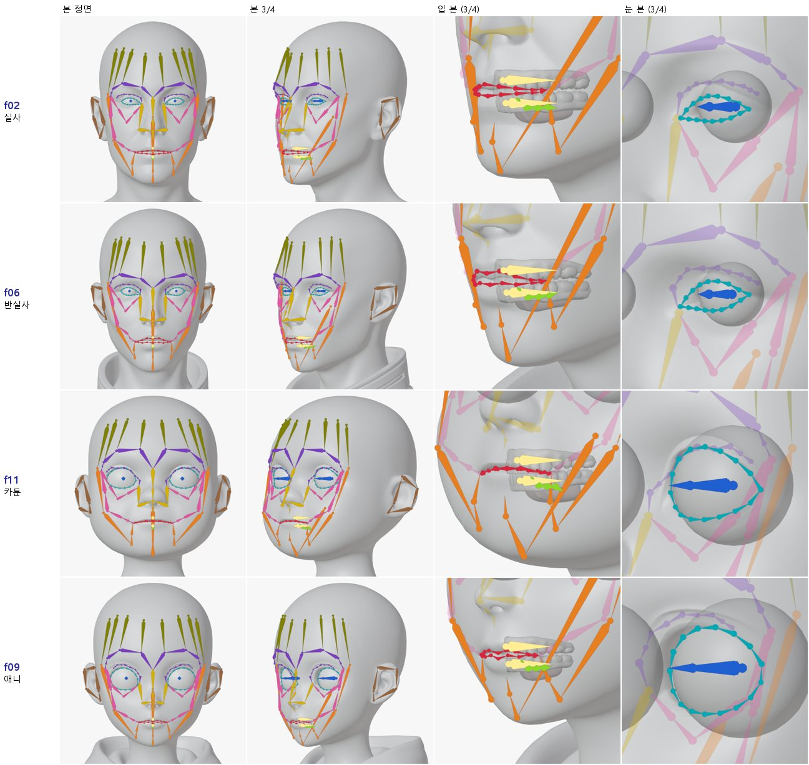

***얼굴 본 (쉬는 자세)**. 색은 부위입니다. 빨강 = 입술, 노랑·연두 = 치아·혀, 하늘 = 눈꺼풀, 파랑 = 안구, 분홍 = 볼·팔자주름, 주황 = 턱, 보라 = 눈썹, 올리브 = 이마. 입 확대(3열)에서 입술 사슬이 입꼬리 쪽으로 촘촘해진 것, 눈 확대(4열)에서 눈꺼풀 사슬이 두 구석에서 끝나는 것을 볼 수 있습니다.*

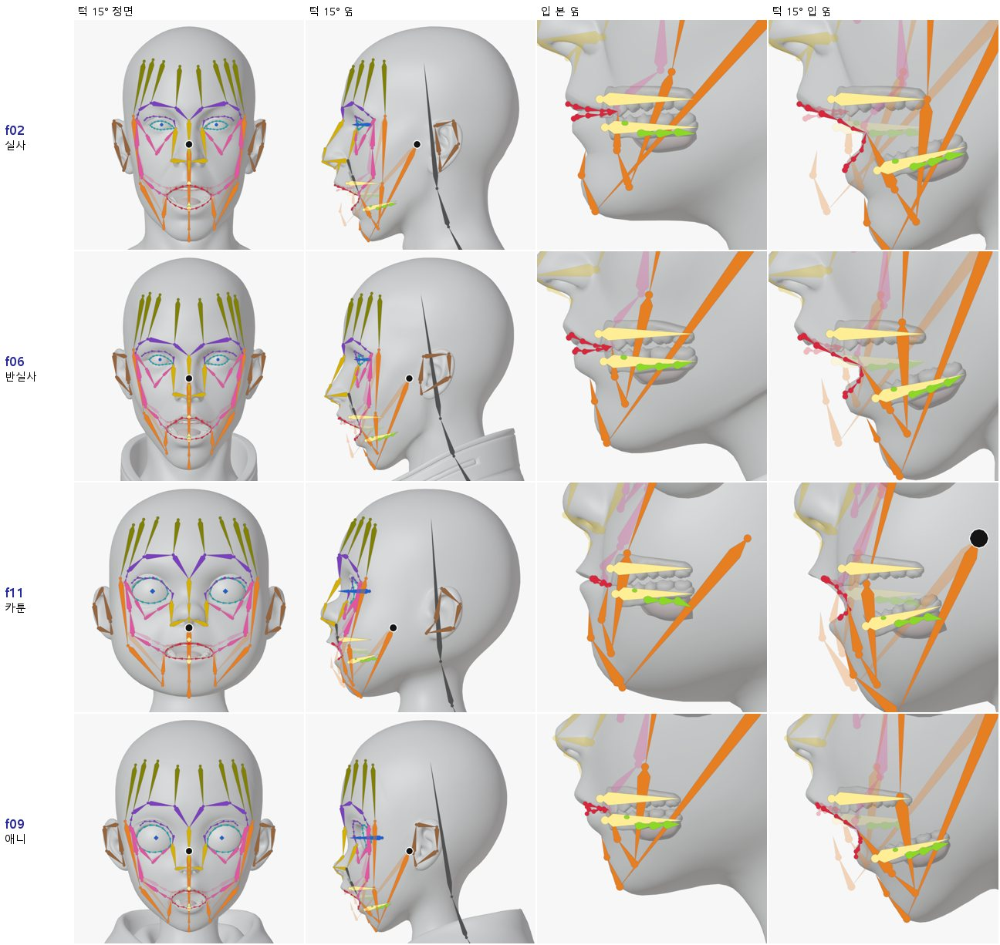

***턱 15° 벌림**. 검은 공이 턱 경첩입니다. 아래 치아와 혀(4본 사슬)가 턱과 함께 돌아갑니다.*

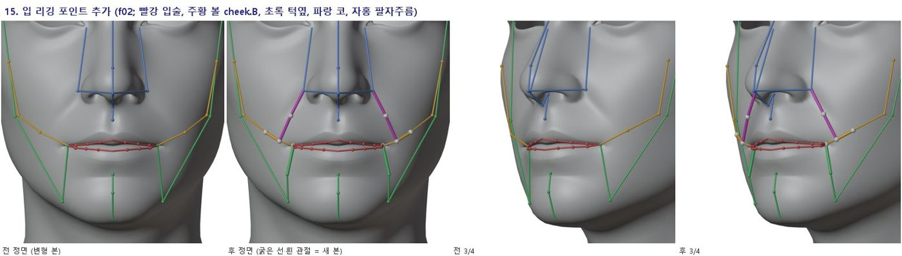

***입 리깅 포인트 추가** (f02, 전/후). ① 입꼬리에서 4 mm에 새 입술 관절 ② 입꼬리 9 mm 바깥에 근육점 ③ 콧방울에서 근육점까지 팔자주름 사슬 ④ 입꼬리 아래 18 mm에 턱 옆 관절.*

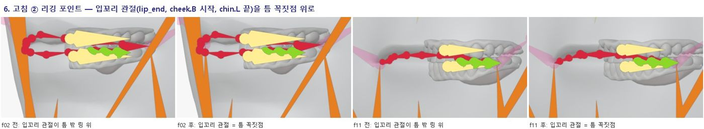

***입꼬리 공용 관절**. 입 틈 바깥 고리 위에서 입 틈 꼭짓점 위로 옮겼습니다(0.9~2.8 mm 이동). 입꼬리 조절점을 반만 따라가던 문제가 없어졌습니다.*

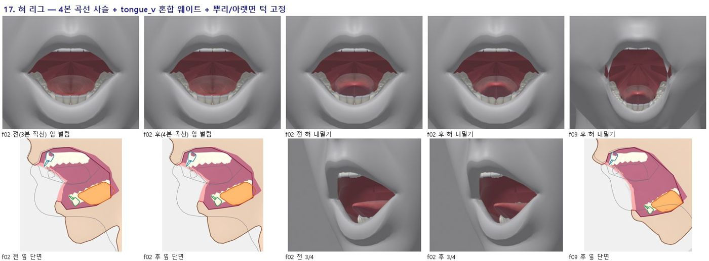

***혀 리그**. 혀 가운데 선을 따라 휘는 4본 사슬입니다. 이웃 본 사이 웨이트를 부드럽게 섞고, 뿌리와 혀끝 아랫면은 턱에 일부 묶습니다. 입 벌림에서 혀가 아래 치아와 같이 약 22 mm 내려갑니다.*

## 3. 웨이트

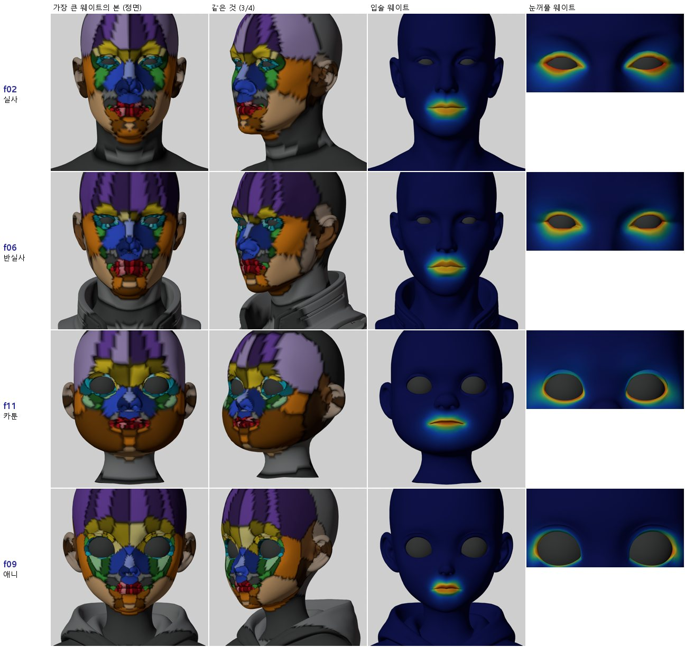

***웨이트**. 1·2열은 정점마다 가장 큰 웨이트를 가진 본의 색이고, 3·4열은 입술과 눈꺼풀 본 웨이트입니다(노랑일수록 큼). 입술은 위/아래를 입꼬리까지 나눕니다. 입꼬리 5% 지점 분리도가 0.20~0.37에서 0.83~0.94로 올라갔습니다. 웨이트를 다듬을 때 입 틈을 건너지 않게 했습니다.*

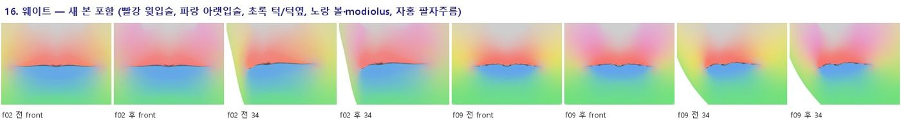

*새 본까지 포함한 입 웨이트 (f02, f09; 빨강 윗입술 · 파랑 아랫입술 · 초록 턱 · 노랑 근육점 · 자홍 팔자주름).*

## 4. 눈

### 4.1 눈 모양을 참조 그림에 맞춤

P2는 눈을 새로 해석해서 원본과 눈매가 달랐습니다. 그래서 눈 가장자리 루프를 참조 그림의 눈 윤곽으로 옮겼습니다.

- 정면 방향으로만 옮기고 깊이는 유지했습니다.

- 안구는 우리 구로 바꾸고, 홍채가 참조 위치에 오게 했습니다.

- 쉬는 시선은 정면에서 1.0~4.4°입니다(이전 6~11°).

- 피부 최대 이동은 1.8~5.0 mm, 뒤집힌 면은 0입니다.

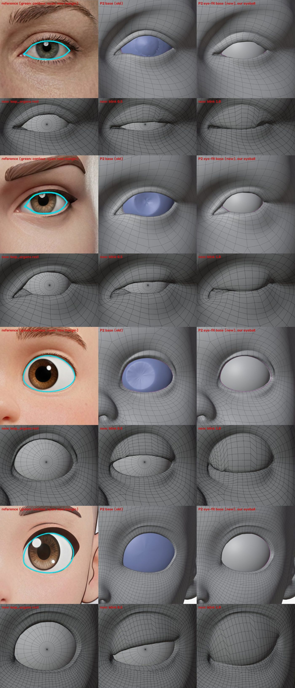

*머리마다 2줄: 참조 눈(청록 = 새 가장자리) | 이전 P2 | 새 베이스 + 우리 안구 / 쉬는 눈 · 반쯤 감기 · 감기.*

### 4.2 두 눈 구석을 기준으로 감기

눈 테두리를 코 쪽 구석(눈물언덕 끝)과 귀 쪽 끝에서 윗선과 아랫선으로 나눕니다. 감으면 윗선이 아랫선 위에 처음부터 끝까지 포개집니다. 두 구석은 감기와 시선 키에서 모두 0 mm로 움직이지 않습니다.

f02와 f06은 눈 가장자리를 눈물언덕 끝까지 4.3 / 7.1 mm 늘렸습니다. 그 안쪽 각에는 구석 살에 붙은 납작한 분홍 눈물언덕을 넣었습니다.

| 머리 | 감은 틈 (이전 → 지금) | 접촉 | 감은 상태 꺾인 면 | 눈물언덕 보임 (0 / 0.5 / 1.0) |
|---|---|---|---|---|
| f02 | 0.20 → 0.03 mm | 100% | 5 → 0 | 4.0 / 1.6 / 0 mm² |
| f06 | 0.17 → 0.03 mm | 100% | 14 → 0 | 3.9 / 1.3 / 0 mm² |
| f11 | 0.09 → 0.05 mm | 100% | 23 → 0 | 없음 (구석이 원래 가장자리) |
| f09 | 0.06 → 0.02 mm | 100% | 41 → 5 | 없음 |

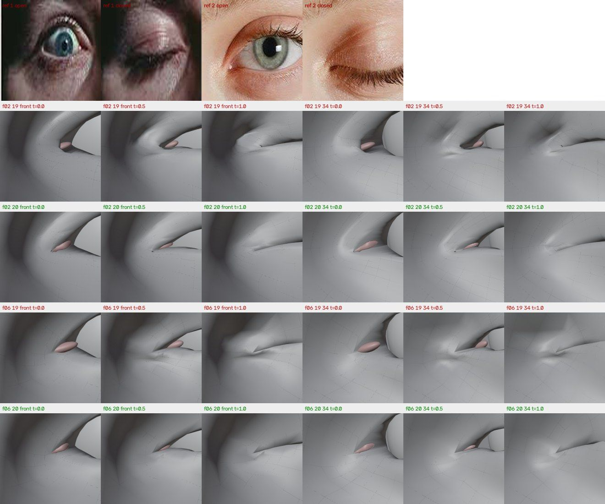

***코 쪽 눈 구석** (맨 위 = 보내 주신 참고 사진). f02·f06 각각 이전(빨강)/지금(초록), 정면·3/4, 0·0.5·1.0.*

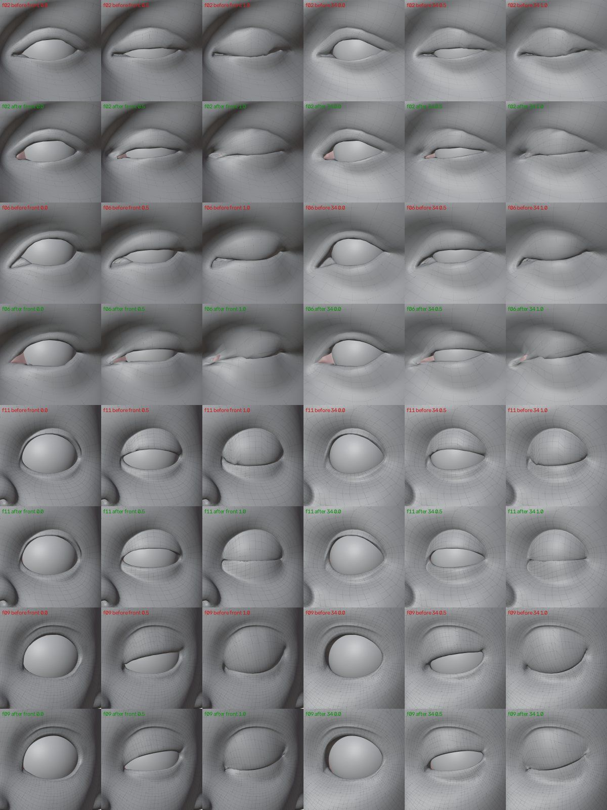

*4명 감기 전후. 이전 방식은 고리 번호로 움직임을 줄여 f02 바깥 1/3이 움푹하고 f06에 계단이 생겼습니다. 이제는 눈꺼풀 위의 실제 위치로 줄여 나갑니다.*

### 4.3 시선을 따라오는 눈꺼풀

위아래를 볼 때 눈꺼풀이 안구 중심을 축으로 함께 돌아갑니다.

- 윗꺼풀: 안구 각도의 0.58~0.60배

- 아랫꺼풀: 0.23~0.25배

- 좌우 시선: 눈꺼풀 꼭짓점이 0.10~0.15배 옆으로 밀림

- 뒤집힌 면 0, 안구와의 간격 유지

반쯤 볼 때와 감으면서 볼 때를 위한 보정 키가 있습니다(`eyeLook…Mid…`, `eyeBlinkLook…Mid…`). 이 키들은 게임에서 기본 키 값에 맞춰 자동으로 구동해야 합니다.

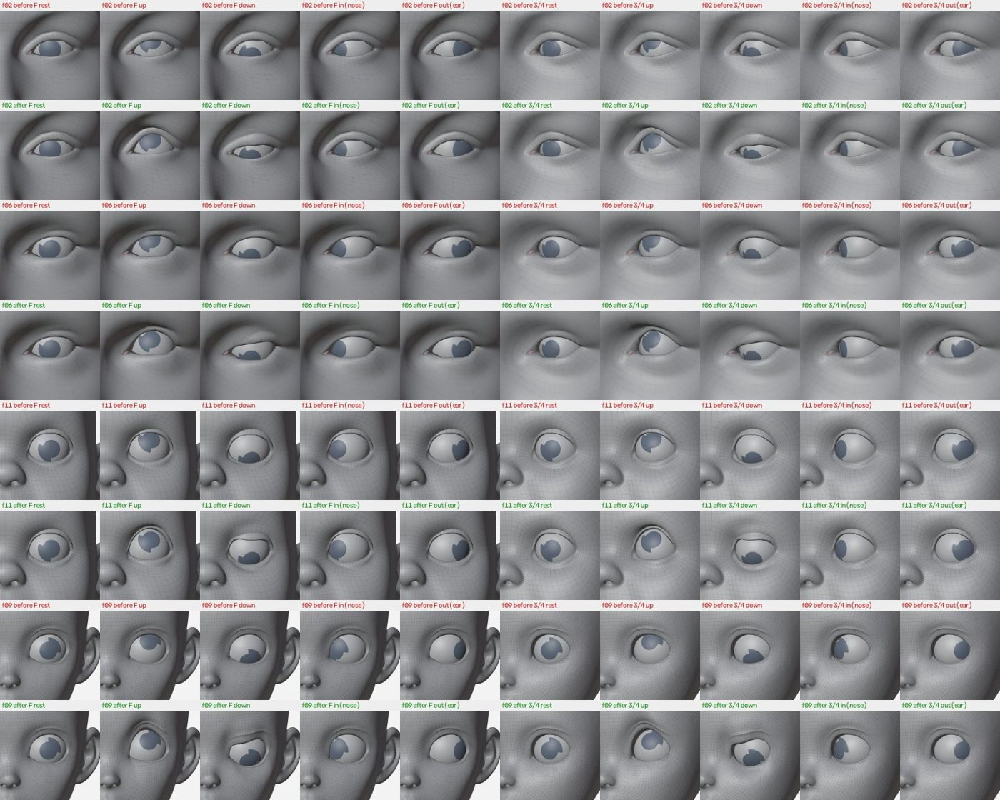

*머리마다 이전(빨강)/지금(초록). 정면·3/4, 정면 보기·위·아래·코 쪽·귀 쪽.*

## 5. 입

입꼬리가 덜 벌어지던 원인은 네 가지였습니다.

1. 웨이트가 입꼬리에서 틈을 건너 번졌습니다.

2. 표정 굽기의 템플릿 대응이 머리 전체 상자를 기준으로 해서 입이 어긋났습니다(f06 옆으로 9.3 mm, f11 14.8 mm 안쪽).

3. 입꼬리 관절이 틈 밖에 있었습니다.

4. f11은 입 틈이 입꼬리 2.8 mm 앞에서 끝났습니다.

넷 다 고쳤고, 그다음 리깅 포인트를 더해 보강했습니다.

| 머리 | 입꼬리 10% 벌어짐 ÷ 가운데 (템플릿) | 뒤집힌 면 (7개 입 표정 합) | 입술선 울퉁불퉁 | 미소 입꼬리 올라감 (템플릿) |
|---|---|---|---|---|
| f02 | 0.20 → 0.25 (0.27) | 26 → 2 (16.4 → 4.3 mm²) | 0.76 → 0.54 mm | 11.6 → 13.9 (14.5) mm |
| f06 | 0.18 → 0.21 (0.25) | 4 → 0 | 0.83 → 0.41 mm | 7.8 → 13.4 (13.8) mm |
| f11 | 0.23 → 0.26 (0.25) | 62 → 28 (22.6 → 2.6 mm²) | 0.54 → 0.25 mm | 7.2 → 14.8 (15.2) mm |
| f09 | 0.18 → 0.26 (0.40) | 112 → 126 (32.9 → 34.4 mm²) | 1.05 → 0.58 mm | 11.9 → 14.3 (14.6) mm |

- **턱 벌리고 입 닫기**: 틈이 2.1~4.8 mm에서 0.15 mm 이하가 됐습니다.

- **다문 미소의 입꼬리 틈**: 최대 0.05~1.1 mm입니다.

- **혀 내밀기**: 키 하나로 턱이 9° 벌어지며 혀끝이 아랫입술 밖으로 14.6~17.8 mm 나옵니다.

- **f09 입술 늘어남**: 작은 입에 템플릿 동작이 과해서 입술이 늘어나는 양에 상한(1.35배)을 두었습니다. 입 벌림 입술 면적 변화가 51%에서 35%로 줄었습니다.

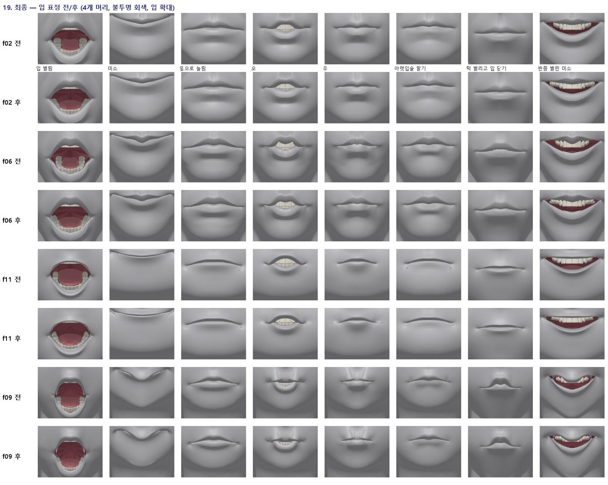

***입 표정 전/후** (보강 전 → 보강 후, 불투명 회색).*

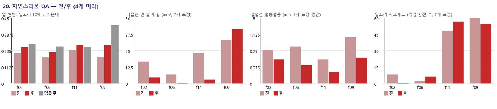

*자연스러움 수치 (연한 = 전, 진한 = 후).*

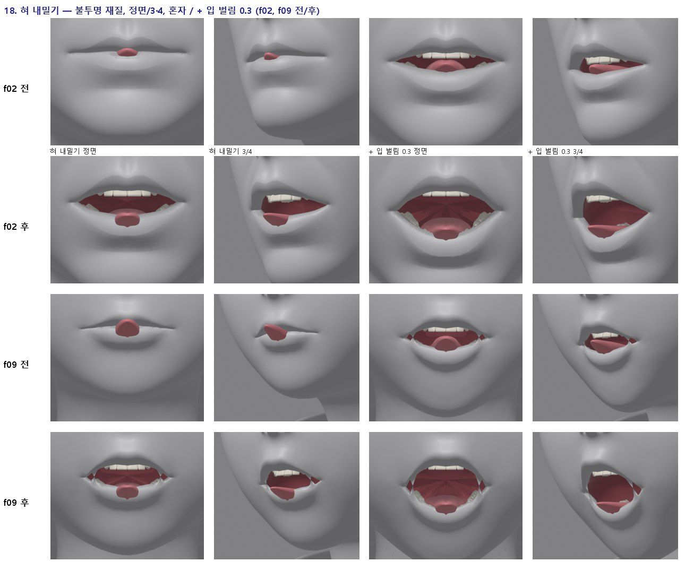

*혀 내밀기 (f02, f09, 전/후, 혼자 / + 입 벌림 0.3).*

## 6. 치아 · 잇몸 · 혀 (organ_teeth_v3)

치아 한 개씩의 모양(교과서 Wheeler 크기)은 유지하고, 배열을 포물선 y = D(0.3u² + 0.7u⁴)으로 바꿨습니다. 앞은 넓고 완만하게 휘고, 송곳니에서 꺾여 뒤로 갈수록 벌어집니다. MakeHuman CC0 치아·혀는 저해상도이고 위아래 잇몸이 붙어 있어서 쓰지 않았습니다.

| 머리 | 송곳니 ÷ 첫 어금니 (위 / 아래) | 뒷줄 벌어짐 | 치아 크기 (v2) | 혀 길이 / 폭 / 두께 mm | 피부 관통 (8개 표정) |
|---|---|---|---|---|---|
| f02 | 0.78 → 0.68 / 0.60 | 14° | 0.95 (1.00) | 33.5 / 31.9 / 13.3 | 0 |
| f06 | 0.83 → 0.68 / 0.60 | 14° | 0.91 (0.97) | 29.5 / 29.9 / 12.1 | 0 |
| f11 | 0.79 → 0.69 / 0.61 | 16° | 0.95 (1.05) | 27.3 / 33.0 / 14.3 | 0 |
| f09 | 0.76 → 0.67 / 0.59 | 16° | 0.63 (0.74) | 21.9 / 22.3 / 10.0 | 0 |

사람 평균: 위 0.70, 아래 0.60. 바깥 치열 폭은 입 너비의 0.97~1.04배입니다.

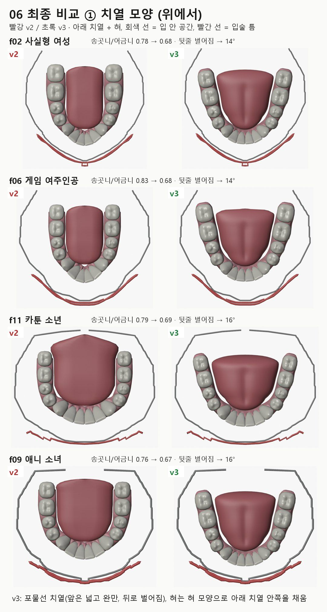

*위에서 본 아래 치열과 혀. 왼쪽 v2(U자), 오른쪽 v3(포물선).*

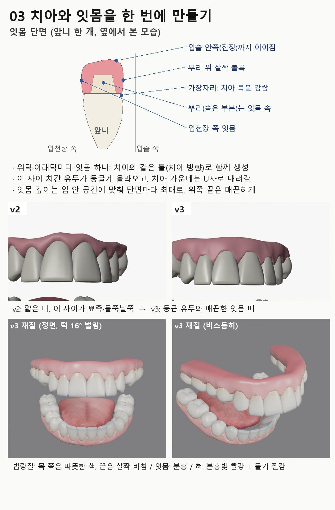

*잇몸을 치아와 같은 틀로 함께 만듭니다. 치아 목을 감싸고, 이 사이로 둥근 유두가 올라오며, 뿌리는 잇몸 속에 묻힙니다.*

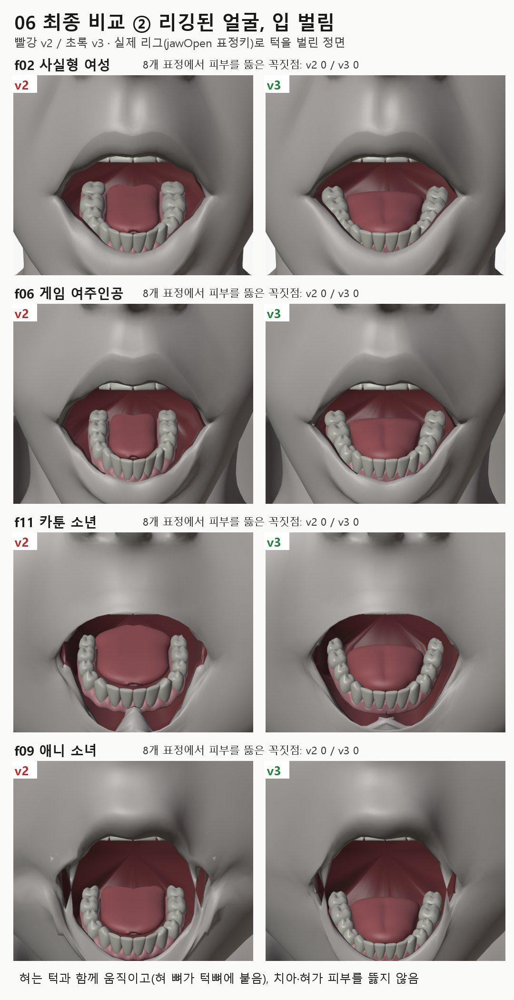

*리깅된 얼굴에서 입 벌림 (v2 / v3).*

## 7. 표정 키 (ARKit 52 + 보정 34)

얼굴 키는 86개로, ARKit 52개가 모두 있고 보정 키 34개가 더 있습니다(감기·시선 중간 보정). 안구는 키 40개(시선 8 + 조합·중간 보정 32)입니다. 치아·혀·눈물언덕·눈썹 조각도 같은 이름의 키로 함께 움직입니다. 아래는 4명의 30가지 표정입니다(회색, 홍채만 칠함).

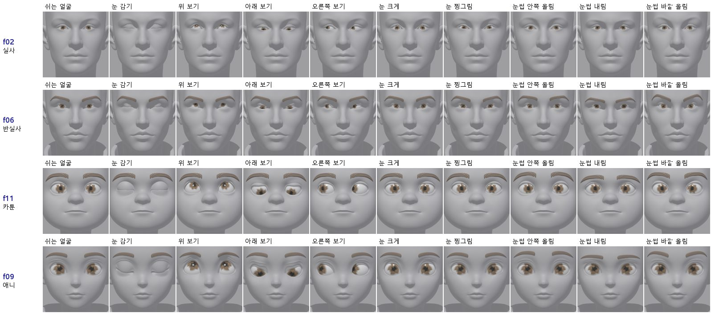

*눈·눈썹 표정.*

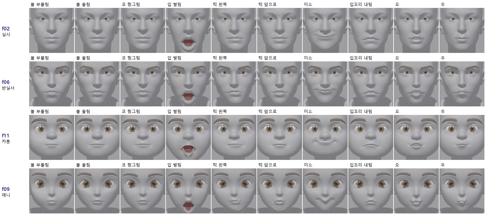

*볼·코·턱·입 표정 1.*

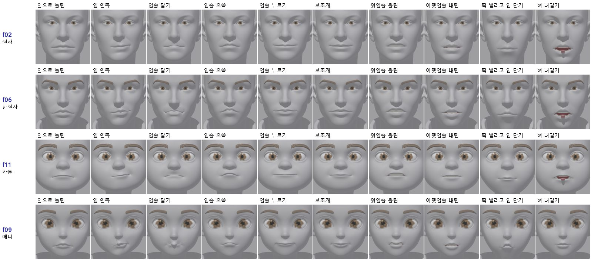

*입 표정 2, 턱 벌리고 입 닫기, 혀 내밀기.*

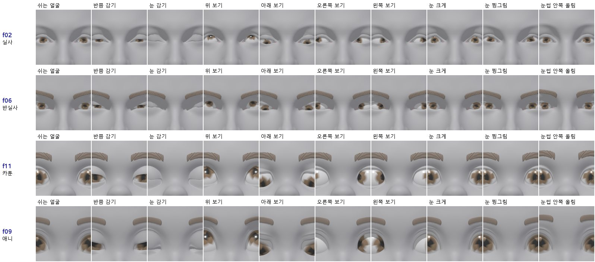

*눈 확대: 반쯤 감기 · 감기 · 위·아래·좌우 보기 · 크게 뜨기 · 찡그림 · 눈썹 올림.*

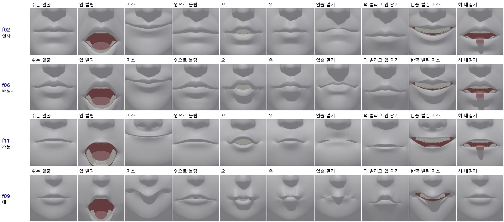

*입 확대: 입 벌림 · 미소 · 늘림 · 오 · 우 · 입술 말기 · 턱 벌리고 입 닫기 · 반쯤 벌린 미소 · 혀 내밀기.*

## 8. 상태 요약

| 항목 | 상태 | 메모 |
|---|---|---|
| 메시: 눈 모양, 눈꺼풀 루프, 코 쪽 구석 | 완료 | 원본 변형은 눈 주변 최대 5 mm, 뒤집힌 면 0 |
| 리깅 포인트·본 | 완료 | 얼굴 본 162, 4명 같은 구조, 웨이트 빠짐 0 |
| 눈 감기·시선 | 완료 | 두 구석 고정, 접촉 100%, 눈꺼풀 따라옴 |
| 입 표정 | 대부분 | f02·f06·f11 좋음, f09 뒤집힌 면 남음 |
| 치아·잇몸·혀 | 완료 | 포물선 치열, 혀 4본 리그 |
| UV·텍스처 | 보류 | 나중에 Tripo 자동 텍스처로 실험 (tex2 도구는 남겨 둠) |

## 9. 남은 문제

**f09(작은 애니 입)의 뒤집힌 면 126개**(보강 전 112개). 원인을 끄기 실험으로 찾았습니다.

  - 입꼬리 옆 근육점이 미소에서 52개를 더합니다.

  - 턱 옆 관절이 입 벌림에서 28개를 더합니다.

  - 입꼬리 쪽 새 입술 본이 입 벌림에서 28개, '오'에서 22개를 더합니다.

1. 다음 시험은 작은 입에서 근육점·팔자주름을 끄는 것입니다(`RIG_MP_MODIOLUS=0`).

2. **f11·f09 입꼬리 계단 주름**. 쉬는 얼굴에서부터 입 틈이 메시 모서리를 계단처럼 따라갑니다(8 / 12곳). 리그가 아니라 `loop_organs`가 자르는 경로의 문제입니다.

3. **템플릿에서 온 모양**. f09의 '턱 벌리고 입 닫기' 윗입술 M자와 f06·f09 미소의 작은 V자는 완화만 했습니다.

4. **f09 양쪽 미소를 함께 켤 때** 입술이 42% 늘어납니다. 상한이 키 하나씩만 보기 때문입니다.

5. **눈물언덕 뒤 작은 틈**. f02·f06을 3/4에서 볼 때 0.7 / 2.2 mm² 정도 보입니다.

6. **f09 치아가 작아짐**(0.74 → 0.63배). 자연형 치열을 작은 입안에 넣기 위해서입니다.

7. **보정 키 구동**. 게임에서 시선·감기 보정 키(`…Mid…`)를 기본 키 값에 맞춰 구동하는 연결이 필요합니다.

## 10. 도구와 명령

| 도구 (tools/face_auto) | 역할 |
|---|---|
| `eye_fit_ref.py` · `canthus_wedge.py` · `lid_fair.py` | 눈 가장자리를 참조 윤곽에, 코 쪽 구석을 눈물언덕 끝까지, 눈꺼풀 고리 다듬기 |
| `caruncle.py` · `caruncle_qa.py` · `lid_qa.py` | 눈물언덕 만들기, 보임 · 눈꺼풀 QA |
| `organ_blink_keys.py` · `organ_eye_look_keys.py` · `organ_lib.py` | 두 구석 고정 감기, 시선 따라오는 눈꺼풀 |
| `organ_teeth_v3.py` | 포물선 치열 + 잇몸 + 혀 모양 혀 |
| `rigify_fit.py` · `organ_mouth_weights.py` · `rigify_bake.py` | 입 리깅 포인트 +12, 혀 4본, 입술 웨이트, 템플릿 대응·봉합·상한 |
| `bind_pieces.py` | P2 눈썹 조각을 얼굴 표정 키에 묶음 |
| `expr_stills.py` · `anim_test.py` | 표정 정지 그림, 점검용 짧은 영상 (요청 때만) |

실행: 바탕은 `bash m1/clean/P2/run_p2.sh`, 리그 전체는 `bash m1/run_v4_all.sh`, 보고서 그림은 `bash m1/report_v4.sh <머리>`와 `python m1/rep_sheets.py`입니다. 결과 파일은 `m1/v4/P2/<머리>/bake/arkit_bp.blend`입니다.
