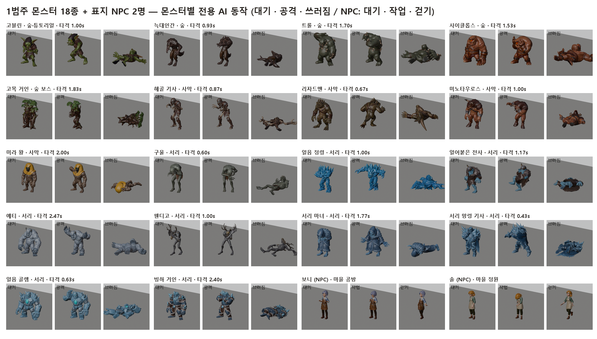
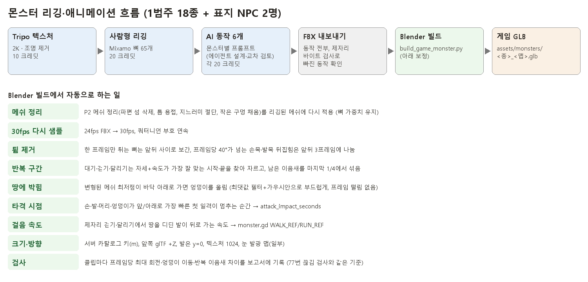
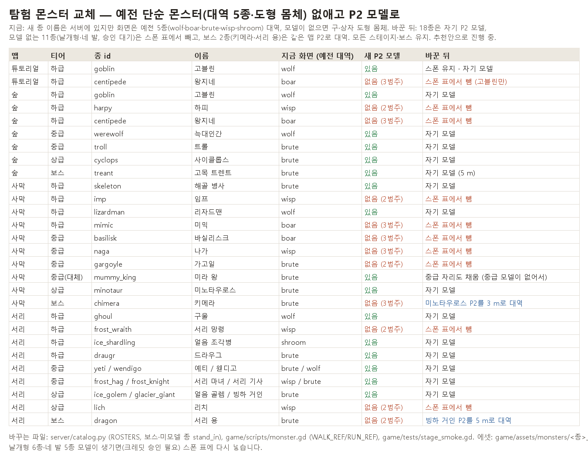

# 22 · 몬스터 리깅·애니메이션 (1범주 18종 + 표지 NPC 2명)

2026-10-16, 세션 05 (몬스터·바디 애니). 탐험 몬스터 P2 메쉬(mon_v3)에 텍스처·리깅·동작을 붙여 게임 GLB로 만들고,
탐험의 예전 대역 몬스터(늑대·멧돼지·이끼 수호자·도깨비불·버섯 망령)와 도형 몸체를 P2 모델로 바꾼 기록입니다.

## 한눈에

- 1범주(사람형 지상 몬스터) 18종: 몬스터마다 **전용 AI 동작 6개**(대기·걷기·달리기·공격·피격·쓰러짐)입니다.
  사용자 지시("같은 동작을 공유하면 싼티 나니까 웬만하면 다 따로")에 따라 무료 공용 프리셋은 쓰지 않았습니다.
- 표지 NPC 보니(공방, npc19)·솔(정원, npc20): 대기·걷기·작업 3개입니다.
  - 보니: 망치질·톱질. 머리색은 초상화 1번과 같은 연보라빛 하늘색입니다.
  - 솔: 물 주기·심기
- 크레딧(Tripo): 1범주 2,760 / 한도 3,000, NPC 180 / 한도 180.
  - 1범주 2,760에는 고블린 시범 170, 구울 걷기 중복 20, 얼음 골렘 쓰러짐 재생성 20이 들어 있습니다.
  - 거절된 생성은 과금되지 않았습니다.
- 게임 연결
  - `game/assets/monsters/<종>_<맵>.glb` 20개, 약 55MB. 18종에 보스 대체 2개(키메라, 서리 용)를 더한 수입니다.
  - 서버 스폰 표에서 모델이 없는 9종을 뺐습니다.

## 흐름

1. **Tripo Studio**(사용자 Chrome)
   - 텍스처 2K + 조명 제거 → 사람형 자동 리깅(Mixamo 뼈 65개) → AI 동작 6개 → FBX(Blender 프리셋)로 동작 전부 내보내기, "Animation stay in Place" 켬.
2. **동작 프롬프트**
   - 워크플로(에이전트 8개)가 몬스터 정면 그림을 보고 개성에 맞게 설계했습니다.
   - 같은 동작 종류를 몬스터끼리 비교하는 교차 검토로 겹치는 개념 55개를 고쳤습니다. 예를 들어 쓰러지는 방향과 공격 방식이 몬스터마다 모두 다릅니다.
   - 금지어·소품·길이 검사를 거쳤습니다. 결과: `art/characters/body_p2_v1/mon_v3/anim/motion_prompts.json`
3. **확인**
   - `tools/body_gen/check_anim_zip.py`가 내보낸 FBX 안에 동작 6개가 모두 있는지 봅니다. Tripo는 프롬프트 앞 약 60자로 동작 이름을 붙입니다.
4. **빌드**
   - `tools/body_gen/build_game_monster.py`가 담당합니다(설정 `anim/game_build.json`).
   - 처리 순서: 메쉬 정리 → 30fps 샘플 → 튐 제거 → 반복 구간 → 땅 박힘 보정 → 타격 시점 → 걸음 속도 → 키·방향 → 발광 맵 → GLB.
5. **확인 그림**
   - `render_clips.py` → `clip_sheet.py`(클립별 6프레임) / `clip_gif.py`(실제 속도 GIF)
   - 한 번에 처리: `process_anim_zip.py <id> <zip>`

## 몬스터별 결과

| id | 이름 | 맵·티어 | 게임 파일 | 키 m | 클립 길이 (초) | 타격 초 | 걷기/달리기 m/s | 최대 회전 °/프레임 | 경고 |
|---|---|---|---|---|---|---|---|---|---|
| goblin | 고블린 | forest · weak | assets/monsters/goblin_forest.glb | 1.2 | idle 2.33 walk 2.13 run 0.60 attack 1.97 hurt 0.97 death 2.97 | 1.0 | 1.64 / 1.908 | 24 | - |
| werewolf | 늑대인간 | forest · mid | assets/monsters/werewolf_forest.glb | 1.9 | idle 1.47 walk 0.90 run 0.57 attack 1.97 hurt 1.97 death 3.97 | 0.933 | 0.047 / 4.826 | 21 | - |
| troll | 트롤 | forest · mid | assets/monsters/troll_forest.glb | 2.8 | idle 1.80 walk 1.73 run 1.03 attack 2.97 hurt 1.97 death 3.97 | 1.7 | 0.185 / 4.044 | 23 | attack impact at 1.70 s - check |
| cyclops | 사이클롭스 | forest · strong | assets/monsters/cyclops_forest.glb | 3.4 | idle 3.60 walk 2.97 run 1.10 attack 2.97 hurt 1.97 death 3.97 | 1.533 | 0.749 / 2.983 | 19 | - |
| treant | 고목 트렌트 | forest · boss | assets/monsters/treant_forest.glb | 5.0 | idle 3.97 walk 2.07 run 1.17 attack 2.97 hurt 1.97 death 3.97 | 1.833 | 0.27 / 7.497 | 27 | attack impact at 1.83 s - check |
| skeleton | 해골 병사 | quarry · weak | assets/monsters/skeleton_quarry.glb | 1.7 | idle 1.70 walk 0.90 run 0.53 attack 1.97 hurt 0.97 death 2.97 | 0.867 | 1.617 / 3.343 | 23 | - |
| lizardman | 리자드맨 | quarry · weak | assets/monsters/lizardman_quarry.glb | 1.7 | idle 2.43 walk 0.90 run 0.90 attack 1.97 hurt 0.97 death 2.97 | 0.667 | 0.246 / 1.206 | 38 | idle: a bone turns 36 degrees in one frame (pop?); death: a bone turns 38 degree |
| minotaur | 미노타우로스 | quarry · strong | assets/monsters/minotaur_quarry.glb | 2.9 | idle 2.20 walk 2.90 run 1.97 attack 2.97 hurt 1.97 death 3.97 | 1.0 | 0.054 / 0.137 | 21 | - |
| mummy_king | 미라 왕 | quarry · strong | assets/monsters/mummy_king_quarry.glb | 2.3 | idle 3.97 walk 2.97 run 1.13 attack 2.97 hurt 1.97 death 3.97 | 2.0 | 0.854 / 2.958 | 27 | attack impact at 2.00 s - check |
| ghoul | 구울 | frost · weak | assets/monsters/ghoul_frost.glb | 1.6 | idle 1.33 walk 1.67 run 0.80 attack 1.97 hurt 0.97 death 3.97 | 0.6 | 0.315 / 1.385 | 26 | clip pattern 'A gaunt, hunched ghoul walking in place with a bow-l' matched 2 ac |
| ice_shardling | 얼음 조각병 | frost · weak | assets/monsters/ice_shardling_frost.glb | 1.4 | idle 1.80 walk 0.90 run 0.63 attack 1.97 hurt 0.97 death 2.97 | 1.0 | 0.008 / 1.616 | 25 | - |
| draugr | 드라우그 | frost · weak | assets/monsters/draugr_frost.glb | 1.9 | idle 2.00 walk 1.33 run 1.43 attack 1.97 hurt 1.97 death 3.97 | 1.167 | 0.013 / 1.005 | 22 | - |
| yeti | 예티 | frost · mid | assets/monsters/yeti_frost.glb | 2.6 | idle 3.80 walk 2.97 run 1.07 attack 2.97 hurt 1.97 death 3.97 | 2.467 | 1.078 / 3.86 | 26 | attack impact at 2.47 s - check |
| wendigo | 웬디고 | frost · mid | assets/monsters/wendigo_frost.glb | 2.2 | idle 2.43 walk 2.70 run 0.83 attack 2.97 hurt 1.97 death 3.97 | 1.0 | 0.377 / 3.31 | 23 | - |
| frost_hag | 서리 마녀 | frost · mid | assets/monsters/frost_hag_frost.glb | 1.8 | idle 2.20 walk 1.37 run 0.67 attack 1.97 hurt 1.97 death 3.97 | 1.767 | 0.022 / 2.929 | 37 | death: a bone turns 37 degrees in one frame (pop?); attack impact at 1.77 s - ch |
| frost_knight | 서리 기사 | frost · mid | assets/monsters/frost_knight_frost.glb | 2.1 | idle 1.80 walk 2.00 run 0.73 attack 1.97 hurt 1.97 death 3.97 | 0.433 | 0.032 / 1.027 | 23 | - |
| ice_golem | 얼음 골렘 | frost · strong | assets/monsters/ice_golem_frost.glb | 3.2 | idle 3.97 walk 2.97 run 1.33 attack 2.97 hurt 1.97 death 3.97 | 0.633 | 0.158 / 3.93 | 22 | - |
| glacier_giant | 빙하 거인 | frost · strong | assets/monsters/glacier_giant_frost.glb | 3.6 | idle 2.83 walk 2.97 run 1.70 attack 2.97 hurt 1.97 death 3.97 | 2.4 | 1.329 / 0.206 | 19 | attack impact at 2.40 s - check |
| boni | 보니 | 마을 공방 | assets/npc/boni.glb | 1.6 | idle 2.27 walk 1.83 work 5.97 | - | 1.576 / - | 17 | - |
| sol | 솔 | 마을 정원 | assets/npc/sol.glb | 1.6 | idle 2.13 walk 1.67 work 5.77 | - | 1.723 / - | 18 | - |
| chimera | 키메라 | quarry · boss | assets/monsters/chimera_quarry.glb | 3.0 | idle 2.20 walk 2.90 run 1.97 attack 2.97 hurt 1.97 death 3.97 | 1.0 | 0.056 / 0.142 | 21 | - |
| dragon | 서리 용 | frost · boss | assets/monsters/dragon_frost.glb | 5.0 | idle 2.83 walk 2.97 run 1.70 attack 2.97 hurt 1.97 death 3.97 | 2.4 | 1.846 / 0.286 | 19 | attack impact at 2.40 s - check |

- 키는 서버 카탈로그(`server/catalog.py` height)를 따릅니다. 하급 4종은 카탈로그에 키가 없어 설계 값을 씁니다.
- 걷기/달리기 m/s 칸은 빌드가 잰 "디딘 발이 뒤로 가는 속도"입니다. AI 동작은 제자리에서 걸어 발이 거의 미끄러지지 않으므로 값이 불안정합니다(0.01~7.5). 그래서 `monster.gd` WALK_REF·RUN_REF에는 키 기반 추정값(1.7 m에서 1.1 / 2.6 m/s)을 넣었습니다.
- 타격 초는 첫 일격이 멈추는 순간입니다. `monster.gd` ATTACK_IMPACT와 `attack_speed()`로 공격 클립을 서버 준비 시간(windup)에 맞춰 0.6~1.8배속으로 재생합니다. 예티(2.47초)·빙하 거인(2.4초)처럼 준비 동작이 긴 종은 1.8배속으로도 0.2~0.3초 늦게 맞습니다.

## 게임 연결 (탐험 몬스터 교체)

- **모델 연결**
  - `monster.gd`는 `assets/monsters/<종>_<맵>.glb`가 있으면 대역 대신 그 종의 모델을 씁니다.
  - 그래서 파일 이름만 맞추면 18종이 자기 모델로 나옵니다. 이 파일들은 git 제외 로컬 에셋이라, 빌드 체크아웃에 복사해야 합니다.
- **모델이 없는 9종** (하피, 왕지네, 임프, 미믹, 바실리스크, 나가, 가고일, 서리 망령, 리치)
  - 스탯은 남기고 `ROSTERS`에서만 뺐습니다.
  - 사막 중급은 모델 있는 종이 없어 미라 왕이 중급 자리도 채웁니다(`FILLERS`).
- **보스 2종** (키메라, 서리 용)
  - 같은 맵 P2 몸을 자기 이름 파일로 넣었습니다: `chimera_quarry.glb` = 미노타우로스 동작 3 m, `dragon_frost.glb` = 빙하 거인 동작 5 m.
  - 대역(stand_in)은 예전 5종 그대로라, 파일이 없는 PC에서도 도형 몸체는 나오지 않습니다(test_monsters 규칙).
- **시험**
  - 서버: test_stages, test_monsters, test_quests, test_living_objects 254개가 통과했습니다.
  - 클라이언트: stage_smoke·combat_play 결과는 아래 "남은 일"을 보세요.

## 실패와 해결

| 문제 | 원인 | 해결 |
|---|---|---|
| Multi-stage Motion(여러 동작을 한 번에 20)으로 비용 줄이기 | 같은 위치 키프레임에서는 동작 폭이 작고 약함 | 쓰지 않음(시험 20) |
| 다른 탭의 동작이 내 모델에 붙음, 내 동작이 빠짐 | AI 동작 목록이 계정 전체 공유라, 열린 animate 페이지마다 자동 적용·재지정 | 내보낸 FBX를 바이트 검사 → 빠진 동작은 카드 클릭으로 무료 재적용 |
| 얼음 정령 공격 생성이 조용히 실패 | "Input rejected due to content policy violation"(과금 없음) | 문장 바꿔 재생성, 단계 함수가 거절 문구 감지 |
| 얼음 골렘 쓰러짐이 서 있음 | AI가 무거운 골렘을 못 넘어뜨림 | 단순한 문장으로 재생성(20) |
| 걷기에서 몸이 덜컹거림 | 프레임마다 "가장 낮은 점만큼 올리기" → 발이 바뀔 때 보정량이 튐 | 보정량을 최댓값 필터+가우시안으로 부드럽게 |
| 트롤 공격 71°/프레임, 리자드맨 쓰러짐 124°/프레임 | 리타깃 때 손목·발목이 한 프레임 뒤집힘 | 한 프레임 튐은 보간, 큰 회전은 ±3프레임에 나눔 |
| 해골 기사 타격 시점 0.27초 | 팔을 드는 준비 동작을 타격으로 잡음 | 앞/아래로 가는 속도만 보고, 일격이 멈추는 순간을 씀 |
| 보니 대기와 걷기가 같은 동작으로 잡힘 | 두 프롬프트 앞 52자가 같음 | 매칭 길이를 58자로 |
| 백그라운드 탭 대기열이 멈춤 | 숨은 탭 타이머 강한 감속 | 페이지 안 반복문 대신, 확인할 때마다 한 단계씩(`__step`) |

## 남은 일

- 2범주 날개형·떠다님 5종과 3범주 네 발·기타 5종, 서리 용 텍스처: 크레딧 승인 대기입니다(`cat23_credit_plan.png`). 서리 용 서리색 정면은 후보 4장이 사용자 승인 대기 중입니다.
- 클라이언트 시험(stage_smoke·combat_play)은 새 작업 폴더에서 Godot 전체 가져오기가 반복 충돌해(0xC0000005, NotoSansSC 폰트) 결과를 아래에 덧붙입니다.
- 공격 클립의 타격 시점(`attack_impact_seconds`)과 서버 windup을 맞추는 재생 속도 조절은 아직 없습니다. 지금은 클립을 1배속으로 재생합니다.
- NPC 보니·솔의 게임 연결(`npc.gd`에서 걷기·작업 클립 쓰기)은 06 스토리와 02 맵이 맡습니다. GLB는 `assets/npc/boni.glb`·`sol.glb`에 둡니다(첫 클립 idle).
