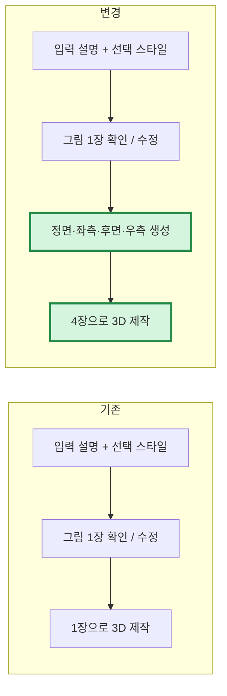

# 캐릭터 멀티뷰 제작 — 2026-10-21

확정한 캐릭터 그림 한 장에서 일관된 네 방향을 생성하고, 네 장을 함께 3D에 전달하도록 구현했습니다.

## 실제 시험

- 이전 입력 검증에서 만든 검은 단발·초록 눈·빨간 재킷 캐릭터를 그대로 참고했습니다. 후보를 다시 뽑지 않았습니다.
- Tripo image-to-multiview: 성공, 실제 10크레딧. 네 장의 머리·의상·색상 유지 확인. 원본의 T자 팔 자세도 그대로 유지되어, A-pose 교정이 자동으로 된 것은 아닙니다.
- Tripo multiview-to-model, P2-20260801, 재질/PBR, 8,000면 목표: 성공, 실제 110크레딧.
- 이번 추가 시험 총 120크레딧, 잔액 5,300 → 5,180. 원본 1장 비용 5크레딧은 이전 시험에 포함되어 여기서 다시 청구되지 않았습니다. 새 원본부터 만들면 P2 재질 모델은 5+10+110=125크레딧, 리깅/애니메이션은 별도입니다.
- GLB: 2,638,944바이트, 버텍스 8,599개, 드로콜 1개, 텍스처 총 12,582,912픽셀. 기존 게임 파일 검증 통과, Godot에서 직접 불러와 세 방향 렌더링 확인.
- 실제 반환값은 문서의 평면 구조와 달리 `output.generate_multiview_image` 아래에 네 URL을 넣었습니다. 두 형식을 모두 처리합니다. 새 유료 요청 없이 기존 작업을 재조회하여 결과를 가져왔습니다.
- 근거: `artifacts/character-multiview-live-20261021/`의 intent/task/result, balance, mesh-validation, front/left/back/right.jpg, character.glb, model-0/1/2.png. 개인정보나 인증정보가 포함될 수 있는 원시 응답은 공개 문서에 복사하지 않습니다.

## 적용 범위와 처리

- 새 요청의 `multiview` 기본값은 true입니다. 캐릭터·로봇·몬스터 등 캐릭터 요청으로 판별되고, 단일 메시이며, 승인된 컨셉 또는 참고 이미지가 있는 제작에 적용됩니다.
- 텍스트로만 제작을 선택하거나 `multiview:false`를 보낸 요청, 여러 파트로 분리한 가구는 기존 경로를 사용합니다. 배포 전에 저장된 요청은 필드가 없으면 false로 읽어 기존 견적을 유지합니다.
- 참고 이미지를 보정했다면 보정 완료 이미지를 네 방향의 기준으로 사용합니다. 각 방향을 독립적인 텍스트 요청으로 생성하지 않습니다.
- 견적·서버 예산·계정 예산에 10크레딧을 포함합니다. 유료 POST 전에 원장에 기록하고 작업 번호를 보관합니다. 결과 불명 요청을 자동 재전송하지 않습니다.
- 조회 일시 오류는 기존 작업을 다시 조회하며, 시간 제한을 넘으면 종료합니다. 멀티뷰 실패를 숨기고 단일 이미지로 제작하지 않습니다.
- 네 이미지 파일을 보관하고 3D 변환 때 파일 토큰으로 업로드해 서명 URL 만료 영향을 줄였습니다. 3D 재시도 시 네 방향을 다시 생성하지 않습니다.
- 새 이미지 조회 API는 제작자만 접근할 수 있습니다. 기존 게임의 진행 단계·견적 화면을 그대로 사용할 수 있어 설치파일을 다시 받을 필요가 없습니다. 게임 안에 네 방향을 나열하는 별도 갤러리 UI를 추가한 것은 아닙니다.

## 검증 및 한계

- 관련 서버 시험 168개 통과: H/P 입력 배열, 추가 비용, 소유권, 이미지 생성/수정, 실제 리깅 경로의 모의 시험, 재시작, 일시 오류, 실패, 결과 불명, 제한 시간, 3D 재시도 재사용, 기존 제작 회귀.
- 유료 실측은 멀티뷰 1회와 3D 1회입니다. 이 새 모델의 실제 유료 리깅/애니메이션 제작이나 싱글뷰 대비 정량 품질 비교까지 검증한 것은 아닙니다.
- 첫 이미지가 틀리면 여러 방향도 그 잘못을 이어갑니다. 앞선 로봇 시험에서 두 명이 나온 이미지는 기준으로 쓰지 않았습니다. 제작 전 그림 확인/피드백 단계는 계속 필요합니다.
- 구현/시험은 완료했으며, 운영 반영 시각과 커밋은 아래 배포 확인에 별도로 기록합니다.

공식 근거: [멀티뷰 생성](https://developers.tripo3d.ai/en/docs/generation-image-to-multiview), [P 시리즈 멀티뷰 3D](https://developers.tripo3d.ai/en/docs/generation-multiview-to-model/p), [요금](https://developers.tripo3d.ai/en/pricing).
