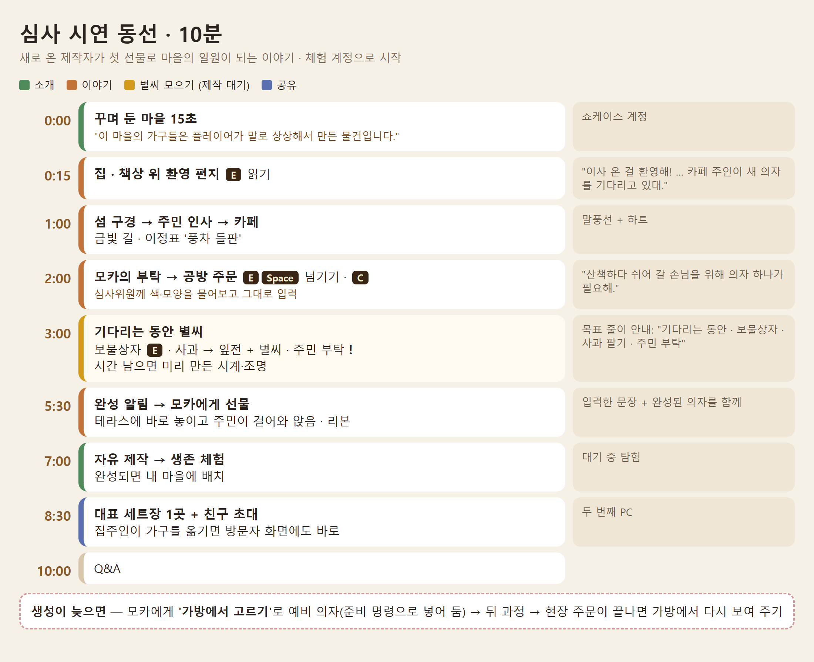

# 심사 시연 진행표 · 10분 (Q&A 제외)

**목표: 깔끔하고 안정적인 시연.** 새로 이사 온 공방 제작자가 **첫 선물**로 마을의 일원이 되는 흐름을 보여 줍니다.
핵심 한 문장: *"내가 말로 상상한 물건이 주민에게 선물이 되고, 마을의 일부로 남는다."*



이야기 자체(편지 → 모카 → 의자 → 테라스)는 [첫 이야기 안내](STORY_DEMO_KO.md), 주민 부탁은 [주민 부탁](../quests/QUESTS_KO.md), 보물상자는 [보물상자](../quests/TREASURE_KO.md)에 자세히 있습니다.

## 1. 진행 대본

| 시각 | 화면 | 말할 것 | 누를 것 |
|---|---|---|---|
| 0:00 | 꾸며 둔 마을 (쇼케이스 계정) 15초 | "이 마을의 가구들은 플레이어가 말로 상상해서 만든 물건입니다." | 카메라로 천천히 한 바퀴 |
| 0:15 | 체험 계정 로그인 → 집 | "이사 온 첫날 아침, 책상 위에 편지가 와 있어요." | 책상 앞 **E** → 다 읽으면 **E** |
| 1:00 | 문 밖 → 금빛 길 → 이정표 → 풍차 들판 | "처음 만난 주민들이 반겨 줘요." (말풍선·하트) | 이정표 **'풍차 들판(으)로 가기'** |
| 2:00 | 카페 앞 모카가 말을 걺 | "카페 주인이 쉬어 갈 의자를 부탁해요. 모양은 저에게 맡겼어요." | **E·Space**로 넘기기 → **'지금 바로 만들기 · C'** |
| 2:20 | 공방 제작 창 | 심사위원께 **"어떤 색, 어떤 모양이면 좋을까요?"** 물어보고 그대로 입력 | 입력 → 제작 의뢰 → 그림 확인 → **'이 그림으로 만들기'** |
| 3:00 | 목표 줄: "제작 중 · 완성되면 모카에게 가져가기 / 기다리는 동안 · 보물상자 · 사과 팔기 · 주민 부탁" | "기다리는 동안 섬에서 별씨를 모을 수 있어요." | 카페 근처 **보물상자 E** (별씨가 날아감) |
| 3:40 | 과수원 → 노점 / 잡화점 | "사과를 따서 팔면 잎전과 별씨를 받아요." | 사과 줍기 → 판매 (별씨 +) |
| 4:30 | (시간이 남으면) 주민 머리 위 **!** | "주민의 부탁을 들어줘도 별씨를 받아요." / 미리 만든 시계·조명 상호작용 | 부탁 받기 또는 시계·조명 **E** |
| 5:30 | 완성 알림 → "완성! 모카에게 가져가기" | "방금 심사위원께서 말씀하신 의자가 완성됐어요." **입력한 문장과 결과를 나란히** | 금빛 길 → 모카 **'○○ 건네기'** |
| 6:00 | 테라스에 의자가 놓이고 주민이 걸어와 앉음, 리본 "마을의 첫 선물" | "이제 이 의자는 마을의 일부예요. 친구가 놀러 와도 보여요." | **'다행이에요'** |
| 7:00 | 자유 제작 | "이번엔 만들고 싶은 걸 마음대로." | C → 입력 → 의뢰 |
| 7:30 | 기다리는 동안 생존 체험 | | 탐험 문 **E** |
| 8:30 | 완성품 배치 → 대표 세트장 1곳 + 친구 초대 | "집주인이 가구를 옮기면 방문자 화면에도 바로 바뀌어요." | 두 번째 PC에서 방문, 가구 옮기기 |
| 10:00 | Q&A | | |

- 생성이 끝나면 다른 체험을 길게 끌지 말고 **바로 선물 장면**으로.
- 생성이 늦으면: "미리 만들어 둔 의자로 먼저 보여 드릴게요" → 모카에게 **'가방에서 고르기'**로 예비 의자 → 뒤 과정 → 현장 주문이 끝나면 다시 확인(가방에서 보여 주기).

## 2. 별씨를 얻는 4가지 길

| 길 | 어디서 | 얼마나 | 제한 |
|---|---|---|---|
| 잡화점 판매 | 바깥 씨앗 노점, 또는 낮(9~19시) 잡화점 안 단비에게 **'물건 팔기'** | 판 값 **3잎전마다 별씨 1개** (잎전은 그대로) | 하루 **15개**까지 (플레이어 날짜) |
| 보물상자 | 집 안 1개 + 섬마다 2개 | 집 10, 들판 3~5 | 계정당 상자마다 1번 |
| 주민 부탁 | 머리 위 **!** | 3~8 (합 82) | 부탁마다 1번 · 의자를 주문하면 열림(모카 것은 이야기 뒤) |
| 퀘스트 완료 | 부탁을 마치면 별이 별씨 칸으로 | 위와 같음 | |

숫자 바꾸기(서버 환경 변수): `TRIPOTHON_SELL_STARS_DAILY`(0 = 판매 별씨 끔), `TRIPOTHON_SELL_COINS_PER_STAR`, `TRIPOTHON_CHEST_STARS_SCALE`, `TRIPOTHON_QUEST_STARS_SCALE`.

## 3. 준비 체크리스트

**서버 (시연 전날까지)**
- [ ] 시연 서버를 정하고(학교 서버 권장) 패치를 올림.
- [ ] **하루 제작 횟수 제한 확인** — 리허설로 다 쓰면 당일 주문이 막힙니다.
  - `TRIPO_DAILY_REQUEST_LIMIT` (서버 전체, 기본 5) → 시연 날은 넉넉히(예: 50).
  - `TRIPO_USER_DAILY_REQUEST_LIMIT` (계정당, 기본 2) → 의자 + 자유 제작 = 2회. 리허설과 같은 날이면 계정을 바꾸거나 4 이상.
  - 횟수는 UTC 날짜로 셉니다(한국 시간 오전 9시에 초기화).
- [ ] `TRIPOTHON_TRIPO_CREDIT_BUDGET` 남은 양이 시연 제작 2~6회에 충분한지.

**계정**
- [ ] 쇼케이스 계정: 마을과 세트장을 미리 꾸며 둠(첫 15초 + 대표 세트장 1곳).
- [ ] 체험 계정(judge01, judge02 …)을 게임에서 미리 가입. 일반 관람객은 원하면 가입부터.
- [ ] 각 체험 계정을 준비 명령으로 정리(아래 4장): 이야기 처음 + 별씨 충전 + 예비 의자·시계·조명을 가방에.
- [ ] 친구 초대용 두 번째 PC/계정, 서로 친구 맺기.

**리허설**
- [ ] 같은 계정으로 다시 하려면 `demo prep` 한 번(모카 테라스의 의자는 가방으로 돌아옴). 보물상자·부탁·판매 별씨는 계정당 한 번이라 **실제 시연은 새 체험 계정**으로.
- [ ] 낮 시간(07~19시)이 가장 밝음. 잡화점 단비는 9~19시에 가게 안.
- [ ] 소리 켜기.

## 4. 체험 계정 준비 명령

계정 하나를 이야기 처음(책상 위 편지)으로 돌리고, 별씨를 최소 N개로 채우고, 다른 계정(쇼케이스)의 완성품을 **복사**해 가방에 넣습니다. 원본은 그대로이고, 만든 사람 표시도 원래 제작자로 남습니다. 게임에서 로그아웃한 뒤 실행하세요.

**이 PC (로컬 서버)**
```
.tools\server-venv\Scripts\python.exe -m server.admin_cli demo list showcase --data-dir server-data
.tools\server-venv\Scripts\python.exe -m server.admin_cli demo prep judge01 --stars 200 --copy-from showcase --pick 의자 --pick 시계 --pick 조명 --data-dir server-data
```

**학교 서버 (EC2 Instance Connect 창에 한 줄씩)**
```
cd ~/tripo_s1
sudo docker compose --env-file ops/production.env -f ops/compose.yaml -f ops/compose.gcp-free.yaml exec -T api python -m server.admin_cli demo list showcase
sudo docker compose --env-file ops/production.env -f ops/compose.yaml -f ops/compose.gcp-free.yaml exec -T api python -m server.admin_cli demo prep judge01 --stars 200 --copy-from showcase --pick 의자 --pick 시계 --pick 조명
```

- `--pick`은 물건 이름의 한 단어 또는 `demo list`에 나온 id 앞 8글자. 맞는 것이 없으면 아무것도 바꾸지 않고 멈춥니다.
- `--stars`는 "최소 이만큼"입니다. 이미 더 많으면 그대로 둡니다(줄이지 않음). 원장에 `demo_topup`으로 남습니다.
- 결과 예: `{"ok": true, "username": "judge01", "story": {"step": "letter", "run": 2, ...}, "shards": 200, "topped_up": 130, "copied": [{"name": "…의자", ...}]}`

## 5. 지금 빌드에서 확인한 것

| 확인할 것 | 결과 |
|---|---|
| 카페 주인(모카)이 선물을 받는가 | ✓ 무엇이든 받음 (`story_chapter` 시험) |
| 선물한 의자가 바로 배치되는가 | ✓ 카페 테라스 나무 데크에 즉시 |
| 실제로 앉는 모습 | ✓ 낮(07:00~21:30)에 테라스 근처(약 50m)로 가면 주민이 걸어와 앉음 |
| 친구 방문 중 가구 이동 반영 | ✓ `visit_furniture_sync` 시험 |
| 대화 E·Space | ✓ 넘기기 + 선택지 고르기(W/S·↑↓ 이동) · `demo_keys` 시험 |
| 판매 별씨 · 보물상자 | ✓ `demo_keys`, `treasure_check` 시험 |
