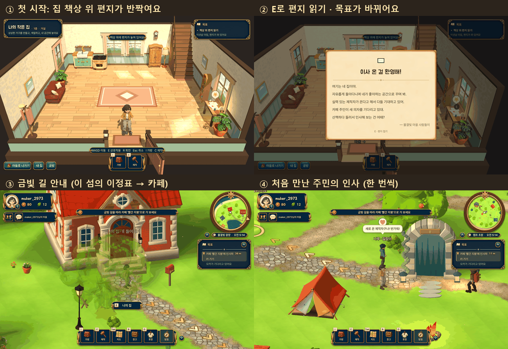
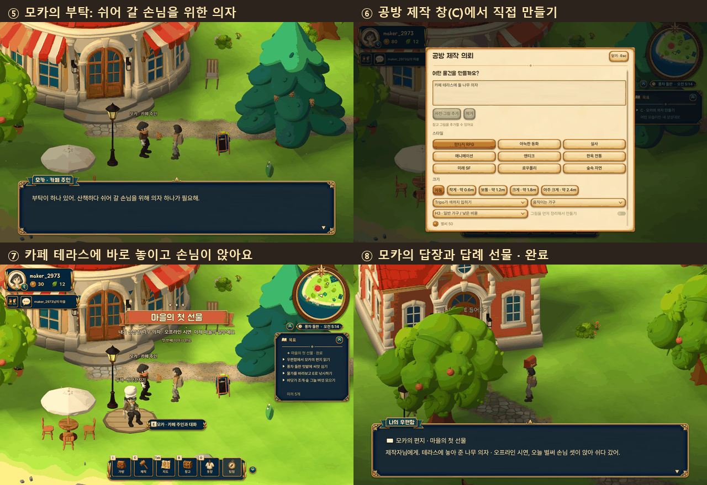
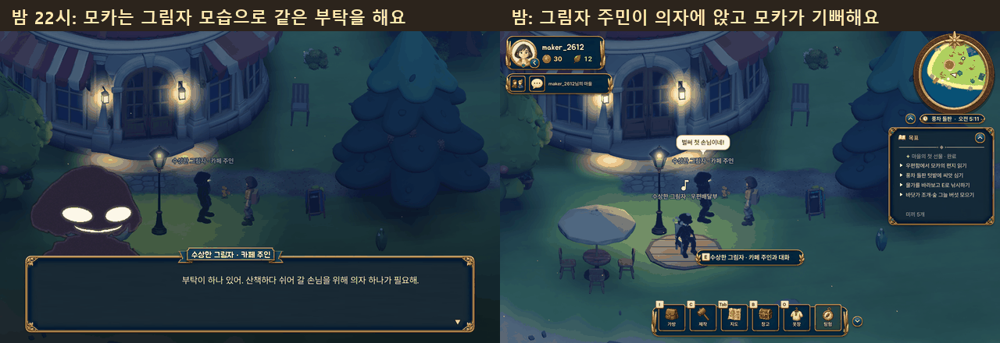

# 첫 이야기 「마을의 첫 선물」 · 시연 안내

막 이사 온 공방 제작자가 **첫 선물**로 마을의 일부가 되는 짧은 이야기입니다.
집 책상 위 편지 → 카페 '빨간 지붕'의 모카에게 인사 → 모카의 부탁(의자) → 공방 제작 창(C)으로 직접 제작 → 카페 테라스에 바로 놓이고 지나가던 주민이 앉아 쉼 → 모카의 답장과 답례 선물.
"내가 상상한 것이 마을의 일부가 된다"는 느낌이 핵심입니다. 설명 문장보다 효과(반짝임, 금빛 길, 말풍선, 하트, 리본)로 보여 줍니다.

- 진행 상황은 **서버가 계정마다 저장**합니다(로그아웃·재시작 후에도 이어짐). 새로 가입한 계정만 이야기를 시작합니다.
- 기존 계정은 **건너뜁니다**(갑자기 편지가 뜨지 않게). 필요하면 운영자가 아래 리셋 명령으로 그 계정에 이야기를 시작시킬 수 있습니다.
- 서버 전체에서 끄려면 `TRIPOTHON_STORY=off` (새 계정이 이야기를 받지 않음).
- 클라이언트 변경은 PCK 패치로 배포됩니다(project.godot, patch_boot.gd는 그대로, 새 autoload 없음).

## 1. 단계별 화면





밤에도 그대로 진행됩니다(모카와 손님이 그림자 모습).



| 단계 | 화면 | 목표(오른쪽 위) |
|---|---|---|
| ① 첫 시작 | 로그인하면 집에서 시작. 문 옆 책상 위 편지에 별 말풍선·빛·반짝임 | ▸ 책상 위 편지 읽기 |
| ② 편지 | 책상 앞에서 E → 양피지 편지가 펼쳐짐(서버에 '읽음' 저장). E로 접으면 문이 반짝임 | ▸ 카페 '빨간 지붕'에 인사하러 가기 |
| ③ 길 안내 | 문을 나서면 금빛 화살표가 자동으로 길을 안내. 카페는 다른 섬(풍차 들판)이라 먼저 **이 섬의 이정표**로 안내하고, 도착하면 이정표 창이 '풍차 들판(으)로 가기'를 맨 위에 두고 열림 | 거리(m)가 줄어듦 |
| ④ 인사 | 가는 길에 처음 만난 주민이 말풍선 + 하트로 한 번씩 인사(밤에는 그림자 주민). 서버에 기록되어 다시 하지 않음 | |
| ⑤ 부탁 | 카페 앞에 모카가 기다림(낮: 카페 주인, 밤: 그림자). 가까이 가면 저절로 말을 걺: "산책하다 쉬어 갈 손님을 위해 의자 하나가 필요해. 어떤 모습이면 좋을지는 네게 맡길게." | ▸ C · 모카의 의자 만들기 |
| ⑥ 제작 | 평소의 공방 제작 창(C). 그림 확인 단계에서는 목표가 "그림이 나왔어요 · C로 확인하기", 맡긴 뒤에는 "제작 중 · 완성되면 모카에게 가져가기". 완성 알림은 어디에 있든(집·다른 섬·건물 안) 옴 | ▸ 완성! 모카에게 가져가기 (금빛 길 자동 안내) |
| ⑦ 선물 | 모카에게 가면 방금 만든 물건을 건넬 수 있음(**무엇이든 받음**). 앉을 수 있는 물건은 카페 테라스 나무 데크에 바로 놓이고 주민이 걸어와 앉음, 아니면 장식으로 놓이고 모카가 어울리는 말을 함. "마을의 첫 선물" 리본 | ✦ 마을의 첫 선물 · 완료 |
| ⑧ 답장 | 우편함에 모카의 감사 편지와 답례 선물(카페 머그잔, 가방으로). 읽으면 목표에서 사라짐 | (우편함 줄을 누르면 길 안내) |

테라스의 물건은 그 플레이어의 마을에 **영구히** 남습니다(친구가 놀러 와도 보임). 낮에 테라스 근처로 오면 의자에 주민이 앉아 쉬고 있습니다.

## 2. 발표 리허설 체크리스트

**준비 (발표 전)**
- [ ] 발표용 계정: 새로 가입하거나, 쓰던 계정을 아래 3장 명령으로 리셋(리셋 전 게임에서 로그아웃, 리셋 후 다시 로그인).
- [ ] 별씨가 제작 1회 이상 충분한지 확인(학교 서버 새 계정은 환영 별씨 70).
- [ ] 제작할 문장 미리 정하기. 예: "하늘색 쿠션을 얹은 둥근 나무 카페 의자", "고양이 귀 모양 등받이가 있는 작은 의자".
- [ ] 시간대: 낮(07~19시)이 가장 밝게 보임. 밤에도 진행되며 모카와 주민이 그림자 모습으로 나옴.
- [ ] 소리 켜기(편지·반짝임·리본 효과음).

**진행 (말할 것 · 누를 것)**
1. 로그인 → 집. "이사 온 첫날 아침, 책상 위에 편지가 와 있어요." 책상(문 오른쪽) 앞에서 **E**, 다 읽으면 **E**로 접기.
2. 문으로 걸어 나가기 → 금빛 길을 따라 광장 이정표로. 이정표에서 **'풍차 들판(으)로 가기'**.
3. 가는 길 주민 인사(말풍선과 하트)를 가리키며 "처음 만난 주민들이 반겨 줘요."
4. 카페 앞 모카에게 다가가면 대화가 저절로 열림. **E**로 넘기고 **'지금 바로 만들기 · C'**.
5. 제작 창에 정해 둔 문장 입력 → 제작 의뢰. 그림이 나오면 **'이 그림으로 만들기'**(이걸 눌러야 3D 제작이 시작됨). 목표가 "제작 중 · 완성되면 모카에게 가져가기"로 바뀐 것을 보여 주기.
6. **제작을 기다리는 2~5분 동안 보여 줄 곳**: 이정표로 물결빛 광장 → 연못 낚시(E), 풍차 들판 텃밭(씨앗 심기), 내 집 꾸미기(I 가방), 우편함, 주민과 대화. 완성 알림이 어디서든 뜨는 것을 보여 줌.
7. "완성! 모카에게 가져가기" → 금빛 길을 따라 카페로(다른 섬이면 이정표가 먼저 열림). 모카에게 가면 대화가 열림 → **'○○ 건네기'**.
8. 테라스에 의자가 반짝이며 놓이고 모카가 기뻐함 → **'다행이에요'** → 주민이 걸어와 앉고 모카가 "벌써 첫 손님이네!" → 리본 "마을의 첫 선물". "내가 상상한 의자가 이제 마을의 일부가 됐어요."
9. (시간이 있으면) 우편함에서 모카의 답장과 답례 선물.

**문제가 생기면 (막히는 곳 없음)**
- 제작 실패/취소 → 목표가 "제작이 멈췄어요 · C로 다시 만들기"로 바뀜(별씨 환불). 다시 만들거나, 모카에게 **'가방에서 고르기'**로 다른 물건(환영의 나무 의자 등)을 건네도 이야기가 끝까지 진행됨.
- 리허설 후 리셋하면 그때 만든 의자가 가방으로 돌아오므로, 실제 발표에서 제작이 늦어지면 **'다른 물건 고르기'**로 그 의자를 바로 건넬 수 있음.
- 모카를 못 찾으면 목표 줄을 누르면 길 안내가 다시 켜짐(금빛 기둥이 모카 위치).
- 중간에 로그아웃해도 다시 로그인하면 그 단계부터 이어짐.
- 길 안내를 껐다면 목표 줄을 한 번 누르면 다시 켜짐.

## 3. 리셋 (리허설용)

계정을 이야기 처음(책상 위 편지)으로 되돌립니다. **다른 데이터는 지우지 않습니다.**
테라스에 놓였던 물건은 그 계정의 가방으로 돌아가고, 인사 기록은 비워지며, 지난 편지·답례 선물·다른 물건은 그대로 남습니다.
리셋 전에 게임에서 로그아웃하고, 리셋 후 다시 로그인하세요. 이야기가 없던 기존 계정도 같은 명령으로 이야기를 시작할 수 있습니다.

**이 PC (로컬 서버, 저장소 폴더에서)**

```
.tools\server-venv\Scripts\python.exe -m server.admin_cli story show <아이디> --data-dir server-data
.tools\server-venv\Scripts\python.exe -m server.admin_cli story reset <아이디> --data-dir server-data
```

(QA 서버는 실행마다 새 데이터 폴더를 쓰므로 리셋이 필요 없습니다. 다른 폴더를 쓰는 서버는 `--data-dir`에 그 폴더를 넣습니다.)

**학교 서버 (EC2 Instance Connect 창에 한 줄씩)**

```
cd ~/tripo_s1
sudo docker compose --env-file ops/production.env -f ops/compose.yaml -f ops/compose.gcp-free.yaml exec -T api python -m server.admin_cli story show <아이디>
sudo docker compose --env-file ops/production.env -f ops/compose.yaml -f ops/compose.gcp-free.yaml exec -T api python -m server.admin_cli story reset <아이디>
```

**같은 VM의 개발 서버 (dev.…)**

```
sudo docker compose -p villagen-staging --project-directory /opt/villagen-staging/ops --env-file /opt/villagen-staging/ops/staging.env -f /opt/villagen-staging/ops/compose.staging.yaml exec -T staging-api python -m server.admin_cli story reset <아이디>
```

결과 예: `{"ok": true, "username": "maker01", "step": "letter", "run": 2, "returned_to_bag": ["…의자 id…"]}`
(서버에 이 기능이 담긴 코드가 올라가 있어야 합니다. 심사 서버는 건드리지 않습니다.)

## 4. 만든 것 (참고)

- 서버: `server/story.py`(진행 저장 `story_progress`, `/v1/story`, `/v1/story/step`, `/v1/story/gift`), `/v1/me`의 `story`. 테라스는 모카의 바깥 "집"(`npc_homes`의 `cafe_terrace`, 슬롯 1개)이라 방문자도 같은 경로로 봅니다. 이야기 선물은 일반 주민 선물과 달리 **즉시·정해진 자리**에 놓입니다(일반 선물의 무작위 지연은 그대로). 답장은 기존 편지/답례 선물 시스템을 씁니다. 오프라인(데모) 설계에 "나무 의자" 고정 설계를 추가했습니다.
- 클라이언트: `game/scripts/story.gd`(마을: 목표 줄, 길 안내 연결, 모카, 인사, 테라스, 리본), `game/scripts/story_home.gd`(집: 책상 위 편지, 목표 카드). 모카는 이야기 동안 일정(residents.gd)에서 빠져 있어 마을과 카페 안에 두 번 나오지 않습니다.
- 앉을 수 있는 물건: 상호작용 '쉬기(앉기)', 의자류 라이브러리 유형, 또는 이름에 의자·소파·벤치 등.
- 시험: `server/tests/test_story.py`, `game/tests/story_chapter.gd`(새 계정 → 편지 → 길 안내 → 인사 → 부탁 → 의자 제작 → 테라스 → 손님 → 답장 → 완료, 램프(장식) 경로, 중간 재로그인, 리셋 명령).

## 5. 알려진 한계

- 데모(오프라인) 서버의 제작물은 단순한 도형입니다. 실제 시연(Tripo)에서는 진짜 3D 모델이 나옵니다. 오프라인 이름에는 "· 오프라인 시연"이 붙습니다.
- 앉는 높이는 모델 크기(높이의 절반, 0.38~0.62m)로 추정합니다. 아주 낮거나 높은 의자, 긴 소파는 앉은 모습이 조금 어긋날 수 있습니다.
- 앉아 있는 주민은 화면 연출(클라이언트)입니다. 테라스 근처(약 50m 안), 낮(07:00~21:30)에만 나옵니다.
- 이야기 동안 모카는 카페 앞에 나와 있어 카페 안 카운터가 비고, 다른 손님이 없으면 카페가 "문을 닫았어요"로 보일 수 있습니다.
- 길 안내는 섬이 다르면 이정표 순간이동을 권합니다. 다리를 걸어가면 지나는 섬마다 그 섬의 이정표를 가리킵니다.
- 친구 마을을 방문하는 동안에는 이야기가 멈춥니다(돌아오면 이어짐). 선물은 내 마을에서만 건넵니다.
- 리셋 후에도 지난 회차의 모카 편지는 우편함에 '읽음'으로 남습니다.
- 패치가 없는 옛 게임으로 접속하면 이야기가 보이지 않습니다(새 계정은 업데이트 후 편지부터 시작).
