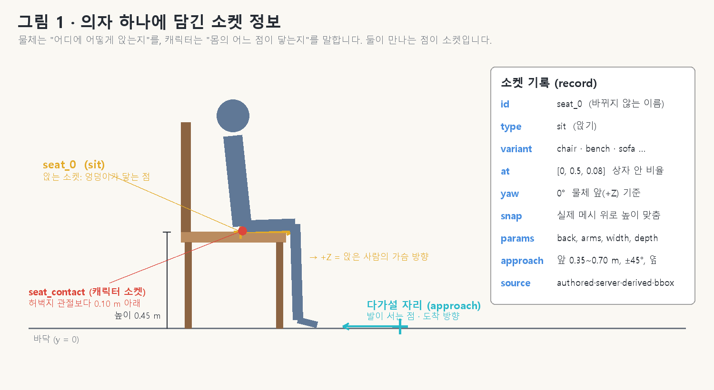
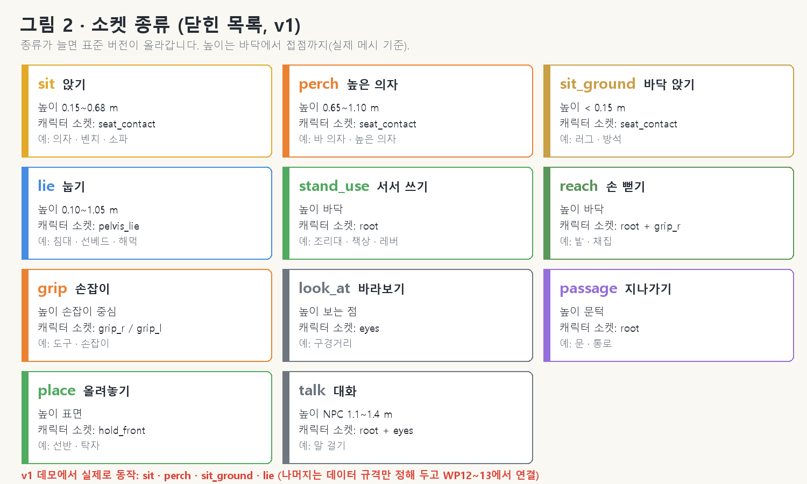
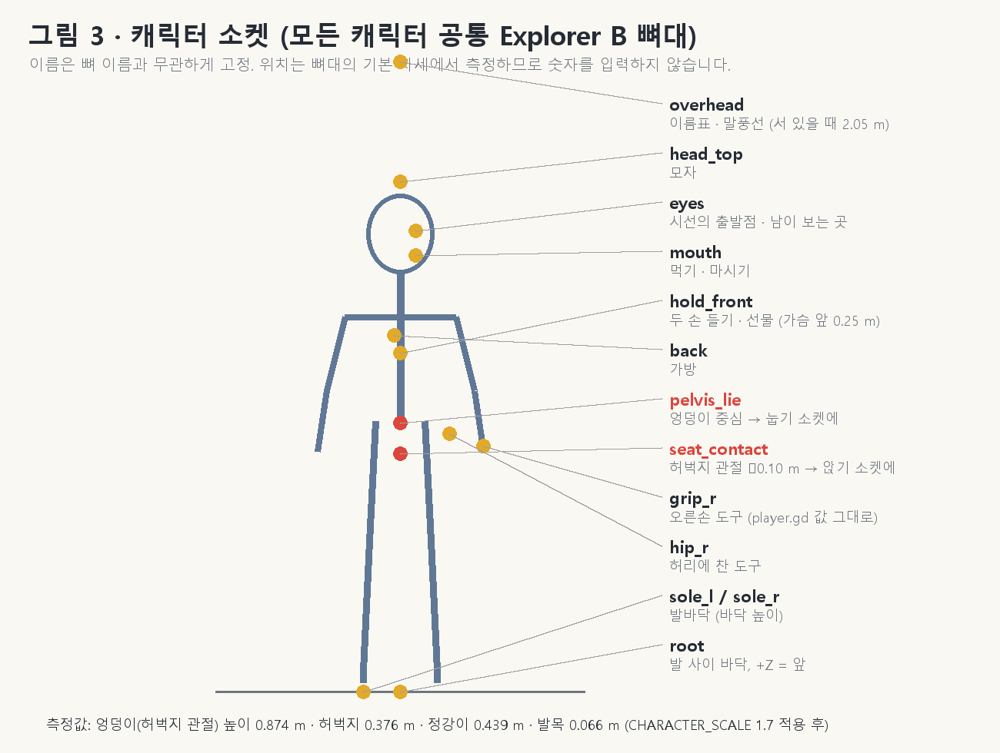
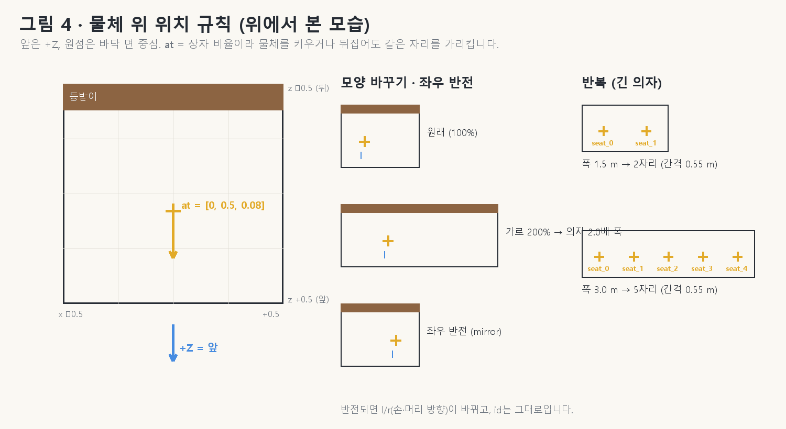
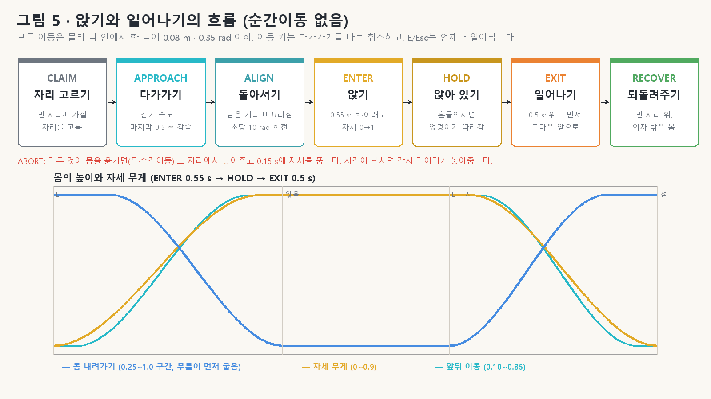
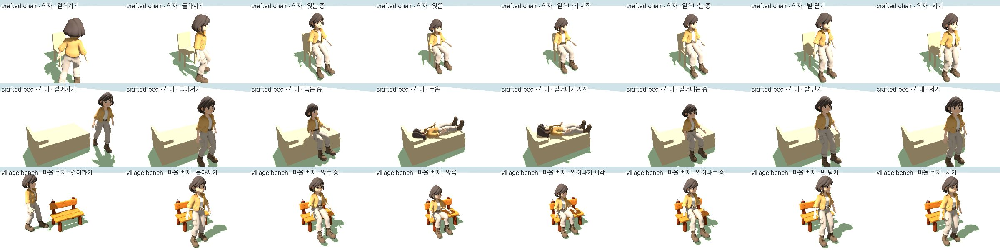
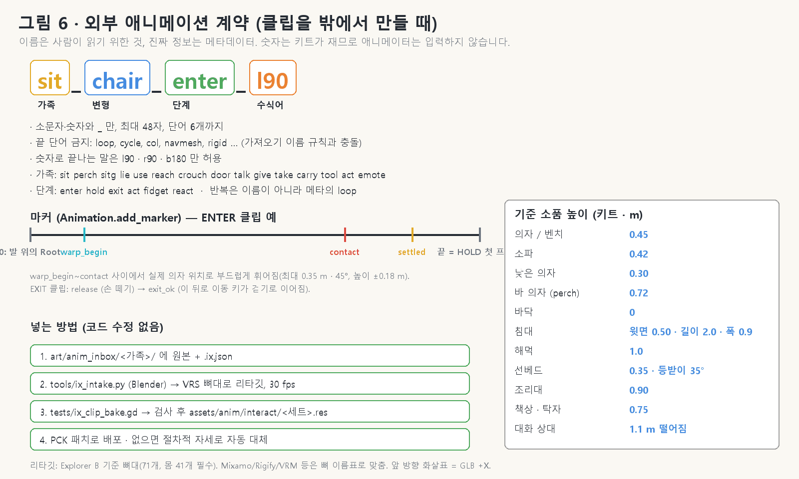

# ISS-1 · 캐릭터와 물체의 상호작용 소켓 표준 (v1)

> 한 줄 요약: **물체는 "어디에, 어떻게"를 소켓으로 말하고, 캐릭터는 "몸의 어느 점이 닿는지"를 말합니다.**
> 둘을 맞추는 동작은 순간이동 없이 이어집니다: 걸어가기 → 돌아서기 → 앉기(눕기) → 앉아 있기 → 일어나기.
>
> 영문 설계서: `docs/design/INTERACTION_SOCKETS.md` · 이 문서는 그 표준을 처음 보는 사람(애니메이터, 기획자)을 위한 설명과 시험 결과입니다.

---

## 1. 왜 필요한가

| 지금까지 | 이제 |
|---|---|
| E를 누르면 한 프레임에 의자 위로 **순간이동** | 의자 앞까지 **걸어가서**, 돌아서서, 0.55초 동안 **앉음** |
| 앉는 높이를 상자 크기의 절반으로 **추측** | 의자의 **실제 표면**(메시 삼각형)에 맞춤 |
| 일어나면 늘 카메라 쪽(+Z)을 봄 | **의자 밖**을 보며, 비어 있는 자리에 섬 |
| 앉기 자세 코드가 세 곳에 따로(방, 그네, 주민) | **자세 레이어 하나**를 모두 사용 |
| 마을 벤치는 "앉아 쉬기"라고 써 있지만 앉지 않음 | 벤치·카페 의자·피크닉 테이블·선베드에 **정말 앉고 누움** |
| 흔들의자에 앉아도 몸이 따라 흔들리지 않음 | 엉덩이가 **흔들리는 좌석을 따라감**(0.3~0.6 cm 이내) |
| 애니메이션을 밖에서 만들 기준이 없음 | **클립 이름·기준 높이·마커 규칙**을 정함(7장) |

## 2. 소켓의 종류

- 목록은 닫혀 있습니다. 새 종류가 필요하면 표준 버전(ISS-2)을 올립니다.
- **높이가 종류를 정합니다.** 0.68 m보다 높은 의자는 자동으로 `perch`(높은 의자 자세), 0.15 m보다 낮으면 `sit_ground`(바닥 앉기). 플레이어가 물체 모양(높이 %)을 바꿔도 맞는 자세가 나옵니다.
- 쉬기(앉을 수 있음/누울 수 있음) 표시는 "앉을 수 있는가"를, 소켓은 "어디에 어떻게"를 정합니다.

## 3. 캐릭터 소켓

모든 캐릭터는 같은 뼈대(Explorer B, 뼈 71개)를 씁니다. 캐릭터 소켓의 위치는 뼈대의 기본 자세에서 **자동으로 측정**합니다(사람이 숫자를 넣지 않음). 앉기에서 중요한 둘:

- **seat_contact** — 허벅지 관절 높이에서 0.10 m 아래. 앉기 소켓에 정확히 놓입니다.
- **pelvis_lie** — 엉덩이 중심. 매트리스 위 0.12 m에 놓입니다.

## 4. 물체 소켓의 위치 규칙

| 규칙 | 뜻 |
|---|---|
| 앞은 +Z, 원점은 바닥 면 중심 | 모든 물체 공통 |
| 소켓 +Z | 쓰는 사람의 **가슴이 향하는 쪽** (의자 밖, 조리대 안, 문 안쪽) |
| `at` | 물체 상자 안의 비율. x·z는 −0.5~0.5, y는 0(바닥)~1(꼭대기) |
| `off` | 비율 뒤에 더하는 m 단위 여유 (늘어나지 않음) |
| `yaw` | 물체 앞 기준 회전(도) |
| `snap` | 실제 메시 위로 높이를 맞춤 |
| 좌우 반전 | 위치·방향이 거울처럼 바뀌고 l/r(손·머리)도 바뀜. **id는 그대로** |
| 반복 | 긴 의자는 폭 ÷ 0.55 m 만큼 자리 (1.5 m → 2자리, 3.0 m → 5자리) |

### 소켓은 어디서 오나 (우선순위)

1. **직접 적은 값** — 방 가구 종류(`ix_data.gd INTERIOR_KINDS`), 마을 소품(`PROP_MODELS`, 모델을 직접 측정).
2. **서버 힌트** — 만들 때 서버가 알려 줌 (WP16, 아직 없음 → 이 단계는 건너뜀).
3. **실제 모양에서 계산** — 직접 만든 물건:
   - 여러 부품 물건: 설계 상자 그대로. 좌석 부품이 움직이면(그네 판, 흔들의자) 소켓도 그 부품을 따라감.
   - 한 덩어리 물건(Tripo 메시): 충돌 상자에서 후보를 찾고, **높이는 항상 실제 메시 삼각형에 맞춤**.
   - 등받이(좌석 가장자리의 높은 상자)가 있으면 그 반대쪽이 앞. 팔걸이는 폭을 줄임. 머리판·등받이가 있는 쪽이 침대의 머리.
4. **상자 추측(마지막 수단)** — 높이 = min(높이의 절반, 0.5 m). 기즈모에서 **호박색**으로 보임.

## 5. 동작의 흐름

| 단계 | 하는 일 | 끝나는 때 |
|---|---|---|
| 자리 고르기 | 비어 있고 유효한 가장 가까운 소켓, 그 앞의 빈 발 자리 | 바로 |
| 다가가기 | 걷기 속도, 마지막 0.5 m 감속. 가구 위로 올라타지 않음 | 0.10 m 안. 0.5초 막히면 1.2 m 이내는 바로 돌아서기, 아니면 취소 |
| 돌아서기 | 남은 거리를 미끄러지듯, 초당 최대 10 rad 회전. 큰 회전은 발걸음 | 0.15~0.40초 |
| 앉기 | 0.55초(낮은 의자 0.5, 바닥 0.6). 무릎이 먼저 굽고 몸이 내려감. 침대는 가장자리에 앉았다가(0.5초) 눕기(0.7초) | 끝 |
| 앉아 있기 | 흔들리는 좌석을 매 틱 따라감. 기울기는 자세 레이어로만 (몸은 늘 곧게) | E · Esc · 이동 키 |
| 일어나기 | 위로 먼저, 그다음 앞으로 (0.5초, 이동 키면 0.4초). 출구 자리는 빈 곳으로 다시 고름 | 0.8 이후 이동 키면 바로 걷기로 |
| 되돌려주기 | 의자 밖을 보며 섬, 자리 점유 해제 | 1틱 |

**안전 장치**: 이동 키는 다가가기를 즉시 취소, E/Esc는 언제나 일어나기, 문·순간이동이 몸을 옮기면 그 자리에서 놓아줌(자세는 0.15초에 풀림), 단계마다 시간 제한(감시 타이머), 모양이 바뀐 캐릭터(옷 갈아입기)도 앉은 채로 유지.

**자세 레이어(`ix_pose.gd`)**: 다리는 실제 좌석 높이에 맞춘 두 관절 계산으로 **발이 바닥에 닿게**(0.30/0.45/0.60 m에서 발목 오차 2 mm 이내) 굽히고, 등과 팔은 재생 중인 숨쉬기 동작 위에 살짝만 더합니다. 눕기는 몸(충돌체)을 눕히지 않고 뼈대만 엉덩이를 축으로 뒤로 눕힙니다. 기존 걷기 각속도 제한기 앞에서 돌기 때문에 관절이 한 틱에 25°를 넘지 않습니다.

## 6. 개발 도구

- **소켓 기즈모**: F3 개발 패널의 「소켓 보기 (ISS-1)」 또는 실행 인자 `--ix-debug`. 꺼져 있으면 아무 노드도 없음(비용 0). 색: 앉기 금색, 눕기 파랑, 쓰기 초록, 다가설 자리 청록, 점유 회색, 무효 빨강, 상자 추측 호박색. 캐릭터 위에 현재 단계와 접점 오차(cm).
- **실험실**: `game/tests/ix_lab.gd` — 42가지 경우를 모두 돌려 `artifacts/ix/lab.json`을 쓰고, `--capture`로 창을 띄우면 아래 연속 사진을 만듭니다.

*위에서부터 만든 의자 · 만든 침대 · 마을 벤치. 각 줄: 걸어가기 → 돌아서기 → 앉는(눕는) 중 → 앉음(누움) → 일어나기 시작 → 일어나는 중 → 발 딛기 → 서기.*

## 7. 외부 애니메이션 계약 (클립을 밖에서 만들 때)

1. **기준 뼈대**: Explorer B (`explorer_b_wardrobe.glb`, 71개, 몸 41개 필수, 손가락은 선택). GLB에서 앞은 **+X**입니다(블렌더의 −Y가 아님).
2. **이름**: `가족_변형_단계[_수식어]` — 예) `sit_chair_enter_l90`, `lie_bed_hold`, `sitg_any_exit`.
   - 소문자·숫자·밑줄만, 48자 이하. 끝 단어로 `loop`·`cycle`·`col` 등 금지(가져오기가 이름을 바꿈). 숫자로 끝나는 말은 `l90`·`r90`·`b180`만.
   - 반복 여부는 이름이 아니라 메타데이터. 반복 단계는 `hold`.
3. **규칙**: 첫 프레임에 Root는 발 위, 앞 화살표 방향. ENTER/EXIT는 Root가 움직여도 되지만 HOLD는 1 cm 이내 정지. 높이 움직임은 Hips에만. 크기(scale) 트랙 금지. 30 fps. ENTER 마지막 = HOLD 첫 프레임(3° · 1 cm 이내).
4. **기준 소품 높이**: 의자·벤치 0.45, 소파 0.42, 낮은 의자 0.30, 바 의자 0.72, 침대 윗면 0.50(길이 2.0 · 폭 0.9), 선베드 0.35(등받이 35°), 해먹 1.0, 조리대 0.90, 책상 0.75. 실제 의자 높이와의 차이는 ±0.18 m까지 자동으로 휘어 맞춥니다(그 밖은 낮은 의자·높은 의자 변형으로).
5. **마커**: `warp_begin`, `contact`(필수, ENTER), `settled`, `release`(필수, EXIT), `exit_ok`, `loop_in`/`loop_out`, `foot_l_plant`/`foot_r_plant` 등. 소리·효과는 마커가 아니라 메타의 이벤트 목록.
6. **넣는 방법**(코드 수정 없음, WP9~10): 원본을 `art/anim_inbox/<가족>/`에 → `tools/ix_intake.py`(블렌더)로 리타깃 → `tests/ix_clip_bake.gd`로 검사·굽기 → `assets/anim/interact/<세트>.res` → PCK 패치. 세트가 없으면 지금처럼 절차적 자세로 자동 대체됩니다.
7. **리타깃**: Mixamo(`mixamorig:*`)·Rigify(`DEF-*`)·VRM·영상 모캡도 뼈 이름표로 맞춥니다. 런타임 RetargetModifier3D는 이 뼈대 이름 구조에 맞지 않아 쓰지 않고, 굽기 단계에서 미리 맞춥니다.

## 8. 시험 결과

| 시험 | 내용 | 결과 |
|---|---|---|
| `ix_math_check` | 회전 0/37/90/217/359° × 모양 50/100/200% × 반전, 20° 기운 부품에서 소켓 위치 | 202/202 · 최대 오차 0.29 mm |
| `ix_pose_check` | 세 GLB 뼈 이름 매핑, 0.30/0.45/0.60 m 좌석, 눕기, 자세 켜고 끄기 | 23/23 · 접점 0.0 cm · 발목 ±2 mm · 관절 최대 5.9°/틱 |
| `ix_sources_check` | 서버 오프라인 설계 16종(흔들의자·침대·소파·벤치·안락의자·왕좌·빈백·그네·해먹·선베드·욕조·변기·러그·시소·흔들목마…), 한 덩어리 침대, 방 가구 | 107/107 · 높이 오차 ≤ 2 cm(타원체 ≤ 3.2 cm) · 계산 0.3~10 ms |
| `ix_flow_check` | 0.30/0.45 의자, 침대, 흔들의자, 이동 키 취소, 외부 이동, 옷 갈아입기, 벤치에 두 명 | 66/66 · 한 틱 최대 0.061 m · 0.30 rad · 접점 ≤ 0.3 cm · 출구 오차 0.000 m · E→앉음 1.32~1.37초 |
| `ix_lab` | 42가지(상자 의자 27, 방 가구 3, 만든 물건 4, 모양 4, 마을 소품 4) | 42/42 · 접점 최대 0.55 cm(흔들의자) · 한 틱 0.061 m · 0.30 rad · 관절 22.9°(제한기 상한) · 앉기 ≤ 1.91초 · 눕기 ≤ 2.63초 |
| `village_rest_check` | 마을에서 만든 흔들의자·침대 (서버) | 21/21 · 한 틱 최대 0.075 m |
| `ix_village_check` | 마을 벤치·카페 의자·피크닉 테이블·선베드, 대화 전 돌아보기 (서버) | 25/25 · 네 소품 모두 앉고/누움 · 한 틱 최대 0.061 m · 대화창은 0.26초 뒤, 주민이 19° 안으로 돌아본 뒤 열림 |
| 기존 시험 | compile_all, controller_acceptance, explorer_b_integration, locomotion_continuity, avatar_everywhere, home_roundtrip, world_transitions, story_chapter, craft_one, interaction, living_objects, field_objects, multiplayer, avatar_rooms, residents, npc_dialogue, door_sounds, home_visit, 기본 통합 시험 | 모두 통과 (hud_fold_check는 기존 시험 스텁의 `post_kept` 누락 오류, furniture_stress는 이 작업 폴더에 없는 `artifacts/furniture-stress.json` 때문에 실행 불가 — 둘 다 이번 변경과 무관) |

**알려진 한계와 실패 기록**

- 관절 한 틱 최대치가 22.9°로 나오는 것은 걷기 → 멈춤 순간의 발 IK 전환을 기존 각속도 제한기가 잡아 준 값입니다(일반 걷기에서도 같은 값, 기준 25° 미만).
- 처음 버전에서 침대에서 일어날 때 0.36 m 튐이 있었음: 다가가는 동안 "턱 오르기"가 침대 위로 몸을 들어 올림 → 상호작용 중에는 턱 오르기를 끔.
- 마을 침대에서 0.11 m 튐: 출구 자리가 침대의 반대 끝으로 골라짐 → 출구 이동 시간을 거리에 맞춰 늘리고, 침대는 긴 쪽에서만 들어가도록 함.
- 출구 자리가 침대의 충돌 상자와 겹쳐 물리가 몸을 밀어냄 → 몸 크기 캡슐로 검사하고 겹치면 바깥으로 5 cm씩 옮김.
- 50% 폭으로 줄인 의자는 좌석이 너무 좁아 **상자 추측**으로 앉습니다(호박색).
- 앉아 있는 모습은 다른 플레이어에게 아직 보이지 않습니다(WP17: 서버 먼저 배포 필요). 지금은 다른 화면에서 땅에 조금 묻힌 채 서 있는 것처럼 보일 수 있습니다(예전 앉기와 같음).
- 카페 의자처럼 앞에 탁자가 있으면 정면 자리가 막힙니다 → 막히면 다른 빈 자리(옆·대각선)로 한 번 더 시도.
- 성능: 자세 계산 한 번 18 µs, 상호작용 중에만 동작. 걷기 경로에는 bool 검사 두 개만 더해졌습니다.
- 주민(NPC)은 아직 이 동작 장치를 쓰지 않습니다(WP15). 이야기의 카페 테라스 손님은 의자의 소켓 위치·방향에 앉고, 그 자리를 점유합니다.

## 9. 남은 작업 (설계서 기준)

| WP | 내용 |
|---|---|
| 8 | 그네·흔들의자·해먹(필드 오브젝트)도 이 동작 장치로 |
| 9~10 | 클립 실행기와 외부 애니메이션 넣기 도구(키트, 인테이크, 검사기) |
| 11 | 발·손 IK와 시선(LookAt) — 높은 의자에서 발 디딤 개선 |
| 12~13 | 짧은 행동(밭, 낚시, 사용)과 문 지나가기 |
| 14 | 캐릭터·도구 소켓으로 모자·가방·도구 붙이기 통일 |
| 15 | 주민이 걸어와서 앉기 |
| 16~17 | 서버 소켓 힌트, 멀티플레이 앉기 동기화 |

## 10. 릴리스 노트 (안)

- 의자·침대·벤치에 이제 **걸어가서 돌아앉습니다.** 순간이동 없이 부드럽게 앉고, 일어나면 의자 밖을 봅니다.
- 직접 만든 가구는 **실제 모양**으로 앉는 자리를 찾습니다. 높이를 바꾸면 앉는 자세도 따라 바뀌고, 흔들의자에 앉으면 함께 흔들립니다.
- 마을의 벤치·카페 의자·피크닉 테이블에 앉고, 해변 선베드에 누울 수 있습니다.
- 주민에게 말을 걸면 서로 마주 본 뒤 대화가 열립니다.
