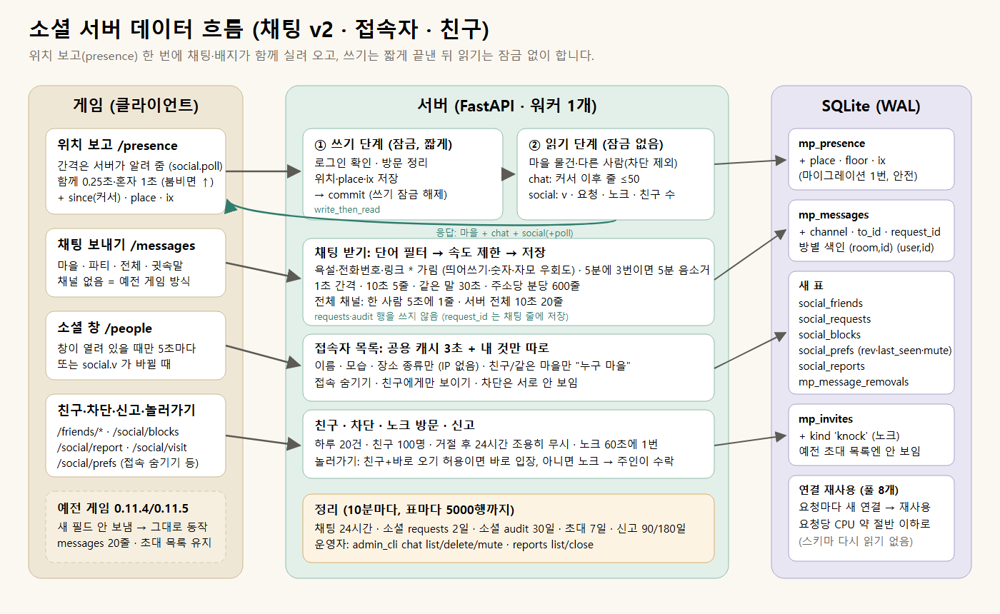

# 소셜 서버 1차 (채팅 v2 · 접속자 · 친구) 요약

브랜치 `wt/socialsrv` · 서버만 바뀌었고 게임(클라이언트)은 아직 그대로입니다. 다음 작업(채팅창·친구 창)은
이 서버 API(`docs/design/SOCIAL_API.md`, 영어)를 그대로 씁니다. 지금 배포된 0.11.4/0.11.5 게임도 이
서버에서 예전처럼 동작합니다.

## 1. 무엇이 생겼나

| 기능 | 내용 |
|---|---|
| 항상 켜진 채팅 | 채널 4개: 마을(방문 중이면 그 마을), 파티, 전체, 귓속말(친구만). 위치 보고 응답에 "커서 이후 새 줄"만 실려 오므로 요청이 늘지 않습니다. 접속하면 최근 30줄(1시간 안)을 기록으로 받습니다 |
| 단어 필터 | 욕설·비하어를 `*` 로 가립니다(띄어쓰기·숫자·점·전각·자모 우회 포함: "시 1 발", "ㅅ.ㅂ", "f u c k"). 전화번호·링크도 가립니다. 5분에 3번 가려지면 5분 음소거. 목록은 `server/data/chat_words.txt`, 학교가 따로 추가할 파일도 지원 |
| 도배 방지 | 1초 간격, 10초에 5줄, 같은 말 30초, 전체 채널은 5초에 1줄·서버 전체 10초 20줄, 같은 주소(학교 공용 IP) 분당 600줄 |
| 접속자 목록 | 서버 전체 접속자와 "지금 내 마을에 있는 사람"(집 안 손님 포함). 학생에게는 이름·모습·장소 종류만 보이고, "누구 마을" 은 친구와 같은 마을 사람에게만. IP 는 어디에도 없음 |
| 개인정보 설정 | 접속 숨기기, 친구에게만 보이기, 친구 신청 받지 않기, 친구가 바로 놀러 오기 허용 |
| 친구 | 신청·수락·거절·취소·삭제, 친구 목록(접속/장소/마지막 접속), 신청 알림(배지). 하루 20건, 친구 100명, 거절 후 24시간은 다시 보내도 조용히 무시 |
| 차단 | 친구·신청·초대·노크·방문을 모두 끊고, 채팅·마을 화면·목록에서 서로 안 보이게 |
| 놀러가기(노크) | 친구가 "바로 오기"를 허용했으면 바로 입장, 아니면 노크 → 주인이 수락하면 입장(손님이 실내면 초대장으로) |
| 신고·운영자 | 신고하면 그 줄과 최근 줄을 함께 저장. 운영자는 `admin_cli chat list/delete/mute`, `reports list/close` 와 관리자 HTTP 로 확인·삭제·음소거. 삭제한 줄은 화면에서도 사라짐 |
| 위치 보고 확장 | 한 번의 마이그레이션으로 `since`(채팅 커서) · `place`/`floor`(어디에 있는지) · `ix`(앉기/눕기 같은 상호작용 상태, 나중 멀티플레이 동기화용 자리) 추가. 예전 게임은 이 필드를 안 보내므로 그대로 |

## 2. 서버를 가볍게 만든 부분

비판 문서(DESIGN_CRITIC)가 짚은 두 문제를 해결했습니다.
- **채팅 전달이 쓰기 잠금 안에서 돌던 문제**: 위치 보고는 이제 "쓰기(짧게) → commit → 읽기(잠금 없음)" 순서입니다.
  채팅·접속자·마을 물건 목록은 모두 읽기 단계에서 만듭니다.
- **requests/audit 표가 끝없이 커지는 문제**: 채팅 줄은 requests·audit 행을 쓰지 않습니다. 소셜 기록은 기간이
  지나면 10분마다 정리됩니다(채팅 24시간, 소셜 requests 2일, 소셜 audit 30일, 초대 7일 등).

덤으로 찾은 큰 비용: 요청마다 SQLite 연결을 새로 열고 닫는 데 쿼리보다 훨씬 많은 CPU 가 들었습니다(스키마를 매번
다시 읽음). 연결을 재사용하게(풀 8개) 바꾸고, 큰 응답은 바로 JSON 으로 보내고, 위치 저장은 디스크 동기화를 기다리지
않게(정전 시 마지막 순간의 위치만 사라질 수 있음) 하자 요청 1개당 서버 CPU 가 절반 이하로 줄었습니다
(마을 위치 보고 9.2 → 4.4 ms, /v1/social 13.7 → 2.7 ms). 전체 서버 테스트도 158초 → 130초로 빨라졌습니다.

**자동 감속(백프레셔)**: 서버가 초당 위치 보고 수를 세어, 예산(기본 초당 60회)을 넘으면 새 게임에게 "조금 천천히"
간격을 알려 줍니다(응답의 `social.poll`). 몇 명일 때는 지금처럼 초당 4번, 한 반 60명이 다 모이면 저절로 초당 1~2번
수준으로 내려가 서버가 버팁니다. 운영자는 `VILLAGEN_PRESENCE_BUDGET` 로 조절합니다.

## 3. 부하 시험 (60명 교실, 이 PC)

60명: 마을 15곳에 3명씩(주인·손님 밖, 손님 1명 집 안), 혼자 마을 9명, 작업실 3명, 생존 탐험 3명(입력 초당 5번).
채팅은 1인당 평균 20초에 1줄(전체 15%, 귓속말 10%, 욕설 2%), 소셜 창 20명이 열어 둠. 2분 측정, CPU 는 서버 프로세스가
코어 1개를 몇 % 썼는지. 부하를 만드는 쪽은 프로세스 8개로 나눔(1개일 때는 그쪽이 먼저 막혀 측정이 틀렸음).

| 실행 | 서버 | 게임 | 위치 보고 간격(함께/혼자) | 처리한 요청/초 | 서버 CPU | 위치 보고 응답 p50/p95 | 채팅 도착 p50/p95 |
|---|---|---|---|---|---|---|---|
| A | 이전 서버 | 0.11.x 60명 | 0.25초/0.25초 | 168 (240 중, **포화**) | 146% | 56 / 975 ms | – |
| B | 새 서버 | 0.11.x 60명 | 0.25/0.25 | 233 | 98% | 13 / 79 ms | – |
| C | 새 서버 | 새 게임 60명 | 0.25/0.25 | 242 | 90% | 11 / 52 ms | 0.16 / 0.6 초 |
| D | 새 서버 | 새 게임 60명 | 0.25/1 | 169 | 57% | 10 / 34 ms | 0.22 / 0.96 초 |
| F | 새 서버 | 새 게임 60명 | 0.5/1 | 110 | 34% | 9 / 19 ms | 0.33 / 0.95 초 |
| G | 새 서버 | 새 게임 60명 | 1/2 | 68 | 22% | 8 / 14 ms | 0.63 / 1.8 초 |
| E | 새 서버 | 새 게임 120명 | 0.5/1 | 221 | 102% | 16 / 94 ms | 0.36 / 0.99 초 |
| H | 새 서버 | 새 게임 60명, 서버 안내(`social.poll`) 따름, 예산 60 | 자동(약 0.6/2.4) | 83 (위치 보고 60.3) | 25% | 9 / 20 ms | 0.47 / 2.3 초 |

- 메모리 약 90~110 MB, DB 파일은 채팅 초당 3줄일 때 분당 약 93 KB 늘고 24시간 지나면 지워진 자리를 다시 씁니다.
- **t4g.small(2 vCPU, 기본 크레딧 0.4 vCPU) 추정**: 이 PC 보다 요청당 약 1.7배 느리다고 보면 C(모두 초당 4번)는
  코어 1.5개분이라 서버가 밀립니다(A 처럼). F 는 약 0.6, G 는 약 0.37 vCPU. 기본 예산 60 을 따르게 한 H 에서는 서버가 정확히 초당 60.3회로
  맞춰졌고 약 0.43 vCPU(기본 크레딧 근처)로 추정됩니다. 혼자 있는 사람에게 가는 채팅은 그만큼 늦게(최대 2초대) 도착합니다. VM 에서 직접 재 보지는 않았습니다. 이 도구는 돌고 있는 서버를 겨눌 수 없고(자기 서버를 따로 띄움),
  VM 에서 재려면 수업 밖 시간에 개발 서버를 잠시 끄고 개발 서버 이미지 안에서 돌립니다(명령은 SOCIAL_API.md 9.4).
  수업 중에는 CloudWatch 의 CPUCreditBalance 를 보시길 권합니다. 자동 감속은 새 게임만 늦추므로, 반 대부분이
  0.11.x 인 배포 첫날의 부하는 B 줄(코어 약 1개)입니다.
- **예전 서버로 되돌릴 때**: 되돌리기 직전에 `python -m server.admin_cli knocks expire` 를 API 컨테이너에서 실행하거나
  서버를 2분 멈춰 둡니다(대기 중인 노크가 예전 서버에서 파티 초대로 보이기 때문).

## 4. 결정이 필요한 것

설정은 학교 서버의 `ops/production.env`(개발 서버는 `ops/staging.env`)에 한 줄씩 적고 업데이트(`sudo bash ops/update_online_server.sh main`)를
돌리면 적용됩니다. 두 compose 파일이 이 값들을 API 컨테이너에 넘기고, 예시 파일(`ops/production.env.example`)에 기본값과 함께
모두 적혀 있습니다. 적용 확인은 `/health` 의 `global_chat`, `social_roster`, `social_poll`.

1. **전체 채팅을 학교 서버에서 기본으로 켤지**: 지금 기본은 켬(필터·도배 방지·음소거·운영자 삭제 있음). 끄려면 `VILLAGEN_GLOBAL_CHAT=off`.
2. **접속자 목록 공개 범위**: 기본은 전원(이름·모습·장소 종류만). 친구만 보이게: `VILLAGEN_SOCIAL_ROSTER=friends`, 끄기: `off`.
3. **귓속말은 친구끼리만**(지금 구현). 모르는 사람에게도 열지 여부.
4. **친구가 바로 놀러 오기 기본값**: 지금은 꺼짐(노크 필요). 학생이 설정에서 켤 수 있음.
5. **위치 보고 예산**: 기본 초당 60회(60명 반이 모이면 자동으로 초당 1~2번). 더 부드럽게 원하면 올리되 CPU 크레딧을 확인.
6. **욕설 목록 검토**: `server/data/chat_words.txt` 는 작게 시작했습니다(오탐이 많은 '보지/자지/꺼져/졸라/새끼' 단독은 뺌). 선생님이 보실 추가 목록 파일을 둘지.

## 5. 확인한 것

- 서버 테스트 전체: `.tools\server-venv\Scripts\python.exe -m pytest server/tests -q` → **932개 통과** (새 테스트 60개:
  채널·커서·기록·필터·속도 제한·정리·차단·친구·개인정보·노크·캐시·신고·운영자 도구·마이그레이션·자동 감속).
- 예전 게임 호환: 0.11.5 게임으로 Godot 클라이언트 시험 `multiplayer`, `host_leaves`, `home_visit`, `visit_furniture_sync` 4개 모두 통과(포트 8863, 끝난 뒤 데이터 삭제).
- 부하 시험: 위 표(`tools/test_multiplayer_load.py`, 포트 8867, 끝나면 데이터 삭제).
- 마이그레이션: 0.11.5 시절 DB 에 두 번 실행해도 데이터 그대로(테스트로 확인).

## 6. 다음 작업(클라이언트)에게
`docs/design/SOCIAL_API.md` 에 모든 경로·응답·오류 코드·폴링 규칙이 있습니다. 핵심: `/health` 의 `social_features`
가 있을 때만 새 필드를 보내고, 422 응답의 `fields` 에 적힌 묶음만 끄고, 응답의 `social.poll` 간격을 따릅니다.
