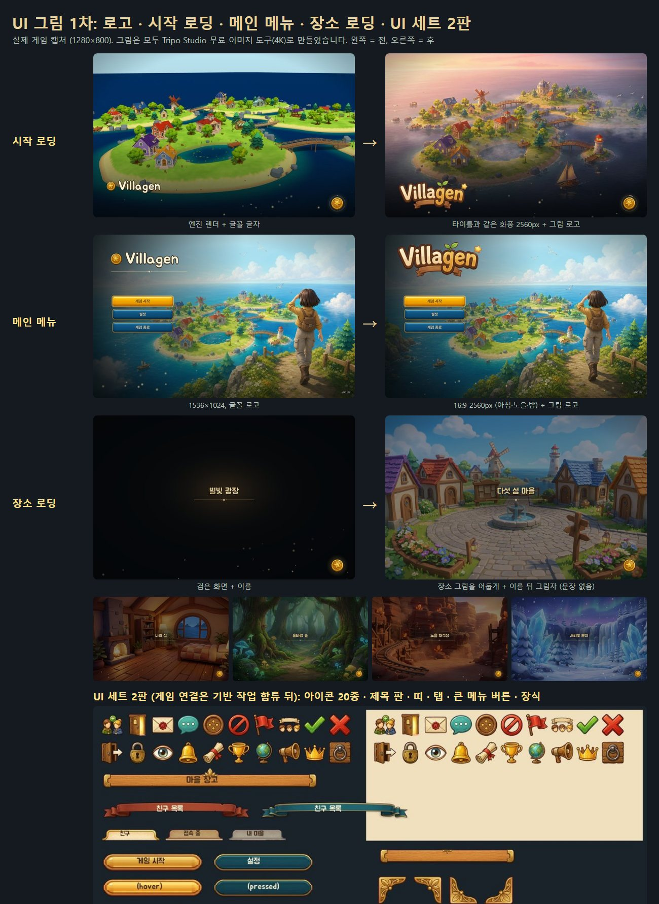

# UI 그림 작업 기록

UI 담당 세션의 그림 작업을 모은 문서입니다. 화면 통일 규칙은 [UI_UNIFICATION.md](UI_UNIFICATION.md)에 있습니다.

## 1차 (2026-10-15): 로고, 시작 로딩, 메인 메뉴, 장소 로딩, UI 세트 2판

### 무엇이 바뀌었나
| 화면 | 전 | 후 |
|---|---|---|
| 시작 로딩 | 게임 엔진으로 찍은 섬, 하늘이 띠처럼 잘림, 글꼴 글자 로고 | 타이틀과 같은 화풍의 섬 그림(2560px), 그림 로고 |
| 메인 메뉴 | 1536×1024 그림, 글꼴 로고 | 같은 그림을 16:9로 넓힌 2560px 판(아침·노을·밤), 그림 로고 |
| 장소 로딩 | 검은 화면에 장소 이름 | 장소 그림을 어둡게 깔고 이름 뒤에 부드러운 그림자. 문장은 넣지 않음 |

장소 그림은 마을, 섬 4곳(풍차 들판, 정원 언덕, 캠프 초원, 등대섬), 집 안, 탐험 지역 3곳(솔바람 숲, 노을 채석장, 서리빛 분지)입니다. 물결빛 광장은 마을 그림을 씁니다.

### 그림을 만든 방법
- 도구: Tripo Studio 이미지 도구, Nano Banana Pro, 16:9, 4K(4096×2272). 비용은 0입니다(무료 사용량 안).
- 화풍: 기존 타이틀 그림을 참고 그림으로 붙였습니다. 처음에는 2D 그림풍으로 나와서 "부드러운 3D 애니메이션 영화풍, 평면 2D 아님"을 넣어 다시 만들었습니다.
- 로고: 마젠타 배경에 그리고 잘라 냈습니다. 별 주변의 분홍 빛번짐은 바깥과 이어진 밝은 분홍 화소만 지워서 없앴습니다. 글자 안의 흰 반사광은 남깁니다.
- 원본: `output/ui-art-20261015/raw/` (Git 밖, 약 200MB). 고른 그림은 `tools/build_brand_art.py`의 `PICKS`에 적혀 있고, 한 줄을 바꾸고 다시 돌리면 교체됩니다.

### 게임 쪽
- `scripts/brand.gd`: 그림 로고 하나를 타이틀과 시작 카드가 함께 씁니다.
- `scripts/transition.gd`: `loading(제목, 종류, 장소 그림 키)`. 그림은 작업 스레드에서 읽고 다 읽히면 0.25초 동안 나타납니다(첫 프레임이 멈추지 않음). 최근 2장은 메모리에 남겨 마을과 집을 오갈 때 바로 보입니다. 키가 없으면 예전처럼 어두운 카드입니다.
- 타이틀 그림은 "천천히 확대" 효과를 넣지 않았습니다. 예전에 그림이 떨려 보여서 뺀 기록이 있습니다.
- 용량: 그림 14장(로고 1, 타이틀 3, 표지 1, 장소 9)이 임포트 후 약 5.5MB입니다. 손실 WebP 0.86, 밉맵 켬.

### 확인
- `tests/loading_backdrop_check.gd`: 장소 그림 로드, 스레드 읽기 후 나타남, 캐시 2장, 그림 없는 카드, 시작 카드 로고, 타이틀 로고. 모두 통과.
- `tests/title_art_check.gd`, `tests/world_polish_check.gd`(fade 부분), `tests/door_sounds_check.gd` 통과.
- BenQ 화면에서 창 모드로 실제 캡처(위 그림).

### UI 세트 2판 (그림만, 연결은 다음 단계)
- 아이콘 20종(128px): 친구 신청, 놀러가기, 초대, 귓속말, 더보기, 차단, 신고, 파티, 수락, 거절, 나가기, 잠금, 보기, 알림, 퀘스트, 업적, 접속, 외치기, 방장, 노크.
- 창 부품(2배 해상도, 9분할 여백은 `frames/frames_v2.json`): 제목 판(+ 잎 장식), 붉은·청록 띠, 탭 3상태, 큰 메뉴 버튼 금색·밤색 4상태, 잎 구분선, 모서리 장식 4개.
- 첫 세트의 아이콘 시트와 종이 창을 참고 그림으로 붙여 같은 화풍으로 만들었습니다. 만드는 스크립트는 `tools/build_ui_kit2.py`.
- RpgUi 연결은 UI 기반 작업(wt/uifound)이 합쳐진 뒤 친구창·채팅창과 함께 합니다.
