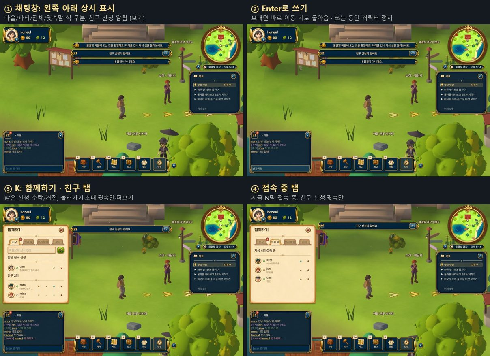

# 상시 채팅창 · 함께하기 창 · 키 통합 (2026-10-15)

U-WP-04(키 입력 통합)와 U-WP-12~15(채팅·함께하기)를 묶은 기록입니다. 설계는 [UI_UNIFICATION.md](UI_UNIFICATION.md) 4·6·7장과 [SOCIAL_CHAT_FRIENDS.md](SOCIAL_CHAT_FRIENDS.md), 서버 API는 [SOCIAL_API.md](SOCIAL_API.md)에 있습니다.

## 무엇이 바뀌었나

### 키 입력 (마을 · 집 안 공통)
| 키 | 동작 |
|---|---|
| 창을 연 키 (Tab 지도, B 창고, O 옷장, C 제작) | 같은 키로 닫힘 |
| Esc | 맨 위 창 → 옆 서랍(함께하기·가방) → 일시정지 순서로 닫힘 |
| E · Space · Enter | 대화 넘기기 (마을 대화도 이제 키로 넘어감) |
| Enter | 채팅 쓰기 시작 (창·대화·배치 중이 아닐 때) |
| K | 함께하기 창 열기·닫기 (설정에서 바꿀 수 있음) |

- 대화에서 클릭이나 E로 줄을 한 번에 다 보여 줄 때, 글자 타이핑 애니메이션이 계속 돌면서 다시 덮어써서 아무 반응이 없어 보이던 버그를 고쳤습니다(마을·집 안 모두).
- K는 project.godot를 바꾸지 않고 시작할 때 추가되는 키입니다(PCK 패치로 배포 가능).

### 상시 채팅창 (`scripts/chat_box.gd`)
- 왼쪽 아래에 늘 있습니다. 마을·집 안·탐험을 오가도 대화가 이어집니다.
- 채널: 마을(흰색), 파티(청록), 전체(금색), 귓속말(분홍). 머리줄의 채널 단추로 바꾸거나 `/w 이름 내용`, `/r`, `/p`, `/v`, `/g`로 보냅니다. 이름을 누르면 그 사람에게 귓속말.
- Enter로 쓰고 Enter로 보내면 바로 이동 키로 돌아옵니다. 빈 Enter, Esc, 화면 클릭도 입력을 끝냅니다(그 클릭은 가구를 누르지 않음).
- 쓰는 동안 캐릭터는 서 있고, 끝나면 W·A·S·D 눌림을 풀어 키가 박히지 않게 합니다. 한글 마지막 글자가 들어가도록 한 프레임 기다린 뒤 보냅니다.
- 8초 동안 조용하면 유리판이 흐려지고, 마우스·새 대화·입력으로 다시 밝아집니다. U(HUD 접기)로 머리줄만 남게 접힙니다.
- 사용자 글은 서식 태그로 해석하지 않습니다. 로그인 직후 지난 대화는 조용히 채워지고(안 읽음으로 세지 않음), 같은 줄이 다시 오지 않습니다.
- 창(제작·지도 등)이나 대화가 열리면 채팅이 숨고, 닫으면 다시 나옵니다.
- 같은 마을 사람이 말하면 머리 위에 말풍선이 4초 뜹니다.

### 함께하기 창 (K, `scripts/social_window.gd`)
- 왼쪽 종이 서랍, 탭 4개: **친구 · 접속 중 · 우리 마을 · 파티**. 친구와 접속 중은 서버가 기능을 알릴 때만 보입니다(심사 서버에는 안 보임).
- 친구: 받은 신청(수락·거절), 친구 목록(상태 점, 있는 곳 또는 마지막 접속), 놀러가기·초대·귓속말·더보기(파티 초대, 친구 끊기, 차단, 신고), 보낸 신청, 차단한 사람.
- 접속 중: "지금 N명 접속 중", 친구 신청·귓속말·더보기.
- 우리 마을: 받은 초대, 문 두드리는 사람(들이기·거절), 마을에 있는 사람(방문 끝내기), 공개 설정(접속 숨기기, 친구 바로 들어오기, 친구 신청 받기).
- 파티: 만들기, 멤버(파티장 왕관), 함께 출발(마을에서), 협동 탐험 복귀, 나가기, 보상 받기.
- 친구 신청·초대·노크는 알림 줄에 [수락]·[보기] 단추로 뜹니다.
- 예전 "함께하기" 창과 마을의 함께하기 칩은 이것으로 바뀌었습니다. 탐험에서는 협동 체력 줄이 있는 작은 칩이 남습니다.

### 구조
- `scripts/social_hud.gd`: 로그인한 세션마다 하나, 장면 밖(트리 루트)에 있는 층. 마을·집 안·탐험의 접속 정보 응답을 받아 채팅과 목록을 채우고, 응답에 채팅 커서(since)와 위치(place)를 붙입니다. 로그아웃이나 세션 만료 때 기록과 함께 사라집니다.
- 서버가 새 필드를 거절하면(422 fields) 그 묶음만 이번 세션에서 끕니다. 심사 서버(기능 없음)에서는 예전 `messages` 목록으로 동작합니다.
- RpgUi에 탭(`tab_strip`), 사람 줄(`person_row`), 상태 점, 둥근 초상, UI 세트 2판의 탭·큰 버튼 모양이 들어갔습니다.

## 확인
| 테스트 | 결과 |
|---|---|
| `window_keys_check` (신규): Tab·B·O·C 여닫기, Esc 순서, 서랍 Esc, E·Enter 대화 넘기기 | 통과 |
| `chat_box_check` (신규): 기록 채우기, 반복 없음, 서식 무시, Enter 보내기·이동 복귀, Esc, /w, 창이 열리면 숨김, K 서랍 탭·줄, 로그아웃 정리 | 31개 통과 |
| `multiplayer` (서버 3명): 다른 사람 채팅창에 대화 도착, 함께하기 창 | 36개 통과 |
| `hud_fold_check`, `tooltip_check`, `settings_check`, `ui_consistency_check`, `keycap_rebind_check`, `toast_check`, `village_rest_check`, `ix_village_check`, `craft_one_check` | 통과 |
| `ime_typing` (실제 한글 입력, 사용자가 직접 실행) | 새 흐름(Enter·Enter·Enter)으로 바꿈, 실행 필요 |

알려진 것: `interior_walk`의 10건 실패(사다리 오르기, 등대 가구 닿기)는 통합 기준 커밋(fb2d589)에서도 똑같이 나서 이번 변경과 관계없습니다. Handoff 세션에 알렸습니다.
