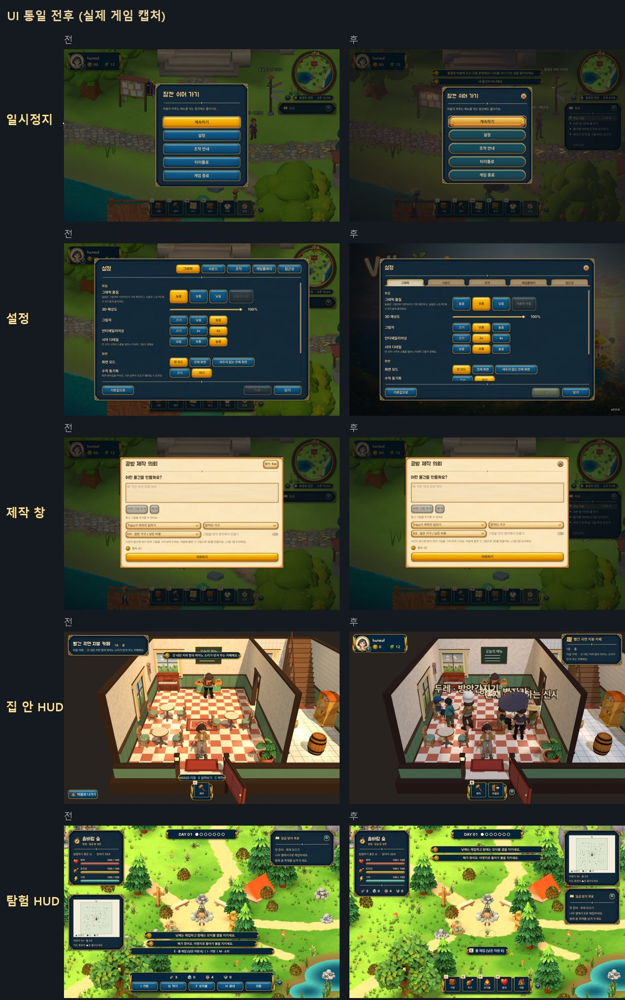
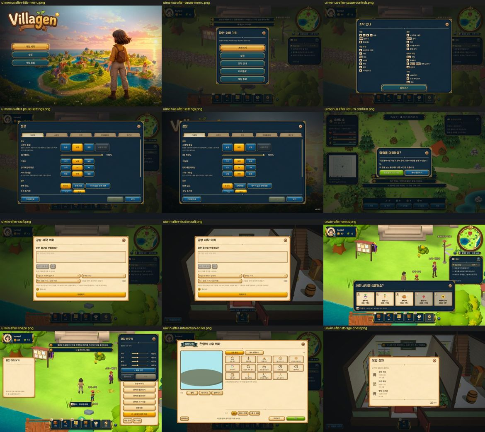

# UI 통일 3단계 기록 (2026-10-15)

[UI_UNIFICATION.md](UI_UNIFICATION.md)의 남은 작업(U-WP-05, 06, 07, 09, 10, 11a, 11b)을 세 브랜치로 나눠 동시에 하고 `wt/uiart`에 모았습니다. 채팅·함께하기·키 통합은 [UI_CHAT_KO.md](UI_CHAT_KO.md), 그림 작업은 [UI_ART_KO.md](UI_ART_KO.md)에 있습니다.

## 무엇이 바뀌었나

### 시스템 메뉴 (U-WP-07)
- 일시정지, 설정, 버전 알림 차단 화면, 탐험 귀환 확인창이 모두 같은 밤색 창(RpgUi.window)과 하나의 어두운 배경을 씁니다. 일시정지에서 설정을 열어도 배경은 하나입니다.
- 귀환 확인창은 Windows 기본 확인창에서 게임 창으로 바뀌었습니다.
- 설정 탭은 새 탭 그림(tab_strip)이고, 설정 화면만의 테마 코드는 지웠습니다.
- 일시정지 → 조작 안내에 Enter 채팅, K 함께하기, U HUD 접기, 1~9 선택지, E·Space·Enter 대화 넘기기를 키 그림으로 넣었습니다. 키를 바꾸면 그림도 바뀝니다.
- 타이틀과 일시정지 메뉴 버튼은 UI 세트 2판의 큰 그림 버튼입니다(첫 칸 금색, 나머지 밤색).

### 창 (U-WP-05, 06)
- 제작 창: 마을·집 안 모두 공용 창(action "craft")입니다. C·Esc로 닫히고, 키를 바꾸면 그 키를 따릅니다. 집 안에서도 제작 창이 뜨면 채팅이 비켜납니다.
- 상호작용 편집기, 집 안 보관 상자, 씨앗 고르기, 모양 바꾸기가 같은 창 틀·닫기 키·키 그림을 씁니다. "E 닫기" 같은 글자 안내는 키 그림으로 바꿨습니다. 씨앗은 칸마다 1~5 키가 붙었습니다.

### HUD (U-WP-09, 10, 11a, 11b)
- 탐험: 680px 글자 도구 막대가 아이콘 칸(가방 I, 먹기 Q, 모닥불 F, 붕대 H, 귀환)으로 바뀌었습니다. 지도와 목표는 마을처럼 오른쪽 위에, 자원 개수는 왼쪽 상태 카드에 있습니다.
- 집 안: 왼쪽 위에 내 프로필, 오른쪽 위에 위치 카드(들어올 때 소개 문구를 잠깐 펼침), 아래 가운데에 아이콘 칸(가방, 제작, 마을로, 내 집/공방)이 생겼습니다. U로 HUD가 접힙니다.
- 집 안 가방: 밤색 상자에서 마을과 같은 종이 서랍(가방)으로 바뀌었고, 탭과 색 견본이 공용 부품입니다. I·Esc로 닫힙니다.
- E 안내 칩: 마을·집 안·탐험 모두 같은 칩(y 560)이고 키 글자는 설정을 따릅니다.
- 채팅창은 세 곳 모두 왼쪽 아래 같은 자리입니다. 탐험의 함께하기 칩은 없앴고, 협동 탐험일 때만 날짜 아래에 작은 협동 체력 줄이 뜹니다.
- UI 배율 120~140%에서 아이콘 칸과 안내 칩이 채팅 구석을 피해 오른쪽으로 비켜나고, 알림 줄은 좌우 카드 사이로 좁아집니다.

### 그 밖의 수정
- 알림 줄: 같은 문장이 처음 뜬 지 2초가 지나 다시 오면 시간을 늘리지 않습니다(탐험 안내 문장이 사라지지 않던 문제).
- 집 안 제작 창 한글 입력 보고: 원인은 테스트였습니다. 앞 단계에서 만든 물건이 완성돼 제작 창이 "완성했어요!" 화면으로 열렸고, 숨은 입력칸에 입력했습니다. 테스트가 먼저 "새로 만들기"를 누르도록 고쳤고, 입력칸이 보이고 한글이 들어가는지 확인하는 검사를 넣었습니다. 실제 한글 입력 실행(`ime_typing`)은 사용자가 한 번 돌려야 합니다.

## 확인
- 새 테스트: `hud_layout_check`(마을·탐험·집 안을 UI 배율 80/100/120/140%에서 HUD 겹침 없는지, 69개), `ui_consistency_check`에 한 배경·탭·키 따라가기·차단 화면 검사 추가.
- 세 브랜치를 합친 뒤 한 번에 돌린 결과(통과 수, 모두 실패 0):

| 묶음 | 테스트 |
|---|---|
| UI | ui_consistency 65, window_keys 44, chat_box 26, hud_layout 69, hud_fold 69, keycap_rebind 26, toast 28, tooltip 45, settings 263, title_art 12, loading_backdrop 27, npc_dialogue 9 |
| 놀이 | craft_one 22, craft_panel 42, interaction 40, object_transform, story_chapter 52, quest 331, npc_gift 33, home_visit 11, home_roundtrip, avatar_rooms 5, combat_play 6, multiplayer 38, village_rest 21, ix_village 40, painter_e2e 38, content_patch 29, interior_walk |
| 통합 | integration (스크립트 오류 0) |

`ix_village_check`는 게임 시각이 밤이면 "말 걸 주민" 항목이 실패합니다(주민이 집에 들어감). 낮 12시(`-Hour 12`)로 돌리면 40개 모두 통과합니다.

알려진 것(이번 작업과 무관, 기준 커밋에서도 같음): `version_gate_check`·`patch_update_check`는 이 PC의 QA 환경에서 실패합니다. `studio_binding`·`studio_flow`는 없어진 workshop 데모 계정으로 로그인해서 멈춥니다. `life_loop`은 `tools/life_bridge.py` 브리지가 있어야 돕니다.
