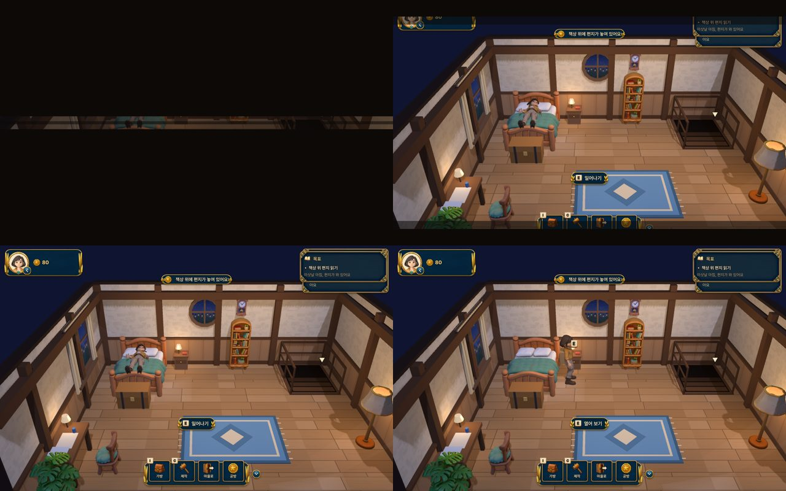
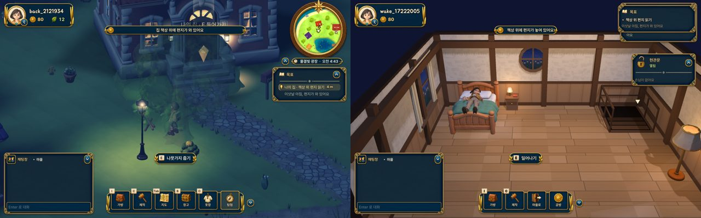
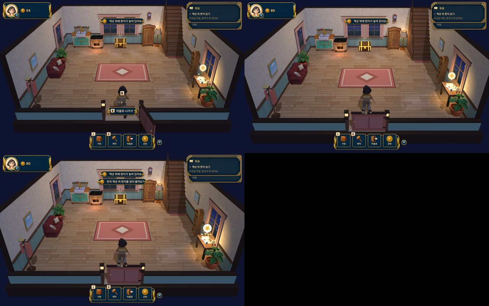
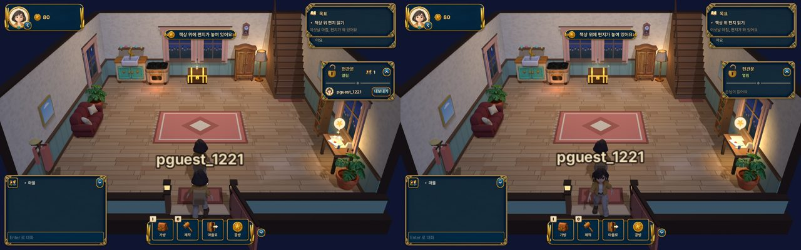
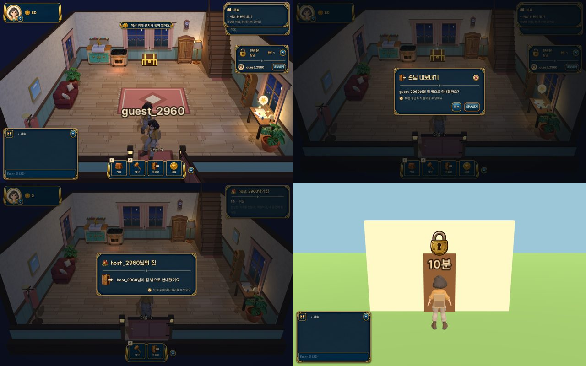
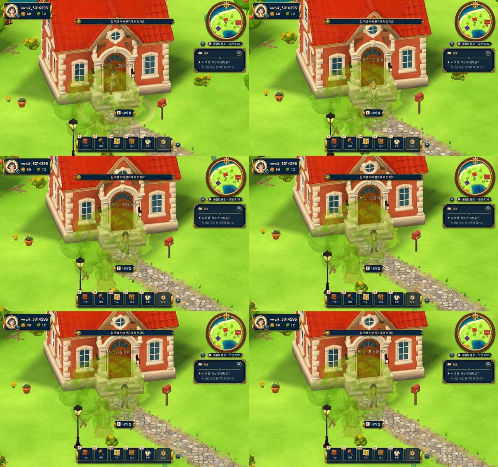

# 집·문·방문 (N3, 2026-10-16)

집에 들어가고 나오는 장면, 문이 열리고 닫히는 모습, 집 잠금과 손님 내보내기, 접속할 때 침대에서 일어나는 장면을 만들었습니다. 0.11.8에 들어간 부분은 병합 커밋 7597a39에 있습니다. 그 뒤 dev 작업은 wt/home 브랜치에 있습니다.

## 한눈에 보기

| 번호 | 내용 | 파일 | 판 |
|---|---|---|---|
| 57 | 게임 종료(메뉴·타이틀·창 X) 때 화면이 어두워진 뒤 꺼짐. 최대 0.8초 | clean_exit.gd, pause_menu.gd | 0.11.8 |
| 55·56 | 서버 resume에 따라 시작: 다락 침대에서 일어나기 또는 마을의 마지막 자리 | main.gd authenticate, bed_wake.gd | 0.11.8 |
| 54 | 편지 맨 위 '안녕!', 편지를 열기 전에는 집 문이 열리지 않음 | story_home.gd | 0.11.8 |
| 32·49·51 (실내) | 현관문이 평소 닫혀 있고 나·손님·주민이 지날 때 열림. 손님이 문으로 걸어 들어오고 나감 | room_door.gd | 0.11.8 |
| 49·51 (마을) | 문까지 걸어가 들어가고, 돌아오면 문간에서 걸어 나옴. 다른 사람이 들어가거나 나오면 그 문이 반응함 | village_doors.gd | 0.11.8 (+dev 보완) |
| 50·52 | 주인용 잠금·내보내기 패널, 손님에게 보이는 안내 카드, 마을 문 앞 자물쇠 표시 | home_door_panel.gd, home_door.gd | 0.11.8 |
| 문짝 | 맵 세션이 원래 메시에서 떼어 낸 문짝(building_doors.gd)을 열림 정도(0..1)로만 움직임 | village_doors.gd, room_door.gd | dev |

## 1. 접속하면 침대에서 일어나기 (55·56)



- 서버가 로그인 응답에 주는 `resume`(server/last_spot.py)로 시작 장면을 정합니다.
  - `null`(처음 접속)이거나 `wake=true`(1시간 넘게 떠나 있었거나 집에서 끝냄): 다락 침대에서 시작합니다.
  - `spot.scene=="village"`: 마을의 그 자리에서 같은 방향을 보고 시작합니다.
  - 그 밖의 경우: 집 문으로 들어오며 시작합니다.
- 기상 순서:
  1. 로딩 카드 아래에서 이미 누워 있습니다(ix_driver.gd `settle_now()`, 눕는 소리 없음).
  2. 카드가 걷히면 눈꺼풀이 반쯤 열렸다가 한 번 깜빡이고 다 열립니다.
  3. 침대 가장자리에 앉았다가 일어나 침대 옆에 섭니다.
  4. 도중에 이동 키를 누르면 바로 일어나고, 눈꺼풀도 0.25초 만에 열립니다.
- 마을 자리 복원: 그 자리에 땅이 있고, 높이 차이가 1 m 이내이며, 기울기가 완만할 때만 그 자리에 섭니다. 아니면 집 문 앞에서 시작합니다(`bed_wake.gd resume_spot`).



왼쪽은 마을의 마지막 자리로 돌아온 장면, 오른쪽은 처음 접속해 침대에서 일어나는 장면입니다(`resume_login_capture`가 타이틀에서 실제로 로그인해 확인).

## 2. 실내 현관문 (32·49·51)



- interiors.gd가 만드는 `FrontDoor`는 예전에 108°로 열린 채 고정돼 있었습니다. 이제 평소에는 닫혀 있습니다.
- 문을 여닫는 방법(어느 쪽 경첩인지, 한 짝인지 두 짝인지, 어느 방향으로 여는지)은 맵 세션 담당입니다. 이 세션은 `Interiors.set_front_door_open(층, 0..1)`로 열린 정도만 넘깁니다.
- 열리는 경우:
  - 들어올 때: 문밖에서 열린 문으로 걸어 들어오고(2.3 m/s), 지나가면 문이 닫힙니다.
  - 나갈 때: 문이 열리고 걸어 나가며 화면이 어두워집니다.
  - 주민이 문 근처를 걸어갈 때.
- 소리는 door_audio.gd를 씁니다. 열릴 때 걸쇠 소리와 삐걱임이 나고, 닫힘 소리는 문짝이 문틀에 닿는 순간에 납니다.
- 편지를 열기 전에는 문이 열리지 않습니다. 대신 '먼저 책상 위 편지를 읽어 볼까요?'가 뜨고 편지 위 별이 튀어 오르며 반짝입니다.
  - 편지를 한 번 열면 서버 저장이 실패해도 나갈 수 있습니다.
  - 테스트 실행(`--qa`)에서는 이 막기가 꺼져 있습니다. 막기를 확인하는 테스트에서만 Engine meta `qa_letter_first`로 켭니다.

## 3. 손님이 문으로 들어오고 나가기



- 내가 집에 있을 때 친구가 들어오면, 문이 열리고 친구가 문간에서 지금 있는 자리까지 걸어옵니다. 그 뒤에는 원래의 움직임 보간(remote_motion)이 이어받습니다.
- 친구가 나가면 문까지 걸어가고, 문이 열렸다가 닫힌 뒤 사라집니다.
- 처음 들어왔을 때 이미 집 안에 있던 사람은 그 자리에 바로 보입니다(문 연출 없음).

## 4. 잠금·내보내기 화면 (50·52)



- **주인**(자기 집, 멀티 켜짐): 오른쪽에 '현관문 열림/잠금' 카드가 보입니다.
  - 자물쇠를 누르면 잠기거나 풀립니다(POST /v1/home/lock). 걸쇠가 움직이는 효과와 소리가 함께 납니다.
  - 손님 목록의 '내보내기'를 누르면 확인 창이 뜨고, 확인하면 내보냅니다(POST /v1/home/eject).
  - 카드는 접을 수 있고, 카드 빈 곳의 클릭은 방으로 그대로 전달됩니다.
- **손님**: 내보내지면 '○○님이 집 밖으로 안내했어요'와 다시 들어갈 수 있는 시간(10분)이 뜨고, 1.8초 뒤 걸어 나갑니다. 주인이 나가면 '함께 나왔어요' 카드가 뜹니다.
- **마을 문 앞**: 들어갈 수 없는 집 문 앞에서는 문이 덜컹거리고 자물쇠가 떠오르며 '부재중', '잠김', 'N분' 중 하나가 표시됩니다.
- 실제로 막는 것은 서버입니다(server/home_access.py). 클라이언트는 보여 주기만 합니다.

## 5. 마을 쪽 출입



- **들어가기**: 문 쪽으로 몸을 돌려 걸어 들어가며 화면이 어두워집니다. 돌아오면 문간에서 계단을 내려와 문 앞 자리까지 걸어 나옵니다. 걷는 동작이 끊기지 않고, 한 틱 이동은 0.07 m 이하입니다.
- **다른 사람**: 다른 사람이 문 옆에서 사라지거나(들어감) 나타나면(나옴) 그 문이 열렸다 닫힙니다. 카페처럼 문이 안쪽으로 들어간 건물은 문 앞 지점 기준으로도 판정합니다.
- **문짝 연결(dev)**: 맵 세션의 `Buildings/<id>/DoorFrame/DoorLeaf`가 있으면 `BuildingDoors.set_door_open(id, 0..1)`로 움직입니다. 문간 밝기는 `DoorOpening`의 `inner_light`로, 안에 있는 사람 수와 밤낮에 맞춰 바뀝니다.
- 0.11.8에서는 `building_doors.ENABLED`가 비어 있어서 문짝이 보이지 않고 소리만 납니다. 사용자가 그린 문 윤곽대로 문짝이 만들어지면 그대로 움직입니다.

## 테스트

| 테스트 | 무엇을 보나 |
|---|---|
| bed_wake_check | 침대에 누운 채 시작 → 눈 뜨기 → 일어남, 한 프레임 최대 이동 0.065 m |
| resume_login_capture | 타이틀에서 실제 로그인: 마을 자리 복원, 첫 접속 기상(창 모드, PNG 2장) |
| resume_spot_check | 열린 자리는 그대로, 허공 자리는 집 문 앞 |
| room_door_check | 들어오기(한 프레임 최대 0.115 m) → 문 닫힘 → 편지 먼저 → 나가기 |
| peer_door_check | 친구가 문간에서 들어와 문이 닫히고, 나갈 때 문으로 걸어 나감 |
| home_access_ui | 잠금, 내보내기, 손님 카드, 마을 문 앞 자물쇠(23개 확인) |
| village_doors_check | 마을 걸어 들어가기/나오기 연속성 |
| village_peer_door_check | 친구가 카페에 들어가면 카페 문이 열렸다 닫힘 |
| village_door_walk_capture | 마을 출입 장면 캡처(창 모드) |

실행 예(포트는 세션마다 다르게, 무거운 실행 전에는 `D:\lsm26\locks\wait_heavy.ps1`):

```
$env:TRIPOTHON_QA_PORT='8773'; powershell -File tools\test.ps1 -SkipServerTests -ClientScript room_door_check
```

## 남은 일

- 맵 세션이 건물별 경첩 정보(left/right/double)와 실내 쪽 열림을 반영하고 ENABLED를 넓히면, 건물마다 캡처해서 확인합니다. 이 세션 코드는 바꿀 필요가 없습니다.
- 실내 문이 카메라를 가릴 때 반투명하게 하는 일은 맵 세션 담당입니다(occluder_fade).
