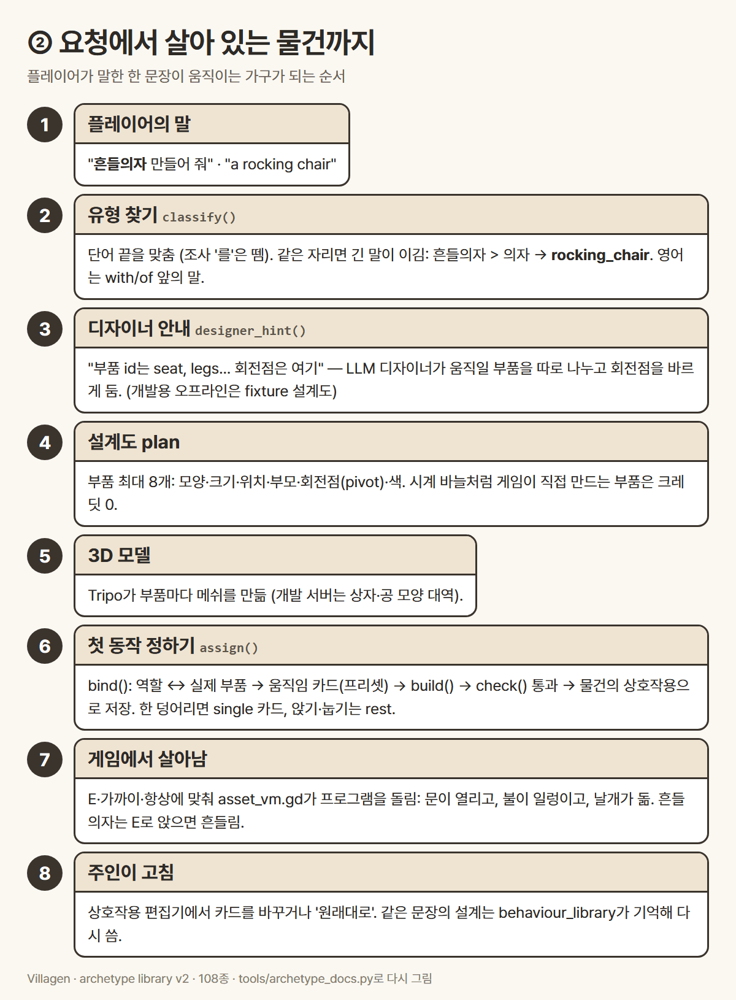
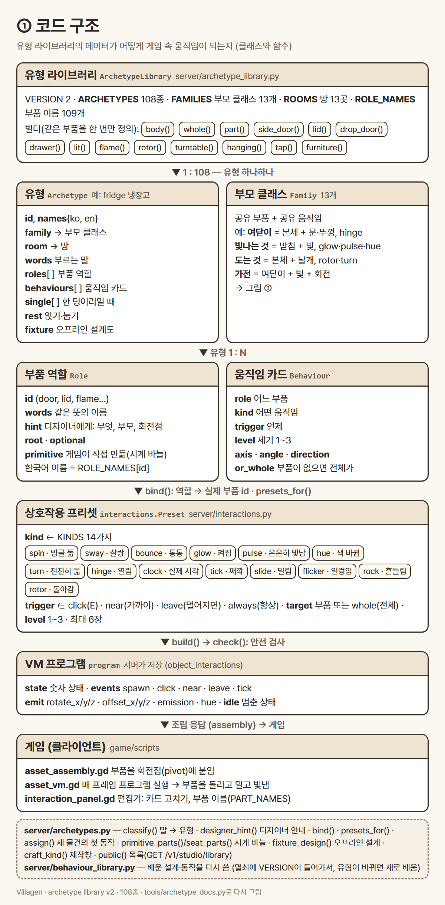
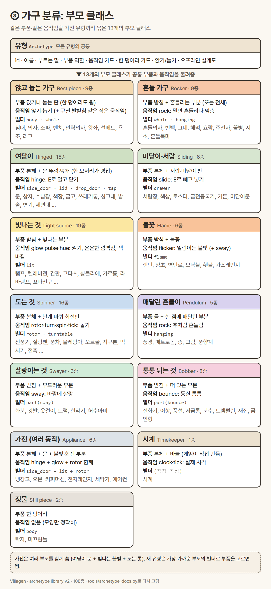
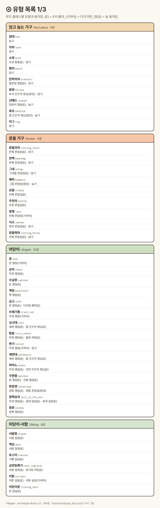
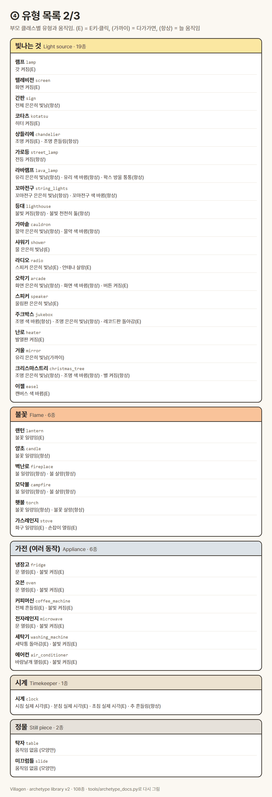
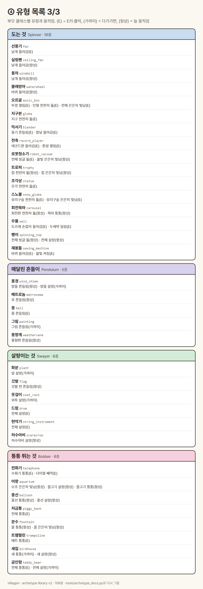
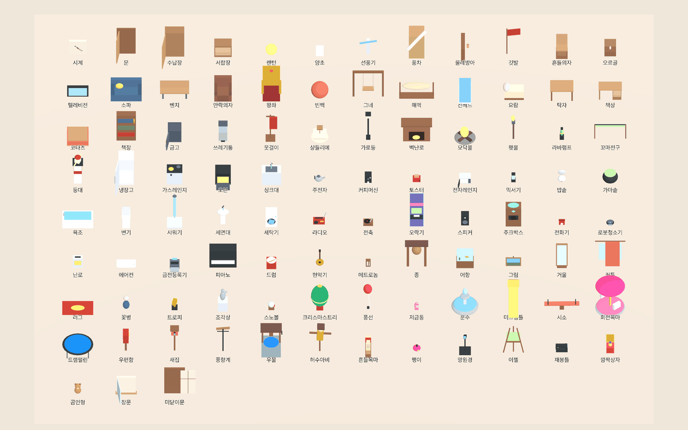

# 물건 유형 라이브러리 (Archetype Library)

> 플레이어가 "냉장고 만들어 줘"라고 하면 게임은 그것이 **냉장고라는 유형**임을 알아보고, 문이 열리고 안에 불이 켜지는
> 냉장고로 만들어 줍니다. 이 문서는 그 "유형"이 무엇인지, 만든 물건이 어떻게 움직임을 얻는지, 지금 아는 유형 **108종**의
> 목록, 그리고 새 유형을 넣는 방법을 설명합니다. (라이브러리 버전 2, 2026-10-14)

## 1. 유형(type)이란?

유형은 한 종류의 물건에 대한 **설계 카드**입니다. 카드 한 장에 다섯 가지가 들어 있습니다.

| 카드에 적힌 것 | 뜻 | 냉장고의 예 |
|---|---|---|
| 부르는 말 (words) | 플레이어가 그 물건을 부르는 한국어·영어 이름 | 냉장고, 김치냉장고, 냉동고, fridge, refrigerator … |
| 부품 역할 (roles) | 물건을 이루는 부품과, 디자이너에게 줄 안내 (회전점이 어디인지) | 본체, 문(왼쪽 모서리가 경첩), 불빛(선택) |
| 움직임 카드 (behaviours) | 어떤 부품이 언제 어떻게 움직이는지 | 문 열림(E), 불빛 켜짐(E) |
| 쉬기 (rest) | 앉거나 누울 수 있는지 | 없음 (소파는 앉기, 침대는 눕기) |
| 오프라인 설계도 (fixture) | 개발 서버가 돈 들이지 않고 보여 주는 상자·공 모양 설계 | 본체 + 문 + 손잡이 + 안쪽 불빛 |

- **부르는 말 찾기:** 한국어는 단어의 **끝**을 맞춥니다. 조사는 떼고 봅니다 (`냉장고를` → `냉장고`). 같은 자리라면 **긴 말이 이깁니다** (`흔들의자` > `의자`). 문장에서는 마지막 이름이 물건입니다 (`시계가 달린 램프` = 램프). 영어는 with·of·for 앞의 말이 물건입니다 (`a clock with a lamp` = 시계).
- **한 말은 한 유형만:** 같은 말이 두 유형에 들어가지 않습니다. 더 구체적인 유형이 생기면 그 말은 일반 유형에서 옮겨 갑니다 (예: `가로등`은 램프 → 가로등 유형).
- 유형을 모르는 물건(예: 가습기)도 만들 수 있습니다. 다만 게임이 미리 정해 주는 움직임이 없을 뿐입니다.

## 2. 만든 물건이 움직임을 얻는 과정



1. 플레이어가 말합니다: "흔들의자 만들어 줘".
2. 게임 서버가 유형을 찾습니다 → `rocking_chair`.
3. 디자이너(AI)에게 "부품 id는 이렇게, 회전점은 여기"라고 안내합니다. 그래서 움직일 부품(문, 뚜껑, 날개…)이 따로 나뉘어 나옵니다.
4. 설계도(부품 최대 8개)가 나오고, 부품마다 3D 모델이 만들어집니다. 시계 바늘처럼 게임이 직접 그리는 부품은 크레딧이 들지 않습니다.
5. 유형의 움직임 카드를 실제 부품에 붙이고(역할 ↔ 부품), 안전 검사를 통과한 **프로그램**으로 만들어 물건에 저장합니다.
6. 게임은 그 프로그램을 매 프레임 돌립니다: **E**를 누르면 문이 열리고, **가까이** 가면 쓰레기통 뚜껑이 열리고, **항상** 모닥불이 일렁입니다.
7. 주인은 상호작용 편집기에서 카드를 바꾸거나 지울 수 있고, '원래대로'로 돌아갈 수도 있습니다.

한 덩어리로 만든 물건(움직이지 않게 만든 것, 또는 크레딧 한도 때문에 한 덩어리가 된 것)은 부품이 없으니 **한 덩어리 카드(single)** 를
씁니다: 램프 전체가 켜지고, 곰인형 전체가 통통 뛰고, 꽃병 전체가 지나갈 때 흔들립니다. 앉기·눕기는 어느 경우에나 그대로입니다.

### 움직임의 종류 (14가지, 새로 만든 종류 없음)

| 이름 | 보이는 모습 | 주로 쓰는 곳 |
|---|---|---|
| hinge 열림 | 한 모서리를 축으로 열고 닫기 | 문, 뚜껑, 오븐 문, 우편함 깃발, 발받침 |
| slide 밀림 | 빼고 넣기 | 서랍, 미닫이문, 토스터 빵, 깜짝상자 광대 |
| glow 켜짐 | 불 켜기·끄기 | 램프, 가로등, 냉장고 안쪽 |
| pulse 은은히 빛남 | 밝아졌다 어두워짐 | 오락기 화면, 거울, 물, 스피커 |
| hue 색 바뀜 | 색이 천천히 바뀜 | 꼬마전구, 라바램프, 주크박스, 이젤 |
| flicker 일렁임 | 불꽃처럼 고르지 않은 빛 | 양초, 모닥불, 벽난로, 가스레인지 |
| rotor 돌아감 | 날개·바퀴·레코드가 제 축으로 돎 | 선풍기, 풍차, 전축, 세탁기, 우물 도르래 |
| turn 천천히 돎 | 진열대처럼 천천히 | 회전목마, 트로피, 조각상, 등대 불빛 |
| spin 빙글 돎 | 한 바퀴 빙글 | 로봇청소기, 팽이 |
| rock 흔들림 | 추·흔들의자처럼 (밀면 흔들리다 멈춤, 또는 계속) | 흔들의자, 그네, 종, 시소, 메트로놈 |
| sway 살랑 | 바람에 살랑 | 화분, 허수아비, 커튼, 옷걸이 |
| bounce 통통 | 위아래로 통통·둥실 | 풍선, 곰인형, 전화기 수화기, 어항 물고기 |
| clock 실제 시각 | 시계 바늘이 플레이어의 실제 시각 | 시계 |
| tick 째깍 | 한 칸씩 째깍 | 금고 다이얼, 전화기 다이얼 |

언제 움직이는지(trigger): **E** (누르거나 클릭) · **가까이** (다가가면) · **멀어지면** · **항상**. 세기는 1~3단계입니다.

## 3. 코드 구조 (클래스 도식)



- `server/archetype_library.py` — 유형 데이터 (108종), 부모 클래스 13개, 방 13곳, 부품 이름표, 그리고 **빌더**: 같은 부품(옆 문,
  뚜껑, 아래로 열리는 문, 서랍, 빛, 불꽃, 날개, 회전판, 매달린 부분, 수도꼭지)을 한 번만 정의해 여러 유형이 나눠 씁니다. 결과는 언제나 같은 모양의 평범한 데이터입니다.
- `server/archetypes.py` — 말 → 유형(classify), 디자이너 안내, 역할 ↔ 부품(bind), 새 물건의 첫 동작(assign), 목록(`GET /v1/studio/library`).
- `server/interactions.py` — 움직임 카드(Preset)와 14가지 종류, 카드를 프로그램으로 바꾸는 build()와 안전 검사.
- 게임: `asset_assembly.gd`(부품을 회전점에 붙임) · `asset_vm.gd`(프로그램 실행) · `interaction_panel.gd`(편집기, 부품 이름).

## 4. 가구 분류: 부모 클래스



같은 부품·같은 움직임을 가진 유형끼리 13개의 부모 클래스로 묶었습니다. **가전**은 여러 부모를 함께 씁니다 (여닫이 문 + 빛 + 회전).





## 5. 오프라인 설계도 모음 (게임 화면)

개발 서버에서 오프라인 설계도가 있는 99종을 실제 제작 과정 그대로 만들어 한 화면에 늘어놓은 사진입니다
(상자·공 모양 대역이라 실제 Tripo 모델보다 단순합니다). 다가가기 + E 직후라 문이 열리고 불이 켜진 상태입니다.



오프라인 설계도가 없는 9종(상자, 램프, 실링팬, 화분, 풍경, 지구본, 간판, 침대, 의자)은 예전부터 테스트들이 기본 상자·꽃 시연에
기대고 있어서 그대로 두었습니다.

## 6. 전체 유형 목록 (방별)

`tools/archetype_docs.py`가 라이브러리에서 직접 만든 표입니다. "(선택)" 부품은 없어도 됩니다.

<!-- types:start -->
### 앉는 가구 (8종)

| 유형 | 부르는 말 | 부품 (역할) | 움직임 | 쉬기 | 부모 클래스 |
|---|---|---|---|---|---|
| **흔들의자** `rocking_chair` | 흔들의자, 흔들 의자, rocking chair, rocker | 전체 | 전체 흔들림(E)<br>한 덩어리: 전체 흔들림(E) | 앉기 | 흔들 가구 |
| **의자** `seat` | 의자, 스툴, 걸상, 좌식의자, chair, stool, seat | 전체 | - | 앉기 | 앉고 눕는 가구 |
| **소파** `sofa` | 소파, 쇼파, 카우치, 러브시트, sofa, couch, loveseat, settee | 받침, 쿠션(선택) | 쿠션 통통(E) | 앉기 | 앉고 눕는 가구 |
| **벤치** `bench` | 벤치, 긴의자, 평상, bench, park bench, garden bench, pew | 전체 | - | 앉기 | 앉고 눕는 가구 |
| **안락의자** `armchair` | 안락의자, 소파의자, 1인용소파, 리클라이너, 암체어, armchair, arm chair, recliner, easy chair, wingback chair, lounge chair | 받침, 발받침(선택) | 발받침 열림(E) | 앉기 | 앉고 눕는 가구 |
| **왕좌** `throne` | 왕좌, 옥좌, 용상, throne | 앉는 자리, 보석 | 보석 은은히 빛남(항상) | 앉기 | 앉고 눕는 가구 |
| **빈백** `beanbag` | 빈백, 빈백소파, 빈백의자, beanbag, bean bag, beanbag chair, bean bag chair | 전체 | 전체 흔들림(E)<br>한 덩어리: 전체 흔들림(E) | 앉기 | 흔들 가구 |
| **그네** `swing` | 그네, 흔들그네, 벤치그네, 해먹의자, swing, hammock chair, swing set, swingset, porch swing, swing chair, swing seat, tire swing | 틀, 그넷줄 | 그넷줄 흔들림(E) | 앉기 | 흔들 가구 |

### 눕는 가구 (4종)

| 유형 | 부르는 말 | 부품 (역할) | 움직임 | 쉬기 | 부모 클래스 |
|---|---|---|---|---|---|
| **침대** `bed` | 침대, 이층침대, 싱글침대, 더블침대, bed, bunk bed, futon | 전체 | - | 눕기 | 앉고 눕는 가구 |
| **해먹** `hammock` | 해먹, 그물침대, hammock | 틀, 그물 | 그물 흔들림(항상) | 눕기 | 흔들 가구 |
| **선베드** `sunbed` | 선베드, 썬베드, 비치체어, sunbed, sun bed, sun lounger, lounger, deck chair, beach chair, chaise longue, chaise lounge | 틀, 등받이 | 등받이 열림(E) | 눕기 | 앉고 눕는 가구 |
| **요람** `cradle` | 요람, 아기침대, 흔들침대, cradle, crib, bassinet | 전체 | 전체 흔들림(E)<br>한 덩어리: 전체 흔들림(E) | - | 흔들 가구 |

### 탁자·책상 (3종)

| 유형 | 부르는 말 | 부품 (역할) | 움직임 | 쉬기 | 부모 클래스 |
|---|---|---|---|---|---|
| **탁자** `table` | 탁자, 테이블, 식탁, 밥상, 좌탁, 원탁, 티테이블, 교자상, table, dining table, coffee table, side table, tea table, picnic table, round table | 상판 | - | - | 정물 |
| **책상** `desk` | 책상, 학생책상, 사무용책상, 작업대, desk, writing desk, school desk, office desk, workbench, work bench | 상판, 서랍 | 서랍 밀림(E) | - | 미닫이·서랍 |
| **코타츠** `kotatsu` | 코타츠, 고타쓰, 온열테이블, kotatsu, heated table | 이불, 히터 | 히터 켜짐(E)<br>한 덩어리: 전체 켜짐(E) | - | 빛나는 것 |

### 수납 (7종)

| 유형 | 부르는 말 | 부품 (역할) | 움직임 | 쉬기 | 부모 클래스 |
|---|---|---|---|---|---|
| **상자** `chest` | 상자, 보물상자, 궤짝, 함, 보석함, 트렁크, chest, box, crate, trunk, coffer | 본체, 뚜껑 | 뚜껑 열림(E) | - | 여닫이 |
| **수납장** `cabinet` | 찬장, 장롱, 옷장, 수납장, 캐비닛, 진열장, 사물함, 장식장, cabinet, wardrobe, cupboard, closet, locker | 본체, 문 | 문 열림(E) | - | 여닫이 |
| **서랍장** `drawer` | 서랍, 서랍장, 협탁, 화장대, drawer, drawers, dresser, nightstand, chest of drawers | 본체, 서랍 | 서랍 밀림(E) | - | 미닫이·서랍 |
| **책장** `bookshelf` | 책장, 책꽂이, 책선반, 선반, bookshelf, bookcase, book shelf, shelf, shelves, bookshelves | 본체, 책(선택) | 책 열림(E) | - | 여닫이 |
| **금고** `safe` | 금고, 대형금고, safe, vault, strongbox, safe box | 본체, 문, 다이얼 | 문 열림(E) · 다이얼 째깍(E) | - | 여닫이 |
| **쓰레기통** `trash_can` | 쓰레기통, 휴지통, 쓰레기함, 분리수거함, trash can, garbage can, trash bin, wastebasket, waste bin, dustbin, bin, rubbish bin, recycling bin | 본체, 뚜껑 | 뚜껑 열림(가까이) | - | 여닫이 |
| **옷걸이** `coat_rack` | 옷걸이, 행거, 모자걸이, 스탠드옷걸이, coat rack, coat stand, hat stand, hat rack, clothes rack, coat tree | 받침대, 외투(선택) | 외투 살랑(가까이)<br>한 덩어리: 전체 살랑(가까이) | - | 살랑이는 것 |

### 조명·불 (11종)

| 유형 | 부르는 말 | 부품 (역할) | 움직임 | 쉬기 | 부모 클래스 |
|---|---|---|---|---|---|
| **램프** `lamp` | 램프, 스탠드, 조명, 등, 전등, 무드등, lamp, light | 받침, 갓 | 갓 켜짐(E)<br>한 덩어리: 전체 켜짐(E) | - | 빛나는 것 |
| **랜턴** `lantern` | 랜턴, 등롱, 등불, 초롱, 호롱, 호롱불, 청사초롱, lantern | 틀, 불꽃 | 불꽃 일렁임(E)<br>한 덩어리: 전체 일렁임(E) | - | 불꽃 |
| **양초** `candle` | 양초, 촛불, 촛대, 캔들, candle, candles, candlestick, candelabra | 본체, 불꽃 | 불꽃 일렁임(항상)<br>한 덩어리: 전체 일렁임(항상) | - | 불꽃 |
| **샹들리에** `chandelier` | 샹들리에, 펜던트조명, 천장조명, 천장등, chandelier, pendant light, pendant lamp, ceiling light, ceiling lamp | 고정대, 조명 | 조명 켜짐(E) · 조명 흔들림(항상)<br>한 덩어리: 전체 켜짐(E) | - | 빛나는 것 |
| **가로등** `street_lamp` | 가로등, 외등, 정원등, streetlight, street light, street lamp, lamppost, lamp post, garden lamp, garden light | 기둥, 전등 | 전등 켜짐(항상)<br>한 덩어리: 전체 켜짐(E) | - | 빛나는 것 |
| **벽난로** `fireplace` | 벽난로, 페치카, fireplace, hearth | 본체, 불 | 불 일렁임(항상) · 불 살랑(항상) | - | 불꽃 |
| **모닥불** `campfire` | 모닥불, 캠프파이어, 화톳불, 장작불, campfire, camp fire, bonfire, fire pit, firepit | 장작, 불 | 불 일렁임(항상) · 불 살랑(항상)<br>한 덩어리: 전체 일렁임(항상) | - | 불꽃 |
| **횃불** `torch` | 횃불, torch, tiki torch, wall torch, sconce | 자루, 불꽃 | 불꽃 일렁임(항상) · 불꽃 살랑(항상)<br>한 덩어리: 전체 일렁임(항상) | - | 불꽃 |
| **라바램프** `lava_lamp` | 라바램프, 용암램프, lava lamp | 받침, 유리, 왁스 방울 | 유리 은은히 빛남(항상) · 유리 색 바뀜(항상) · 왁스 방울 통통(항상)<br>한 덩어리: 전체 은은히 빛남(항상) · 전체 색 바뀜(항상) | - | 빛나는 것 |
| **꼬마전구** `string_lights` | 꼬마전구, 알전구, 줄조명, 전구줄, fairy lights, string lights, christmas lights, light string | 전선, 꼬마전구 | 꼬마전구 은은히 빛남(항상) · 꼬마전구 색 바뀜(항상)<br>한 덩어리: 전체 은은히 빛남(항상) · 전체 색 바뀜(항상) | - | 빛나는 것 |
| **등대** `lighthouse` | 등대, lighthouse, beacon | 탑, 불빛 | 불빛 켜짐(항상) · 불빛 천천히 돎(항상)<br>한 덩어리: 전체 은은히 빛남(항상) | - | 빛나는 것 |

### 주방 (11종)

| 유형 | 부르는 말 | 부품 (역할) | 움직임 | 쉬기 | 부모 클래스 |
|---|---|---|---|---|---|
| **냉장고** `fridge` | 냉장고, 김치냉장고, 냉동고, refrigerator, fridge, icebox, freezer | 본체, 문, 불빛(선택) | 문 열림(E) · 불빛 켜짐(E) | - | 가전 (여러 동작) |
| **가스레인지** `stove` | 가스레인지, 가스렌지, 인덕션, 전기레인지, 레인지, 곤로, stove, cooktop, gas stove, kitchen stove, gas range, hob, cooker | 본체, 화구, 손잡이(선택) | 화구 일렁임(E) · 손잡이 열림(E) | - | 불꽃 |
| **오븐** `oven` | 오븐, 화덕, 피자화덕, 전기오븐, oven, pizza oven, bread oven, baking oven | 본체, 문, 불빛(선택) | 문 열림(E) · 불빛 켜짐(E) | - | 가전 (여러 동작) |
| **싱크대** `sink` | 싱크대, 개수대, 주방싱크, sink, kitchen sink | 본체, 레버, 물(선택) | 레버 열림(E) · 물 은은히 빛남(E) | - | 여닫이 |
| **주전자** `kettle` | 주전자, 찻주전자, 티포트, 다관, kettle, teapot, tea pot, tea kettle | 본체, 뚜껑 | 뚜껑 흔들림(E)<br>한 덩어리: 전체 흔들림(E) | - | 흔들 가구 |
| **커피머신** `coffee_machine` | 커피머신, 커피메이커, 커피기계, 에스프레소머신, coffee machine, coffee maker, coffeemaker, espresso machine, espresso maker | 본체, 불빛 | 전체 흔들림(E) · 불빛 켜짐(E)<br>한 덩어리: 전체 흔들림(E) · 전체 켜짐(E) | - | 가전 (여러 동작) |
| **토스터** `toaster` | 토스터, 토스터기, 토스트기, toaster | 본체, 식빵 | 식빵 밀림(E) | - | 미닫이·서랍 |
| **전자레인지** `microwave` | 전자레인지, 전자렌지, microwave, microwave oven | 본체, 문, 불빛(선택) | 문 열림(E) · 불빛 켜짐(E) | - | 가전 (여러 동작) |
| **믹서기** `blender` | 믹서기, 믹서, 블렌더, 주서기, 착즙기, blender, mixer, juicer, food processor | 받침, 용기, 칼날 | 용기 흔들림(E) · 칼날 돌아감(E)<br>한 덩어리: 전체 흔들림(E) | - | 도는 것 |
| **밥솥** `rice_cooker` | 밥솥, 전기밥솥, 압력밥솥, rice cooker, pressure cooker | 본체, 뚜껑, 불빛(선택) | 뚜껑 열림(E) · 불빛 켜짐(E) | - | 여닫이 |
| **가마솥** `cauldron` | 가마솥, 마녀솥, 물약솥, 솥, cauldron, witch pot | 솥, 물약 | 물약 은은히 빛남(항상) · 물약 색 바뀜(항상)<br>한 덩어리: 전체 은은히 빛남(항상) | - | 빛나는 것 |

### 욕실·세탁 (5종)

| 유형 | 부르는 말 | 부품 (역할) | 움직임 | 쉬기 | 부모 클래스 |
|---|---|---|---|---|---|
| **욕조** `bathtub` | 욕조, 반신욕조, 목욕통, 자쿠지, bathtub, bath tub, tub, bath, hot tub, jacuzzi | 욕조, 물 | 물 은은히 빛남(항상) | 눕기 | 앉고 눕는 가구 |
| **변기** `toilet` | 변기, 양변기, 좌변기, toilet, toilet seat, loo, commode | 본체, 뚜껑 | 뚜껑 열림(가까이) | 앉기 | 여닫이 |
| **샤워기** `shower` | 샤워기, 샤워부스, 샤워실, 샤워, shower, shower head, shower booth, shower stall | 본체, 물 | 물 은은히 빛남(E) | - | 빛나는 것 |
| **세면대** `washbasin` | 세면대, 세면기, washbasin, wash basin, basin, bathroom sink | 받침대, 레버, 물(선택) | 레버 열림(E) · 물 은은히 빛남(E) | - | 여닫이 |
| **세탁기** `washing_machine` | 세탁기, 드럼세탁기, 통돌이, 건조기, 빨래건조기, washing machine, washer, dryer, tumble dryer, laundry machine | 본체, 세탁통, 불빛(선택) | 세탁통 돌아감(E) · 불빛 켜짐(E) | - | 가전 (여러 동작) |

### 가전·전자 (13종)

| 유형 | 부르는 말 | 부품 (역할) | 움직임 | 쉬기 | 부모 클래스 |
|---|---|---|---|---|---|
| **선풍기** `fan` | 선풍기, 환풍기, 탁상선풍기, fan, desk fan, electric fan, ventilator | 본체, 날개 | 날개 돌아감(E) | - | 도는 것 |
| **실링팬** `ceiling_fan` | 실링팬, 천장선풍기, ceiling fan | 본체, 날개 | 날개 돌아감(항상) | - | 도는 것 |
| **텔레비전** `screen` | 텔레비전, 티비, 모니터, 스크린, 컴퓨터, 노트북, tv, television, monitor, screen, computer, laptop | 본체, 화면 | 화면 켜짐(E)<br>한 덩어리: 전체 켜짐(E) | - | 빛나는 것 |
| **라디오** `radio` | 라디오, 카세트, 카세트플레이어, 붐박스, 오디오, radio, boombox, cassette player, tape player, stereo, transistor radio | 본체, 스피커, 안테나(선택) | 스피커 은은히 빛남(E) · 안테나 살랑(E)<br>한 덩어리: 전체 살랑(E) | - | 빛나는 것 |
| **전축** `record_player` | 전축, 턴테이블, 레코드플레이어, 축음기, 유성기, 엘피플레이어, record player, turntable, gramophone, phonograph, vinyl player | 본체, 레코드판, 톤암(선택) | 레코드판 돌아감(E) · 톤암 열림(E) | - | 도는 것 |
| **오락기** `arcade` | 오락기, 아케이드, 게임기, 핀볼, arcade, arcade machine, arcade cabinet, game machine, pinball, pinball machine | 본체, 화면, 버튼(선택) | 화면 은은히 빛남(항상) · 화면 색 바뀜(항상) · 버튼 켜짐(E)<br>한 덩어리: 전체 은은히 빛남(항상) | - | 빛나는 것 |
| **스피커** `speaker` | 스피커, 앰프, 우퍼, 사운드바, speaker, loudspeaker, amplifier, amp, subwoofer, soundbar | 본체, 울림판 | 울림판 은은히 빛남(E)<br>한 덩어리: 전체 은은히 빛남(E) | - | 빛나는 것 |
| **주크박스** `jukebox` | 주크박스, jukebox | 본체, 조명, 레코드판(선택) | 조명 색 바뀜(항상) · 조명 은은히 빛남(항상) · 레코드판 돌아감(E)<br>한 덩어리: 전체 색 바뀜(항상) | - | 빛나는 것 |
| **전화기** `telephone` | 전화기, 전화, 유선전화, 공중전화, telephone, phone, rotary phone, landline, payphone | 받침, 수화기, 다이얼(선택) | 수화기 통통(E) · 다이얼 째깍(E)<br>한 덩어리: 전체 통통(E) | - | 통통 튀는 것 |
| **로봇청소기** `robot_vacuum` | 로봇청소기, 청소기, 진공청소기, robot vacuum, robot cleaner, roomba, vacuum, vacuum cleaner | 본체, 불빛(선택) | 전체 빙글 돎(E) · 불빛 은은히 빛남(항상)<br>한 덩어리: 전체 빙글 돎(E) | - | 도는 것 |
| **난로** `heater` | 난로, 히터, 온풍기, 라디에이터, 전기난로, 석유난로, 장작난로, 난방기, heater, radiator, space heater, wood stove, wood burner | 본체, 발열판 | 발열판 켜짐(E)<br>한 덩어리: 전체 켜짐(E) | - | 빛나는 것 |
| **에어컨** `air_conditioner` | 에어컨, 냉방기, 벽걸이에어컨, air conditioner, aircon, air con | 본체, 바람날개, 불빛(선택) | 바람날개 열림(E) · 불빛 켜짐(E) | - | 가전 (여러 동작) |
| **금전등록기** `cash_register` | 금전등록기, 계산대, 포스기, 카운터, cash register, checkout counter | 본체, 서랍, 표시창(선택) | 서랍 밀림(E) · 표시창 켜짐(E) | - | 미닫이·서랍 |

### 악기·소리 (6종)

| 유형 | 부르는 말 | 부품 (역할) | 움직임 | 쉬기 | 부모 클래스 |
|---|---|---|---|---|---|
| **오르골** `music_box` | 오르골, 뮤직박스, 음악상자, music box, musicbox | 상자, 뚜껑(선택), 인형 | 뚜껑 열림(E) · 인형 천천히 돎(E) · 전체 은은히 빛남(E)<br>한 덩어리: 전체 천천히 돎(E) · 전체 은은히 빛남(E) | - | 도는 것 |
| **피아노** `piano` | 피아노, 그랜드피아노, 업라이트피아노, 전자피아노, 건반, 오르간, piano, grand piano, upright piano, pianoforte, organ | 본체, 뚜껑, 건반(선택) | 뚜껑 열림(E) · 건반 은은히 빛남(E) | - | 여닫이 |
| **드럼** `drum` | 드럼, 드럼세트, 큰북, 작은북, 장구, 소고, 봉고, 젬베, drum, drum kit, drum set, snare drum, bongo, djembe | 본체 | 전체 살랑(E)<br>한 덩어리: 전체 살랑(E) | - | 살랑이는 것 |
| **현악기** `string_instrument` | 기타, 통기타, 전기기타, 일렉기타, 클래식기타, 우쿨렐레, 바이올린, 첼로, 하프, 가야금, 거문고, guitar, ukulele, violin, cello, harp, lute, mandolin, banjo | 본체 | 전체 살랑(E)<br>한 덩어리: 전체 살랑(E) | - | 살랑이는 것 |
| **메트로놈** `metronome` | 메트로놈, metronome | 본체, 추 | 추 흔들림(항상) | - | 매달린 흔들이 |
| **종** `bell` | 종, 종탑, 범종, 교회종, bell, church bell, temple bell, bell tower, school bell | 틀, 종 | 종 흔들림(E) | - | 매달린 흔들이 |

### 장식 (18종)

| 유형 | 부르는 말 | 부품 (역할) | 움직임 | 쉬기 | 부모 클래스 |
|---|---|---|---|---|---|
| **시계** `clock` | 시계, 벽시계, 탁상시계, 괘종시계, 뻐꾸기시계, clock, wall clock, grandfather clock, cuckoo clock | 본체, 시침, 분침, 초침(선택), 추(선택) | 시침 실제 시각(E) · 분침 실제 시각(E) · 초침 실제 시각(E) · 추 흔들림(항상) | - | 시계 |
| **화분** `plant` | 화분, 식물, 화초, 꽃, 선인장, 분재, 관엽식물, 야자수, plant, potted plant, tree, flower, flowers, bush, cactus, bonsai, palm | 화분, 잎 | 잎 살랑(가까이)<br>한 덩어리: 전체 살랑(가까이) | - | 살랑이는 것 |
| **깃발** `flag` | 깃발, 깃대, 현수막, 배너, 휘장, flag, banner, pennant | 깃대, 깃발 천 | 깃발 천 흔들림(항상)<br>한 덩어리: 전체 살랑(항상) | - | 살랑이는 것 |
| **풍경** `wind_chime` | 풍경, 윈드차임, 모빌, wind chime, windchime, mobile | 윗부분, 방울 | 방울 흔들림(항상) · 방울 살랑(가까이)<br>한 덩어리: 전체 흔들림(항상) | - | 매달린 흔들이 |
| **지구본** `globe` | 지구본, 지구의, globe | 받침대, 지구 | 지구 천천히 돎(E) | - | 도는 것 |
| **간판** `sign` | 간판, 표지판, 네온사인, 이정표, sign, signboard, signpost, neon sign | 전체 | 전체 은은히 빛남(항상)<br>한 덩어리: 전체 은은히 빛남(항상) | - | 빛나는 것 |
| **어항** `aquarium` | 어항, 수족관, 물고기어항, aquarium, fish tank, fishbowl, fish bowl | 수조, 물고기 | 수조 은은히 빛남(항상) · 물고기 살랑(항상) · 물고기 통통(항상)<br>한 덩어리: 전체 은은히 빛남(항상) | - | 통통 튀는 것 |
| **그림** `painting` | 그림, 액자, 명화, 초상화, 풍경화, 유화, 포스터, 사진액자, painting, picture, picture frame, photo frame, portrait, poster | 고리, 그림 | 그림 흔들림(가까이) | - | 매달린 흔들이 |
| **거울** `mirror` | 거울, 전신거울, 손거울, 화장거울, 스탠드거울, mirror, full length mirror, vanity mirror, standing mirror, hand mirror | 틀, 유리 | 유리 은은히 빛남(가까이)<br>한 덩어리: 전체 은은히 빛남(가까이) | - | 빛나는 것 |
| **커튼** `curtain` | 커튼, 블라인드, 암막커튼, 레이스커튼, 가림막, curtain, drapes, drape, blinds | 커튼봉, 커튼 | 커튼 밀림(E) · 커튼 살랑(가까이)<br>한 덩어리: 전체 살랑(가까이) | - | 미닫이·서랍 |
| **러그** `rug` | 러그, 카펫, 양탄자, 깔개, 매트, 발매트, 돗자리, rug, carpet, mat, doormat, bath mat, yoga mat, tatami, picnic mat | 전체 | - | 앉기 | 앉고 눕는 가구 |
| **꽃병** `vase` | 꽃병, 화병, 항아리, 도자기, vase, urn, pottery | 전체 | 전체 흔들림(가까이)<br>한 덩어리: 전체 흔들림(가까이) | - | 흔들 가구 |
| **트로피** `trophy` | 트로피, 우승컵, 상패, trophy, trophy cup, award | 받침, 컵 | 컵 천천히 돎(항상) · 컵 은은히 빛남(항상)<br>한 덩어리: 전체 은은히 빛남(항상) | - | 도는 것 |
| **조각상** `statue` | 동상, 조각상, 석상, 흉상, 조각, 피규어, statue, sculpture, bust, figurine, monument | 받침대, 조각 | 조각 천천히 돎(E) | - | 도는 것 |
| **스노볼** `snow_globe` | 스노볼, 스노우볼, 스노글로브, snow globe, snowglobe | 받침, 유리구슬 | 유리구슬 천천히 돎(E) · 유리구슬 은은히 빛남(E) | - | 도는 것 |
| **크리스마스트리** `christmas_tree` | 크리스마스트리, 성탄트리, 트리, christmas tree, xmas tree | 나무, 조명, 별(선택) | 조명 은은히 빛남(항상) · 조명 색 바뀜(항상) · 별 켜짐(항상)<br>한 덩어리: 전체 은은히 빛남(항상) | - | 빛나는 것 |
| **풍선** `balloon` | 풍선, 고무풍선, 열기구, balloon, hot air balloon | 무게추, 풍선 | 풍선 통통(항상) · 풍선 살랑(항상)<br>한 덩어리: 전체 통통(항상) · 전체 살랑(항상) | - | 통통 튀는 것 |
| **저금통** `piggy_bank` | 저금통, 돼지저금통, 저금함, piggy bank, coin bank, money box | 전체 | 전체 통통(E)<br>한 덩어리: 전체 통통(E) | - | 통통 튀는 것 |

### 마당·놀이터 (12종)

| 유형 | 부르는 말 | 부품 (역할) | 움직임 | 쉬기 | 부모 클래스 |
|---|---|---|---|---|---|
| **풍차** `windmill` | 풍차, 바람개비, windmill, pinwheel, wind turbine | 탑, 날개 | 날개 돌아감(항상) | - | 도는 것 |
| **물레방아** `waterwheel` | 물레방아, 수차, 물레, waterwheel, water wheel, mill wheel, spinning wheel | 틀, 바퀴 | 바퀴 돌아감(항상) | - | 도는 것 |
| **분수** `fountain` | 분수, 분수대, 정원분수, fountain, water fountain, garden fountain, bird bath, birdbath | 수반, 물 | 물 통통(항상) · 물 은은히 빛남(항상)<br>한 덩어리: 전체 은은히 빛남(항상) | - | 통통 튀는 것 |
| **미끄럼틀** `slide` | 미끄럼틀, 미끄럼대, slide, playground slide | 전체 | - | - | 정물 |
| **시소** `seesaw` | 시소, seesaw, see-saw, teeter totter | 받침, 판자 | 판자 흔들림(E) | 앉기 | 흔들 가구 |
| **회전목마** `carousel` | 회전목마, 메리고라운드, 뺑뺑이, carousel, merry-go-round, roundabout | 받침, 회전판, 목마(선택) | 회전판 천천히 돎(항상) · 목마 통통(항상)<br>한 덩어리: 전체 천천히 돎(항상) | - | 도는 것 |
| **트램펄린** `trampoline` | 트램펄린, 방방, 봉봉, trampoline | 틀, 매트 | 매트 통통(E)<br>한 덩어리: 전체 통통(E) | - | 통통 튀는 것 |
| **우편함** `mailbox` | 우편함, 우체통, 편지함, 우편통, mailbox, letterbox, letter box, postbox, post box, mail box | 기둥, 상자, 문, 깃발 | 문 열림(E) · 깃발 열림(E) | - | 여닫이 |
| **새집** `birdhouse` | 새집, 새둥지, 둥지, 새장, birdhouse, bird house, nest box, bird feeder, birdcage, bird cage, nest | 기둥, 새집, 새(선택) | 새 통통(가까이) · 새 살랑(항상) | - | 통통 튀는 것 |
| **풍향계** `weathervane` | 풍향계, 풍향기, weathervane, weather vane, weathercock, wind vane | 기둥, 풍향판 | 풍향판 흔들림(항상) | - | 매달린 흔들이 |
| **우물** `well` | 우물, 두레박, well, wishing well, water well | 벽, 도르래 손잡이, 두레박, 지붕(선택) | 도르래 손잡이 돌아감(E) · 두레박 밀림(E) | - | 도는 것 |
| **허수아비** `scarecrow` | 허수아비, scarecrow | 기둥, 허수아비 | 허수아비 살랑(항상)<br>한 덩어리: 전체 살랑(항상) | - | 살랑이는 것 |

### 장난감·취미 (7종)

| 유형 | 부르는 말 | 부품 (역할) | 움직임 | 쉬기 | 부모 클래스 |
|---|---|---|---|---|---|
| **흔들목마** `rocking_horse` | 흔들목마, 목마, 장난감말, rocking horse, hobby horse | 전체 | 전체 흔들림(E)<br>한 덩어리: 전체 흔들림(E) | 앉기 | 흔들 가구 |
| **팽이** `spinning_top` | 팽이, 팽이장난감, spinning top, whirligig | 전체 | 전체 빙글 돎(항상) · 전체 살랑(항상)<br>한 덩어리: 전체 빙글 돎(항상) · 전체 살랑(항상) | - | 도는 것 |
| **망원경** `telescope` | 망원경, 천체망원경, 쌍안경, telescope, spyglass | 삼각대, 경통 | 경통 열림(E) · 경통 흔들림(항상) | - | 여닫이 |
| **이젤** `easel` | 이젤, 화판, easel, painting easel | 받침대, 캔버스 | 캔버스 색 바뀜(E) | - | 빛나는 것 |
| **재봉틀** `sewing_machine` | 재봉틀, 미싱, 재봉기, sewing machine | 본체, 바퀴, 불빛(선택) | 바퀴 돌아감(E) · 불빛 켜짐(E) | - | 도는 것 |
| **깜짝상자** `jack_in_the_box` | 깜짝상자, jack in the box | 상자, 뚜껑, 광대 | 뚜껑 열림(E) · 광대 밀림(E) · 광대 살랑(E)<br>한 덩어리: 전체 통통(E) | - | 여닫이 |
| **곰인형** `teddy_bear` | 곰인형, 인형, 테디베어, 봉제인형, 애착인형, teddy bear, teddy, plush, plushie, stuffed animal, stuffed toy, doll | 전체 | 전체 통통(E) · 전체 살랑(가까이)<br>한 덩어리: 전체 통통(E) · 전체 살랑(가까이) | - | 통통 튀는 것 |

### 문·창 (3종)

| 유형 | 부르는 말 | 부품 (역할) | 움직임 | 쉬기 | 부모 클래스 |
|---|---|---|---|---|---|
| **문** `door` | 문, 대문, 출입문, 현관문, 쪽문, 여닫이문, 문짝, door, gate, doorway | 틀, 문 | 문 열림(가까이) | - | 여닫이 |
| **창문** `window` | 창문, 창호, 들창, 여닫이창, 창틀, window, windowpane, casement | 틀, 창짝 | 창짝 열림(E) | - | 여닫이 |
| **미닫이문** `sliding_door` | 미닫이문, 미닫이, 장지문, 미세기문, 슬라이딩도어, sliding door, shoji, barn door, pocket door | 틀, 판 | 판 밀림(E) | - | 미닫이·서랍 |

<!-- types:end -->

## 7. 새 유형을 넣는 법

1. 가장 가까운 **부모 클래스**를 고릅니다 (위 그림 ③). 예: 문이 달린 물건 → 여닫이, 빛나는 물건 → 빛나는 것.
2. `server/archetype_library.py`의 알맞은 방 아래에 한 항목을 더합니다. 빌더가 부품과 움직임을 함께 만들어 줍니다.

```python
furniture('fridge', '냉장고', 'Fridge', 'appliance', 'kitchen',
          ['냉장고', '김치냉장고', '냉동고', 'refrigerator', 'fridge', 'icebox', 'freezer'],   # 부르는 말
          body('the tall fridge body', 'body'),                                              # 본체 (뿌리 부품)
          side_door(what='the fridge door, as tall as the body'),                            # 왼쪽 경첩 문, E로 열림
          lit('light', 'optional: the lit inside behind the door, parent body', level=1,     # 안쪽 불빛, E로 켜짐
              or_whole=False, words=('light', 'inside'), optional=True),
          fixture=('냉장고', [box('body', [.8, 1.8, .7], [0, .9, 0], '#ecf0f1'), ...]))       # 오프라인 설계도
```

3. 지킬 것
   - **부르는 말:** 다른 유형과 겹치지 않게. 한 글자 말은 피합니다(허용: 문·등·함·꽃·종·솥). `화로`처럼 조사로 끝나는 말은
     `전화로`에 걸리므로 넣지 않습니다. 더 구체적인 유형을 만들면 그 말을 일반 유형에서 옮기고 `VERSION`을 올립니다.
   - **부품 id:** 처음 쓰는 id라면 `ROLE_NAMES`에 한국어 이름을 넣고, 게임의 `interaction_panel.gd` `PART_NAMES`에도 같은 이름을 넣습니다 (테스트가 둘을 맞춰 봅니다).
   - **회전점:** 문은 경첩 모서리(`[-.5,0,0]`), 뚜껑은 뒷모서리(`[0,0,-.5]`), 매달린 것은 윗점(`[0,.5,0]`), 받침에서 흔들리는 것은 아랫점(`[0,-.5,0]`).
   - **오프라인 설계도:** 부품 id를 역할 id와 똑같이 씁니다. 자식 부품의 위치는 부모의 회전점에서 잰 값입니다.
   - **이미 있는 유형을 바꾸면** `VERSION`을 올립니다 (배운 설계가 옛 안내로 다시 쓰이지 않도록).
4. 확인: 아래 테스트를 돌리고 `tools/archetype_docs.py`로 그림과 표를 다시 만듭니다.

## 8. 테스트

| 무엇을 | 어디서 | 결과 (2026-10-14) |
|---|---|---|
| 모든 부르는 말이 자기 유형을 찾음 (조사 붙여서, 문장 속에서) | `server/tests/test_archetype_library.py` | 통과 |
| 한 말이 두 유형에 없음, 한 글자 말 제한 | 〃 | 통과 |
| 역할·움직임·한 덩어리 카드가 맞물림, 디자이너 안내에 모든 부품 | 〃 | 통과 |
| 오프라인 설계도 = 역할 부품, 경첩은 모서리, 프로그램이 검사를 통과하고 실제로 움직임 | 〃 | 통과 (99종) |
| 부품 한국어 이름이 게임 편집기와 같음 | 〃 | 통과 |
| 목록 API (`GET /v1/studio/library`) | 〃 | 통과 |
| 서버 테스트 전체 | `pytest server/tests` | 862 통과 |
| 99종을 개발 서버에서 실제로 만들어 게임에 불러오고, 가까이 + E 후 움직임·오류 없음 확인 | `game/tests/archetype_gallery.gd` | 696 통과 (약 2분 40초) |
| 기존 게임 검사: 전체 컴파일, 제작창, 상호작용, 살아 있는 물건, 통합 | `tools/test.ps1 -ClientScript …` | 모두 통과 |

```text
.tools\server-venv\Scripts\python.exe -m pytest server/tests -q
$env:TRIPOTHON_QA_PORT='8832'; powershell -File tools\test.ps1 -SkipServerTests -ClientScript archetype_gallery
$env:TRIPOTHON_QA_PORT='8832'; powershell -File tools\test.ps1 -SkipServerTests -Capture -ClientScript archetype_gallery   # 사진
.tools\server-venv\Scripts\python.exe tools\archetype_docs.py                                                          # 그림·표
```

개발 서버는 하루 100개까지 만들 수 있어서, 유형이 더 늘면 `TRIPOTHON_TEST_ARGS='--part=1/2'`처럼 나눠 돌립니다.

## 9. 알려진 한계

- 한 글자 말(문·종·솥…)에 바로 조사가 붙으면(`종을`) 알아보지 못합니다. `종이`(종이)가 종으로 잡히지 않게 하려는 기존 규칙입니다. 문장 속 `종 만들어 줘`는 알아봅니다.
- 띄어 쓴 이름(`해먹 의자`, `크리스마스 트리`)은 마지막 단어로 판단합니다 (해먹 의자 → 의자).
- 오프라인 설계도는 불투명한 상자·공이라 어항 속 물고기나 믹서기 칼날 같은 "안쪽" 부품은 바깥에 살짝 보이게 두었습니다.
- 탁자와 미끄럼틀은 움직임이 없습니다 (디자이너 안내와 이름만). 나머지는 움직이거나 앉기·눕기가 됩니다.
- 가로등은 늘 켜져 있습니다(낮에도). 낮·밤에 따라 켜지는 동작은 아직 없습니다.
