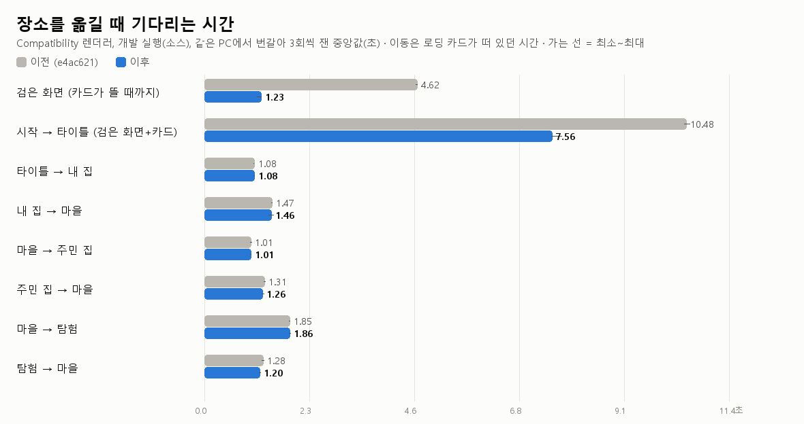
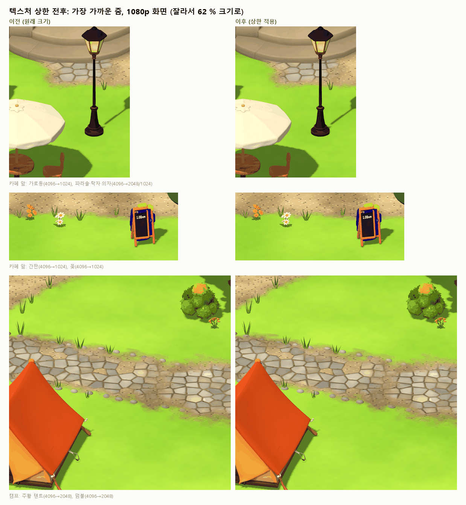
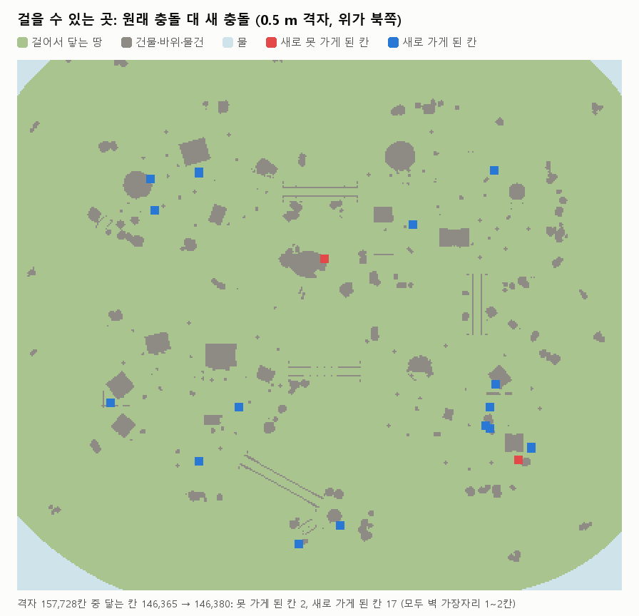
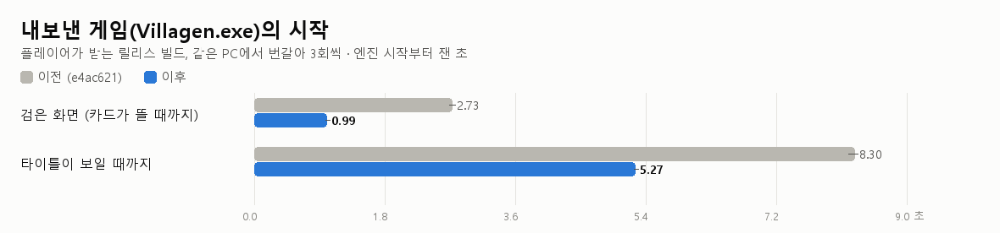
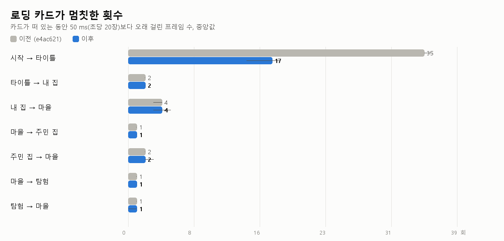
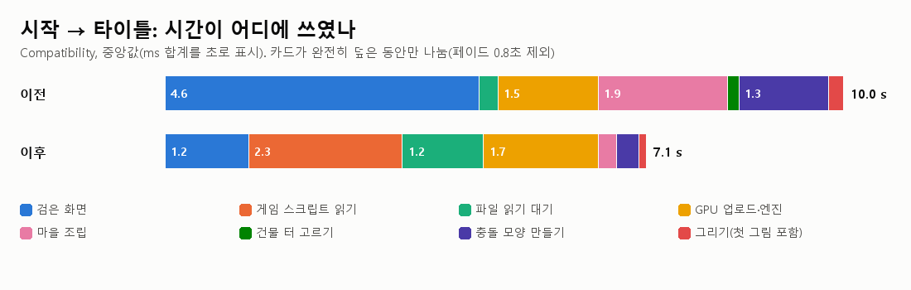
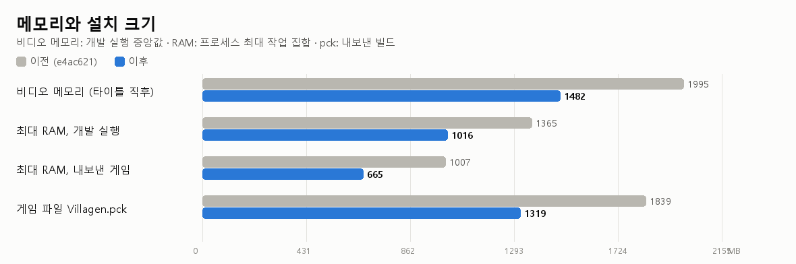
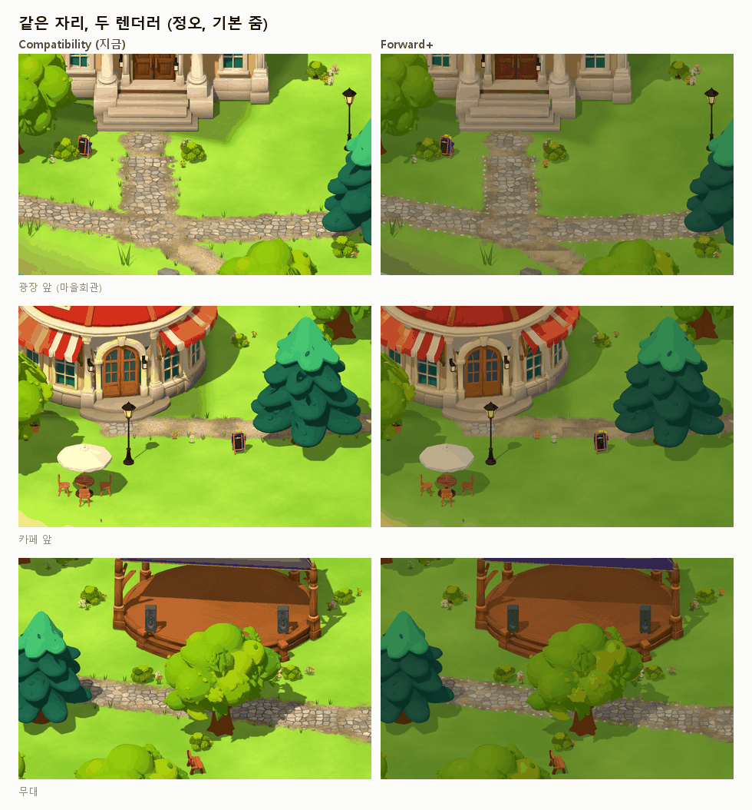
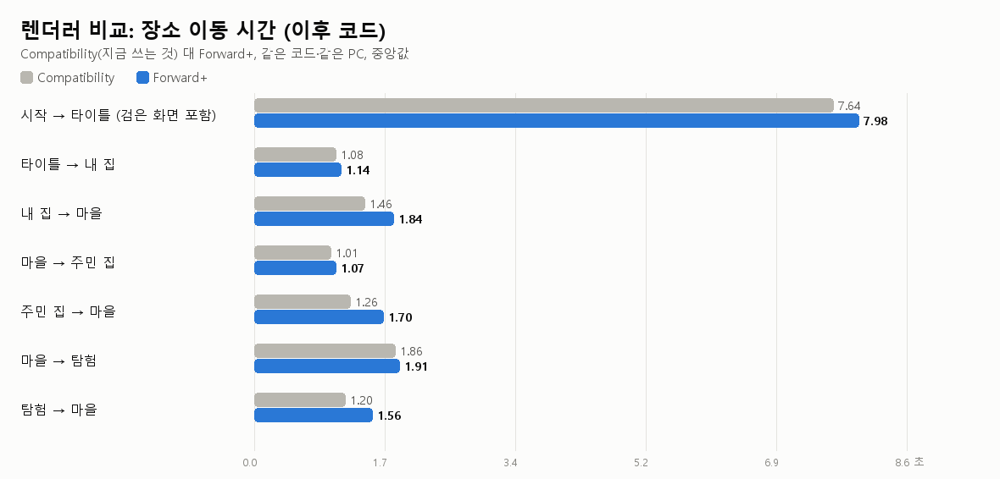

# 로딩 개선 2단계 — 가벼운 데이터, 미리 구운 섬, 검은 화면 없는 시작

작업 브랜치 `wt/loading2` (기준 `e4ac621`), 2026-10-14. 0.11.6을 **PCK 패치**로 낼 수 있게 `project.godot` 설정과 `patch_boot.gd`는 손대지 않았습니다.

## 한눈에 보기

| 플레이어가 느끼는 것 | 이전 | 이후 |
|---|---|---|
| 게임을 켜고 **검은 화면** (내보낸 게임) | 2.7초 | **1.0초** |
| 게임을 켜고 **타이틀이 보일 때까지** (내보낸 게임) | 8.2–8.4초 | **5.3초** |
| 시작 중 로딩 카드가 **멈칫한 횟수** (50 ms 넘는 프레임, 내보낸 게임) | 28–32번 | **9–14번** |
| 마을로 돌아올 때 가장 긴 멈춤 (탐험 → 마을) | 94–98 ms | **48–53 ms** |
| 비디오 메모리 (타이틀 직후) | 1,995 MB | **1,482 MB** |
| 게임이 쓰는 RAM 최대 (내보낸 게임) | 1,007 MB | **665 MB** |
| 게임 파일 `Villagen.pck` | 1,839 MB | **1,319 MB** |
| 보이는 모습 | — | **그대로** (가장 가까운 줌 비교: 평균 차이 0.06/255 이하, 모닥불 불꽃 빼고) |
| 걸어갈 수 있는 곳 | — | **그대로** (15만 칸 검사: 문·다리·정자 바닥 모두 같고, 벽 가장자리 1~2칸짜리 흔들림만) |

모든 숫자는 같은 PC에서 **이전 코드와 이후 코드를 번갈아** 3회씩 잰 값입니다(맨 처음 1회는 셰이더 캐시를 비운 "차가운" 실행으로 따로 표시). 측정 도구: `tools/measure_loading.ps1`, 표: `tools/summarize_loading.py`, 원자료: `docs/performance/data/loading2_measurements.json`.



## 1. 무엇을 바꿨나

### 1-1 보이지 않는 텍스처 크기 줄이기
섬의 소품(의자, 탁자, 가로등, 꽃, 울타리 …)은 1~2 m짜리인데 4096×4096 그림을 하나씩 갖고 있었습니다. 카메라가 가장 가까이 가도(1080p 화면) 1 m는 화면에서 166 픽셀입니다. 그래서 **소품 표면 90 %에서 1 m에 300 텍셀 이상이 남는 만큼만** 줄였습니다(1024~2048). 그 정도면 그래픽카드가 어차피 큰 그림 대신 한 단계 작은 그림(밉맵)을 쓰고 있었기 때문에 화면이 바뀌지 않습니다.
- 줄인 것: 소품 텍스처 34장 + **화면에 한 번도 안 그려지는** 텍스처 6장(지형 파일 안의 바다·연못 재질은 물 셰이더가 덮어쓰고, 물 셰이더의 `surface_color`는 아예 읽지 않음 → 256 px로, 코드도 더는 읽지 않음).
- 건물·나무는 그대로 둠: 가장 가까운 줌에서 거의 1텍셀 = 1픽셀이라 줄이면 보입니다.
- 압축 방식(BPTC 고품질, 데이터 맵 4장은 무손실)은 확인했고 그대로입니다.
- 결과: 섬 텍스처 1,477 MB → 945 MB, 비디오 메모리 −513 MB. 규칙과 표: `tools/lighten_archipelago_map.py`, `data/texture_caps.json`. 지도 자산은 git에 없으므로 이 스크립트가 `.import`의 `size_limit`만 바꾸고, `tools/port_archipelago_map.py`가 복사 끝에 자동으로 다시 실행합니다.



### 1-2 충돌 모양 가볍게 (걷는 곳은 그대로)
건물·다리·땅의 충돌은 그려지는 모델 삼각형을 그대로 썼습니다(합계 162만 개). 큰 모양 하나를 만드는 데 30~130 ms가 걸려서 그 프레임에 카드가 멈췄습니다.
- 미리(도구에서) 모양을 **단순화**하고(걷는 곳 = 건물 아래쪽 3.6 m·다리·부두는 3 mm 이내, 땅은 1 cm, 나머지 2 cm 이내) **6,000개 이하 조각**으로 나눴습니다: 162만 → 49만 개, 조각 하나는 몇 ms.
- 걷는 곳 확인(`tests/collision_equivalence.gd`): 섬 전체를 0.5 m 격자 15만 칸으로 나눠 이전/이후 충돌에서 **땅 높이, 캐릭터 캡슐이 설 수 있는지, 옆 칸으로 걸어갈 수 있는지, 출발점에서 닿는 곳**을 비교. 닿는 칸 146,365 → 146,380, 달라진 칸은 화분·간판·바위 가장자리의 1~2칸 묶음뿐(19칸), 문 14곳·다리 끝 8곳·정자/무대/피크닉 바닥 3곳은 모두 같음, 캐릭터가 갈 수 있는 바닥 높이 변화 99 %가 1.5 cm 이하.



### 1-3 섬을 미리 굽기 (bake)
매번 실행 때 하던 일 — 건물 터 고르기(지형 정점 수정), 다리·소품 배치와 바닥 맞추기, 바위 벽 계산, 길 만들기, 재질 설정 — 을 **도구가 한 번** 해서 `generated/island.scn`(5.7 MB)에 저장합니다. 게임은 이 파일을 읽어 조각별로 넣고, 충돌 조각은 한 프레임에 하나씩 만듭니다. 주민·선물·다른 플레이어·밤낮 같은 움직이는 부분은 지금처럼 따로 만듭니다.
- 같음 확인(`tests/island_bake_check.gd`): 실행 중 만든 섬과 구운 섬을 노드 2,510개(종류·위치·보임·메시·재질·그림자·LOD·조명·충돌층·모양)와 충돌 탐침 39,432개로 비교 → **차이 0**.
- 오래된 굽기 막기: 입력(배치 JSON, 만드는 스크립트, 엔진 버전, 지도 자산의 MD5)이 바뀌면 굽기가 "낡음"이 되어 테스트가 실패하고, 게임은 굽기를 쓰지 않고 예전처럼 만듭니다. `tools/build_game.ps1`과 패치 내보내기(`tools/game_patch.py`)는 낡았으면 다시 굽고, `tools/package_release.py`는 낡았거나 pck 안의 굽기가 디스크와 다르면 포장을 거부합니다. 다시 굽기: `.tools\art-venv\Scripts\python.exe tools\bake_archipelago.py`.
- pck: 굽기 파일 +12 MB, 텍스처 −532 MB → 1,839 MB에서 1,319 MB.

### 1-4 처음의 검은 화면 없애기
게임 메인 스크립트(`main.gd`, 3,600줄)와 그것이 미리 읽는 것들을 다 읽고 나서야 카드가 그려졌습니다. 이제 `main.tscn`의 첫 노드(`scripts/boot.gd`)가 **카드부터 그리고**, 메인 스크립트는 다른 스레드에서 읽는 동안 카드가 돕니다. 다 읽으면 `main.tscn`을 다시 열고, 그때는 메인 스크립트가 메모리에 있으니 루트가 바로 예전 그대로의 게임이 됩니다(방에서 돌아올 때·테스트·헤드리스는 바로 이 길). `project.godot`의 메인 씬·오토로드는 그대로입니다.

### 1-5 카드 아래 작은 끊김 줄이기
- 걷는 캐릭터가 입는 모델(`explorer_b_wardrobe.glb`)이 미리 읽을 목록에 없어서 첫 생성 때 0.2~0.3초 멈췄음 → 목록에 넣음.
- 마을 모듈 스크립트(필드 오브젝트, 건물 꾸밈 …)를 처음 쓸 때 메인 스레드에서 컴파일(30~140 ms) → 시작할 때 미리 읽음.
- 자원을 한 번에 하나씩 읽던 것을 **두 개씩**: 하나가 끝나고 다음 프레임까지 놀던 시간이 없어져 시작 −0.9초(카드 아래 50 ms 넘는 프레임은 조금 늘지만 이전보다 훨씬 적음). `--load-threads=1`로 예전처럼.
- 바위 벽 650개 모양을 몸체에 하나씩 붙이던 것(1초 넘게)을 붙인 뒤 한 번에 넣기.

## 2. 숫자

### Compatibility (지금 렌더러), 개발 실행 — 로딩 카드가 떠 있던 시간(초), 가장 긴 프레임(ms), 50 ms 넘는 프레임 수
| 이동 | 이전 초 | 이후 초 | 이전 최악 | 이후 최악 | 이전 >50ms | 이후 >50ms | 차가운 실행 초 (이전/이후) |
|---|---|---|---|---|---|---|---|
| 검은 화면 | 4.60–4.64 | 1.15–1.24 | | | | | 4.59 / 1.25 |
| 시작 → 타이틀 (카드) | 5.83–5.93 | 6.32–6.53* | 239–243 | 1114–1214** | 35–36 | 14–18 | 6.08 / 6.61 |
| 타이틀 → 내 집 | 1.07–1.08 | 1.08–1.09 | 62–65 | 63–66 | 2 | 2 | 1.11 / 1.12 |
| 내 집 → 마을 | 1.46–1.47 | 1.40–1.50 | 102–107 | 64–70 | 3–4 | 3–5 | 1.55 / 1.51 |
| 마을 → 주민 집 | 1.00–1.03 | 1.00–1.02 | 75–78 | 73–78 | 1 | 1 | 1.06 / 1.03 |
| 주민 집 → 마을 | 1.29–1.32 | 1.25–1.30 | 99–104 | 57–101 | 2 | 2–3 | 1.32 / 1.34 |
| 마을 → 탐험 | 1.85–1.86 | 1.84–1.87 | 118–125 | 118–128 | 1 | 1 | 1.92 / 1.89 |
| 탐험 → 마을 | 1.26–1.29 | 1.19–1.22 | 94–98 | 48–53 | 1 | 0–1 | 1.34 / 1.23 |

\* 시작의 카드 시간이 늘어난 것은 예전 검은 화면에서 하던 일(메인 스크립트 읽기 2.3초)이 이제 카드 아래로 왔기 때문입니다. 검은 화면 + 카드 합계는 10.5초 → 7.6초.
\*\* 개발 실행에서만 있는 1.1초 프레임: 만든 물건의 텍스처 압축기 준비(`model_loader.warm_up_compression`). 내보낸 게임에는 압축기가 없어 건너뜁니다(아래 내보낸 게임 표의 최악 프레임 94–125 ms).

### 내보낸 게임 (Villagen.exe, 릴리스 템플릿) — 시작
| | 이전 | 이후 |
|---|---|---|
| 카드가 뜰 때까지 | 2.70–2.78초 | 0.99–1.05초 |
| 타이틀이 보일 때까지 | 8.22–8.36초 (차가운 실행 11.15) | 5.25–5.32초 (차가운 실행 6.62) |
| 카드 아래 50 ms 넘는 프레임 | 28–32 | 9–14 |
| 가장 긴 프레임 | 204–230 ms | 94–125 ms |
| RAM 최대 | 1,004–1,018 MB | 664–668 MB |

릴리스 템플릿은 테스트 스크립트와 `--main-pack`을 받지 않아서 게임 자체의 `--log-load` 기록(카드·타이틀 시각, 50 ms 넘는 프레임)으로 쟀습니다. 모든 이동은 같은 pck를 에디터 실행 파일에 `--main-pack`으로 넣어 쟀습니다: 검은 화면 3.93 → 1.14–1.21초, 시작 카드 5.78–5.80 → 5.70–5.85초(합계 9.7 → 7.0초), 집 → 마을 1.45 → 1.36–1.40초, 탐험 → 마을 1.27 → 1.20초, 다른 이동은 같음.




### 시간이 어디에 쓰였나 (시작 → 타이틀)
| 단계 (ms, 중앙값) | 이전 | 이후 |
|---|---|---|
| 검은 화면 | 4,620 | 1,200 |
| 게임 스크립트 읽기 (카드 아래) | — | 2,258 |
| 파일 읽기 대기 | 275 | 1,196 |
| GPU 업로드·엔진 | 1,470 | 1,691 |
| 마을 조립 | 1,904 | 266 |
| 건물 터 고르기 | 167 | 0 (구워 둠) |
| 충돌 모양 만들기 | 1,313 | 329 |
| 그리기 | 218 | 100 |

이제 남은 시간 대부분은 **파일을 읽고 GPU에 올리는 시간**(텍스처 945 MB)과 메인 스크립트 읽기입니다.




## 3. 렌더러 비교 (Compatibility ↔ Forward+) — 결정은 사용자 몫
같은 코드에서 `--rendering-method forward_plus`로만 바꿔 쟀습니다(`project.godot`는 그대로).

| | Compatibility (지금) | Forward+ |
|---|---|---|
| 시작 → 타이틀 (검은 화면 포함) | 7.6초 | 8.0초 (차가운 실행 9.5초, 이전 코드 첫 실행 16초에 2.7초짜리 멈춤) |
| 집 → 마을 / 주민 집 → 마을 / 탐험 → 마을 | 1.46 / 1.26 / 1.20초 | 1.84 / 1.70 / 1.56초 |
| 비디오 메모리 / RAM 최대 | 1,482 / 1,016 MB | 2,071 / 1,882–1,910 MB |
| 모습 | 지금의 밝은 초록 | 같은 조명값에서 어둡고 탁함 (조명을 Forward+용으로 다시 맞춰야 함) |




**추천: 지금은 Compatibility 유지.** Forward+는 모든 이동이 느리고(마을 복귀 +0.4초), 메모리를 더 쓰고, 처음 실행 때 셰이더 컴파일 멈춤이 크며, 조명·색을 다시 맞춰야 합니다. 그림자·조명 품질이 꼭 필요해지면 그때 조명 재조정과 셰이더 미리 컴파일을 함께 하는 별도 작업으로 하길 권합니다.

## 4. 확인한 것
| 검사 | 결과 |
|---|---|
| 서버 테스트 `pytest server/tests` | 447 통과 |
| compile_all, world_transitions, world_polish_check, home_roundtrip, host_leaves, multiplayer, home_visit, visit_furniture_sync, avatar_everywhere_check, version_gate_check, patch_update_check, ime_editing_check, guide_check, 기본 integration | 모두 통과 (guide_check: 알려졌던 실패 4개가 이번엔 나오지 않음) |
| survival_maps | 창 모드(`-Capture`)로 통과 — 헤드리스로는 끝나지 않음(테스트 머리말대로 창이 필요) |
| studio_races | 기존 파싱 오류(함수 시그니처) 고쳐서 통과 |
| 내보낸 pck로 integration (`test.ps1 -Packaged`) | 통과, 굽기 사용 |
| island_bake_check / collision_equivalence | 차이 0 / 걷는 곳 그대로 |
| loading_frames (모든 이동) | 두 렌더러·내보낸 pck 모두 통과 |

## 5. 결정이 필요한 것
1. **0.11.6 패치 크기**: 텍스처 상한 때문에 바뀐 텍스처 40장(77 MB)과 굽기(12 MB)가 패치에 들어가 패치가 약 **90 MB**가 됩니다(전체 설치 1.3 GB보다는 훨씬 작음). 대안: 텍스처 상한은 다음 전체 설치판으로 미루면 패치는 약 12 MB이고 비디오 메모리·pck 이득은 그때 얻습니다.
2. **건물 텍스처**(17채 × 4096, 380 MB): 가장 가까운 줌에서 거의 1텍셀 = 1픽셀이라 손대지 않았습니다. 2048로 줄이면 −285 MB, 색 텍스처만 DXT1로 바꾸면 −190 MB지만 가까이서 흐려지거나 블록이 보일 수 있어 직접 보고 정할 일입니다.
3. **동시 로드 수**: 2(지금)는 시작 −0.9초, 카드 아래 50 ms 넘는 프레임 +8개 정도(가장 긴 프레임은 같음). 1이면 예전처럼 매끈하지만 느립니다.
4. 렌더러 전환은 위 3장 참고(추천: 유지).

## 6. 남은 것
- 시작의 대부분은 텍스처 읽기·GPU 업로드와 메인 스크립트 컴파일입니다. 더 줄이려면 건물 텍스처(위 2번)나 스크립트 분할이 필요합니다.
- 섬 조각이 처음 그려지는 프레임 1~2개가 100~250 ms(첫 그리기), 탐험 맵 만들기(마을 → 탐험 1.9초)는 이번 범위 밖입니다.
- **설치 후 맨 처음 실행**: 그래픽 드라이버 셰이더 캐시가 비어 있으면 첫 실행에서 몇 초짜리 멈춤이 있었습니다(이 PC에서 새 exe의 첫 실행 때 7.4초 프레임 하나). 드라이버 캐시는 작업 폴더 밖이라 다시 재지 못했습니다. 카드 아래에서 셰이더를 미리 컴파일하는 작업을 따로 권합니다.
- 내보낸 게임은 시작할 때 기억된 월드(기본: 온라인 월드)에 버전을 묻습니다. 측정 초반 3회(그리고 `test.ps1 -Packaged` 2회도 그랬을 수 있음)는 이 설정을 미리 바꾸지 않아 온라인 월드에 `/v1/client` GET 요청이 갔습니다(버전 확인 읽기만, 계정·행동 없음). 이후 측정 도구가 QA 서버를 미리 넣도록 고쳤습니다.

## 7. 다시 재는 법
```
.tools\server-venv\Scripts\python.exe -m uvicorn server.app:create_app --factory --port 8824   (TRIPOTHON_MODE=demo, 별도 데이터 폴더)
powershell -File tools\measure_loading.ps1 -Renderer gl_compatibility -Cold -Runs 1
powershell -File tools\measure_loading.ps1 -Renderer gl_compatibility -First 2 -Runs 3
powershell -File tools\measure_loading.ps1 -Label fin-exe -Exe builds\windows\Villagen.exe -Runs 3
.tools\art-venv\Scripts\python.exe tools\summarize_loading.py gl_compatibility
.tools\art-venv\Scripts\python.exe tools\loading2_figures.py
```
사용자 데이터는 `artifacts\loading\appdata-<이름>`에 따로 두므로(APPDATA/LOCALAPPDATA를 바꿔 실행) 실제 설정·캐시는 건드리지 않습니다.
