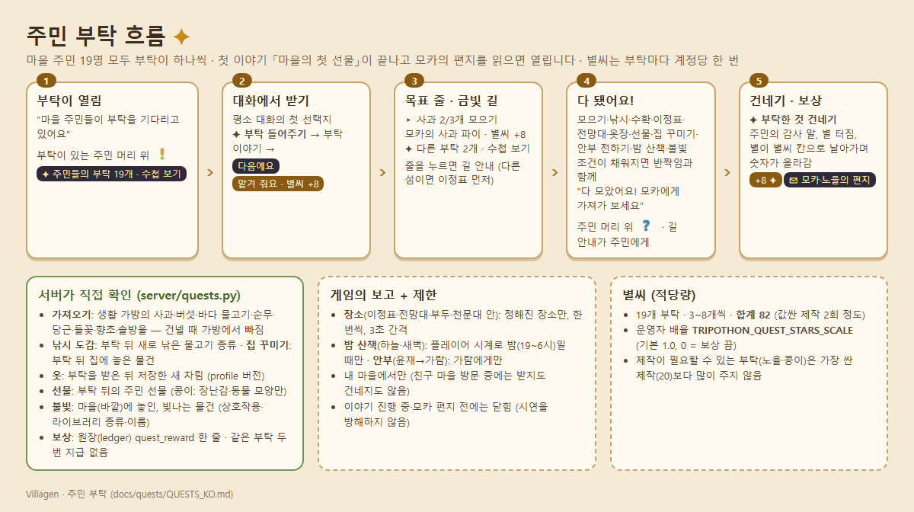
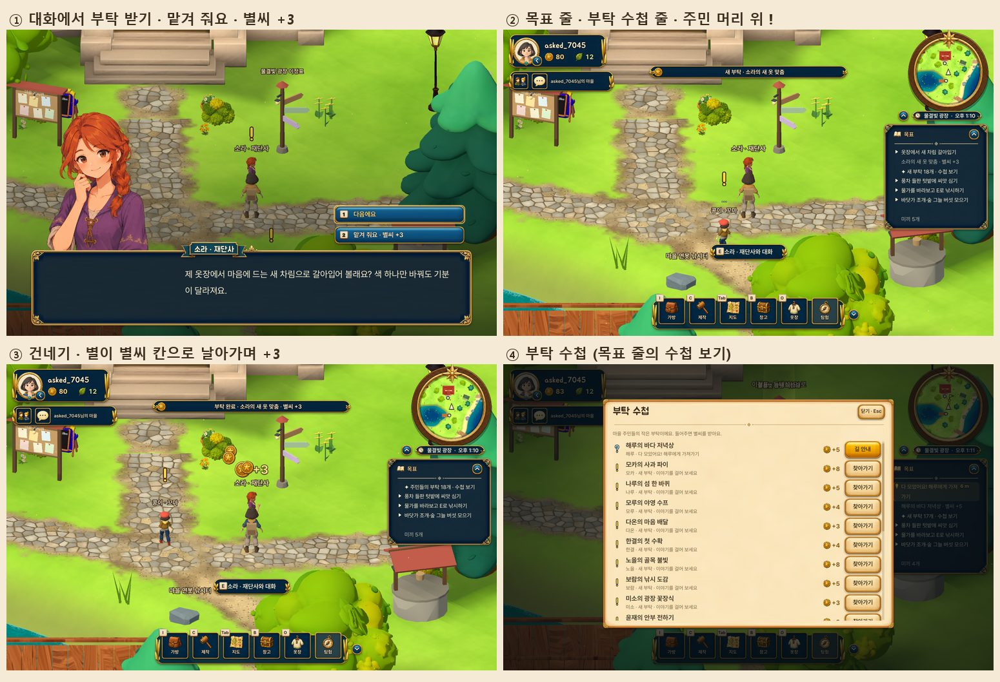

# 주민 부탁 (퀘스트) · 별씨 보상

마을 주민 **19명 모두**(이름이 붙은 4명, 카페의 모카, 낮에는 주민·밤에는 그림자인 14명)가 각자 작은 부탁을 하나씩 합니다. 부탁을 들어주면 **적당량의 별씨**(쉬운 심부름 3~6개, 편지가 오는 두 부탁은 8개, 모두 합쳐 **82개** ≈ 값싼 제작 2회)를 **계정당 한 번** 받습니다.
첫 이야기 「마을의 첫 선물」에서 **모카의 의자를 주문하면** 열립니다(제작을 기다리는 동안 할 일이 생김). 모카 자신의 부탁(사과 파이)만 이야기가 끝난 뒤 열립니다. 이야기가 없는 기존 계정은 바로 열립니다.





## 1. 부탁 목록 (19개)

| 주민 | 부탁 | 해야 할 일 | 서버가 확인하는 것 | 별씨 | 편지 |
|---|---|---|---|---|---|
| 모카 · 카페 주인 | 모카의 사과 파이 | 사과 3개 (과수원 상자 · 둥근 나무 흔들기) | 생활 가방의 사과 → 건넬 때 빠짐 | 8 | ✉ |
| 나루 · 길잡이 | 나루의 섬 한 바퀴 | 서로 다른 섬 3곳의 이정표 찾아가기 | 게임 보고(섬 이름 5개 중, 섬마다 1번, 3초 간격) | 5 | |
| 소라 · 재단사 | 소라의 새 옷 맞춤 | 소라의 옷장에서 새 차림으로 갈아입기 | 부탁 뒤 저장한 새 차림 (프로필 버전) | 3 | |
| 모루 · 야영 전문가 | 모루의 야영 수프 | 숲 그늘 버섯 2개 | 가방의 버섯(금빛 송이 포함), 보통 버섯부터 빠짐 | 4 | |
| 해루 · 낚시꾼 | 해루의 바다 저녁상 | 바다 물고기 1마리 (등대 부두) | 가방의 바다 물고기, 가장 싼 것부터 빠짐 | 5 | |
| 다온 · 우편배달부 | 다온의 마음 배달 | 아무 주민에게나 선물 1번 | 부탁 뒤의 주민 선물 기록 (npc_gifts) | 3 | |
| 한결 · 농부 | 한결의 첫 수확 | 순무 2개 (씨앗 심고 물 주기, 90초) | 가방의 순무 → 건넬 때 빠짐 | 4 | |
| 노을 · 등불지기 | 노을의 골목 불빛 | 빛나는 물건 하나를 마을(바깥)에 놓기 | 마을에 놓인 빛나는 물건 (상호작용 빛·불꽃, 라이브러리 light/flame, 램프·랜턴·양초 이름) | 8 | ✉ |
| 보람 · 낚시꾼(조용한) | 보람의 낚시 도감 | 서로 다른 물고기 2종 낚기 (연못과 바다는 종류가 다름) | 부탁 뒤 낚시 도감에 새로 늘어난 종류 (팔거나 먹어도 그대로) | 5 | |
| 미소 · 청소부 | 미소의 광장 꽃장식 | 들꽃 3송이 | 가방의 들꽃 → 건넬 때 빠짐 | 3 | |
| 윤재 · 산책하는 신사 | 윤재의 안부 전하기 | 시인 가람에게 안부 전하기 (가람과의 대화에 `✦ 윤재의 안부 전하기`) | 게임 보고(가람에게만, 1번) | 3 | |
| 하늘 · 별지기 (밤) | 하늘의 밤하늘 관측 | **밤에** 별빛 천문대 안에 들어가기 | 게임 보고(천문대 방 입장, 또는 천문대 안에서 부탁을 받을 때 함께) + 서버가 플레이어 시계로 밤(19~6시)인지 확인 | 4 | |
| 초록 · 정원사 | 초록의 향초 주머니 | 향초 3줌 (정원 향초밭 · 덤불) | 가방의 향초 → 건넬 때 빠짐 | 3 | |
| 바우 · 탐험가 | 바우의 캠프 불쏘시개 | 솔방울 3개 (뾰족한 나무 흔들기) | 가방의 솔방울 → 건넬 때 빠짐 | 4 | |
| 두레 · 방앗간지기 | 두레의 당근 케이크 | 당근 2개 (씨앗 심고 물 주기, 120초) | 가방의 당근 → 건넬 때 빠짐 | 4 | |
| 단비 · 잡화점 주인 | 단비의 집들이 점검 | 나의 집 안에 물건 하나 놓기 | 부탁 뒤 집에 새로 놓거나 옮긴 물건 | 3 | |
| 콩이 · 꼬마 | 콩이의 보물 상자 | 장난감이나 동물 모양 물건을 콩이에게 선물 (공방에서 만들어도 됨) | 부탁 뒤 콩이에게 한 선물 중 장난감·동물 태그(또는 라이브러리 장난감 방) | 6 | |
| 새벽 · 산책자 (밤) | 새벽의 밤바다 산책 | **밤에** 등대 부두 끝까지 걷기 | 게임 보고(부두 끝) + 서버가 밤인지 확인 | 4 | |
| 가람 · 시인 | 가람의 첫 줄 | 천문대 전망대에서 다섯 섬 내려다보기 | 게임 보고(전망대, 1번) | 3 | |
| **합계** | | | | **82** | |

- 활동이 골고루 섞였습니다: 모으기(사과·버섯·들꽃·향초·솔방울), 낚시(바다·도감), 농사(순무·당근), 장소(이정표·전망대·밤 부두·천문대 안), 옷 갈아입기, 선물(누구에게나·콩이에게 장난감), 주민에게 말 전하기, 집 꾸미기, 마을에 불빛 놓기.
- 새 제작이 필요할 수 있는 부탁은 노을(빛나는 물건)과 콩이(장난감) 둘뿐입니다. 둘 다 가장 싼 제작(별씨 20)보다 많이 주지 않도록 서버가 막아 둡니다(배율을 올려도 20이 상한). 나머지는 학교 서버의 Tripo 크레딧을 쓰지 않습니다.
- 밤에만 나오는 그림자 주민(하늘·새벽)의 부탁은 밤 심부름입니다. 밤은 플레이어 PC의 시계 기준(밤 낚시와 같은 규칙)입니다. 밤에는 목표 줄·수첩·알림이 머리 위 이름과 같게 `하늘(별지기)`, `새벽(밤 산책자)`처럼 역할을 함께 부릅니다(낮 주민 14명 모두 같은 규칙).
## 2. 화면 (게임 안)

| 순간 | 보이는 것 |
|---|---|
| 열림 | "마을 주민들이 부탁을 기다리고 있어요" 알림(이번 접속에서 닫혀 있다가 열린 순간에만, 남은 부탁이 있을 때만), 부탁이 있는 주민 머리 위에 금빛 **!**, 목표 줄 `✦ 주민들의 부탁 19개 · 수첩 보기` |
| 받기 | 평소 대화의 **첫 선택지** `✦ 부탁 들어주기` → 주민의 부탁 말 → `다음에요` / `맡겨 줘요 · 별씨 +8` (실수로 받지 않게 '다음에요'가 먼저) |
| 진행 | 목표 줄에 한 번에 하나: `▸ 사과 2/3개 모으기` / `모카의 사과 파이 · 별씨 +8` / `✦ 다른 부탁 2개 · 수첩 보기`. 줄을 누르면 금빛 길 안내(다른 섬이면 이 섬 이정표 먼저). 가방 개수는 바로 반영 |
| 대화 중 | `부탁 이야기` → 몇 개 남았는지, `길 안내 받기`(소라는 `옷장 열기`). 윤재의 부탁 중에는 가람과의 대화 맨 위에 `✦ 윤재의 안부 전하기` |
| 다 됨 | 반짝임과 "다 모았어요! 모카에게 가져가 보세요", 주민 머리 위 하늘색 **?**, 길 안내가 주민에게 (주민이 건물 안이면 그 문으로) |
| 건네기 | `✦ 부탁한 것 건네기`(가져오기) / `✦ 부탁을 마쳤어요`(나머지) → 감사 말과 함께 주민 위에 별 터짐·빛·고리와 `+8` 별씨. 대화를 닫으면(대화 중에는 HUD가 숨어 있음) 별들이 왼쪽 위 별씨 칸으로 날아가며 숫자가 올라가고 "부탁 완료 · 모카의 사과 파이 · 별씨 +8" |
| 편지 | 모카·노을은 우편함에 감사 편지(깃발이 섬). 편지를 읽으면 `✉ 모카의 편지 · 부탁을 들어줘서` |
| 수첩 | 목표 줄의 `✦ … 수첩 보기`를 누르면 「부탁 수첩」(기존 창 모양): 다 됨 ?, 진행 ▸, 새 부탁 !, 완료 ✓, 별씨, `길 안내`/`찾아가기` |

- 건물 안(카페, 집 등)에서 만난 주민도 같은 선택지를 보입니다(방의 대화 창, 반짝임과 별씨 줄 갱신).
- 친구 마을을 방문하는 동안에는 부탁 선택지가 나오지 않습니다(서버도 거절).
- 한국어가 원문이고 영어·중국어 번역이 game/i18n/strings.json에 있습니다.

## 3. 보상 금액 바꾸기

1. **부탁마다**: `server/quests.py` 맨 위의 `STARS` 표 한 곳에서 숫자를 바꿉니다.
   ```python
   STARS = {'moka_pie': 8, 'naru_islands': 5, 'sora_outfit': 3, 'moru_soup': 4, 'haeru_fish': 5,
            'daon_gift': 3, 'hangyeol_turnips': 4, 'noeul_light': 8, 'boram_catch': 5, 'miso_flowers': 3,
            'yunjae_regards': 3, 'haneul_stars': 4, 'chorok_herbs': 3, 'bau_pinecones': 4, 'dure_carrots': 4,
            'danbi_home': 3, 'kongi_toy': 6, 'saebyeok_walk': 4, 'garam_lookout': 3}
   ```
2. **전체 배율 / 끄기**: 서버 환경 변수 `TRIPOTHON_QUEST_STARS_SCALE` (기본 `1.0`, 0~5).
   - `0` = 보상 끔: 부탁은 그대로 진행되고 별씨만 0 (게임에도 `별씨 +N` 대신 보상 없이 표시).
   - `2.0` = 두 배, `0.5` = 절반(반올림). 노을·콩이의 부탁은 배율과 상관없이 최대 20.
   - 학교 서버: `ops/production.env`에 `TRIPOTHON_QUEST_STARS_SCALE=0.5`처럼 적고 api 컨테이너를 다시 올립니다(`ops/compose.yaml`이 값을 넘깁니다). 개발 서버는 `ops/staging.env`의 `STAGING_QUEST_STARS_SCALE`.
   - 잘못된 값(음수, 5 초과, 숫자가 아님)이면 서버가 시작하지 않고 이유를 알려 줍니다.
3. 이미 받은 보상은 바뀌지 않습니다. 지급 기록은 원장(ledger)의 `quest_reward` 줄(참조 = 부탁 id)입니다.

## 4. 서버 규칙 (server/quests.py)

- 진행은 계정마다 `quest_progress`(CREATE TABLE IF NOT EXISTS, 기존 데이터에 안전하게 추가)에 저장됩니다.
- 열림: 이야기 기록이 없거나, 이야기가 `done`이거나, 이야기가 `craft`(모카의 부탁 뒤)이고 그 뒤로 공방 제작을 한 번이라도 맡겼을 때. 이때 모카의 부탁(`moka_pie`, `quests.STORY_HELD`)만 `locked`로 남고 이야기가 끝나면 열립니다. 이야기를 리셋(`admin_cli story reset`)하면 다시 닫힙니다(이미 받은 별씨는 그대로). 닫혀 있는 동안에는 받기·장소 보고·건네기가 모두 `quests_locked`로 거절됩니다.
- API: `GET /v1/quests`, `POST /v1/quests/{id}/accept`, `POST /v1/quests/{id}/progress`(장소·안부 부탁만, `place`=정해진 장소/주민 이름), `POST /v1/quests/{id}/complete`. `accept`에 `place`를 함께 보내면(천문대 안에서 하늘의 부탁을 받을 때) 그 장소가 바로 셉니다(밤 부탁은 밤에만). `/v1/me`의 `quests`는 가벼운 요약(`unlocked`, `catalog` 해시, 부탁별 `state`·`have`·`visited`)이고, 게임은 해시가 바뀌면 `/v1/quests`로 전체 목록을 한 번 받습니다. 노을의 불빛 조건은 마을 물건을 한 번의 쿼리로 보고, 디자인 판정(매니페스트)은 서버가 기억해 폴링마다 다시 읽지 않습니다.
- 같은 요청 id의 재전송은 같은 답을 돌려주고(중복 지급 없음), 완료된 부탁은 `quest_already_done`, 원장에 이미 있으면 다시 주지 않습니다.
- 거절 코드: `quest_not_found`(404), `quests_locked`, `quest_own_village_only`, `quest_not_active`, `quest_not_ready`, `quest_already_done`, `quest_wrong_kind`, `quest_bad_place`(422), `quest_too_fast`(429), `quest_not_night`(밤 심부름을 낮에 보고).
- 운영자 확인(읽기 전용):
  ```
  .tools\server-venv\Scripts\python.exe -m server.admin_cli quests show <아이디> --data-dir server-data
  sudo docker compose --env-file ops/production.env -f ops/compose.yaml -f ops/compose.gcp-free.yaml exec -T api python -m server.admin_cli quests show <아이디>
  ```

## 5. 시험

| 시험 | 내용 |
|---|---|
| `server/tests/test_quests.py` (12개) | 이야기·편지 전에는 닫힘, 19개 각각 받기→미완료 거절→조건→완료→한 번 지급(재전송·두 번째 완료·원장), 가방에서 빼기(싼 것부터), 이정표 간격·중복·잘못된 섬, 옷·선물은 받은 뒤만, 불빛은 빛나고 마을에 있어야, 편지 1회, 낚시 도감·집 꾸미기·콩이의 장난감은 부탁 뒤만, 밤 심부름(플레이어 시계)·안부(가람에게만), 배율 0/2/상한, 합계 75~85, 거절 코드, admin_cli |
| `game/tests/quest_check.gd` | 새 계정으로 이야기를 끝내고, 게임의 대화 코드(Quests.choice_for)로 19개를 차례로 받기→부탁 이야기→실제 방법으로 완료(사과·솔방울 나무, 버섯·들꽃·향초, 바다·연못 낚시, 순무·당근 재배, 이정표·전망대, 밤 심부름(낮엔 거절·밤엔 인정), 옷, 선물, 가람에게 안부, 곰인형 집에 놓기→콩이에게, 등불 제작·배치)→건네기, 별씨가 정확히 한 번 오름, 편지 2통 |
| `game/tests/quest_e2e.gd` | 마을 화면: 이야기 중에는 없음 → 열림 알림과 ! → 소라(받기, 목표 줄, 옷장, 다 됨 ?, 건네기 · 대화를 닫으면 별이 날아가 카운터 +3, 폴링 뒤에도 +3) → 해루(다른 섬에서 낚시, 이정표 먼저 길 안내, 건네기 +5, 물고기 빠짐) → 부탁 수첩(19줄) |

## 6. 알려진 한계 · 결정할 것

- 장소 부탁(나루·가람·하늘·새벽)과 윤재의 안부는 게임의 보고를 믿습니다(정해진 장소/주민만, 한 번씩, 3초 간격, 밤 심부름은 서버가 시각 확인). 서버는 걸음을 보지 않기 때문입니다. 보상이 3~5개라 악용해도 한 번뿐입니다.
- 밤 심부름은 플레이어 PC의 시계(시간대 헤더)를 따릅니다. 낮에만 노는 플레이어는 하늘·새벽의 부탁을 끝낼 수 없습니다(밤 낚시와 같음).
- 노을의 "빛나는 물건"은 이름에 램프·랜턴·양초 같은 단어가 있어도 인정합니다(오래된 한 덩어리 모델 포함).
- 부탁 진행 중 표시는 마을에서만 보입니다(건물 안에서는 대화로만). 방의 별씨 줄은 숫자만 바뀝니다(별이 날아가는 연출은 마을에서).
- 패치가 없는 옛 게임으로 접속하면 부탁이 보이지 않습니다(서버는 그대로 동작).
