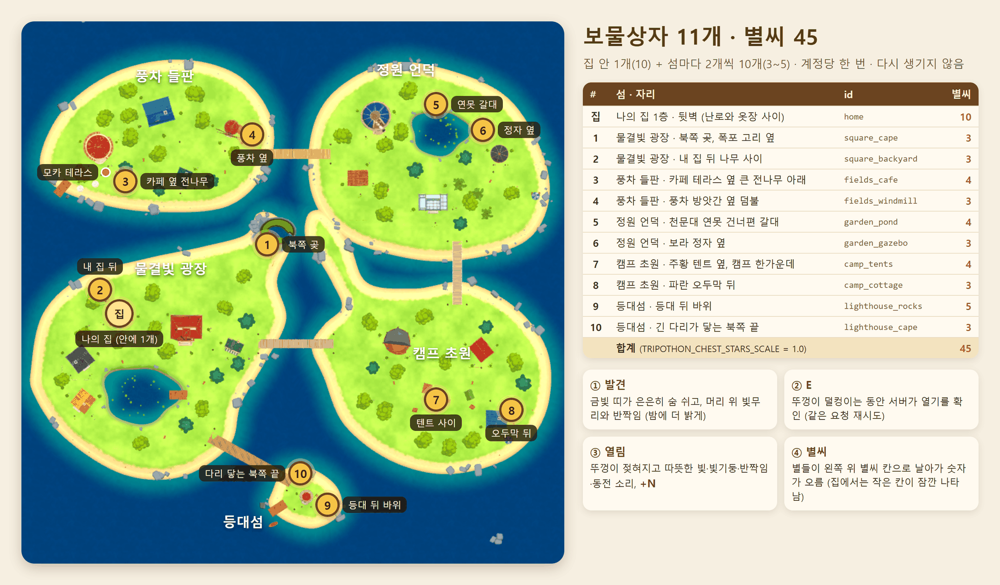
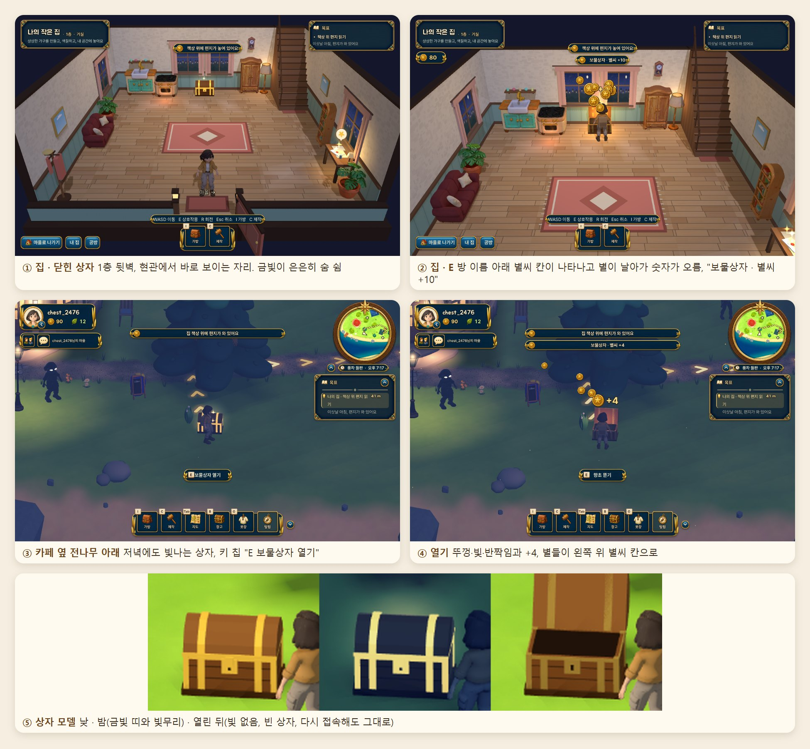

# 보물상자 · 별씨 보상

새 계정은 **나의 집 안에 1개**, 다섯 섬에 **2개씩 10개**, 모두 **11개**의 보물상자를 찾을 수 있습니다. 상자 앞에서 **E**를 누르면 뚜껑이 열리며 따뜻한 빛과 반짝임이 터지고, 별들이 왼쪽 위 별씨 칸으로 날아가 숫자가 올라갑니다. 보상은 **집 10개, 섬 상자 3~5개, 합계 45개**이며 **계정당 한 번**, 다시 생기지 않습니다. 열린 상자는 다시 접속해도 뚜껑이 열린 채(빛 없음, E 안내 없음) 남습니다.

시연용 별씨 공급원 중 하나입니다. 카페 테라스(모카)에서 몇 걸음 거리에 상자가 하나 있어 제작을 기다리는 동안 열어 볼 수 있습니다.





## 1. 위치와 보상 (11개)

| # | 섬 | 자리 (발견 느낌) | id | 좌표 (x, z) | 별씨 |
|---|---|---|---|---|---|
| 집 | 나의 집 1층 | 뒷벽 가운데, 난로와 옷장 사이 · 현관을 바라봄 | `home` | 방 안 (-0.15, -4.38) | 10 |
| 1 | 물결빛 광장 | 북쪽 곶, 폭포가 흐르는 풀 고리 옆 | `square_cape` | (-6.0, -6.0) | 3 |
| 2 | 물결빛 광장 | 내 집 뒤, 큰 나무 사이 | `square_backyard` | (-61.5, 9.0) | 3 |
| 3 | 풍차 들판 | 카페 앞 길가 (모카에서 약 9 m, 향초 자리에서 3.5 m 떨어짐) | `fields_cafe` | (-51.0, -29.5) | 4 |
| 4 | 풍차 들판 | 풍차 방앗간 옆 덤불 · 가로등 곁 | `fields_windmill` | (-11.0, -42.5) | 3 |
| 5 | 정원 언덕 | 천문대 연못 건너편 갈대 사이 | `garden_pond` | (50.0, -52.5) | 4 |
| 6 | 정원 언덕 | 보라 지붕 정자 옆 | `garden_gazebo` | (65.5, -44.0) | 3 |
| 7 | 캠프 초원 | 주황 텐트 옆, 캠프 한가운데 | `camp_tents` | (50.0, 45.5) | 4 |
| 8 | 캠프 초원 | 파란 지붕 오두막 뒤(동쪽) | `camp_cottage` | (75.0, 49.0) | 3 |
| 9 | 등대섬 | 등대 뒤 바위, 바다 쪽 | `lighthouse_rocks` | (14.0, 80.5) | 5 |
| 10 | 등대섬 | 긴 다리가 닿는 북쪽 끝 | `lighthouse_cape` | (5.0, 70.0) | 3 |
| | | | | **합계** | **45** |

- 좌표는 게임 월드 좌표(m)입니다. 지도 그림의 배경은 `game/assets/archipelago_map.png`(Tab 지도와 같은 그림)이라 최신 건물 배치와 조금 다를 수 있습니다.
- 모든 섬 상자는 길에서 걸어서 닿습니다(점프 없음). 문·이정표·카페 테라스 선물 자리(-60.2, -27.6)·모카 자리·활동 장소(낚시터, 과수원 등)·마을 사람 자리를 비켜 두고, 지도의 의자·벤치·피크닉 테이블·선베드에서는 3.8 m 넘게 떨어뜨려 그 앞에서 E를 누르면 언제나 앉습니다.
- 상자는 길 쪽으로 30°까지 돌아가되 자물쇠가 카메라(남쪽)를 보도록 놓이고, 땅의 기울기만큼 살짝 기울어집니다.

## 2. 화면 (게임 안)

| 순간 | 보이는 것 |
|---|---|
| 닫힌 상자 | 둥근 뚜껑에 금빛 띠·모서리·자물쇠. 금빛이 은은하게 숨 쉬고, 머리 위에 옅은 빛무리, 가까이(24 m 안) 가면 2.3초마다 반짝임 몇 개. 밤에는 금빛과 빛무리가 더 밝아 멀리서도 보임 |
| 다가가면 | 다른 E 상호작용과 같은 키 칩: `E  보물상자 열기` (키 설정을 바꾸면 그 키) |
| E | 서버가 답하는 동안 뚜껑이 덜컹덜컹(최소 0.3초) |
| 열림 | 뚜껑이 뒤로 젖혀지고(살짝 튕김) 안쪽에서 따뜻한 빛(짧은 조명 1개, 그림자 없음), 빛기둥, 반짝임 26개, 바닥 고리, 삐걱·동전·반짝 소리, 상자 위 `+N` 별씨 배지 |
| 별씨 | 별들이 왼쪽 위 별씨 칸으로 날아가며 숫자가 올라감(부탁 보상과 같은 연출, `quests.gd reward_fly`). 집 안에는 HUD 별씨 칸이 없어서 방 이름 아래에 작은 별씨 칸이 잠깐 미끄러져 나왔다가 사라지고, 가방의 지갑 줄도 바뀜 |
| 알림 | `보물상자 · 별씨 +4` 한 줄. 11개를 다 찾으면 `보물상자를 모두 찾았어요! 11/11` |
| 열린 뒤 | 상자 안 금화 더미가 사라지고 뚜껑은 열린 채, 빛·반짝임·E 안내 없음 (다시 접속해도 같음) |
| 친구 마을 | 방문 중에는 섬 상자가 보이지 않고, 친구 집 안에도 상자가 없습니다(서버도 거절) |

- 한국어가 원문이고 영어·중국어 번역이 `game/i18n/strings.json`에 있습니다(새 문구 8개).
- 거절될 때 한 줄: 이미 열린 상자 `이미 열어 본 보물상자예요`(뚜껑만 열림), 친구 마을 `친구 마을의 보물상자는 열 수 없어요`, 너무 빠름 `잠시 뒤에 다시 열어 보세요`, 그 밖 `보물상자가 열리지 않았어요. 잠시 뒤 다시 해 보세요.`

## 3. 보상 금액 바꾸기

1. **상자마다**: `server/treasure.py` 맨 위 `STARS` 표 한 곳에서 숫자를 바꿉니다.
   ```python
   STARS = {'home': 10,
            'square_cape': 3, 'square_backyard': 3, 'fields_cafe': 4, 'fields_windmill': 3,
            'garden_pond': 4, 'garden_gazebo': 3, 'camp_tents': 4, 'camp_cottage': 3,
            'lighthouse_rocks': 5, 'lighthouse_cape': 3}
   ```
   게임은 금액을 서버 답에서 받으므로 클라이언트 패치가 필요 없습니다. 합계를 바꾸면 `ops/production.env.example`의 안내 줄(45/90/225)도 고칩니다(테스트가 확인).
2. **한꺼번에**: 서버 환경 변수 `TRIPOTHON_CHEST_STARS_SCALE` (기본 1.0). 상자마다 `반올림(STARS × 배율)`을 줍니다.
   - `0` = 보상 끔: 상자는 그대로 열리고 열린 채 남지만 별씨를 주지 않습니다.
   - 0~5 사이만 허용. 숫자가 아니거나 범위 밖이면 **서버가 시작하지 않습니다**.
   - 1.0 → 45, 2.0 → 90, 5 → 225 (계정당).
   - 학교 서버: `ops/compose.yaml`이 `TRIPOTHON_CHEST_STARS_SCALE`을 컨테이너에 넘기므로 VM의 `.env`에 한 줄 넣고 다시 띄웁니다.
   - 스테이징: `.env`의 `STAGING_CHEST_STARS_SCALE` (`ops/compose.staging.yaml`이 `TRIPOTHON_CHEST_STARS_SCALE`로 넘김).
   - 이미 연 상자는 그때의 금액 그대로이며, 배율을 올려도 다시 주지 않습니다.
3. **상자를 옮기거나 더하기**: `game/scripts/treasure.gd`의 `FIELD`(id, 좌표, 필요하면 대체 좌표 `alts`)와 `server/treasure.py`의 `STARS`에 같은 id를 둡니다(섬마다 2개 규칙은 서버 assert와 테스트가 확인). 자리를 바꾼 뒤에는 `treasure_spots` 검사를 돌립니다. 새 id는 클라이언트 PCK 패치와 서버 배포가 함께 필요합니다.

## 4. 서버 (server/treasure.py)

| 항목 | 내용 |
|---|---|
| 표 | `chest_opened(user_id, chest_id, opened, stars)`, 계정·상자당 한 줄 (CREATE TABLE IF NOT EXISTS) |
| 목록 | `GET /v1/chests` → `{scale, opened, found, total, list:[{id, place, open, stars, opened?}]}` |
| 열기 | `POST /v1/chests/{id}/open` (`request_id`) → `{chest, stars, shards, chests:{opened,total}}`. 같은 `request_id` 재시도는 같은 답(두 번 지급 없음) |
| 지급 | 원장 `money(conn, user, stars, 'chest_reward', chest_id)`; 장부에 같은 상자 보상이 있으면 다시 주지 않음 |
| 거절 | `chest_not_found` 404 · `chest_already_open` 409 · `chest_own_village_only` 409(친구 마을/집 방문 중) · `chest_too_fast` 429(두 상자 사이 2초 미만) |
| /v1/me | `chests: {opened:[...], total:11}` — 게임이 첫 화면부터 열린 상자를 열린 채로 그림 |
| 운영 | `python -m server.admin_cli chests show USERNAME` (읽기 전용: 연 상자·시각·별씨, 원장 줄, 남은 상자). `admin_cli story reset`은 상자를 건드리지 않습니다(이야기와 독립). 계정 삭제(`delete-accounts`)는 상자 기록도 함께 지웁니다 |

- 서버는 플레이어가 어디 서 있는지 확인하지 않습니다(부탁의 장소 보고처럼 게임을 믿음). 대신 계정당 한 번, 2초 간격, 자기 마을에서만.

## 5. 클라이언트 (PCK 패치 가능)

- `game/scripts/treasure.gd` 하나에 모두 들어 있습니다. `project.godot`, `patch_boot.gd`, 오토로드는 바꾸지 않았습니다.
- 마을: `main.gd`의 `VILLAGE_MODULES` 끝에 `"res://scripts/treasure.gd"` 한 항목. 모듈 계약(setup/closest/interact/leave)으로 E 키와 키 칩이 다른 상호작용과 똑같이 동작합니다. 열린 상자 목록은 `/v1/me`(main.gd가 이미 3초마다 받음)를 0.5초마다 읽습니다.
- 집: `studio.gd`에 세 줄 — `show_story()`에서 `treasure.gd.enter_room(self)`, `use_decor()`에서 `use_home(self,record)`, `update_hint()` 칩 줄에서 `home_chip(self,record)` (이야기 편지 `story_home.gd`와 같은 방식). 상자는 방의 고정 가구 기록(solid)이라 걸어서 통과하지 못하고, 가구를 그 위에 놓을 수도 없습니다. 플레이어 가구가 뒷벽 가운데에 있으면 x = 0.95, -1.15 순서로 옆으로 비켜 섭니다.
- 모델: 저장소에 뚜껑이 따로 움직이는 상자 모델이 없어(주민 집의 `chest`는 단순 상자) 기본 도형으로 만들었습니다. 몸통·판자 홈·금빛 모서리와 띠·자물쇠, 뒤쪽 경첩에 달린 둥근 뚜껑(판자처럼 보이게 평면 음영), 안쪽 금화 더미. 부분 메시는 재질별로 한 번만 합쳐 모든 상자가 공유합니다(상자당 그리기 약 7번).
- 성능: 매 프레임 하는 일은 공유 재질 두 개의 값(금빛 밝기, 빛무리 투명도) 쓰기뿐입니다. 반짝임은 2.3초마다 가까운 상자 2개에만, 조명은 여는 순간 1.7초 동안 1개만 만듭니다. 배치는 마을을 지을 때 로딩 카드 아래에서 한 번(LoadPace).
- 소리: 기존 효과음만 씁니다(`sfx/field/box·lid·coin`, `Fx.sound` twinkle·pluck, `RpgUi.sfx("confirm")`).

## 6. 테스트

| 검사 | 실행 | 결과 |
|---|---|---|
| 서버 `server/tests/test_treasure.py` (8개): 한 번 열기·원장, 같은 요청 재시도, 두 번째 열기 거절, 원장으로도 막힘, 없는 id 404, 방문자 거절, 2초 간격, 배율 0/2·잘못된 값·환경 변수, 합계 45·섬마다 2개·게임 id와 일치, 운영 예시 합계·compose 전달, admin_cli chests show, story reset 뒤에도 그대로 | `.tools\server-venv\Scripts\python.exe -m pytest server/tests/test_treasure.py -q` | 8 통과 (서버 전체 999 통과) |
| 클라이언트 `game/tests/treasure_check.gd`: 새 계정 → 집 상자 빛남 → 칩 `보물상자 열기` → E → 열림·별씨 +10 정확히 한 번·두 번째 E 무지급 → 마을 카페 상자 E → +4, HUD 숫자 도착 → 다시 접속(기억 지움) 뒤 두 상자 모두 열린 채 | `$env:TRIPOTHON_QA_PORT='8893'; tools\test.ps1 -SkipServerTests -ClientScript treasure_check` | 31 PASS / 0 FAIL |
| 배치 `game/tests/treasure_spots.gd` (서버 없이 지도만): 10개 모두 자리 찾음(원래 자리에서 0 m), 섬마다 2개, 땅 위, 길에서 떨어짐, 문·이정표·의자·테라스와 거리, 0.5 m 격자 걷기로 길에서 도달(점프 없음), E 안내, 카페 상자 거리 | `godot --headless --path game --script res://tests/treasure_spots.gd` (`-- --capture`로 낮/밤/열림 시트, `--probe=x,z;…`, `--grid=x0,z0,x1,z1`로 자리 찾기) | 114 PASS / 0 FAIL |
| 기존 이야기·부탁 | `-ClientScript story_chapter`, `-ClientScript quest_e2e` | 52 PASS, 47 PASS (FAIL 없음) |
| 기존 통합·앉기 | `tools\test.ps1 -SkipServerTests` (integration), `-ClientScript ix_village_check` | 통합 완료(INTEGRATION_COMPLETE). ix_village_check 37 PASS / 1 FAIL "a villager to talk to" — 상자 모듈을 뺀 상태에서도 똑같이 실패(저녁 시간대에 대화할 주민이 안 보이는 기존 문제) |
| 창 모드 화면 확인 | `tools\test.ps1 -SkipServerTests -Capture -ClientScript treasure_check` | 31 PASS, 위 화면 시트의 ①~④ |

## 7. 알려진 한계

- 서버는 위치를 확인하지 않으므로, 조작된 클라이언트는 걷지 않고 11개를 열 수 있습니다(계정당 45개가 상한, 2초 간격).
- 지도는 다른 세션의 담당입니다. 건물·나무가 상자 자리에 새로 생기면 상자는 최대 2 m 옆으로 비켜 서고, 자리가 없으면 그 상자는 나타나지 않습니다(서버는 그대로). 지도를 바꾼 뒤 `treasure_spots`를 돌리면 바로 보입니다.
- 남은 상자 수를 보여 주는 화면(수첩·지도 표시)은 없습니다. 발견의 재미를 위해 일부러 뺐고, 다 찾았을 때만 알림이 나옵니다.
- 상자를 다시 닫거나 초기화하는 운영 명령은 없습니다(계정당 한 번이 규칙). 리허설이 필요하면 새 계정을 씁니다.
- 집 상자는 1층 뒷벽에 고정입니다. 플레이어 가구가 세 후보 자리를 모두 막고 있으면 겹쳐 보일 수 있습니다.
