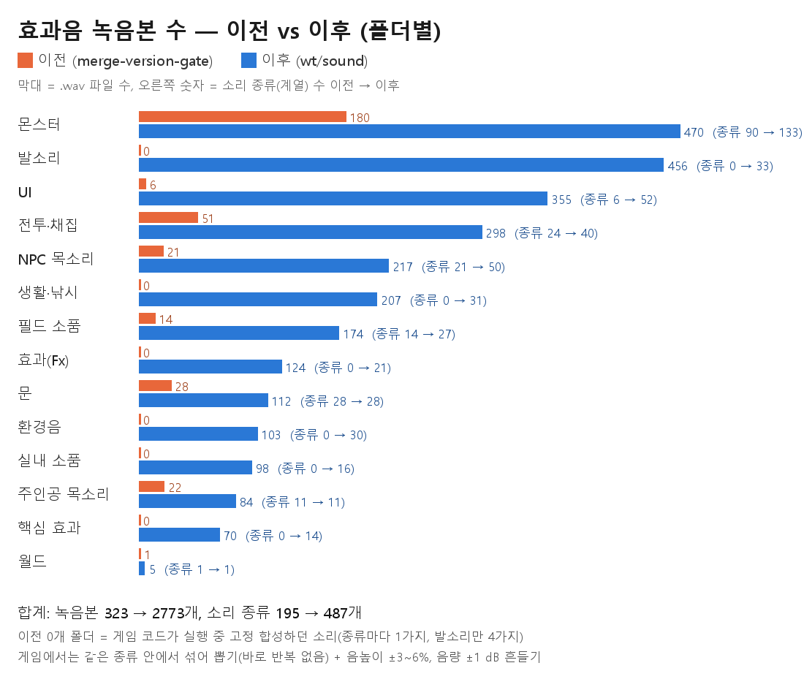
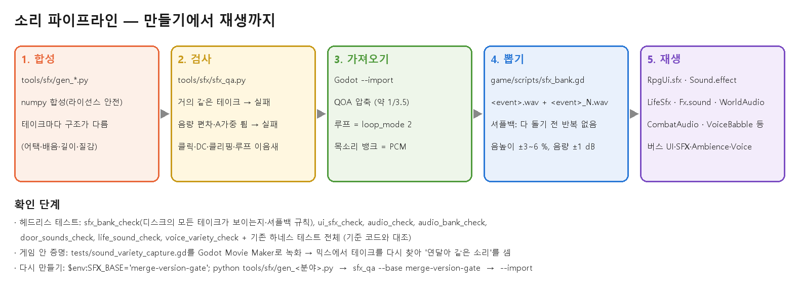
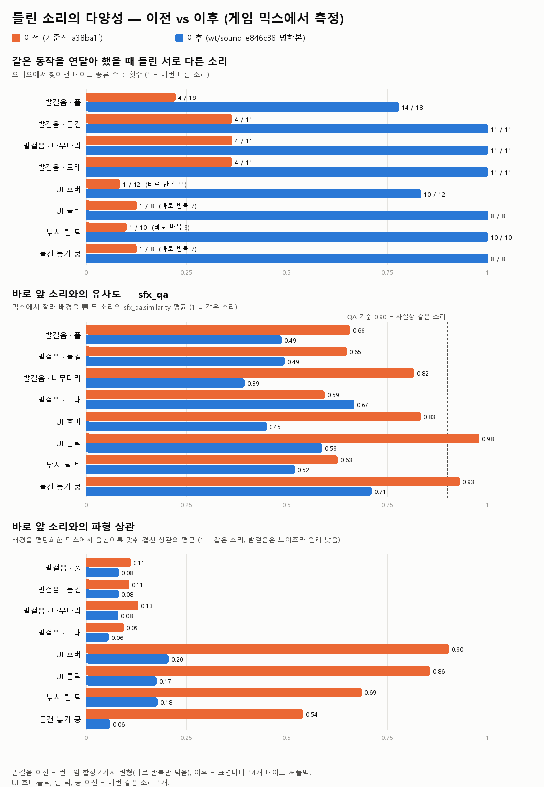
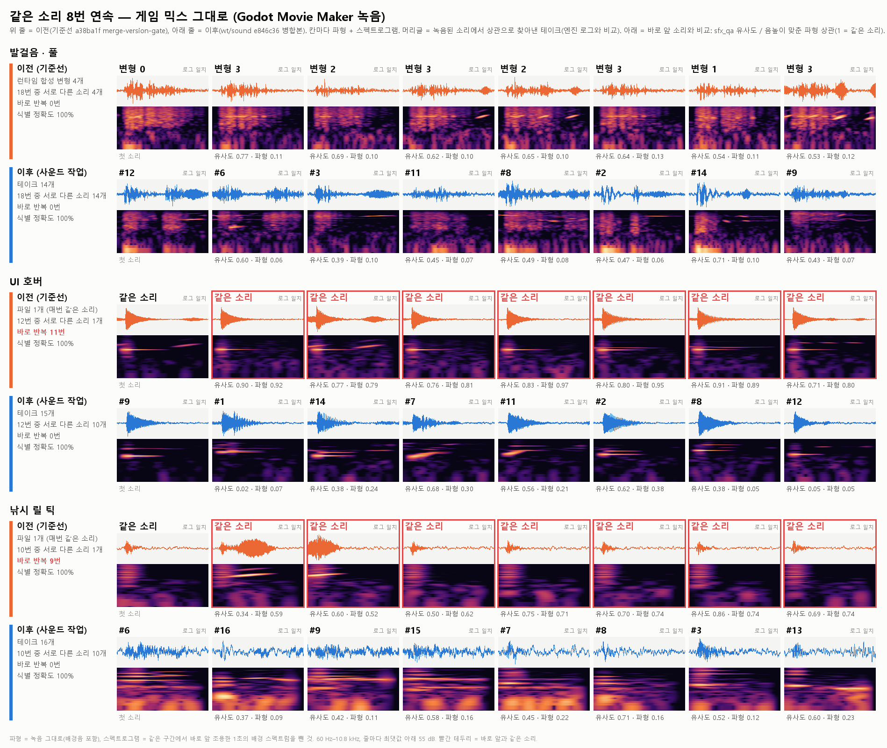
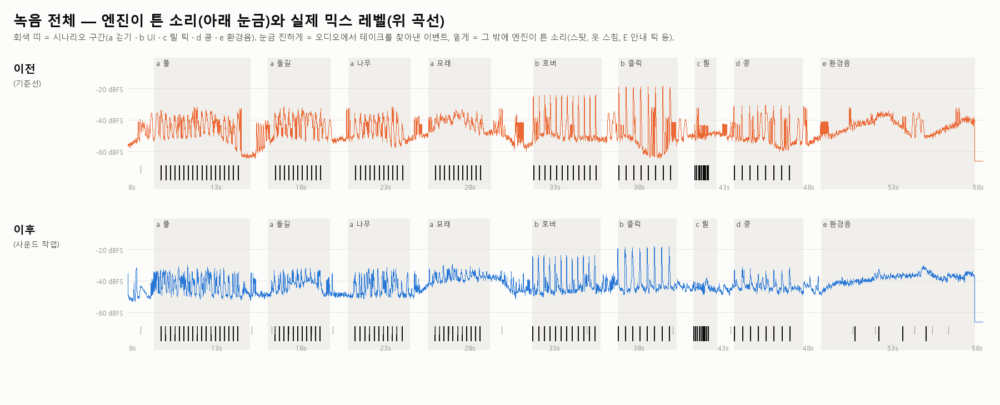

# 사운드 다양화 (2026-10-15 ~ 16, 브랜치 wt/sound)

요청: "중복으로 계속 들리는 게 없고 다양하도록 최대한 많이 만들어서 적용".

결과:
- 효과음 녹음본(테이크)은 **323개에서 2,773개**로, 소리 종류는 **195개에서 487개**로 늘었습니다.
- 모든 소리는 같은 종류 안에서 **섞어 뽑기(셔플백)**로 재생됩니다. 한 바퀴를 다 돌기 전에는 같은 테이크가 다시 나오지 않습니다. 여기에 음높이와 음량을 조금씩 흔듭니다.
- 소리가 없던 동작 약 100곳에 소리를 붙였습니다.
- 팀이 만든 음악 5곡은 그대로 두었습니다.



이전 0개인 폴더는 게임 코드가 실행 중에 고정 시드로 합성하던 소리입니다. 그래서 매번 완전히 같은 소리가 났습니다(발소리만 4가지 변형이 있었습니다).

## 1. 분야별로 달라진 것

| 분야 | 이전 | 이후 |
|---|---|---|
| UI (`RpgUi.sfx`) | 6종 × 1개 | 52종, 355개 (호버 15, 클릭 13, 열기·닫기 9 …) + 거절·탭·선택·슬라이더·서랍·채팅·퀘스트·배치·페인터 등 신규 46종 |
| 생활·낚시 (`LifeSfx`) | 실행 중 합성 1개씩 | 31종, 207개 (릴 틱 16, 수확 12, 입질 10, 몸부림 10 …) |
| 핵심 효과 (`Sound.effect`) | 합성 1개씩 | 14종, 70개 (보상·채집·제작·먹기·수프·붕대·거절·판매·구매·새날·승리·패배) |
| 발소리 (`WorldAudio`) | 6표면 × 4 합성 | 16표면 × 걷기·뛰기 × 14개 (풀·모래·돌·나무·바위·얕은 물·눈·얼음·자갈·낙엽·재·흙·마루·타일·러그·계단) + 옷 스침 8개 |
| 환경음 | 7~10초 루프 7개 | 60~90초 루프 19개 (마을·밤·숲·서리·채석장·불씨·실내 난로·시계·풍차·카페 등) + 무작위 스팟 (새 16, 갈매기 8, 파도 18, 돌풍 8, 귀뚜라미 8, 부엉이 6, 개구리 8, 수탉 3, 풍차 6, 먼 종 3) |
| 소품 (`Fx`·필드·실내·문) | 문 28 + 필드 14 + 합성 | 필드 25종 162개, Fx 21종 124개, 실내 16종 98개, 문 14곳 × 열기·닫기 × 4개 |
| 전투·채집 (`CombatAudio`) | 51개 (1~3개씩) | 40종 298개. 휘두르기 15, 타격 13, 채집 12개(팀 녹음 1번을 바탕으로 만든 변형) |
| 몬스터 (`CreatureAudio`) | 종별·동작별 2개 | 133종 470개. 종 × 동작마다 6개 이상 + 발소리(발바닥·발굽·쿵·철벅·날갯짓) |
| 주인공 목소리 (`HeroVoice`) | 22개 | 84개 |
| NPC 목소리 (`VoiceBabble`) | 캐릭터당 음절 뱅크 1개 | 뱅크 3개를 음절마다 섞어 씀 + 감정 표현(♪ ! … ♥ ✉ zz) + 인사 + 편지·표지판 펜 소리 |

## 2. 새로 소리가 생긴 동작 (주요)

- **이동**
  - 실내 걷기(마루·타일·돌·러그)와 계단
  - 생존 지역별 지면(눈·얼음·자갈·낙엽·재)과 밭의 흙
  - 다른 플레이어·그림자 주민·몬스터의 발소리(위치 기반)
  - 착지, 바다에 빠질 때 첨벙 소리
- **배치**
  - 고스트 회전 래칫, 격자 스냅
  - 놓을 수 있음 ↔ 없음이 바뀔 때
  - 집기, 놓기, 취소, 빠른 칠하기
  - 만든 물건 사용(클릭)
- **낚시**
  - 물고기 몸부림 물튀김, 찌 물결
  - 줄 감는 바람 소리, 놓친 뒤 감기
  - 낚아 올림, 장비 장착
- **마을**
  - 가방으로 날아드는 아이템(연속으로 주우면 음이 올라감)
  - 열매 떨어짐과 튕김
  - 상점에서 살 때와 팔 때 다른 소리, 등대 종, 잠긴 문 노크
  - 우편함·깃발·우물·망원경·모이통 새 소리
  - 보물상자 열기와 덜컹 소리
- **UI**
  - 거절할 때 반가운 알림음 대신 부드러운 거절음
  - 토스트 종류별 소리(성공·경고·오류·소셜)
  - 서랍 열기·닫기, 탭, 목록 선택, 재화 카운트, 숫자키 선택지, 대사 넘김
- **소셜**
  - 채팅 받기·보내기·귓속말
  - 친구, 입장·퇴장, 함께하기 창(K)
- **퀘스트**
  - 수락, 완료 가능, 완료, 별 착지, 해금
- **좌석** (상호작용 소켓)
  - 앉을 때 닿는 소리, 일어날 때, 흔들의자·해먹 삐걱임, 거절
- **NPC**
  - 감정 말풍선 소리, 실내 주민 말소리, 자는 주민
  - 스토리 손님의 발소리와 앉는 소리

## 3. 파이프라인



- 합성은 Python/numpy로만 합니다(`tools/sfx/`, 설명은 `tools/sfx/README.md`).
  - AI 오디오 모델은 쓰지 않았습니다. AudioGen과 MusicGen은 비상업 라이선스이고, Stable Audio는 이용 승인이 필요합니다.
- 같은 종류의 테이크는 "같은 동작을 여러 번 녹음한 것"처럼 만들었습니다. 어택, 배음 비율, 길이(±15 %), 잡음 질감이 서로 다릅니다.
  - 검사 도구 `sfx_qa.py`가 거의 같은 두 테이크(유사도 0.90 이상)를 실패로 잡습니다.
  - 체감 음량이 튀는 테이크(A가중 기준 중앙값보다 2.5 dB 이상 큰 것)도 실패로 잡습니다.
- 원본 파일은 덮어쓰지 않았습니다. 팀 녹음(채집 3종), `ui/*.wav`, 문 소리가 해당됩니다.
  - 새 테이크는 `_1`, `_2` … 번호로 옆에 추가했습니다.
  - 다시 만들 때는 `SFX_BASE=merge-version-gate`로 실행합니다. 그러면 원본은 보호되고 우리가 만든 테이크만 다시 써집니다.

## 4. 게임 안 증명 (Movie Maker 녹음)

같은 장면을 두 빌드에서 녹화했습니다(`tests/sound_variety_capture.gd`, 약 58초, 48 kHz).
- 기준 코드: `merge-version-gate` a38ba1f
- 이후: `wt/sound` 병합본

녹화된 게임 믹스에서 각 소리가 어느 테이크인지 상관 분석으로 다시 찾아냈고, 엔진 로그와 **100 % 일치**했습니다.



| 같은 동작을 연달아 | 이전: 서로 다른 소리 / 바로 반복 | 이후: 서로 다른 소리 / 바로 반복 |
|---|---|---|
| 풀 발걸음 18번 | 4 / 0 | 14 / 0 |
| 돌·나무·모래 발걸음 각 11번 | 4 / 0 | 11 / 0 |
| UI 호버 12번 | 1 / 11 | 10~12 / 0 |
| UI 클릭 8번 | 1 / 7 | 8 / 0 |
| 낚시 릴 틱 10번 | 1 / 9 | 10 / 0 |
| 물건 쿵 8번 | 1 / 7 | 8 / 0 |





녹음을 듣고 맞춘 것(이후 커밋 반영):
- 클릭 테이크 하나가 -1.9 dBFS까지 튀었습니다. 그래서 클릭 피크를 -6 dBFS로 제한했습니다.
- 새 마을 환경음의 바닥이 예전보다 6~7 dB 높아서 릴 틱과 모래 발소리가 묻혔습니다.
  - 마을 야외 환경음을 4 dB 낮췄습니다.
  - 릴 틱은 +6 dB, 모래 발소리는 +2 dB 올렸습니다.
- E 안내 칩의 틱이 같은 순간의 마우스 호버 소리를 막았습니다. 칩에 전용 종류 `chip`을 줘서 해결했습니다.

## 5. 테스트

| 구분 | 결과 |
|---|---|
| 소리 테스트 (헤드리스) | sfx_bank_check, audio_check, audio_bank_check, door_sounds_check, ui_sfx_check, life_sound_check, voice_variety_check 모두 통과 |
| 하네스 (병합본) | 보물상자·채팅창·창 단축키·토스트·HUD 배치·설정·퀘스트·스토리·집 방문·NPC 대화·상호작용·좌석·페인터·옷장·멀티플레이·통합 테스트 통과 |
| 기준 코드에서도 실패 (사운드와 무관) | island_bake_check·survival_bake_check(굽기 파일이 생성물이라 작업 폴더에 없음), studio_flow(시험 계정 없음), ix_village_check 2건(밤이라 주민 없음) |
| 종료 시 누수 | 사운드 쪽 원인은 없습니다. 작업 중 1건(환경음을 미리 불러놓고 회수하지 않은 문제)을 찾아서 고쳤습니다. 창 모드 테스트 2개에 남는 경고는 기준 코드에도 똑같이 있습니다 |

## 6. 귀로 확인이 필요한 것 / 남은 일

- 모든 소리는 수치(유사도·음량·스펙트로그램)와 게임 녹화로 검사했습니다. 사람이 직접 듣고 맞춘 것은 아닙니다. 플레이해 보시고 "이 소리가 크다/거슬린다"를 알려 주시면 해당 종류만 다시 만들거나 재생 dB만 조정합니다.
- 해변에서는 새 스팟이 파도에 묻혀 거의 들리지 않습니다(의도한 거리감). 모래 발소리도 파도와 비슷한 크기입니다.
- 실내 방에서 만든 물건을 사용할 때는 아직 소리가 없습니다(마을에는 있음).
- 음악은 팀 곡이라 손대지 않았습니다. 대신 재생 방식만 바꿨습니다.
  - 시작 위치를 무작위로 정합니다.
  - 최소 75초 또는 두 바퀴를 들은 뒤 20~60초 쉬고, 환경음만 남깁니다.
  - 짧은 곡(서리 13초, 숲 26초)이 계속 반복되는 문제를 줄이려는 것입니다. 새 곡은 팀이 만들어야 합니다.

## 7. 용량

- WAV 원본: 21.5 MB(323개) → 117 MB(2,773개)
- 게임에 들어가는 가져온 데이터(QOA 압축): 약 32 MB
- 무게 대부분은 환경음 루프(약 24 MB)와 몬스터 소리입니다. 환경음 일부는 용량 때문에 11 kHz로 저장했습니다(어두운 소리라 차이가 작음). 밝아야 하는 벌레·밤·숲·폭포·난로는 22 kHz입니다.

## 8. 다시 만들기·조정

```bash
cd D:/lsm26/wt/sound
SFX_BASE=merge-version-gate .tools/art-venv/Scripts/python.exe tools/sfx/gen_ui.py --only click
.tools/art-venv/Scripts/python.exe tools/sfx/sfx_qa.py game/assets/sfx/ui --base merge-version-gate
.tools/godot/Godot_v4.7.2-stable_win64_console.exe --headless --path game --import
```

- 생성기 목록:

  | 생성기 | 분야 |
  |---|---|
  | `gen_ui.py` | UI |
  | `gen_life.py` | 생활·핵심 |
  | `gen_props.py` | Fx·필드·실내 |
  | `gen_doors.py` | 문 |
  | `make_world_steps.py` | 발소리 |
  | `make_world_ambience.py` | 환경음 |
  | `gen_combat*.py` | 전투·몬스터·주인공 |
  | `gen_voice.py` | NPC 목소리 |

- 재생 음량만 바꿀 때는 호출하는 곳의 dB를 고칩니다. 위치는 다음과 같습니다.
  - 각 스크립트의 `RpgUi.sfx(kind, db)`
  - `world_audio.gd`의 `BED_DB`·`SURFACE_DB`
  - `combat_audio.gd`의 `EVENTS`
- 게임 안 증명을 다시 하려면 `tests/sound_variety_capture.gd`를 Movie Maker로 녹화합니다(`--write-movie`, 두 번째 모니터 `--position 2880,314`).
